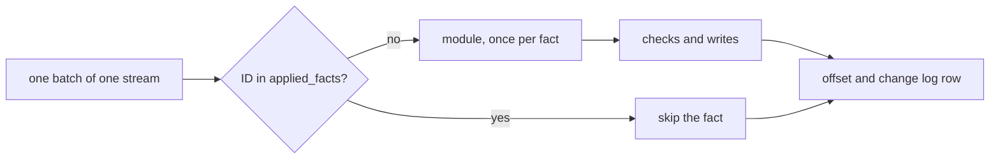

# The host

The host is one Rust process, and the only process that writes the tables a deployment serves. Each
consumer is a pure function from facts to rows, which `pepys build` compiles to a WebAssembly module
and lists in `consumers.json`. The host reads each consumer's streams from the
[fact log](../ingest/fact-log.md), runs the module on new facts, and writes the returned operations
into the consumer's own database file. To deploy a new version, the host builds a new file beside
the live one by replaying the log, then swaps it in, so a reader never sees a half-built table. The
host hardcodes no source, table or consumer: it reads each from `consumers.json`.

[Plug-ins and the build](./plug-ins-and-build.md) covers `consumers.json`, the manifest of each
entry, and the modules. [The API](../queries/api.md) covers the reader of the host's files.
[Decision 0006](../../decisions/0006-consumers-return-operations.md) records why a consumer returns
operations, and [decision 0018](../../decisions/0018-preview-and-up.md) records `preview` and `up`.

## Commands and the store folder

The binary is `pepys`, and it has three commands:

- `run [--up]` applies new facts to the current version of every consumer in `consumers.json` until
  it is stopped. With `--up`, it deploys every consumer first.
- `up [<consumer>] [--version <version>]` deploys the version that `consumers.json` lists for one
  consumer, or for every consumer in file order. With `--version`, it swaps a kept previous version
  of that consumer back in.
- `preview <consumer>` prints the row diff that the listed version would make against the current
  one. It changes nothing that a reader sees.

Every command needs five settings: `--s2-endpoint`, `--s2-access-token`, `--s2-basin`, `--store-dir`
and `--consumers`. Each flag has a variable, such as `PEPYS_S2_BASIN` for `--s2-basin`, and
[Start the processes](../../runbooks/deploying.md#4-start-the-processes) lists them.

The store folder holds one folder per consumer, and one folder per version inside it:

```text
<store>/host.db                          the state of every consumer version
<store>/<consumer>/writer.lock           the consumer's writer lock
<store>/<consumer>/current -> <version>  the live version
<store>/<consumer>/<version>/            consumer.db with its WAL files, module.wasm, version.json
<store>/<consumer>/builds/<version>/     the build lock of one version
<store>/<consumer>/preview-<pid>/        a preview's replay, deleted when it ends
```

A version's `consumer.db` holds everything the host writes for it: the consumer's tables, and these:

- `offsets`, the last sequence number the version read on each stream;
- `applied_facts`, the ID of each fact the version applied;
- `change_log`, one row for each batch that changed a row or a link, with one entry per change;
- `link`, the links the consumer wrote;
- in a scope consumer's file, `scope_fact`, the fact index, and `scope_row`, the scope that owns
  each row and link.

One file holds all of them, so a batch's rows, links and offsets commit in one transaction, and no
transaction spans files. The host and the API open each file with Turso, a Rust rewrite of SQLite
that keeps its file and WAL format. Every connection opens with Turso's multi-process WAL option: a
writer that opens the file without it locks the file, and the API cannot read it.

## Versions

[Versions](./versions.md) covers what a version of a consumer is and how the host makes one current.

## Running consumers

`run` refuses to start when a consumer has no current version, or when two current versions own one
table. It runs one task per consumer, which polls the consumer's streams on a short timer. Each pass
takes the consumer's writer lock, repairs the `current` link, opens the new version's folder after a
swap, and applies what is new. The writer lock is an OS file lock, so an `up` and a `run` of one
consumer never write a file at once, and the kernel frees it when its holder exits.

In both modes, the host reads each stream in batches: one read of at most 100 facts, applied as one
transaction, so a crash or an error never leaves half a batch in the file.

A failed batch rolls back, and the task then picks one of two outcomes by the error:

- After a store or log error, such as a Turso error or a failed S2 read, the task prints the error,
  waits, reopens the version and runs the pass again from the committed offsets. The wait doubles
  after each failed pass, up to a cap, and a pass that succeeds resets it. After a set number of
  failed passes in a row, the task stops. [`retry.rs`](../../../crates/host/src/retry.rs) holds the
  first wait, the cap and the limit.
- After any other error, the task stops at once, because the same facts fail the same way again.
  Examples are output the host refuses, a trap in the module and a module file with the wrong hash.

The `up` of `run --up` retries a store or log error as a task does. After such an error, for example
a refused S2 connection, `run` prints the consumer and the error, waits, and runs that consumer's
`up` again from step 1. The waits and the limit are those of a task, and the host counts the failed
tries of each consumer's `up` on their own. After any other error, or when one consumer's `up`
reaches the limit, `run` exits 1 before any task starts. The `up` command never retries.

A stopped task stays stopped until the process restarts. The host prints the error, and the other
tasks keep running. When every task has stopped, `run` exits 1. SIGINT or SIGTERM stops `run` with
exit 0 at any point, during the `up` of `--up` as well as once the tasks run. The next `up` builds
again a version whose build the signal stopped. When `consumers.json` lists no consumer, `run` waits
for one of the two signals.

## The module boundary

A module can only read through its imports and return operations, so the same facts always give the
same operations, and a replay rebuilds every row. The host enforces this. It links the whole WASI
preview 1 set, binds the wall clock and the monotonic clock to 0, and gives a module no environment,
files or network. It sets no fuel or time limit on a module.

The host creates a new module instance for each fact and each scope, links its read imports by the
manifest's symbols, and calls the export the manifest lists. The module returns the text of one JSON
list of operations, each with exactly one verb: upsert, delete, link or unlink.

A consumer has two reads: a row of its own tables by primary key, and, in scope mode, the facts of
its scope. A row read returns `-1` when no row has that key. The module passes a key of one column
as the value's text, and a key of several columns as the JSON list of the values in key order.

Each read takes two host calls, one for the result's length and one for its bytes, because scriptc,
the compiler `pepys build` uses, generates imports that return only a number. A read blocks on the
async store inside a synchronous wasm call, so the host and every test of a real read run on a Tokio
multi-thread runtime, such as `#[tokio::test(flavor = "multi_thread")]`.

## A fact-mode batch



A fact-mode consumer keeps one offset per stream. In one batch, the host skips each fact whose ID is
already in `applied_facts`, so a fact that the log holds twice applies once. It runs the module on
each other fact, checks and writes every operation the module returned, and records the fact's ID.
It then writes the stream's offset, and one `change_log` row when any row or link changed.

The host refuses the output, and the batch fails, when it is not a JSON list, when an operation has
no verb or more than one, when an upsert writes to a table the consumer does not own, or when a link
fails [the link check](#the-link-check).

An upsert equal to the stored row, and a delete of a row that is not stored, change nothing and add
no change entry. The host writes each link as a `link` row with no scope, and with the consumer's
name as its origin. An unlink takes no link check, and an unlink of a link that is not stored
changes nothing. The module decides whether an older fact may overwrite a newer row; the host
compares no times.

## A scope-mode batch


A scope consumer computes everything it owns for one entity, its scope, from every fact of that
entity. The result depends only on the facts, never on the order they arrived in, so a late fact or
a replay gives the same rows. Each fact carries one entity ID, such as `ledger:account:42`, and the
manifest declares the consumer's scope kind, such as `ledger:account`. In one batch, the host:

1. adds the facts to `scope_fact`, with one row per fact ID, and keeps the first copy in sequence
   order when the log holds a fact twice;
2. collects the dirty scopes, the distinct entities of the batch's facts whose kind is the scope
   kind, in sorted order;
3. calls the module once for each dirty scope, with the scope's entity ID;
4. checks the module's output and replaces the scope;
5. writes the offset, and one `change_log` row when a row or a link changed.

The module's scope read returns every fact of its scope in `scope_fact`, sorted by source time, then
stream, then sequence number. A module that reads another scope traps. The fact index stores each
source time with the fraction of a second padded to 9 digits, so sorting the text sorts the times.

The index rows and the offset commit together, so a version's index holds exactly the facts up to
its offsets. A preview that stops at the current version's offsets therefore gives each scope the
same facts that the current version saw.

The scope replace is a diff. The host writes each returned row and link that is absent or differs,
records the scope as its owner in `scope_row`, and deletes each row and link that the scope owned
and did not return. A scope consumer never returns a delete or an unlink. When a returned row or
link belongs to another scope, the batch fails. A second copy of a fact in the log changes nothing:
the index holds one row for it, the module returns the same result, and the diff is empty.

The test store, the in-memory store that plug-in tests run consumers on, has its own TypeScript
replace. It and the host's Rust replace both run every case in `scope-replace-cases.json` in
`@pepys/testing`: stored links, batches of module output, and the change entries or refusal of each
batch. The host reads each number as the double that `JSON.parse` gives, compares a `REAL` column
and a link's confidence as floats, and stores a JSON column with each object's keys sorted, so a
replay never rewrites an equal value.

## The link check

In both modes, the host checks each returned link against the manifest alone. A link passes when:

1. its type is one the consumer declares;
2. each end is an entity ID of a kind that the type allows;
3. its confidence is from 0 to 1;
4. its evidence is not empty.

On the first rule that a link breaks, in this order, the batch fails with that problem. The host
never looks a row up, so it writes a link to an entity that has not arrived yet. The host's Rust
check and the kit's TypeScript check both run every case in `link-check-cases.json` in `@pepys/kit`,
the package plug-ins build on, and each check must report the problem kind that the case expects.

## Known limits

- `run --up` never retries an `up` that fails on an error other than a store or log error. `run`
  exits, so no consumer's tables update until someone fixes the error, while ingest keeps appending
  facts.
- A batch that fails on another scope's row or link stops its consumer until a new module is up.
- A store or log outage longer than the sum of the retry waits makes `run --up` exit 1 when the
  outage comes during the `up`. Once the tasks run, such an outage stops every task that reads
  during the outage, until the process restarts.
- The host never deletes an old version's folder, so each swap leaves one more folder in the store.
- Each version of a scope consumer stores its own copy of its streams' facts, and a new version
  indexes them again as it replays.
- The host recomputes a scope in every batch that holds one of its facts, and each recompute reads
  every fact of the scope, so the cost of a batch grows with the length of the scopes it touches.
- The host sorts the keys of a JSON object in a row's key, and `JSON.stringify` keeps insertion
  order. A TypeScript lookup that builds such a key with `JSON.stringify` therefore misses the row.
- `consumers.json` describes each table twice, as columns and as SQL. The schema check on every open
  of a version fails when the two disagree.
