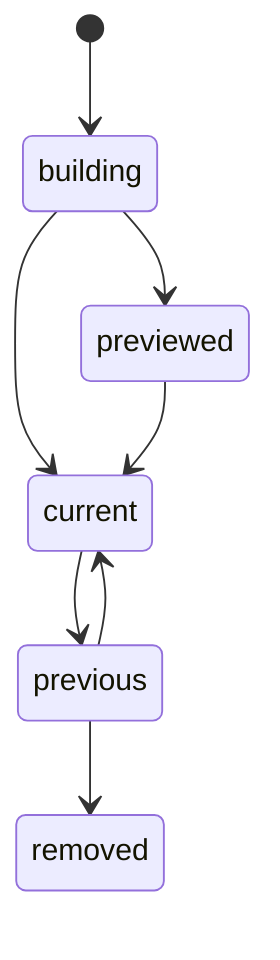

# The host

The host is one Rust process that runs every consumer of a deployment from `consumers.json` alone.
It reads each consumer's streams from the fact log, hands each fact, or each changed scope, to the
consumer's WebAssembly module, and applies the operations the module returns to the consumer's own
database file, in one transaction with the consumer's offsets. It also deploys each new consumer
version: it builds the new file beside the live one by replaying the log, and swaps it in, so a
reader never sees a half-built table. The host holds the name of no source, table or consumer, and
it is the only writer of the store.

[Plug-ins and the build](./plug-ins-and-build.md) covers `consumers.json` and the modules.
[The API](../queries/api.md) covers the reader of the files the host writes.
[Decision 0006](../../decisions/0006-consumers-return-operations.md) records why a consumer returns
operations, and [decision 0018](../../decisions/0018-preview-and-up.md) records `preview` and `up`.

## Commands and the store folder

The binary is `pepys`, and it has three commands:

- `run [--up]` applies facts to every listed consumer's current version until it is stopped. With
  `--up`, it deploys every listed consumer first.
- `up [<consumer>] [--version <version>]` deploys the listed version of one consumer, or of every
  listed consumer in file order. With `--version`, it swaps a kept previous version back in.
- `preview <consumer>` prints the row diff that the listed version would make against the current
  one, and changes nothing a reader sees.

Every command takes the S2 endpoint, access token and basin, the store folder and the path of
`consumers.json`, each as a flag or as `PEPYS_S2_ENDPOINT`, `PEPYS_S2_ACCESS_TOKEN`,
`PEPYS_S2_BASIN`, `PEPYS_STORE_DIR` and `PEPYS_CONSUMERS`.

```text
<store>/host.db                         the state of every consumer version
<store>/<consumer>/writer.lock          the consumer's writer lock
<store>/<consumer>/current -> <version> the live version
<store>/<consumer>/<version>/           consumer.db with its WAL files, module.wasm, version.json
<store>/<consumer>/builds/<version>/    the lock that keeps two builds of one version apart
```

Each consumer's file holds its tables, its `offsets`, its `change_log`, the `applied_facts` it has
applied, and the `link` table. A scope consumer's file also holds its fact index. Every transaction
stays inside one file, so a batch's rows, links and offsets commit together with no transaction
across files. Every connection opens with Turso's multi-process WAL option, because a writer opened
without it locks the file, and the API could then not read it.

## Versions

`host.db` is the truth about which version is current. Each version moves only along these edges,
and the host is the one writer of version state:



`up` runs in this order:

1. It checks that the module file's SHA-256 equals the entry's hash, that no other consumer's
   current version owns one of its tables, and that a folder of that version holds no other
   `version.json`.
2. It writes the module and the entry to a new version folder, runs the manifest's SQL on a new
   file, and checks the file's tables against the manifest's columns before it reads a fact.
3. It replays the log into the new file beside the live version.
4. It takes the consumer's writer lock, catches up the last facts, and checkpoints the new file's
   WAL.
5. It records the swap in `host.db`, then writes the new link as `current.tmp` and renames it over
   `current`.

The host never renames a database file, because SQLite finds its WAL files by path, and a renamed
file can pick up a stale log. A crash between the two writes of step 5 leaves `current` behind
`host.db`, and the host repairs the link from `host.db` before its next pass. An `up` of the version
that is already current only catches it up. An `up` that finds a build that never finished deletes
it and builds it again from the first record. The old version's folder stays on disk, and
`up <consumer> --version <version>` catches that folder up from its own offsets and swaps it back
in, which costs only the facts that arrived since.

`preview` replays the listed version into a throwaway folder up to the current version's offsets,
prints the JSON row diff, and deletes the folder. Both versions have then read the same facts, so
the diff shows only what the code changes. With no current version, it replays the whole log.

## Running consumers

`run` refuses to start when a listed consumer has no current version, or when two current versions
own one table. It runs one task per consumer. Each task polls its streams on a short timer, takes
the consumer's writer lock for each pass, and opens a new folder on its next pass after a swap. A
failed batch stops that consumer's task: the host prints the error, and the other tasks keep
running. A stopped task stays stopped until the process restarts. When every task has stopped, `run`
exits 1. With no listed consumer, it waits for SIGINT or SIGTERM.

The writer lock is an OS file lock, so the kernel releases it when its holder exits. One `up` and
one `run` of the same consumer therefore never write one file at once.

## The module boundary

The host links each module's read imports by the symbols in its manifest, and calls the export that
the manifest lists, in a new instance for each fact and each scope. A module reads through its
imports, computes, and returns one JSON list of operations as text, each with one verb: upsert,
delete, link or unlink. A read takes two host calls, one for the length and one that writes the
bytes into the module's buffer, because a scriptc import returns only a number. A row read returns
`-1` for no row. A one-column key goes over as its value's text, and a key of several columns as the
JSON list of its values.

The host links the whole WASI preview 1 set, binds both clocks to 0, and gives a module no
environment, no files and no network. Because a module can do nothing but read and return, the same
facts always give the same operations, and a replay rebuilds every row. The host sets no fuel or
time limit on a module. A read blocks on the async store from inside a synchronous wasm call, so the
host and every test that runs a real read use a multi-thread runtime.

## A fact-mode batch

A fact-mode consumer reads each of its streams in order and keeps one offset per stream. One batch
is one transaction: for each fact the consumer has not applied, the module, the parse of its output,
the checks of every operation, then the writes; then the offsets, the applied fact IDs, and one
change log row when anything changed. Any error rolls the whole batch back and stops the consumer's
task. The parse refuses output that is no JSON list, an operation with no verb or two, and an upsert
to a table the consumer does not own, before any row or link check.

An upsert equal to the stored row and a delete of a row that is not stored change nothing and give
no change entry. A link writes a `link` row with no scope and the consumer's name as its origin. The
host never checks an unlink. Whether an older fact may overwrite a newer row is the module's rule,
not the host's.

## A scope-mode batch

A scope consumer recomputes everything it owns for one scope, such as one ledger account, from every
fact of that scope. The result depends only on the facts, never on the order they arrived in, so a
late fact or a replay gives the same rows. A batch is up to 100 records of one stream:

1. The host adds the records to the fact index, the `scope_fact` table of the consumer's own file,
   with one row per fact ID. The first copy of a fact in sequence order stays.
2. The dirty scopes are the entities of the batch's facts that have the consumer's scope kind, each
   once, in sorted order.
3. For each dirty scope, the host calls the module with the scope ID. The module's one read returns
   every indexed fact of that entity, sorted by source time, then stream, then sequence number. A
   read of another scope traps the module.
4. The host checks the result and replaces the scope.
5. The host writes the offset, and one change log row when a row or a link changed.

Steps 1 to 5 are one transaction, so a rolled-back batch leaves no index row, and the index never
holds a fact past the file's offsets. A version that replays beside the live one therefore reads
exactly what the live one read. The index stores each time with its fraction padded to 9 digits, so
text order is time order.

The scope replace is a diff. The host writes each returned row and link that is absent or differs,
with the scope as its owner in `scope_row`, and deletes each row and link that the scope owned and
did not return. A scope consumer never returns a delete or an unlink. A row or a link that another
scope owns, or a link stored with no scope, stops the batch. A copy of a fact in the log changes
nothing: the index holds one row for it, the module returns the same result, and the diff is empty.

The case file `scope-replace-cases.json` in `@pepys/testing` holds the replace as data: stored
links, batches of module output, and the change entries or the refusal each batch gives. The test
store's TypeScript replace and the host's Rust replace both run every case, so the two stay equal.
The host reads each number as the double that `JSON.parse` gives, compares a REAL column and a
link's confidence as floats, and stores a JSON column with each object's keys sorted, so a replay
never rewrites an equal value.

## The link check

The link check reads the manifest alone. A link's type must be one the consumer declares, each end
must be an entity ID of a kind the type allows, the confidence must be from 0 to 1, and the evidence
must not be empty. The check reports the first problem in that order. The host never looks a row up,
so a link to an entity that has not arrived is written as it is. The case file
`link-check-cases.json` in the kit gives each case a problem kind, and the Rust check and the kit's
TypeScript check both report that kind.

## Known limits

- One failed `up` stops `run --up`, so every consumer's tables go stale until it is mended, while
  ingest keeps storing facts. A scope conflict stops its consumer until a new module is up.
- Each scope consumer version stores its own copy of its streams' facts, and a new version indexes
  them again as it replays.
- A scope with N facts is computed again in every batch that holds one of its facts.
- The host sorts the keys of a stored JSON object, so a table whose primary key is a JSON object
  gets a key text that a TypeScript reader does not compute.
- Each table is described twice in `consumers.json`, as columns and as SQL, and the schema check on
  every open holds the two together.
