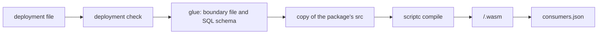

# Plug-ins and the build

A plug-in is the unit a deployment lists. It declares its fact families, sources, consumers, tables,
link types, queries and settings as plain data with `@pepys/kit`, and a deployment is a list of
plug-ins. `pepys build` turns that data into what the processes run: it checks the deployment,
writes each consumer's glue, compiles each consumer's TypeScript entry to a WebAssembly module with
scriptc, and writes `consumers.json`, the one file the host reads. `@pepys/testing` runs the same
consumers and queries on Bun with no host and no compiler, so a plug-in author tests a consumer
before it compiles.

[The host](./host.md) covers how the host runs a module from `consumers.json`.
[Entities and links](../queries/entities-and-links.md) covers entity views and link types.
[Decision 0005](../../decisions/0005-consumers-compile-to-webassembly.md) and
[decision 0022](../../decisions/0022-consumers-are-core-modules.md) record why a consumer is a core
WebAssembly module.

## What a plug-in declares

A plug-in's `define*` calls hold no secret and read no environment, so a process that only declares
or sends needs no setting and installs no SQLite binding. A source holds its paths and its pure read
and pull functions. A consumer declares its entry file, its input mode and streams, its tables, one
entity view per table whose rows are entities, the tables it reads by key, and the link types it
writes. A query declares its name, which is both its procedure key and its MCP tool name, a
description that an agent reads, zod schemas for its input and output, the consumers it reads, and a
handler. The kit works out a plug-in's link types from its consumers, and its entity kinds from its
fact families and entity views.

Ingest, the API, the build and the test store each run the kit's deployment check first, and stop on
a failure, so a deployment that one process would refuse runs in none. The check refuses, among
other things, two declarations under one name, a link end whose entity kind no plug-in brings, a
stream that no family declares, a source named after a fact kind, a query or table name that the
core reserves, a key column that can be null, and a row read of a table with a JSON key. A plug-in
built alone skips only the checks that need another plug-in: unknown entity kinds, missing consumers
and missing streams.

An entity kind is `<source>:<kind>` in every place, so a pull request is `github:pull_request` in
its entity ID, its entity view and a link end. The types require only the colon, and nothing checks
that the prefix is the plug-in's own source.

## Settings

A plug-in may declare settings: a zod schema of flat values, and the defaults. The deployment file
gives the values as literals, by plug-in name, and the deployment check merges them with the
defaults and parses them. The glue of each consumer of the plug-in then holds the checked values as
a constant that the entry file imports. A consumer reads no setting at run time, so it stays
deterministic, and a changed setting changes the text of every consumer's glue in the plug-in, so
each of them gets a new module and a new version, whether its entry reads the value or not.

## The glue

The kit's generators write two files for each consumer: the boundary file, the TypeScript
declarations of the read imports with the settings constant and the model contract, and the SQL
schema of the consumer's file. A package commits the glue of its own consumers in a `generated`
folder beside each entry's folder, and its tests import that glue. `pepys build <file> --check`
writes nothing and exits 1 when a committed glue file is stale.

scriptc attests a module deterministic only for a library with a model contract: a model type, a
message union, and `init` and `update` exports. The glue writes the two types and two functions that
do that, and an entry file declares `init` and `update` that call them, because scriptc takes a
re-exported type but refuses a re-exported function. The glue brands every entity ID with one fixed
tag and puts the kind in a second tag, because scriptc refuses a brand whose tag is a type
parameter.

## pepys build

`pepys build <file> [--out <directory>]` takes a file that exports exactly one deployment or one
plug-in:

1. It runs the deployment check.
2. It writes the glue of every consumer.
3. With `--out`, it compiles each consumer.
4. It writes each module as `<consumer>/<hash>.wasm`, then `consumers.json`, which must pass the
   strict manifest schema before the build writes it.

The build compiles a consumer from a copy, never from the package in place. It copies the `src`
folder of the consumer's package to `<out>/.work/<consumer>/src`, writes the glue into the copy with
its own generator, and runs scriptc on the copy, so no build compares or trusts a published glue
file. It deletes the work folder afterwards. scriptc builds the entry's absolute path into the
module, so a build of the same source in the same output folder gives the same module, and a build
in another folder gives another module, and so another version. A deployment therefore builds in a
fixed folder, such as the work folder of its image.

Each consumer builds as a scriptc library whose determinism settings refuse Date, performance,
process, the random sources, the file system and the OS, so a call to any of them fails the compile.
The build then fails unless scriptc attests the module deterministic, and it reads the module's
imports with `wasm-tools` and refuses one that asks for random numbers, polling, sockets or a file.
The build finds zig and wasm-tools at `PEPYS_ZIG_BIN` and `PEPYS_WASM_TOOLS_BIN`, or on `PATH`.
Without one, it writes the glue, exits 1 and names the missing tool.

## Writing an entry file

scriptc compiles a subset of TypeScript, so an entry file follows these rules, and scriptc refuses a
break of each at its line:

1. It imports only files under its package's `src` folder, because the build copies nothing else. A
   type import from another file there compiles.
2. A `switch` whose `default` assigns the value to `never` throws there, because scriptc refuses a
   return of the `never` value.
3. It exports `init`, `update`, and `applyFact` or `applyScope`.

A consumer breaks every tie of time by fact ID, such as keeping the smaller fact ID on an equal
time, because its result must not depend on the order of two facts with one time. One arrival order
cannot show a missing tie-break, so a consumer's tests call `applyInBothOrders` from
`@pepys/testing`, which applies the facts one at a time in order, then in reverse, and compares the
stores.

## consumers.json

The host reads nothing else about a consumer. The file names the deployment, or null for a plug-in
built alone, and holds one whole entry per consumer: its name, the module's hash and path, its
version, and a manifest with the input, the export and read symbols, the tables with their columns,
the link types and the SQL schema. No two entries share a list, so a kept version needs only its own
entry.

The version is the SHA-256 of the module's hash, the pins and the manifest, as JSON with sorted
keys. The build computes it, and the host uses it as the name of the version's folder and never
computes it. A consumer's export symbols are `<consumer>_init`, and `<consumer>_apply_fact` or
`<consumer>_apply_scope`. One function gives the symbols to the scriptc profile and to the manifest,
so the two cannot disagree.

Both the TypeScript schema in `@pepys/schema` and the host's Rust parser refuse a field they do not
know, so a file from a newer build fails at once, with the field's name. The case file
`consumer-manifest-cases.json` in `@pepys/schema` holds whole `consumers.json` files, each with its
verdict and, for a refused file, the path of the first problem. Both parsers give each case its
verdict. One case equals what the build writes for the repo's stub deployment, so a change to the
build's output fails that case.

## The test store

`createTestStore` runs each consumer's TypeScript entry on Bun over one in-memory database that
holds every table, the `link` table, `scope_row` and the shared views. It drops a repeated fact by
its ID, and runs the envelope check, the link check and the scope replace in TypeScript, from the
same case files as the host. Its memory store reader runs each query in a transaction that rolls
back, and can mark a consumer as having no current version.

The test store proves a consumer's logic and a query's SQL. It does not prove the scriptc compile,
the Rust host, or a route. Its `link_effective` view is a plain view over `link`.
