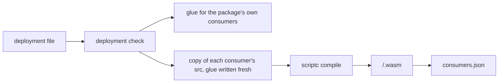

# Plug-ins and the build

A deployment is a list of plug-ins. Each plug-in declares, as plain data, the fact families,
sources, consumers, tables, link types, queries and settings it brings, with the `define*` functions
of `@pepys/kit`, such as `definePlugin` and `defineConsumer`. `pepys build` turns that data into the
files the host runs: a WebAssembly module for each consumer, and `consumers.json`, which lists them.
`@pepys/testing` runs the same consumers and queries on Bun with no host and no compiler, so a
plug-in author can test a consumer before it compiles.

[The host](./host.md) covers how the host runs a module from `consumers.json`.
[Entities and links](../queries/entities-and-links.md) covers entity views and link types.
[Decision 0005](../../decisions/0005-consumers-compile-to-webassembly.md) and
[decision 0022](../../decisions/0022-consumers-are-core-modules.md) record why a consumer is a core
WebAssembly module.

## What a plug-in declares

- A source declares its receive routes and pull timers, which [ingest](../ingest/ingest.md) serves,
  and the pure functions that turn a delivery or a pull into facts.
- A consumer declares its entry file and its input mode. In fact mode it gets one fact at a time
  from its streams. In scope mode it gets every fact of one scope at a time, such as one pull
  request. [The host](./host.md) runs both modes.
- A consumer also declares its tables, the tables it reads by key, and the link types it writes.
  Each table whose rows are entities gets one entity view; other tables get none.
- A query declares its name, a description that an agent reads, zod schemas for its input and
  output, the consumers it reads, and a handler. The name is both the query's procedure key under
  `/rpc` and its MCP tool name.

The kit works out a plug-in's link types from its consumers, and its entity kinds from its fact
families and entity views.

The `define*` calls hold no secret and read no environment variable, and the kit depends on no
SQLite package. A process that only declares a deployment, or only sends fact batches with the kit's
sender, therefore needs no environment variable and installs no SQLite binding. Only a process that
opens the store needs one.

An entity kind is written `<source>:<kind>` in every place, so a pull request is
`github:pull_request` in its entity ID, its entity view and a link end. The kit's types require only
the colon. The deployment check never tests that the prefix is the plug-in's own source.

## The deployment check

Ingest, the API, the build and the test store each run the kit's deployment check first, and stop on
a failure, so a deployment that one process would refuse runs in none. The failure kinds are in
`packages/kit/src/deployments/types.ts`. The check refuses, for example:

- two declarations under one name;
- a link end or a scope kind whose entity kind no plug-in brings;
- a query that reads a consumer no plug-in declares;
- a stream that no fact family declares;
- a source named `webhook`, `event`, `observation`, `enrichment` or `manual`, because a fact ID
  starts with one of those words;
- a query or table name that the core reserves, such as `get_entity` or `link_effective`;
- a key column that can be null;
- a consumer that reads a table by key when that table's key is a JSON column.

`pepys build` also takes a file that exports one plug-in, with no deployment. The check of a plug-in
alone skips the three checks that need another plug-in: the unknown entity kind, the unknown
consumer and the unknown stream.

## Settings

A plug-in may declare settings: a zod schema of flat values, and the defaults. The deployment file
gives the values as literals, by plug-in name, and the deployment check merges them with the
defaults and parses them. The glue of each consumer in the plug-in holds the checked values as a
constant that the entry file imports. A consumer therefore reads no setting at run time, and stays
deterministic.

A changed setting changes the glue of every consumer in the plug-in. Each of those consumers then
gets a new module, and so a new version in `consumers.json`, whether its entry reads the value or
not.

## The glue

The kit's generators write two glue files for each consumer:

- The boundary file is TypeScript. It declares:
  - the read functions that the host gives the module, for rows by key and for a scope's facts;
  - the settings constant;
  - the model contract.
- The SQL schema creates the consumer's tables in its own database file. The host keeps one database
  file per consumer.

scriptc, the compiler that `@pepys/cli` ships, attests a module deterministic only when the module
is a library with a model contract. The model contract is a model type, a message union, and `init`
and `update` exports. The generators write the model type, the message union, and two functions that
build the model and apply a message. scriptc takes a re-exported type but refuses a re-exported
function, so each entry file declares its own `init` and `update`, which call those two functions.

Every generated entity ID type is a branded string: a string type with a tag that keeps one kind of
ID from passing as another. The generators use one fixed tag, `EntityID`, and put the entity kind in
a second tag, because scriptc refuses a tag that is a type parameter.

A package commits the glue of its own consumers in a `generated` folder beside each entry's folder,
and its tests import that glue. `pepys build <file> --check` writes nothing, and exits 1 when a
committed glue file is stale.

## pepys build

`pepys build <file> [--out <directory> | --check]` takes a file that exports exactly one deployment
or one plug-in:

1. It runs the deployment check.
2. It writes the glue of each consumer whose entry file sits in the same package as `<file>`,
   outside `node_modules`. It never writes into an installed package. A run with neither flag stops
   here, and a run with `--check` only compares.
3. With `--out`, it compiles each consumer from a copy of the consumer's package, as the next
   paragraph describes.
4. It writes each module to `<directory>/<consumer>/<hash>.wasm`, then `<directory>/consumers.json`.
   It refuses to write a `consumers.json` that fails the schema in `@pepys/schema`.

To compile a consumer, the build copies the `src` folder of the consumer's package to
`<directory>/.work/<consumer>/src`. The build's own generators write the consumer's glue into the
copy, and scriptc compiles the copy. A glue file that a published package ships therefore never
reaches a module. The build deletes the `.work` folder afterwards.

Each consumer compiles as a scriptc library whose determinism settings refuse Date, performance,
process, the random sources, the file system and the OS, so a call to any of them fails the compile.
The build then fails unless scriptc attests the module deterministic. Last, the build reads the
module's imports with `wasm-tools`, and refuses a module that asks for random numbers, polling,
sockets or a file.

A build with `--out` finds zig and wasm-tools at `PEPYS_ZIG_BIN` and `PEPYS_WASM_TOOLS_BIN`, or on
`PATH`. Without one of them, it writes the glue, exits 1 and names the missing tool.

Build a deployment from the same absolute path every time, such as one fixed folder in its container
image. scriptc builds the entry file's absolute path into the module, so the same source built in
another folder gives another module, and so another version.

## Writing an entry file

scriptc compiles a subset of TypeScript, and refuses a break of each rule below at its line:

1. Import only files under the package's `src` folder, because the build copies nothing else. Type
   imports between files under `src` compile.
2. In a `switch` whose `default` branch assigns the value to `never`, throw in that branch. scriptc
   refuses a return of the `never` value.
3. Export `init` and `update`. Also export `applyFact` for a fact-mode consumer, or `applyScope` for
   a scope-mode consumer.

When two facts have the same source update time, break the tie by fact ID, such as by keeping the
fact with the smaller ID. A consumer's result must not depend on the order in which two facts with
the same time arrive. One test run sees one arrival order, so it cannot show a missing tie-break.
Call `applyInBothOrders` from `@pepys/testing` in a consumer's tests: it applies the facts one at a
time in order, then in reverse, and compares the two stores.

## consumers.json

The host reads nothing about a consumer except its entry in `consumers.json`. The file names the
deployment, or holds null for a plug-in built alone, and holds one entry per consumer. An entry
never refers to another entry's tables or links, so one entry is enough to run its consumer. The
host stores a copy of the entry beside each version it keeps, so an old version stays runnable after
a later build drops it from `consumers.json`.

Each entry holds these fields:

| Field      | Holds                                                                                                  |
| ---------- | ------------------------------------------------------------------------------------------------------ |
| `name`     | the consumer's name                                                                                    |
| `module`   | the SHA-256 of the module file                                                                         |
| `path`     | the module's path, inside the folder of `consumers.json`                                               |
| `pins`     | a map from a name to a hash, which the version covers; the build writes it empty in every entry        |
| `version`  | the SHA-256 of `module`, `pins` and `manifest`, as JSON with sorted keys                               |
| `manifest` | the consumer manifest: the module's input mode, symbols, tables and columns, link types and SQL schema |

The build computes the version. The host names the version's folder after it, and never computes it.

A consumer's export symbols are `<consumer>_init`, and `<consumer>_apply_fact` or
`<consumer>_apply_scope`. One function in the build gives the symbols both to the settings that
scriptc compiles with and to the consumer manifest, so the two cannot disagree.

The TypeScript schema in `@pepys/schema` and the host's Rust parser each refuse a field they do not
know, so a file from a newer build fails at once, with the field's name. The case file
`consumer-manifest-cases.json` in `@pepys/schema` holds whole `consumers.json` files, each with its
verdict and, for a refused file, the path of the first problem. The tests of both parsers run every
case. One case equals what the build writes for the repo's stub deployment,
`scripts/stub-deployment.ts`, so a change to the build's output fails that case.

## The test store

`createTestStore` runs each consumer's TypeScript entry on Bun, over one in-memory database. The
database holds every consumer's tables, the `link` table, the `scope_row` table that records which
scope owns each row, and the two shared views, `entity` and `link_effective`, which span every
consumer. The test store drops a repeated fact by its ID, as the host does. It also runs three of
the host's checks in TypeScript, each against the same case file as the host:

| Check              | Case file                                      | Described in                                            |
| ------------------ | ---------------------------------------------- | ------------------------------------------------------- |
| the envelope check | `fact-envelope-cases.json` in `@pepys/kit`     | [the fact log](../ingest/fact-log.md#the-fact-envelope) |
| the link check     | `link-check-cases.json` in `@pepys/kit`        | [the host](./host.md#the-link-check)                    |
| the scope replace  | `scope-replace-cases.json` in `@pepys/testing` | [the host](./host.md#a-scope-mode-batch)                |

For query tests, `@pepys/testing` has a store reader over memory. It runs each query in a
transaction that rolls back, so one test's writes never reach the next. A test can mark a consumer
as having no current version, to check that the query then fails the way the API fails.

The test store proves a consumer's logic and a query's SQL. It does not prove the scriptc compile,
the Rust host or a route. Its `link_effective` view is a plain view over its one `link` table, so it
does not prove the API's union of the `link` tables across consumer files.
