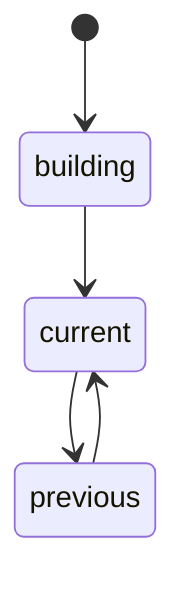

# Versions

[The host](./host.md) keeps each consumer's rows in versions. This doc covers what a version is and
how the host makes one current.

A version is one build of a consumer, named by the hash in its `consumers.json` entry, and the
commands move it along the edges above. The host takes the hash as a name and never computes it.
`host.db` records each version's state, and is right when it and the `current` link disagree. Its
state table also allows `previewed` and `removed`, but no command moves a version into either.

Every command starts from the same two steps. It repairs the `current` link from `host.db`, and then
opens the version: it checks that the SHA-256 of `module.wasm` equals the entry's `module` digest,
runs the manifest's SQL on the file, and checks the file's tables against the manifest's columns
before it reads a fact.

`up` then runs in this order:

1. It checks that no other consumer's current version owns one of its tables, and that any
   `version.json` in the folder holds the same entry, as one name never covers two builds.
2. It takes the build lock of the version, so two `up` runs of one version, such as `run --up` and
   `up` in two shells, never build it at once.
3. It writes `module.wasm` and `version.json` to the version folder, and opens the new file.
4. It replays the log into the new file, beside the live version.
5. It takes the consumer's writer lock, applies the facts that arrived during the replay, and
   checkpoints the new file's WAL.
6. It records the swap in `host.db`, then writes the new link as `current.tmp` and renames it over
   `current`.

The host swaps a link and never renames a database file: SQLite finds a file's WAL files by its
path, so a renamed file can pick up a stale WAL. After a crash between the two writes of step 6,
`current` names the old version and `host.db` the new one, and the next command repairs the link.

An `up` of the version that is already current only applies the new facts. An `up` that finds an
unfinished build deletes it and builds it again from the start of the log. The old version's folder
stays on disk, and `up <consumer> --version <version>` applies to it the facts that arrived since it
was current, from its own offsets, and swaps it back in.

`preview` replays the listed version into `preview-<pid>/` up to the current version's offsets, or
the whole log with no current version, prints the JSON row diff, and deletes the folder. Both
versions have then read the same facts, so the diff shows only what the new code changes.
