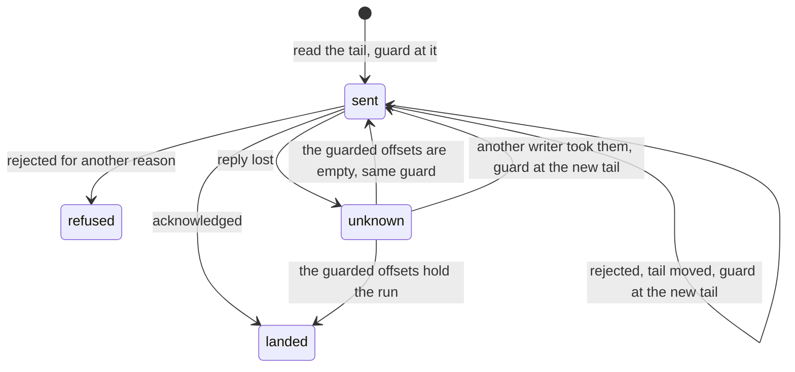

# The fact log

The fact log holds every fact pepys has, and it is the one store that nothing can rebuild. Ingest is
its only writer: ingest turns each delivery from a source into facts and appends them. The host is
its only reader: the host runs each consumer, the code that builds a consumer's tables from facts,
on the streams that the consumer declares. This doc covers the streams, the envelope of a fact, and
how one append lands once. [The ingest doc](./ingest.md) covers the deliveries, and
[the host doc](../consumers/host.md) covers the consumers.

The log keeps every record forever and never rewrites one. A copy of a fact is harmless: every fact
has a deterministic ID, so a fact written twice has the same ID both times, and the host applies
each fact ID to a consumer once, as [a fact-mode batch](../consumers/host.md#a-fact-mode-batch)
describes. A copy in the log therefore never changes a row of a consumer's tables.

s2-lite serves the log. s2-lite is the open-source, single-binary server for S2, a hosted service
for durable streams, and speaks the same streams API. s2-lite keeps its data in an object storage
bucket, and acknowledges an append only once the data is durable there. Each adapter in pepys named
"S2" calls that API, and every deployment and test of pepys points those adapters at s2-lite.

## Streams

A fact family is one kind of thing that a source reports, such as GitHub's pull requests, and each
fact family has one stream. A stream is named `facts.<source>.<family>`, such as
`facts.github.pull_request`. A source names a stream after the kind of thing a consumer builds from
it, never after the name of a webhook event, so that a consumer reads one stream for one kind of
thing.

s2-lite orders the records of one stream and gives each a sequence number, which a consumer keeps as
its offset. The log keeps records of different streams in no order, and a consumer never needs one,
as [decision 0003](../../decisions/0003-one-stream-per-fact-family.md) sets out.

Ingest creates each stream at start with infinite retention, because s2-lite keeps a record for a
limited time by default.

## The fact envelope

Every fact has one envelope around the payload the source sent:

| Field     | Holds                                                                          |
| --------- | ------------------------------------------------------------------------------ |
| `id`      | the deterministic fact ID                                                      |
| `type`    | the event type, such as `github.pull_request.opened`                           |
| `v`       | the envelope version, 1                                                        |
| `api`     | the source API version of the payload, such as `github/2022-11-28`             |
| `entity`  | the [entity ID](../queries/entities-and-links.md#entity-ids) the fact is about |
| `actor`   | the entity ID of the actor, when the source names one                          |
| `at`      | the source time, as an ISO date and time                                       |
| `cursor`  | the source position, when a [pull timer](./ingest.md#pull-paths) sets one      |
| `payload` | the source object, whole                                                       |

Ingest refuses an envelope with any other field. Ingest keeps the payload whole, because some source
APIs never return old data, and a field that ingest trimmed would be lost for good. When a source
changes the shape of its payload, the consumer reads `api` and handles each shape it knows.

A source builds each fact ID from the data it was sent, so the same data always gives the same ID.
The envelope check accepts five forms:

| Prefix         | Rest of the ID                                      | Used for                                                 |
| -------------- | --------------------------------------------------- | -------------------------------------------------------- |
| `webhook:`     | the source name, a colon, and a delivery ID         | a webhook delivery                                       |
| `event:`       | the source name, a colon, and the sender's ID       | one event of a signed fact batch                         |
| `observation:` | 64 hex digits, a SHA-256 hash of what the poll read | the state of an object that a poll read                  |
| `enrichment:`  | 64 hex digits                                       | an enrichment result                                     |
| `manual:`      | 64 hex digits                                       | a link or a correction that a person or an agent asserts |

A source name is lowercase letters, digits and `_`, and starts with a letter. The GitHub source puts
a hash of the body in place of a delivery ID, as
[ingest](./ingest.md#why-a-fact-id-comes-from-the-signed-body) explains.

The kit, `@pepys/kit`, holds the case file `fact-envelope-cases.json`, with the envelopes the check
accepts and refuses. The TypeScript parser and the Rust fact log adapters, which check each body
before an append, both test against it.

## One append

s2-lite caps the number of records and the bytes of one append, and counts each record as its stored
body in UTF-8 bytes plus a fixed overhead. Ingest cuts each stream's facts into runs that fit inside
both caps, with the append planner in `@pepys/ingest`, and appends the runs one after the other.
When one fact is larger than a whole append, ingest answers the delivery with HTTP 413 and appends
nothing.

Ingest guards every append of a run. It reads the stream's tail first, and sends the run with that
offset as the guard: the offset that the run's first record must get. s2-lite stores every fact of
the run or none, and only when the tail still matches the guard. Each attempt ends in one of three
ways:

- **Acknowledged:** the run landed.
- **Rejected:** when the tail had moved, ingest reads the tail again and sends the run with the new
  guard. For any other reason, such as an unknown stream, ingest stops and answers the delivery with
  an error ([the answers](./ingest.md#the-answers)).
- **Unknown:** the reply was lost, and s2-lite may or may not have stored the run.

After an unknown outcome, ingest reads exactly the offsets that the attempt guarded, and compares
their fact IDs with the run's:

- When the offsets hold every fact ID of the run, in order, the run landed.
- When the offsets are empty, the lost attempt can still land, so ingest sends the run again with
  the same guard.
- When the offsets hold anything else, another writer took them, and the lost attempt can never
  land. Ingest reads the new tail and sends the whole run there.

While a lost attempt can still land, ingest treats each later tail mismatch at the same guard as a
possible landing. Ingest reads the guarded offsets again, and settles the result by the same three
rules. So when the lost attempt lands late, ingest finds the run there, and the run lands once.

Ingest stops after a fixed number of attempts and answers the delivery with an error. A fact can
then reach the log twice: once from a lost attempt that lands after ingest stopped, and once when
the same delivery comes in again. Another process that stores the same facts at the same time also
writes a second copy. No fact is lost in either case.

## Ports and their fixtures

pepys reaches each outside system through a port: an interface with one adapter per backend.
`@pepys/ingest` holds the TypeScript adapters of two storage ports, and the host holds the Rust
ones.

| Port       | TypeScript adapters  | Rust adapters        | Used in a deployment by       |
| ---------- | -------------------- | -------------------- | ----------------------------- |
| fact log   | S2, memory           | S2, memory           | ingest writes, the host reads |
| blob store | Garage, local folder | Garage, local folder | nothing                       |

Every fact log adapter refuses the appends that s2-lite refuses, each as too large: an empty run, a
run over the record cap, and a run over the byte cap.

The TypeScript memory log is the test fake for ingest's retries. It can lose the next reply, fill
the next append's offsets with another writer's records, and land the next append late, so ingest's
tests cover each way an outcome can be unknown. The Rust memory log can only lose the next reply,
because the host never appends.

Each port has one folder of fixture files. A fixture file holds a sequence of calls, with the result
each call must return, and both languages run every file against every adapter. The memory and local
folder adapters run under `bun test` and `cargo nextest run`, and the S2 and Garage adapters run in
the e2e lanes, which start s2-lite and Garage in Docker. The TypeScript test runs each file it finds
in the folder. The Rust test runs a list of files, and fails when the list differs from the folder,
so a fixture added to the folder fails `cargo nextest run` until the Rust test runs it too.

The blob store keeps each file under the SHA-256 of its content, so a read of one hash always
returns the same bytes. A source can hand ingest blobs beside a fact, outside its envelope. Ingest
refuses every such fact, because a deployment wires in no blob store, and the host gives a consumer
no way to read a blob.

## Known limits

- The log is one bucket, and pepys copies it nowhere. A deployment that loses the bucket with no
  backup of its own loses every fact, and the host can then rebuild none of the tables.
- Anyone who captures a signed delivery can send it again. The sender signs the body, never a time,
  as [ingest](./ingest.md#why-a-fact-id-comes-from-the-signed-body) explains, so the replay passes
  the check. Ingest remembers each body it stored for one hour, in memory, and ignores a repeat of a
  remembered body. A replay after that hour, or after a restart, adds one more copy of the
  delivery's facts to the log. The GitHub route is public, so anyone can replay a captured GitHub
  delivery, and only the route's body limit and the one-hour memory slow the growth of the log.
