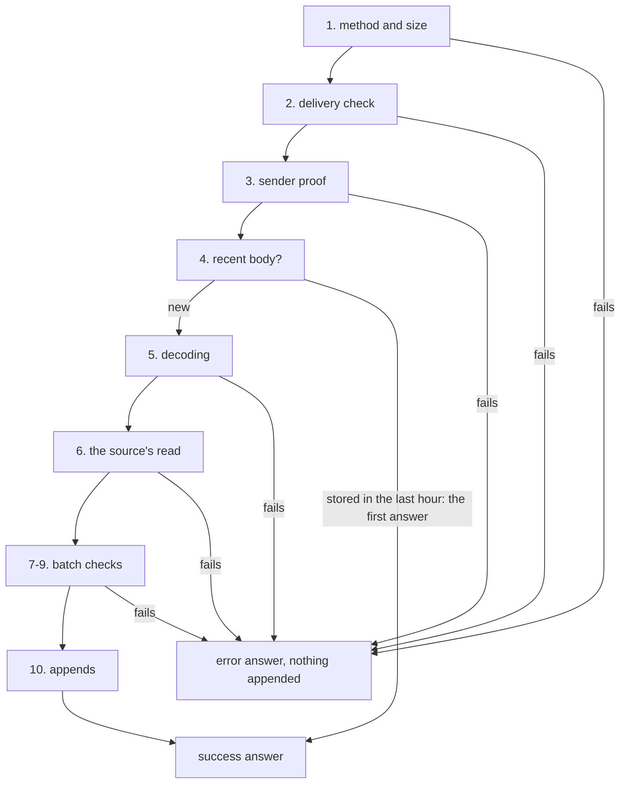

# Ingest

Ingest is the process that puts facts into pepys. A deployment is the set of plug-ins one owner runs
together, and each plug-in brings its sources, such as GitHub. One ingest process serves every
source of a deployment. It answers a sender with success only when the fact log holds every fact of
the delivery, and a sender that gets any other answer sends the same delivery again.

Ingest does every step of a delivery itself, with one exception. The source writes the receive
path's `read` function, a pure function that turns the delivery into a batch of facts.

Each source declares its paths as data, in up to four slots. A receive path is a POST route that a
sender posts to. A pull path is a timer that calls the source's API.

| Slot     | Kind of path    | Filled in this repo by                                      |
| -------- | --------------- | ----------------------------------------------------------- |
| live     | receive or pull | the GitHub webhook; the telemetry OTLP logs route           |
| recovery | pull            | the GitHub pull of failed deliveries                        |
| backfill | pull            | none                                                        |
| resync   | pull            | the GitHub pull that rereads objects whose row may be stale |

[The fact log](./fact-log.md) covers the appends that ingest makes.
[The GitHub plug-in](../plug-ins/github.md) and [the telemetry plug-in](../plug-ins/telemetry.md)
cover the two sources in this repo.

## A delivery, step by step

Each step either answers and stops, or passes the delivery on:

1. A method other than POST gets 405, and a body over the path's size limit gets 413. Ingest counts
   the body as it reads it, so a body with no `content-length` still stops at the limit.
2. Ingest runs the delivery check on the bytes as sent, before any code of the source runs. The
   check is an HMAC-SHA256 signature of the body, or a token in a header. A delivery that fails the
   check gets 401.
3. When the path needs a proven sender, ingest asks the [sender proof](#the-sender-proof). A
   delivery gets 401 when the proof finds no sender or throws.
4. When the path stored the same body in the last hour, ingest gives the answer it gave the first
   time, and appends nothing.
5. Ingest decodes the body. An encoding the path does not take gets 415, a decoded body over the
   size limit gets 413, and a corrupt gzip body gets 400.
6. The source's `read` refuses the delivery with 400 or 422, ignores it, or returns a batch. A
   `read` that throws gets 500.
7. A batch over the path's fact limit gets 413. A fact gets 422 when its envelope, the fact's fixed
   outer fields, fails the [envelope check](./fact-log.md#the-fact-envelope). A fact also gets 422
   when it names a stream outside the source's fact families, the groups of fact types that each own
   one [stream](./fact-log.md#streams) of the log.
8. A fact that names a blob, a large file stored beside the log, gets 500. Ingest has no blob store,
   so a source must never return one.
9. A fact larger than the log takes in [one append](./fact-log.md#one-append) gets 413.
10. Ingest appends each stream's facts, then answers.

Ingest answers every failure with a JSON body of the form `{"error": "<reason>"}`. A path's `answer`
setting picks the form of a success:

| `answer`           | Stored                                 | Ignored                    |
| ------------------ | -------------------------------------- | -------------------------- |
| `status` (default) | 200 `{"status":"stored","stored":<n>}` | 202 `{"status":"ignored"}` |
| `empty`            | 200 `{}`                               | 200 `{}`                   |

An OTLP exporter expects the `empty` form.

## The answers

Ingest tries each append up to 5 times when the log gives no acknowledgement, and waits longer
before each new try than before the last one, by the same step each time. The answer then depends on
what the log holds:

| Case                                               | The log holds                                    | Status | `retry-after` |
| -------------------------------------------------- | ------------------------------------------------ | ------ | ------------- |
| every append is acknowledged                       | every fact                                       | 200    | none          |
| an append has no acknowledgement after its 5 tries | the appends before it on that stream, perhaps it | 503    | 1             |
| the log refuses an append, or an append throws     | the appends before it on that stream             | 500    | none          |

503 means "send the same delivery again, unchanged". The resend fills in what the first delivery
left out, because each [consumer](../consumers/host.md) drops a fact it already has. After a 500, a
resend of the same bytes meets the same refusal. When one stream refuses an append and another
stream has no acknowledgement, ingest therefore answers 500.

Ingest queues the appends on each stream, so the appends of two deliveries never mix on one stream.
Each stream has its own queue, and the streams never wait for each other. A delivery that gets 503
can therefore leave its facts on one stream and not on another.

## Why a fact ID comes from the signed body

A source builds every fact ID of a receive path from the body, never from a header. Neither delivery
check signs a time, so a captured delivery passes its check again at any later time. A replayed body
then carries the fact IDs of the first delivery. Each consumer drops a fact whose ID it already has,
so a replay changes no row of a consumer's tables and no link between entities.

- The kit's fact batch reader serves a path that takes signed fact batches: bodies of facts that a
  deployment's own tool sends, such as `@pepys/kit/send`. Each fact in the body holds an event ID,
  and the reader makes the fact ID `event:<source>:<event ID>`.
- GitHub puts the delivery's ID in a header that GitHub never signs, so the GitHub source hashes the
  body instead.

The recent-body step only slows how fast replays grow the log, and the fact IDs keep the rows right.
For each receive path, ingest keeps a SHA-256 of each body that got a 200 stored answer, in memory,
for one hour, and at most 10,000 of them. A body that got any other answer is never kept, so its
resend runs every step again. On a path with a sender proof, the proven sender is part of the key,
so the same body from two senders counts as two bodies. A replay after the hour, or after a restart,
adds one more copy of its facts to the log, and the copy changes no row.

## The sender proof

A receive path that needs a proven sender names the kind of proof and two environment variables,
which the deployment sets:

- the audience: the name a sender's identity token must be issued for;
- the folder of trust documents: the issuers whose signatures ingest accepts.

Ingest reads both variables at start. When either one is unset or empty, ingest still starts, and
answers every delivery on that path with 401. The deployment's owner then learns of the gap only
from the 401 answers. When ingest cannot read the folder, or a trust document fails its check,
ingest exits at start.

The sender proof is an interface with one adapter in use. That adapter checks the signed identity
token in the `imp-identity` header, which the worker machine that runs the sender gets from its
token broker. The adapter checks the token with `@impz/client/identity`, against the trust documents
and the audience.

Ingest passes the proven issuer and subject to the source's `read`. Each `read` in this repo stores
them as `origin` in each fact's payload, over any `origin` the body held, so the origin is the one
part of such a fact that the sender did not write. Ingest never checks that a `read` does this.

Tests use either a fake adapter that proves a fixed sender, or an adapter that finds no sender and
so gets every delivery a 401.

## Pull paths

Ingest starts one timer for each pull path that sets an interval. A pull path with no interval never
runs. A run never overlaps the one before it on the same timer. Each timer keeps its cursor, the
source's position, in memory, so the first run after a start reads from no cursor. A pull that
reports its cursor expired starts again from none. On any other failure, ingest logs the error and
keeps the cursor for the next run.

A pull's batch goes through the same batch checks and appends as a delivery. When a pull returns a
fact with a blob, ingest appends nothing from that run, logs the error, and keeps the cursor.

A resync pull reads the resync marks that the receive paths of the same process set, one per entity
whose row may be stale. Ingest removes each mark only after the run's whole batch is stored, so a
failed run keeps every mark for the next one. The marks live in memory, at most 10,000 per source
with the oldest dropped first, and a restart loses them.
[The resync pull](../plug-ins/github.md#the-resync-pull) lists when a receive path sets a mark.

## Settings and start

Ingest runs the kit's [deployment check](../consumers/plug-ins-and-build.md#the-deployment-check)
first, and exits 1 on a failure. It then reads these variables:

- the settings of S2, the stream store that holds the fact log: `PEPYS_S2_ENDPOINT`,
  `PEPYS_S2_ACCESS_TOKEN` and `PEPYS_S2_BASIN`;
- every secret that a receive path's delivery check names;
- every variable that a pull path lists.

When any of them is unset or empty, ingest names every missing variable at once and exits 1. Ingest
listens on `PEPYS_INGEST_HOST`, 127.0.0.1 by default, and `PEPYS_INGEST_PORT`, 8080 by default.

Before it listens, ingest creates the S2 basin, the namespace that holds every stream, and the
stream of each fact family. It gives each stream infinite retention, and sets infinite retention on
a stream that already exists. s2-lite, the S2 server a deployment runs, drops old records from a
stream that has the default retention.

Ingest takes no lock across processes. Two processes of one deployment would each keep their own
recent bodies, timers and resync marks, so a deployment runs one.

## Known limits

- A GitHub delivery larger than one append of the log is never stored. The webhook route answers it
  with 413, and the recovery pull logs its delivery ID and skips it.
- A restart loses every resync mark, so an entity whose mark is lost keeps a stale row until its
  next delivery.
