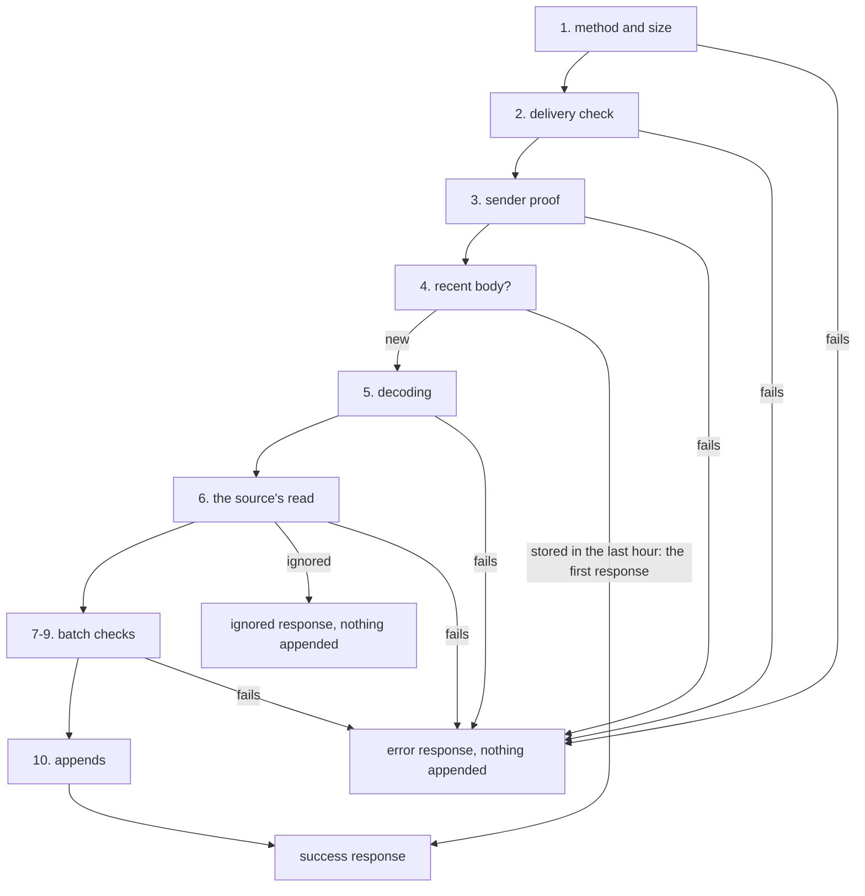

# Ingest

Ingest takes facts into pepys and appends them to the [fact log](./fact-log.md). One ingest process
serves every source of a deployment. A deployment is the set of plug-ins that one owner runs
together. A plug-in brings one or more sources, and a source is one place the data comes from, such
as GitHub.

Facts reach ingest in two ways:

- A receive path is a POST route. A sender, such as GitHub's webhooks, posts a delivery to it.
- A pull path is a timer. On each run, ingest calls the source's API.

Ingest responds to a sender with success only when the fact log holds every fact of the delivery.
[Retries and status codes](#retries-and-status-codes) gives each failure, and whether a resend of
the delivery fixes it.

A source declares each of its paths in its plug-in's code, and puts each path in one of four slots,
by what the path is for:

| Slot     | Kind of path    | What the path is for                                          | Filled in this repo by                            |
| -------- | --------------- | ------------------------------------------------------------- | ------------------------------------------------- |
| live     | receive or pull | the source's own stream of new data                           | the GitHub webhook; the telemetry OTLP logs route |
| recovery | pull            | the data that the live path missed                            | the GitHub pull of failed deliveries              |
| backfill | pull            | history from before the source was connected                  | none                                              |
| resync   | pull            | a fresh read of each entity that ingest marked as maybe stale | the GitHub resync pull                            |

Ingest does every step of a delivery itself. The one exception is step 6, where the receive path's
`read` function, which the source writes, turns the delivery into facts. `read` does no I/O, and
writes only to the logger that ingest passes it.

[The fact log](./fact-log.md) covers the appends that ingest makes.
[The GitHub plug-in](../plug-ins/github.md) and [the telemetry plug-in](../plug-ins/telemetry.md)
cover the two sources in this repo.

## A delivery, step by step

At each step, ingest either sends a response and stops, or goes on to the next step:

1. A method other than POST gets 405, and a body over the path's size limit gets 413. Ingest counts
   the body as it reads it, so a body with no `content-length` still stops at the limit.
2. Ingest runs the delivery check on the bytes as sent, before any code of the source runs. The
   check is an HMAC-SHA256 signature of the body, or a token in a header. A delivery that fails the
   check gets 401.
3. When the path needs a proven sender, ingest calls the [sender proof](#the-sender-proof). Ingest
   responds 401 when the call returns no sender or throws.
4. When ingest stored the same body on this path in the last hour, it sends the response it sent the
   first time, and appends nothing.
5. Ingest decodes the body. An encoding the path does not take gets 415, a decoded body over the
   size limit gets 413, and a corrupt gzip body gets 400.
6. Ingest calls the path's `read`, which returns one of three results:
   - a refusal, which ingest sends as 400 or 422;
   - an ignore, which ingest sends as the ignored response in the table below;
   - a batch of facts, which goes on to step 7.

   When `read` throws, ingest responds 500.

7. A batch over the path's fact limit gets 413. A fact gets 422 when its envelope, the fact's fixed
   outer fields, fails the [envelope check](./fact-log.md#the-fact-envelope). Each source owns fact
   families: groups of fact types, each with one [stream](./fact-log.md#streams) of the log. A fact
   also gets 422 when it names a stream outside its source's fact families.
8. A fact that names a blob gets 500. A blob is a large file stored beside the log, and ingest has
   no blob store. Return no fact that names a blob from `read`.
9. A fact larger than the log takes in [one append](./fact-log.md#one-append) gets 413.
10. Ingest appends each stream's facts, then sends a response.

Ingest sends every failure with a JSON body of the form `{"error": "<reason>"}`. You choose the body
of a success with the path's `answer` setting:

| `answer` setting   | Stored                                 | Ignored                    |
| ------------------ | -------------------------------------- | -------------------------- |
| `status` (default) | 200 `{"status":"stored","stored":<n>}` | 202 `{"status":"ignored"}` |
| `empty`            | 200 `{}`                               | 200 `{}`                   |

An OTLP exporter expects the `empty` form.

## Retries and status codes

Ingest makes one append for each stream that a delivery's facts name. When the log gives no
acknowledgement for an append, ingest tries the append again, up to 5 tries in all. Each wait
between two tries is one fixed step longer than the wait before it, and
[`pick-retry-step.ts`](../../../packages/ingest/src/fact-log/pick-retry-step.ts) sets the step. The
status that ingest sends then depends on what the log holds:

| Case                                                       | The log holds                                                             | Status | `retry-after` |
| ---------------------------------------------------------- | ------------------------------------------------------------------------- | ------ | ------------- |
| the log acknowledges every append                          | every fact                                                                | 200    | none          |
| an append has no acknowledgement after its 5 tries         | the earlier appends on that stream, and perhaps the unacknowledged append | 503    | 1             |
| the log refuses an append on a stream, or an append throws | the earlier appends on that stream                                        | 500    | none          |

After a 503, send the same delivery again, unchanged. The resend fills in what the first delivery
left out, because the [host](../consumers/host.md#a-fact-mode-batch) skips a fact whose ID it
already applied. After a 500 or a 4xx status, a resend of the same bytes fails in the same way. When
the log refuses an append on one stream and gives no acknowledgement on another, ingest responds
500, because a resend fails on the first stream again.

Ingest queues the appends on each stream, so the appends of two deliveries never mix on one stream.
Each stream has its own queue, and the streams never wait for each other. A delivery that gets 503
can leave its facts on one stream and none on another.

## Why a fact ID comes from the signed body

A source builds every fact ID of a receive path from the body, never from a header. The delivery
checks never sign a time, so a captured delivery passes its check again at any later time. A replay
of the body then carries the same fact IDs as the first delivery. The host skips a fact whose ID it
already applied, so a replay changes no row and no link between entities.

The two kinds of receive path in this repo build their fact IDs from the body in these ways:

- `receiveFactBatch` from `@pepys/kit` makes a path that takes signed fact batches: bodies of facts
  that a deployment's own tool sends, such as a sender that `createFactBatchSender` from
  `@pepys/kit/send` makes. Each fact in the body holds an event ID, and the path's `read` makes the
  fact ID `event:<source>:<event ID>`.
- GitHub puts the delivery's ID in a header that GitHub never signs, so the GitHub source hashes the
  body instead.

The recent-body step of a delivery only slows how fast replays grow the log. For each receive path,
ingest keeps a SHA-256 of each body that it stored, in memory, for one hour, and at most 10,000 of
them. Ingest keeps the hash on a path whose `answer` setting is `empty` too, and the response it
keeps is then 200 `{}`. Ingest never keeps the hash of a body that it ignored or refused, so a
resend of that body runs every step again. On a path with a sender proof, the proven sender is part
of the key, so the same body from two senders counts as two bodies. A replay after the hour, or
after a restart, adds one more copy of its facts to the log, and the host applies none of the copy.

## The sender proof

A receive path can require a proven sender: a sender whose identity ingest checks, beside the
delivery check. The one kind of proof in use checks an identity token from impz. impz runs the
owner's coding agents, each in an imp, a small virtual machine, and gives each imp a signed identity
token. [The api-auth design](../../design/api-auth/README.md) describes impz.

A path that requires a proven sender declares the kind of proof and two environment variables, which
the deployment sets:

- the audience: the name a sender's identity token must be issued for;
- the folder of trust documents: the issuers whose signatures ingest accepts.

Ingest reads both variables at start. When either one is unset or empty, ingest still starts, and
responds 401 to every delivery on that path. The deployment's owner then learns of the gap only from
the 401 responses. When ingest cannot read the folder, or a trust document fails its check, ingest
exits at start.

A sender in an imp puts its token in the `imp-identity` header. Ingest checks the token with
`@impz/client/identity`, against the trust documents and the audience. For a token that passes,
ingest gives the source's `read` the token's issuer, which signed the token, and its subject, the
identity the token was issued to. Each `read` in this repo writes the two as `origin` in the payload
of each fact, over any `origin` the body held. In a fact from a proven sender, `origin` is then the
one part that the sender did not write. Ingest never checks that a `read` does this.

## Pull paths

Ingest starts one timer for each pull path that sets an interval. Ingest never runs a pull path with
no interval on its own. Code that holds the result of `createIngest` can run such a path once
through `runPull`, as the tests do. A run never overlaps the one before it on the same timer.

Each timer keeps its cursor, the source's position, in memory, so the first run after a start passes
the pull no cursor. When a pull reports that its cursor expired, ingest drops the cursor, and the
next run passes no cursor too. On any other failure, ingest logs the error and keeps the cursor for
the next run.

A pull's batch goes through the same batch checks and appends as a delivery. When a pull returns a
fact with a blob, ingest appends nothing from that run, logs the error, and keeps the cursor.

Ingest keeps resync marks, one per entity whose row may be stale. A delivery on a receive path can
set a mark, and the resync pull of the same ingest process reads the marks.
[The resync pull](../plug-ins/github.md#the-resync-pull) lists when the GitHub webhook sets one.
Ingest removes each mark only after the run's whole batch is stored, so a failed run keeps every
mark for the next one. Ingest keeps the marks in memory, at most 10,000 per source with the oldest
dropped first, and a restart loses them.

## Log lines

Ingest writes each failure and each warning to stderr as one JSON object per line, such as
`{"level":"error","message":"an append to facts.github.pull_request failed","detail":{"kind":"not-stored","attempts":5}}`.
The `level` is `error` or `warn`, and a line with no detail leaves `detail` out. An error in
`detail` keeps its name, message, stack and cause.

Ingest passes its logger to your source's `read` and `pull`, in the `log` field of their context.
Log through `log`, never through `console`, so your lines reach stderr in the same shape as
ingest's.

Ingest's own lines hold no token and no secret. When your `read` or `pull` throws, ingest logs the
whole error, with its message and stack. Keep tokens and secrets out of the errors your source
throws, and out of what it passes to `log`.

To capture lines in a test, give `createLogger` from `@pepys/kit` an object with a `write` method,
such as `{ write: (line) => lines.push(line) }`.

## Settings and start

Ingest runs the kit's [deployment check](../consumers/plug-ins-and-build.md#the-deployment-check)
first, and exits 1 on a failure. It then reads these variables:

- the settings of S2, the stream store that holds the fact log: `PEPYS_S2_ENDPOINT`,
  `PEPYS_S2_ACCESS_TOKEN` and `PEPYS_S2_BASIN`;
- every secret that a receive path's delivery check names;
- every variable that a pull path lists.

When any of them is unset or empty, ingest names every missing variable at once and exits 1. Ingest
listens on `PEPYS_INGEST_HOST`, 127.0.0.1 by default, and `PEPYS_INGEST_PORT`, 8080 by default.

Before it listens, ingest creates the S2 basin, the namespace that holds every stream, and the
stream of each fact family. It gives each stream infinite retention, and sets infinite retention on
a stream that already exists. s2-lite, the S2 server a deployment runs, drops old records from a
stream that has the default retention.

Ingest takes no lock across processes. Two processes of one deployment would each keep their own
recent bodies, timers and resync marks, so a deployment runs one.

## Known limits

- A GitHub delivery larger than one append of the log is never stored. The webhook route answers it
  with 413, and the recovery pull logs its delivery ID and skips it.
- A restart loses every resync mark, so an entity whose mark is lost keeps a stale row until its
  next delivery.
