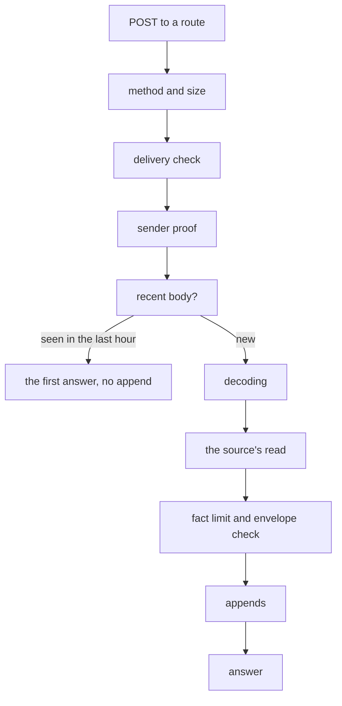

# Ingest

Ingest is how facts get into pepys. A source declares its paths as data: a receive path is a route
that a sender posts to, and a pull path is a timer that reads the source's API. Ingest owns every
step of a delivery except the source's own read, which is a pure function from the delivery to a
batch of facts. Ingest answers a sender with success only when the fact log holds every fact of the
delivery, so a sender that gets any other answer sends the same delivery again. Each process of
ingest serves every source of one deployment.

[The fact log](./fact-log.md) covers the appends that ingest makes.
[The GitHub plug-in](../plug-ins/github.md) and [the telemetry plug-in](../plug-ins/telemetry.md)
are the two sources in this repo, and each shows one kind of receive path.

## A delivery, step by step

Each step either answers and stops, or passes the delivery on:

1. A method other than POST gets 405, and a body over the path's limit gets 413. Ingest counts the
   body as it reads it, so a body with no `content-length` still stops at the limit.
2. The delivery check runs on the bytes as sent, before any code of the source runs. A failed check
   gets 401. The check is an HMAC-SHA256 signature of the body, or a token in a header, and an empty
   secret passes nothing.
3. On a path that needs a proven sender, ingest calls the sender proof port. No proof, or a proof
   that throws, gets 401.
4. A body that this route stored whole in the last hour gets the answer it got the first time, and
   ingest appends nothing.
5. Ingest decodes the body: an encoding the path does not take gets 415, a decoded body over the
   limit gets 413, and a corrupt gzip body gets 400.
6. The source's read refuses the delivery with its own status, ignores it, or returns a batch. A
   read that throws gets 500.
7. A batch over the path's fact limit gets 413. A fact whose envelope fails the check, or whose
   stream the source does not own, gets 422.
8. A fact that carries a blob gets 500, because no ingest process has a blob store wired in.
9. Ingest appends each stream's facts, then answers.

Every failure answers with a JSON body of the form `{"error": "<reason>"}`. An ignored delivery
answers 202, or 200 with `{}` on a path whose answer is the empty kind, which an OTLP exporter
expects.

## Why a fact ID comes from the signed body

Neither delivery check signs a time, so a captured delivery passes its check again at any later
time. Ingest therefore takes every fact ID of a signed route from the signed body, never from a
header. A replay then carries the fact IDs of the first delivery, and each consumer drops the copy,
so a replay changes no row and no link. A signed fact batch holds an event ID for each fact, and the
fact ID is `event:<source>:<event ID>`. GitHub puts the delivery's ID in a header that GitHub does
not sign, so the GitHub source hashes the body instead.

The recent-body step bounds how fast replays grow the log, and it is not what keeps the rows right.
Ingest keeps the SHA-256 of each body it stored whole, with the proven sender on a sender path, in
memory for one hour, and at most 10,000 of them per route. A replay after the hour, after a restart,
or on another process adds one more copy of its facts to the log. The copy changes no row.

## The sender proof

A path that needs a proven sender holds the kind of proof and the two settings that hold its
audience and its folder of trust documents. Ingest reads both settings at start. When either one is
unset or empty, ingest starts and refuses every delivery on that path with 401, so a deployment that
forgets them notices only from the answers. A folder that ingest cannot read, or a trust document
that fails its check, stops the start.

The one adapter in use verifies a worker machine's signed identity token with
`@impz/client/identity`, from the `imp-identity` header. The source's read gets the proven issuer
and subject, and stores them as `origin` in each fact's payload, over any `origin` the body held.
The origin is then the one part of such a fact that the sender did not write. Tests use a fake
adapter, or one that proves nothing.

## The answers

| Case                                               | The log holds                                      | Answer                |
| -------------------------------------------------- | -------------------------------------------------- | --------------------- |
| every append is acknowledged                       | every fact                                         | 200                   |
| one fact is too large for any append               | nothing                                            | 413                   |
| an append has no acknowledgement after its 5 tries | the appends before it on that stream, and maybe it | 503, `retry-after: 1` |
| the log refuses, or an append throws               | the appends before it on that stream               | 500                   |

503 means "send the same delivery again, unchanged". Ingest waits a little longer after each try.
When one stream refuses and another stream's append stays unknown, the refusal wins, because a
resend of those bytes fails again.

A delivery holds one turn on each of its streams for all of its appends there, so the appends of two
deliveries never interleave on one stream. Streams do not wait for each other. A failed delivery can
therefore leave its facts on one stream and not on another, and the resend fills in the rest,
because each consumer drops the facts it already has.

## Pull paths

Ingest starts one timer for each pull path that sets an interval: live, recovery, backfill or
resync. A run never overlaps the one before it on the same timer. Each timer keeps its cursor in
memory, so the first run after a start reads from no cursor. A pull that reports its cursor expired
starts again from none, and any other failure keeps the cursor for the next run.

A pull's batch goes through the same envelope check, fact limit and appends as a delivery. A pull
that returns a fact with a blob is refused. A resync pull reads the resync marks that the receive
routes set in the same process, and ingest removes each mark only after the run's whole batch is
stored, so a failed run keeps every mark for the next one. The marks live in memory, at most 10,000
per source with the oldest dropped first, and a restart loses them. The
[GitHub plug-in](../plug-ins/github.md#the-resync-pull) says when a route sets a mark.

## Settings and start

Ingest checks the deployment first, with the kit's deployment check, and exits 1 on a failure. It
then reads the S2 settings, `PEPYS_S2_ENDPOINT`, `PEPYS_S2_ACCESS_TOKEN` and `PEPYS_S2_BASIN`, every
secret that a receive path's check holds, and every variable that a pull path lists. A missing one
stops the start, and ingest names every missing variable at once. Ingest listens on
`PEPYS_INGEST_HOST`, 127.0.0.1 by default, and `PEPYS_INGEST_PORT`, 8080 by default. Before it
listens, it creates the basin and each family's stream with infinite retention, and sets infinite
retention on a stream that already exists, because s2-lite keeps a record for a limited time by
default.

Ingest takes no lock across processes. Two processes of one deployment would each keep their own
recent bodies, timers and resync marks, so a deployment runs one.

## Known limits

- A GitHub delivery larger than one append of the log is never stored. The webhook route answers it
  with 413, and the recovery pull logs its delivery ID and skips it.
- A restart loses every resync mark, so an object whose mark is lost keeps a stale row until its
  next delivery.
