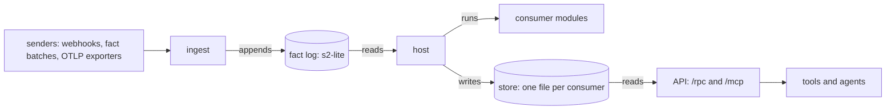
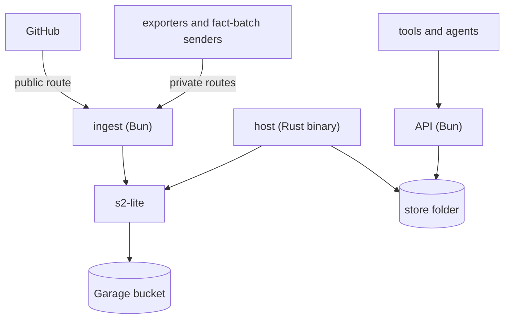

# pepys architecture

pepys keeps its owner's data from pluggable sources as facts that never change, builds tables and
links from those facts, and answers typed queries over them. Facts enter at one place, the fact log,
and everything else is a projection: a replay of the facts rebuilds every table and every link. A
deployment is a list of plug-ins, and each plug-in brings its sources, its consumers and its
queries. Three processes run a deployment: ingest takes deliveries in and appends them to the log,
the host runs each consumer on the log and writes the store, and the API reads the store. The docs
below each cover one part, and this page says where each one fits.

## The path of a fact

A sender delivers to one of ingest's routes, and ingest checks the delivery before any code of the
source runs. The source turns the delivery into facts, and ingest answers success only once the log
holds every fact of the delivery. The host reads each stream that a consumer declares, hands each
fact or each changed scope to the consumer's WebAssembly module, and applies the operations the
module returns, in one transaction with the consumer's offsets. The API attaches the current file of
each consumer a query reads, read-only, and runs the query there. Nothing writes back: the API never
writes the store, and the host never writes the log.

- [Ingest](./ingest/ingest.md) covers the receive routes, the checks, the answers and the pull
  timers.
- [The fact log](./ingest/fact-log.md) covers the streams, the fact envelope, fact IDs and how one
  append lands exactly once.
- [Plug-ins and the build](./consumers/plug-ins-and-build.md) covers what a plug-in declares, the
  deployment check, and how `pepys build` turns each consumer into a module and `consumers.json`.
- [The host](./consumers/host.md) covers consumer versions, fact mode, scope mode and the store
  files.
- [Entities and links](./queries/entities-and-links.md) covers entity IDs, the shared `entity` view
  and the link table.
- [The API](./queries/api.md) covers the store reader, the core queries and the router behind `/rpc`
  and `/mcp`.

## Topology

Ingest and the API are Bun processes that a deployment starts from its own entry files, with
`serveIngest` and `serveAPI`. The host is one Rust binary, released with each version of the
packages. s2-lite serves the log and keeps its data in an object storage bucket, Garage in the
deployed setup. The host and the API share one store folder on disk: the host writes it, and the API
reads it. The repo that holds a deployment builds its own images and sets its own network rules,
because pepys publishes no image. Each route of ingest carries a reach mark, public or private, that
the deployment's network rules read. The GitHub webhook is the one public route, and the API checks
no token, so its listen address and the network rules decide who reaches it.

[Deploying a deployment](../runbooks/deploying.md) gives the steps and the settings of each process.

## The data

| Store                   | Holds                                                                | Written by | Rebuilt from        |
| ----------------------- | -------------------------------------------------------------------- | ---------- | ------------------- |
| the fact log            | one stream per fact family, kept forever                             | ingest     | nothing: the source |
| a consumer's file       | the consumer's tables, its offsets, its change log, the `link` table | the host   | a replay of the log |
| `host.db`               | the state of every consumer version                                  | the host   | nothing             |
| a scope consumer's file | also the fact index of its streams, and the scope that owns each row | the host   | a replay of the log |

The fact log is the one store that a replay cannot rebuild, so a lost bucket loses every fact. A
consumer's file is a projection: `pepys up` builds a new version of it from the start of the log.

## Concerns that cut across the system

**One writer per file.** The host is the only writer of the store, and it holds one writer lock per
consumer. Each transaction stays inside one consumer's file, so a batch's rows, links, offsets and
change log row commit together without a transaction across files.

**Determinism.** A consumer reads no clock, no random source, no network and no file. The build
refuses a module that scriptc does not attest deterministic, and the host binds the module's clocks
to 0. A setting reaches a consumer at build time, as a constant in its glue, so a changed setting
makes a new consumer version and a replay gives the same rows.

**Ports with shared case files.** pepys calls each outside system through a port with at least two
adapters, a test fake counted as one, as
[decision 0023](../decisions/0023-ports-strategies-champion-challenger.md) sets out. The fact log
and the blob store each have an S2 or Garage adapter and a memory or local folder adapter, in
TypeScript and in Rust. One set of fixture files drives a conformance test on every adapter in both
languages, so a change on one side fails the other side's test. The same holds for every rule that
TypeScript and Rust both run: the fact envelope, the consumer manifest, the link check and the scope
replace each have one case file that both sides test against.

**Core packages and plug-ins.** A core package holds a part of the path, such as ingest, the host or
the API, and holds no source's name. A plug-in holds one source and the consumers and queries built
on it. A lint rule lets a core package import only core packages, and the kit imports no other pepys
package, so a plug-in in another repo builds against the published packages alone.

**One version for every package.** Every public package and the host binary carry one version, and a
release publishes them together. [Releasing](../runbooks/releasing.md) covers the steps the release
workflow leaves to a person.
