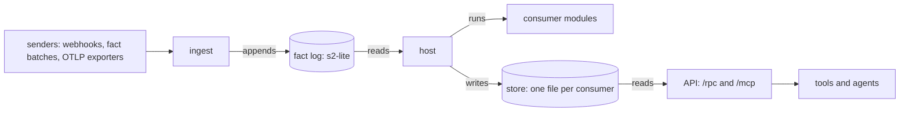
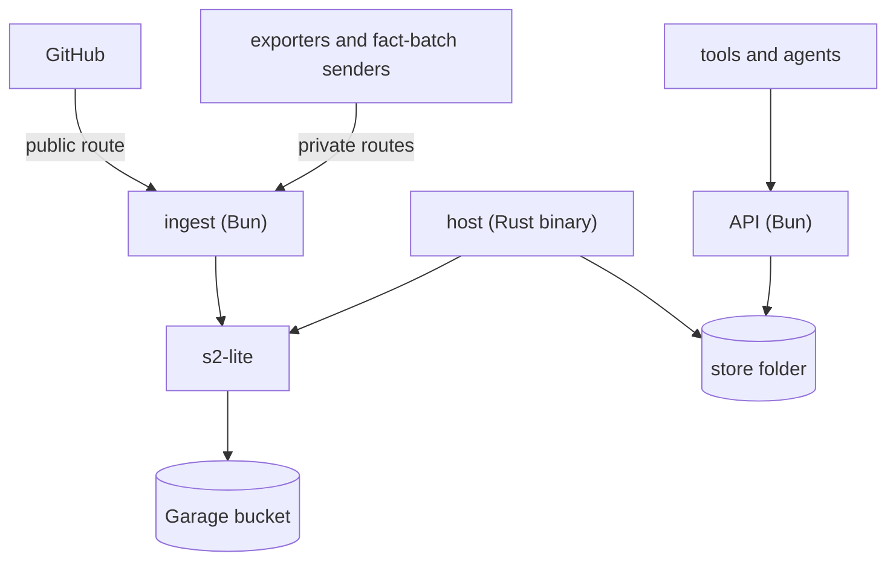

# pepys architecture

pepys keeps its owner's data as facts that never change, and answers typed queries over tables built
from those facts. Every table can be deleted and built again by a replay of the facts.

These are the terms the docs under `docs/architecture/` use:

- A fact is one record of something a source reported, such as a GitHub webhook or a telemetry log
  line. The fact log keeps facts in streams, one stream for each kind of fact a source sends.
- An entity is one thing a source knows about, such as a pull request or a release. Each entity has
  an ID, and one row in a consumer's table describes it.
- A link joins two entities, such as a pull request and the release that ships it. The two ends can
  come from two sources.
- A consumer is a function that reads the facts of the streams it declares, and returns the rows and
  links to write.
- A plug-in holds the code for one source: the source module that turns a delivery into facts, its
  consumers, and the queries that read their tables.
- A deployment names the plug-ins one installation of pepys runs. It lives in its own repo, with the
  entry files that start each process and the settings of each plug-in.

Three processes run a deployment:

- ingest takes deliveries in, and pulls from a source's API on a timer, and appends the facts to the
  fact log;
- the host runs each consumer on the fact log and writes the rows to the store, a folder with one
  database file per consumer;
- the API runs queries on the store, as typed oRPC calls under `/rpc` and as MCP tools at `/mcp`.

## The path of a fact

1. A sender posts a delivery to a route of ingest, an HTTP path that one source module owns. Ingest
   checks the delivery's signature or token before the source module sees it.
2. The source module turns the delivery into facts. Ingest appends them to the fact log, and answers
   success only once the log holds every fact of the delivery. A pull timer takes the same path from
   step 2, with no sender.
3. The host reads each stream that a consumer declares, and passes the facts to the consumer's
   WebAssembly module in one of two modes:
   - in fact mode, one fact at a time;
   - in scope mode, every fact of one scope, a group of facts such as all the facts of one pull
     request. The module returns the scope's whole set of rows, and they replace the rows the scope
     wrote before.
4. The host writes the rows and links the module returns, in one transaction with the consumer's
   read position on each stream.
5. The API opens the file of each consumer that a query reads, read-only, and runs the query there.
   The API joins the `link` tables of every file, so a query can follow a link to an entity in
   another consumer's file.

The API never writes the store, and the host never writes the fact log.

- [Ingest](./ingest/ingest.md) covers the routes, the delivery checks, the answers and the pull
  timers.
- [The fact log](./ingest/fact-log.md) covers the streams, the format of a fact, fact IDs and how
  one append lands exactly once.
- [Plug-ins and the build](./consumers/plug-ins-and-build.md) covers what a plug-in declares, the
  check on a deployment, and how `pepys build` compiles each consumer.
- [The host](./consumers/host.md) covers consumer versions, fact mode, scope mode and the store
  files.
- [Entities and links](./queries/entities-and-links.md) covers entity IDs, the shared `entity` view
  and the `link` table.
- [The API](./queries/api.md) covers how the API reads the store, the core queries, and the routes
  `/rpc` and `/mcp`.

## Topology

Ingest and the API are Bun processes. The deployment's entry files start them with `serveIngest`
from `@pepys/ingest` and `serveAPI` from `@pepys/api`. The host is one Rust binary, which each
release of pepys publishes beside the npm packages. s2-lite serves the fact log, and keeps its data
in an object storage bucket such as a Garage bucket. The host and the API share the store folder on
disk: the host writes it, and the API reads it.

pepys publishes no container image. The deployment's repo builds its own images and sets its own
network rules. Each source module marks each of its routes public or private, and a route it leaves
unmarked is private. The GitHub webhook is the only public route. The API checks no token on `/rpc`,
so the deployment's network rules must keep the API off the public network.
[The API](./queries/api.md) covers the access tokens that `/mcp` checks.

[Deploying pepys](../runbooks/deploying.md) gives the steps and the settings of each process.

## The data

`pepys build` compiles each consumer, and each build is a consumer version, named by a hash. To
deploy a version, run `pepys up`: the host builds the version's file from the start of the fact log,
then makes that version current.

| Where                   | Holds                                                                                   | Written by | Rebuilt by          |
| ----------------------- | --------------------------------------------------------------------------------------- | ---------- | ------------------- |
| the fact log            | the streams of facts, kept forever                                                      | ingest     | cannot be rebuilt   |
| a consumer's file       | the consumer's tables, its read positions, a change log of each batch, the `link` table | the host   | a replay of the log |
| a scope consumer's file | the same, plus an index of which facts belong to which scope                            | the host   | a replay of the log |
| `host.db`, in the store | which version of each consumer is current                                               | the host   | cannot be rebuilt   |

A lost bucket loses every fact. A lost `host.db` loses the record of which version of each consumer
is current. The change log records each row and link that each batch changed.

## Concerns that cut across the system

**One writer per file.** Only the host writes a consumer's file, and the host holds one writer lock
per consumer. When the host applies a batch of facts, it commits the rows, the links, the read
positions and the change log entry in one transaction inside that one file. A transaction never
spans two files.

**Determinism.** A consumer must never read a clock, a random source, the network or a file, so a
replay always gives the same rows. `pepys build` compiles each consumer with scriptc, a compiler
from TypeScript to WebAssembly, and refuses a module that scriptc does not mark deterministic. As a
second guard, the host makes every clock the module can call read 0. A setting reaches a consumer as
a constant compiled into the module, so a changed setting makes a new consumer version.

**Shared test cases for TypeScript and Rust.** pepys calls each outside system through a port, an
interface with at least two implementations, and a test fake counts as one.
[Decision 0023](../decisions/0023-ports-strategies-champion-challenger.md) records this choice. Both
languages implement each port:

- the fact log, with an s2-lite and an in-memory implementation;
- the blob store, for files too large to keep in a fact, with a Garage and a local-folder
  implementation. Only the blob store's own tests run it.

One set of fixture files holds the test cases for each port, and the tests of every implementation
in both languages run those fixtures. The rules that both languages check share case files the same
way: the fact format, the consumer manifest in `consumers.json`, the check on a consumer's links,
and the check on the rows a scope replaces. A change that makes one language disagree with a case
file fails that language's tests.

**Core packages and plug-ins.** Put a part of the path, such as ingest or the API, in a core
package, and keep every source's name out of it. Put a source, with its consumers and queries, in a
plug-in. A lint rule lets a core package import only other core packages. A plug-in builds on
`@pepys/kit`, which imports no other pepys package, so a plug-in in another repo needs only the
published packages.

**One version for every package.** Every public package and the host binary carry one version, and a
release publishes them together. [Releasing](../runbooks/releasing.md) covers the steps of a release
that a person does.
