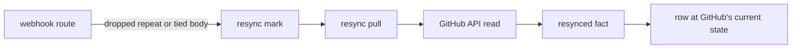

# The GitHub plug-in

With the GitHub plug-in, `@pepys/source-github`, you can ask when a pull request reached its users:
its merge, its first release and its first deploy. The plug-in stores the webhooks of a GitHub App
as facts. Its consumers turn those facts into tables of pull requests, releases, commits and
deploys, and [the delivery query](#the-delivery-query) joins the tables each time it runs.

Ingest also runs two pulls for the plug-in: jobs on a timer that read the GitHub API as the App.
They fill the gaps that webhooks leave. The recovery pull fetches deliveries that failed, and the
resync pull reads an object again when ingest cannot tell its newest state from its facts.

[Ingest](../ingest/ingest.md) covers the receive route, the dropping of repeated bodies and the pull
timers. [The fact log](../ingest/fact-log.md) covers fact families, streams and ID forms.
[The host](../consumers/host.md#a-fact-mode-batch) covers how each consumer applies a fact once.
[Entities and links](../queries/entities-and-links.md) covers the entity IDs.

## The route and the settings

GitHub calls `/webhook/github` from the public internet. The route declares `reach: 'public'`, and a
deployment opens only such routes to the internet, by the network rules in
[Deploying](../../runbooks/deploying.md). Ingest checks each delivery against GitHub's HMAC
signature in `x-hub-signature-256`.

Ingest exits at start when one or more of these environment variables is missing:

| Variable                       | Value                                                                      |
| ------------------------------ | -------------------------------------------------------------------------- |
| `PEPYS_GITHUB_WEBHOOK_SECRET`  | the webhook secret of the App                                              |
| `PEPYS_GITHUB_APP_ID`          | the App ID or the Client ID, which GitHub takes as the JWT issuer          |
| `PEPYS_GITHUB_APP_PRIVATE_KEY` | the App's private key in PEM, with line breaks or with `\n` in their place |

The plug-in also has one build-time [setting](../consumers/plug-ins-and-build.md#settings),
`deployTagPattern`, set as `settings: { github: { deployTagPattern: '<pattern>' } }`.
[Deploys](#deploys) covers the tags it matches.

Ingest answers a delivery with 200 when it stores the delivery's fact.
[A delivery, step by step](../ingest/ingest.md#a-delivery-step-by-step) covers the answers every
route gives, such as 401 for a bad signature. The GitHub route adds these:

- 400 when the delivery ID header is missing or the body is not JSON;
- 422 when the body does not fit its event;
- 202, storing nothing, for an event not in [Families and consumers](#families-and-consumers);
- 202, with nothing stored, when the event's family has no fact type for the delivery's `action`.
  Each family lists its fact types in `packages/source-github/src/families/`.

## Families and consumers

| Webhook event                         | Family                | Entity                                    | Built by                      |
| ------------------------------------- | --------------------- | ----------------------------------------- | ----------------------------- |
| `pull_request`                        | `pull_request`        | `github:pull_request:<id>`                | `github_pull_request`         |
| `release`                             | `release`             | `github:release:<id>`                     | `github_release`              |
| `push` to the default branch or a tag | `ref`                 | `github:ref:<repository ID>:<ref>`        | `github_ref`, `github_deploy` |
| `deployment`, `deployment_status`     | `deployment`          | `github:deployment:<id>`                  | `github_deploy`               |
| `workflow_run`                        | `workflow_run`        | `github:workflow_run:<id>`                | nothing: the facts are stored |
| `issues`                              | `issue`               | `github:issue:<id>`                       | nothing: the facts are stored |
| `pull_request_review`                 | `pull_request_review` | `github:pull_request_review:<id>`         | nothing: the facts are stored |
| `pull_request_review_comment`         | `review_comment`      | `github:review_comment:<comment ID>`      | nothing: the facts are stored |
| `pull_request_review_thread`          | `review_thread`       | `github:review_thread:<first comment ID>` | nothing: the facts are stored |
| `issue_comment`                       | `issue_comment`       | `github:issue_comment:<comment ID>`       | nothing: the facts are stored |
| `repository`                          | `repository`          | `github:repo:<id>`                        | nothing: the facts are stored |

Each family has its own stream, `facts.github.<family>`. The plug-in stores the families no consumer
builds, for a later consumer to replay, because GitHub redelivers a webhook only within a fixed
[window](https://docs.github.com/en/webhooks/testing-and-troubleshooting-webhooks/redelivering-webhooks).

The `github_release`, `github_deploy` and `github_pull_request` consumers each write a table of
their own name. The `github_ref` consumer writes only `github_commit`, one row per commit of a push.
The `github_pull_request` consumer also writes `github_release_bump`, one row for each URL of the
form `https://github.com/<owner>/<name>/releases/tag/<tag>` in the description of a pull request
whose author GitHub gives the user type `Bot`. Such a pull request is a bump: it updates its own
repository to use a release of another repository, as a dependency update bot does.
[The delivery query](#the-delivery-query) follows a bump to a deploy.

A winning fact adds its `html_url` and `<owner>/<repo>#<number>`, in lowercase, to
`github_pull_request_alias` as [aliases](../queries/entities-and-links.md#aliases). Old forms stay
after a rename, and each alias goes to the newest fact that names it.

A delivery can embed another object, such as the pull request inside a review event. A row changes
only with facts of its own object, so the embedded object updates nothing.

## Fact IDs from the body hash

The ID of a GitHub fact is `webhook:github:h-<hash>`. The hash is the SHA-256 of the canonical JSON
of the delivery body: its keys sorted at every depth, with no white space. GitHub signs the body and
never signs the delivery ID header, so the plug-in builds the ID from the body alone. A redelivery,
or a captured body sent again under any header, gets the same ID. The recovery pull hashes the same
canonical form. Ingest writes the delivery ID to its log line, and never puts it in a fact.

A repeated body changes no row. When ingest stored the same body in the last hour, it drops the
repeat, gives the answer it gave the first time, and appends nothing, as
[Ingest](../ingest/ingest.md#why-a-fact-id-comes-from-the-signed-body) describes. A repeat after the
hour reaches the log, and the host skips it, because the host applies each fact ID once, at its
first position in the stream.

## Which fact wins

The `github_pull_request` and `github_release` consumers compare the times of facts. The fact with
the newer time wins, and so does the first fact of an object. When two facts have equal times, the
later one in the stream wins. The host keeps the stream order on every replay, so a replay picks the
same winner.

A pull request's time is its `updated_at`. A release's time is the first of `updated_at`,
`published_at` and `created_at` that holds a value.

[Deploys](#deploys) holds the `github_deploy` rule. The two consumers above also follow these:

- A release that GitHub deleted keeps its row, with the time of the delete in `deleted_at`. A later
  fact never clears `deleted_at`, because GitHub never gives a release ID to another release. The
  `entity` view leaves the row out, as
  [Entities and links](../queries/entities-and-links.md#the-entity-view) describes.
- The `github_pull_request` consumer writes nothing for a fact whose row equals the stored row in
  every column, so a repeat leaves the pull request and its bump rows as they are.
- The bump rows of a pull request change only with its row. When a fact wins, the consumer reads the
  bump URLs of the old description from the payload stored with the row. It then deletes each bump
  row whose URL the new description drops, and adds a row for each URL the new description adds.

## The recovery pull

GitHub never retries a failed delivery by itself. Every hour, the recovery pull lists the App's
webhook deliveries, newest first, back to the highest delivery ID of its last run. It reads the body
of each delivery that GitHub recorded with no 2xx answer, oldest first, and builds the fact as the
webhook route does. Some of those deliveries did reach the log, such as one that ingest stored but
answered too late for GitHub. Their facts get the ID of the stored fact. The pull's facts skip the
receive route's drop of repeated bodies, so ingest appends them, and the host skips them.

The pull keeps its cursor in memory, so the first run after a start reads every delivery that GitHub
still keeps. When one delivery's fact is too large for one append to the fact log, the pull logs the
delivery ID and skips it.

## The resync pull

For each object, the webhook route remembers the last body it stored. It marks the object for a
resync when a new delivery leaves the newest state unknown:

1. The route drops a repeat of an earlier body, and the last body it stored for the object is a
   different one. The object went from state A to state B, and the repeat is A again. The repeat may
   be a stale redelivery of A, or GitHub may have moved the object back to A. A dropped repeat never
   reaches the consumer, so the row stays at B either way.
2. The route stores a tied body: one with the same update time as the last body it stored for the
   object, and different from it. The later fact in the stream wins the tie, and the stream order
   need not match the order of the changes on GitHub.

Ingest holds the marks in memory, each with the object's API path from its body. Every minute, the
resync pull reads each marked pull request or release at that path, and writes one fact of type
`github.<family>.resynced`. The fact has the object's own update time, and a payload in the shape of
a webhook body. The release API leaves out the repository, so for a release the pull makes a second
call and adds the repository's ID and full name.

The resynced fact comes later in the stream than the deliveries before it, so it wins on an equal
time, and the row takes GitHub's current state. A replay reads no API, and applies the stored
resynced facts, so it gives the same rows as the first run.

The resynced fact's ID takes the [`observation:` form](../ingest/fact-log.md#the-fact-envelope). Its
hash covers the payload and the last body that the webhook route stored for the object. A resynced
fact never counts as that last body. With the payload alone in the hash, this sequence would leave a
row wrong:

1. A resync writes a fact, and the row takes GitHub's state.
2. A delivery arrives with the same update time. Its fact comes later in the stream, so it wins, and
   the object gets a new mark.
3. The second resync gets the same answer from GitHub as the first. Its fact gets the ID of the
   first, the host skips it, and the row stays at the tied delivery.

The tied delivery is the new last body, so the second resync's hash differs from the first. The
second resynced fact is a new fact, and it wins.

The resync pull reads only pull requests and releases, though the route marks objects of every
family. Once the pull's batch is stored, ingest removes every mark it handed the pull, and so also
each mark that the pull read nothing for:

- a mark of another family, or with no API path;
- a mark of an object that GitHub answers 404 for. A 404 does not prove a delete: GitHub never
  deletes a pull request, and shows a draft release only to a token that can push. A deleted
  release's own `deleted` delivery sets its `deleted_at`;
- a mark in a repository where the App has no installation.

When any other call to GitHub fails, the run stops and stores no fact, and every mark stays for the
next run. After a 401, which means the App's credentials are wrong, ingest also logs that GitHub
refused the App token.

## Deploys

The `github_deploy` consumer records a deploy from either of two webhooks. It stores the kind of
webhook in the row's `signal` column, and the fact's time as the deploy time:

| Webhook                                                         | `signal`            | Deploy time                                               |
| --------------------------------------------------------------- | ------------------- | --------------------------------------------------------- |
| a push that moves a tag matching `deployTagPattern` to a commit | `tag`               | the repository's `pushed_at`, else the head commit's time |
| a deployment status of `success`                                | `deployment_status` | the deployment status's `created_at`                      |

`deployTagPattern` is `deployed/<environment>` by default, and must hold `<environment>` exactly
once. A tag can add one more part after the pattern to name a target, such as
`deployed/production/api` for the target `api`. A row from a deployment status has no target. A push
that deletes the tag records nothing.

The consumer keeps one row for each repository, environment, signal, commit and target. When a
second fact names the same five values, the row keeps the earlier of the two deploy times, so the
order of the facts never changes the row.

## The delivery query

The plug-in's query `github_pull_request_delivery`, which the API serves under `/rpc`, takes up to
200 pull requests, an environment and an optional target. It returns each pull request's merge time,
its first release and its first deploy. The plug-in also exports the query's SQL statement as
`githubDelivery`, so a query of another plug-in can run the statement and join its result. The query
reads the rows that are stored when it runs, so its answer is right in any order the facts arrived.
The plug-in never stores the answer as a [link](../queries/entities-and-links.md#links).

The query orders commits by commit time, from `github_commit`, and never checks ancestry. When a
commit has no row, the query uses a stand-in time:

- for a release's target commit, the release's `created_at`;
- for a pull request's merge commit, the pull request's `merged_at`;
- for a deploy's commit, the deploy's own time.

The query finds the first release and the first deploy by these rules:

- **The first release** of a merged pull request is the earliest release of its repository that is
  published, is not a draft, is not deleted, and whose target commit is no older than the merge
  commit. Such a release contains the pull request.
- **The first deploy** comes through a bump. The query takes every release that contains the pull
  request, and every merged bump that links one of them. The first deploy is the earliest deploy of
  a bump's repository, to the environment, whose commit is no older than that bump's merge.

The query picks one signal for each repository and environment. It counts only the repository's tag
deploys when the repository has one or more tag deploys to the environment, and only its deployment
statuses when it has none. With a target given, the query counts only deploys to that target, and
looks only for tag deploys to that target. With no target given, a deploy to any target counts.

## Known limits

- A commit time is not ancestry: a release cut from another branch after the merge counts as
  containing the pull request.
- The query takes a bump's merge as the time its repository starts to ship the release. When a
  repository needs a second pull request to ship it, such as one that turns the new version on, a
  deploy between the two counts, so the query reports the deploy early.
- A repository that cuts releases of several components gets the first release of any component, not
  of the component that holds the pull request.
- A repository that deploys its own code, with no bump pull request, gets no deploy time.
- Ingest loses its resync marks when it restarts, so an object marked before a restart keeps a stale
  row until its next delivery.
