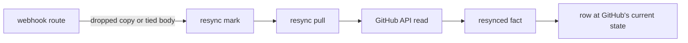

# The GitHub plug-in

With the GitHub plug-in, `@pepys/source-github`, you can ask when a pull request reached its users:
its merge, its first release and its first deploy. It stores the webhooks of a GitHub App as facts,
and its consumers build pull requests, releases, commits and deploys from them. One query joins
those tables when it runs. Every fact ID comes from a hash of the webhook body, because GitHub signs
the body and not the delivery ID header. Two pulls fill the gaps that webhooks leave: the recovery
pull fetches deliveries that failed, and the resync pull reads an object from the API when ingest
cannot tell its newest state from its facts.

[Ingest](../ingest/ingest.md) covers the receive route, the dropping of copies and the pull timers.
[The fact log](../ingest/fact-log.md) covers fact families, streams and ID forms.
[Entities and links](../queries/entities-and-links.md) covers the entity IDs.

## The route and the settings

GitHub calls `/webhook/github` from the public internet. The route declares `reach: 'public'`, and a
deployment opens only such routes to the internet, by the network rules in
[Deploying](../../runbooks/deploying.md). Ingest checks each delivery against GitHub's HMAC
signature in `x-hub-signature-256`.

Ingest exits at start when one or more of these environment variables is missing:

| Variable                       | Value                                                                      |
| ------------------------------ | -------------------------------------------------------------------------- |
| `PEPYS_GITHUB_WEBHOOK_SECRET`  | the webhook secret of the App                                              |
| `PEPYS_GITHUB_APP_ID`          | the App ID or the Client ID, which GitHub takes as the JWT issuer          |
| `PEPYS_GITHUB_APP_PRIVATE_KEY` | the App's private key in PEM, with line breaks or with `\n` in their place |

The plug-in also has one build-time [setting](../consumers/plug-ins-and-build.md#settings),
`deployTagPattern`. The deployment file sets it under the plug-in's name, as
`settings: { github: { deployTagPattern: '<pattern>' } }`. [Deploys](#deploys) covers the tags it
matches.

Ingest answers each delivery by these rules:

- 400 when the delivery ID header is missing or the body is not JSON;
- 422 when the body does not fit its event;
- 202, storing nothing, when the event is not in the table below, or when its `action` is not one of
  the fact types its family lists in `src/families/`.

## Families and consumers

| Webhook event                         | Family                | Built by                      |
| ------------------------------------- | --------------------- | ----------------------------- |
| `pull_request`                        | `pull_request`        | `github_pull_request`         |
| `release`                             | `release`             | `github_release`              |
| `push` to the default branch or a tag | `ref`                 | `github_ref`, `github_deploy` |
| `deployment`, `deployment_status`     | `deployment`          | `github_deploy`               |
| `workflow_run`                        | `workflow_run`        | nothing: the facts are stored |
| `issues`                              | `issue`               | nothing: the facts are stored |
| `pull_request_review`                 | `pull_request_review` | nothing: the facts are stored |

The plug-in stores the last three families with no consumer. GitHub redelivers a webhook only within
the window its
[redelivery docs](https://docs.github.com/en/webhooks/testing-and-troubleshooting-webhooks/redelivering-webhooks)
give, so the log is the only full history a later consumer can replay.

`github_ref` writes `github_commit`, one row per commit of a push. `github_pull_request` writes
`github_pull_request`, and `github_release_bump`: one row for each URL of the form
`https://github.com/<owner>/<name>/releases/tag/<tag>` in the body of a pull request that a bot
opened. Such a pull request is a bump. It moves its own repository to a release of another
repository, and [the delivery query](#the-delivery-query) follows it to a deploy.

A delivery can embed a copy of another object, such as the pull request inside a review event. Only
the object's own facts change its row, so the embedded copy updates nothing.

## Fact IDs from the body hash

The ID of a GitHub fact is `webhook:github:h-<hash>`, where the hash is the SHA-256 of the canonical
JSON of the delivery body. GitHub signs the body and not the delivery ID header, so only the body
decides the ID. A redelivery, or a captured body sent again under any header, gets the same ID. The
recovery pull hashes the same canonical form. Ingest writes the delivery ID to its log line, and
never puts it in a fact.

A copy of a stored body changes no row. Ingest drops a copy of a body it stored recently, answers as
it did the first time, and appends nothing. A later copy reaches the log, and the host skips it,
because the host applies each fact ID once, at its first position in the stream.

## Which fact wins

`github_pull_request` and `github_release` compare update times. Each keeps its stored row only when
the new fact is older, so a fact with a newer or an equal time wins, and so does the first fact of
an object. When two facts have equal times, the later one in the stream wins. The host keeps the
stream order on every replay, so a replay picks the same winner.

A release's time is the first of `updated_at`, `published_at` and `created_at` that holds a value.

These rules keep a late delivery from undoing a newer state:

- A release that GitHub deleted keeps its row, with the time of the delete in `deleted_at`. No later
  fact clears it, because GitHub never gives a release ID to another release.
- `github_pull_request` writes nothing for a fact whose row equals the stored row in every column,
  so a repeat leaves the pull request and its bump rows as they are.
- The bump rows of a pull request change only with its row. When a fact wins, the consumer reads the
  old body's bump rows from the stored row's payload. It then deletes each bump row that the new
  body drops, and adds each one that the new body adds.

`github_deploy` follows a rule of its own, in [Deploys](#deploys).

## The recovery pull

GitHub never retries a failed delivery by itself. Every hour, the recovery pull lists the App's
webhook deliveries, newest first, back to the highest delivery ID of its last run. It reads the body
of each delivery that GitHub recorded with no 2xx answer, oldest first, and builds the fact as the
webhook route does. Some of those deliveries did reach the log, such as one that ingest stored but
answered too late for GitHub. Their facts get the ID of the stored fact, so the host skips them.

The pull keeps its cursor in memory, so the first run after a start reads every delivery that GitHub
still keeps. When one delivery's fact is too large for one append to the fact log, the pull logs the
delivery ID and skips it.

## The resync pull

Ingest marks an object for a resync when its facts cannot say which state is newest. The webhook
route marks it in two cases:

1. The route drops a copy of an earlier body, and stored another body of the same object between the
   two. The copy may be a stale redelivery or a true return to the earlier state, and the dropped
   copy cannot move the row back either way.
2. The route stores a body with the same update time as the last body it stored for the object, and
   the two bodies differ. The stream order then picks the row, and that order need not match the
   order of the changes on GitHub.

Ingest holds the marks in memory, each with the object's API path from its body. Every minute, the
resync pull reads each marked pull request or release at that path, and writes one fact of type
`github.<family>.resynced`. The fact has the object's own update time, and a payload in the shape of
a webhook body. The release API leaves out the repository, so for a release the pull makes a second
call and adds the repository's ID and full name.

The resynced fact comes later in the stream than the deliveries before it, so it wins on an equal
time, and the row takes GitHub's current state. Its ID uses the
[`observation:` form](../ingest/fact-log.md#the-fact-envelope): a hash of the payload together with
the last body ingest stored for the object. The stored body is in the hash for this case: a resync,
then a later delivery with a tied time, then a second resync with the same answer from GitHub. A
hash of the payload alone would give the second resync the ID of the first, and the host would skip
it, leaving the tied delivery's row. With the stored body in the hash, the second resync is a new
fact, and it wins. A replay reads no API, and applies the stored resynced facts, so it gives the
same rows as the first run.

Ingest marks objects of every family, but the pull reads only pull requests and releases. Once the
pull's batch is stored, ingest removes every mark it handed the pull, these included:

- a mark of another family, or with no API path;
- a mark of an object that GitHub answers 404 for. GitHub never deletes a pull request, and shows a
  draft release only to a token that can push, so a 404 does not prove a delete. A deleted release's
  own `deleted` delivery sets its `deleted_at`;
- a mark in a repository where the App has no installation.

When any other call to GitHub fails, the run stops and stores no fact, and every mark stays for the
next run. After a 401, which means the App's credentials are wrong, ingest also logs that GitHub
refused the App token.

## Deploys

`github_deploy` records a deploy from either of two webhooks:

- a push that moves a tag matching `deployTagPattern` to a commit, recorded with the signal `tag`;
- a deployment status of `success`, recorded with the signal `deployment_status`.

`deployTagPattern` is `deployed/<environment>` by default, and must hold `<environment>` exactly
once. A tag can add one more part after the pattern to name a target, such as
`deployed/production/api` for the target `api`. A row from a deployment status has no target. A push
that deletes the tag records nothing.

One row stands for one report: a repository, an environment, a signal, a commit and a target. When
the same report comes again, the row keeps the earlier time, so the order of the facts never changes
the row.

## The delivery query

`github_pull_request_delivery` takes up to 200 pull requests, an environment and an optional target.
It returns each pull request's merge time, its first release and its first deploy. The plug-in
exports the statement as `githubDelivery`, so a query of another plug-in can join its result. The
query reads the rows stored when it runs, so its answer is right in any order the facts arrived, and
no link stores the result.

The query orders commits by commit time, from `github_commit`, and never checks ancestry. When a
commit has no row, the query uses a stand-in time: a release's `created_at`, a pull request's
`merged_at`, or a deploy's own time.

- **The first release** of a merged pull request is the earliest release of its repository that is
  published, is not a draft, is not deleted, and whose target commit is no older than the merge
  commit. Such a release contains the pull request.
- **The first deploy** reaches the pull request through a bump. The query takes every release that
  contains the pull request, and every merged bump in another repository that links one of them. The
  first deploy is the earliest deploy of a bump's repository, to the environment, whose commit is no
  older than that bump's merge.

For each repository and environment, the query counts tag deploys when that repository has any, and
deployment statuses when it has none. With a target given, only tag deploys to that target count.
With no target given, a deploy to any target counts.

## Known limits

- A commit time is not ancestry: a release cut from another branch after the merge counts as
  containing the pull request.
- The query takes a bump's merge as the time its repository starts to ship the release. When a
  repository needs a second pull request to ship it, such as one that turns the new version on, a
  deploy between the two counts, so the query reports the deploy early.
- A repository that cuts releases of several components gets the first release of any component, not
  of the component that holds the pull request.
- A repository that deploys its own code, with no bump pull request, gets no deploy time.
- Ingest loses its resync marks when it restarts, so an object marked before a restart keeps a stale
  row until its next delivery.
