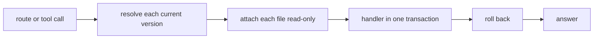

# The API

A consumer is the code that a plug-in declares to turn facts into rows. The host runs each consumer
and writes its rows to one database file per consumer version, and a `current` link in the
consumer's folder points at the version that readers see. [The host](../consumers/host.md#versions)
covers versions and how `up` swaps the `current` link.

Tools and agents read those files through the API, one Bun process. It serves every query of a
deployment from one router, twice: as a typed oRPC route under `/rpc`, and as an MCP tool at `/mcp`.
A plug-in declares each query once. The API serves that one declaration as both the route and the
tool, and a plug-in test runs the same declaration on the test store of `@pepys/testing`. The API
only reads: each call attaches its files read-only, and rolls back the transaction its handler runs
in.

The API checks no credential on `/rpc`, so its listen address and the deployment's network rules
decide who reaches that route. It serves `/mcp` only with `PEPYS_API_PUBLIC_URL` and
`PEPYS_AUTH_DIR` set, and then refuses each MCP request without a valid access token from its OAuth
server. With `PEPYS_API_PUBLIC_URL` unset, `/mcp` answers 404. With it set and `PEPYS_AUTH_DIR`
unset, the API exits 1 at start. [The OAuth server](./oauth-server.md) covers the tokens and the
owner's passkey sign-in.

[Entities and links](./entities-and-links.md) covers entity IDs, kinds, links and the views the
queries read. [Decision 0010](../../decisions/0010-kysely-for-api-queries.md) and
[decision 0020](../../decisions/0020-api-stack.md) record the query builder and the server stack.

## One call

Each call reads a set of consumers that is fixed before the call opens a file. A plug-in query lists
its consumers in its `reads`. Each of the two [core queries](#the-core-queries) picks its set from
its input, as that section describes. `get_entity` with an alias runs two calls, each through the
steps below: one over the consumers with an alias table, then one over the consumer of the entity's
kind. The API keeps one connection per call, on Turso, the SQLite engine that the host also writes
with.

1. The call resolves the `current` link of each of its consumers before it opens a file, and keeps
   the version folders it resolved. When `up` swaps a version during the call, the call stays on the
   old version, and the next call reads the new one.
2. The call opens a connection on an empty in-memory database, and attaches each file as
   `file:<path>?mode=ro`. Turso would attach a bare path read-write, so the URI sets read-only.
3. The handler runs in a transaction, and the call rolls the transaction back at the end, so a
   handler cannot write. The call takes its view of each file the first time it reads that file: the
   host's newest commit at that moment. It keeps that view until it ends.

The host opens each file with Turso's multi-process WAL, which lets a second process read the file
while the host writes it. Turso attaches such a file to a second process only when that process
holds its own handle on the file. The API therefore keeps one read-only handle on each current file.
When `up` swaps a version, the API retires the old file's handle, and closes it once the last call
on that file ends.

A call fails in these cases:

- When a consumer that the call needs has no current version, the handler never runs. The API
  answers a route call with 503 and the name of each such consumer.
- When a file fails to open, the API answers a route call with 500, and tries the file again on the
  next call.

On `/mcp`, each of these failures comes back as a tool error.

The host commits each consumer's batches in that consumer's own file, and a call takes its view of
each file separately. A query that joins two consumers can therefore see a newer batch in one file
beside an older batch in the other.

## The core queries

The API serves two queries of its own, beside the plug-in queries: `get_entity` and `neighbourhood`.
Each takes an entity ID of the form `<source>:<kind>:<id>`, as
[Entity IDs](./entities-and-links.md#entity-ids) describes. The `id` input of `get_entity` can hold
an alias in place of the ID.

**`get_entity`** returns one entity. Text that parses as an entity ID is an ID, and any other text,
such as `acme/api#412`, is an alias. The API resolves an alias to an ID first, as
[Aliases](./entities-and-links.md#aliases) describes, in a call of its own. The
[deployment check](../consumers/plug-ins-and-build.md#the-deployment-check) lets only one consumer
declare the entity view of a kind, so `get_entity` then reads the kind from the ID and attaches that
one consumer's file. The answer holds:

- the entity's row in the shared `entity` view;
- the name of the consumer;
- the name of the consumer's table behind the view;
- the entity's full row in that table.

`get_entity` fails with these typed errors, each with its HTTP status on a route call:

- `BAD_REQUEST`, 400: empty text.
- `NOT_FOUND`, 404: an ID whose kind no consumer declares an entity view for, an ID with no row, or
  an alias that no alias table holds.
- `SERVICE_UNAVAILABLE`, 503: the consumer of the entity's kind has no current version, as
  [One call](#one-call) describes. An alias that no alias table holds also gets 503 in place of 404
  when a consumer with an alias table has no current version, because that consumer may hold the
  alias.

**`neighbourhood`** returns the entities linked to a start entity, and the links between them. It
walks the `link_effective` view, breadth first, in both directions, with one SQL query per hop. It
reads every consumer that has a current version, and lists the names of the consumers it skipped, so
a consumer with no version makes the walk smaller and never fails it.

The caller shapes the walk with these inputs:

- `depthLimit`: 1 by default, and 3 at most.
- `entityLimit`: 50 entities by default, the start included, and 200 at most. The walk also reads at
  most 1000 link rows per hop.
- `linkTypes`: the link types to follow, every declared type when it is null. An unknown type is a
  bad request, and the API lists the known types in the error.
- `includeHubs`: false by default. A plug-in marks each link type it declares as a hub type when the
  type can join one entity to thousands of others. The walk follows a hub type only when
  `includeHubs` is true, and otherwise drops it from `linkTypes` with no error.
- `minimumConfidence`: 0 by default. Each link carries a confidence from 0 to 1, and the walk skips
  each link below this value. When two consumers write the same link, the walk counts it once, at
  the higher confidence.

When a limit cuts the walk short, the API sets `isTruncated` in the answer and returns no error. The
walk starts even when the start entity has no row. The answer lists in `unresolved` every ID the
walk reached that has no row.

## The router

The API serves the router on two paths:

- `/rpc/*` is oRPC's fetch handler, on an Elysia route.
- `/mcp` holds a tool for every query, which `@orpc/mcp` registers on a new stateless MCP server for
  each request. An agent reads each query's description as the tool's description, and gets a typed
  error as a tool error.

The router is flat, and keyed by each query's snake case name, which is also its tool name.
`@pepys/contract` holds the contract of the two core queries: each query's description, zod schemas
and errors. The API builds the contract of each plug-in query from its declaration.

The kit's deployment check refuses a plug-in query that takes a core query's name. At start, the API
also refuses a query whose zod schema has a transform, and the process stops. An MCP tool needs a
JSON Schema of each input and output, and zod cannot write one for the output of a transform.

`@pepys/api` exports a `DeploymentClient` type, built from `@orpc/contract` types. A caller outside
the repo that builds a typed client with `@orpc/client` installs it at the version the repo pins for
every `@orpc/*` package, so the client and the contract share one copy of the oRPC types. The pin is
a beta of oRPC v2, because v2 is the one major version of oRPC with an MCP integration.

A query handler reads through Kysely with the `@pepys/kysely-turso` dialect, and the dialect's
driver queues every query of the call through the call's one connection. A query takes its row types
from the table declarations of the consumers it reads.

## Start-up

A deployment's entry file starts the API with `serveAPI` from `@pepys/api`. Before it listens,
`serveAPI` runs the deployment check from `@pepys/kit`, which
[Plug-ins and the build](../consumers/plug-ins-and-build.md) covers. When the check fails, or a
setting is missing or bad, the process logs the failure and exits 1.
[Deploying](../../runbooks/deploying.md) gives the settings and their defaults.
