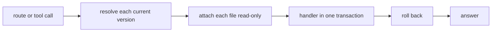

# The API

The API is how tools and agents read pepys. It is one Bun process that serves every query of a
deployment as a typed oRPC route under `/rpc` and as an MCP tool at `/mcp`, from one router, so one
declaration gives a route, a tool and a test. Each call attaches, read-only, the current file of
each consumer it reads, and runs its handler in one transaction that always rolls back. The API
never writes the store and checks no token: its listen address and the deployment's network rules
decide who reaches it.

[Entities and links](./entities-and-links.md) covers the `entity` and `link_effective` views.
[The host](../consumers/host.md) covers the files the API reads.
[Decision 0010](../../decisions/0010-kysely-for-api-queries.md) and
[decision 0020](../../decisions/0020-api-stack.md) record the query builder and the server stack.

## One call

A call resolves the `current` link of each consumer it names before it opens anything, and keeps the
folders it resolved, so a swap during the call changes nothing for it, and the next call reads the
new version. When a named consumer has no current version, the handler never runs, and the call
fails with the list of every such consumer, which a route answers as 503. The call then opens one
connection on an empty in-memory database and attaches each current file as `file:<path>?mode=ro`,
because Turso attaches a bare path read-write. The handler runs inside a transaction that the call
rolls back at its end, so a handler cannot write, and one call reads one snapshot of each file.

Turso refuses to attach a file that the host holds open with its multi-process WAL, unless the
reading process holds a handle of its own. The API therefore keeps one read-only handle on each
current file, and through that handle each attach sees the host's newest commit. A state machine
tracks each handle: a swap retires the old file's handle, and the handle closes once the last call
on that file ends. A file that fails to open fails the call with 500, and the next call tries it
again.

The host commits each consumer's batches in that consumer's own file. One call can therefore see one
file's newer batch beside another file's older one, in a query that joins across two consumers.

## The core queries

**`get_entity`** reads the kind from the ID, finds the consumer and table that own the kind's entity
view, attaches only that file, and returns the entity row, the consumer, the table and the full row.
An ID that does not parse is a bad request. A kind that no plug-in brings, a kind with no entity
view, and an ID with no row are each not found.

**`neighbourhood`** walks the links around one entity, breadth first, in both directions, with one
query per hop. It attaches every consumer that has a current version, and returns the names of the
ones it skipped, so a consumer with no version makes the walk smaller and does not fail it. The
walk's limits keep a hub from multiplying the rows of every hop:

- The depth is 1 by default and 3 at most.
- The walk returns 50 entities by default and 200 at most, and reads at most 1000 link rows per hop.
- It follows a hub link type only when the caller asks, and a named hub type is dropped when the
  caller does not.
- The caller can set a lowest confidence. A link that two origins hold counts once, with the higher
  confidence.

A walk cut by a limit is marked as cut, and is no error. A start entity with no row still walks, and
the answer lists the IDs it found no row for. An unknown link type is a bad request that lists the
known types.

## The router

The two core procedures and each plug-in query sit in one flat router with snake case keys, and a
plug-in query cannot take a core name. The core contract lives in `@pepys/contract`, with each
procedure's description, zod schemas and errors. The API builds each plug-in query's contract from
its declaration, and refuses a query whose zod schema has a transform, because zod writes no JSON
Schema for a transform's output, and an MCP tool needs one.

The API serves the router twice. `/rpc/*` mounts oRPC's fetch handler on an Elysia route that leaves
the body unparsed, so oRPC reads it. `/mcp` registers every procedure as a tool with `@orpc/mcp`, on
a stateless MCP server for each request, so no tool is registered by hand. The text an agent reads
is the procedure's description, and a typed error reaches an agent as a tool error. Every `@orpc/*`
package is pinned to one exact version, in the API, the contract and each client, because the API
runs a beta of oRPC v2, the one major version with an MCP integration.

A query handler reads through Kysely, with the `@pepys/kysely-turso` dialect: Kysely's SQLite
adapter, compiler and introspector, with a driver over the Turso binding that queues every query of
a call through its one connection. A query takes its row types from its consumers' table
declarations.

## Settings

The API reads `PEPYS_STORE_DIR`, the store folder that the host writes, and listens on
`PEPYS_API_HOST`, 127.0.0.1 by default, and `PEPYS_API_PORT`, 8081 by default. It runs the kit's
deployment check before it listens.
