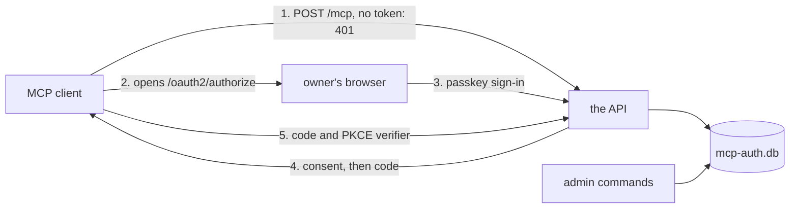

# The OAuth server

The owner's MCP clients, such as Claude Code, reach the API's `/mcp` from the internet, so every MCP
request carries an access token. The API issues those tokens itself, from an OAuth 2.1 authorization
server that runs in the API's process. The owner signs in with a passkey. A client can start an
authorization only after the owner adds it by hand, and each authorization asks for a fresh passkey
sign-in and the owner's consent. `/rpc`, the API's typed query route, takes no token, so the
deployment's network keeps it off the internet.

The server is the shared package `@zgeoff/mcp-auth`, which atc, boxxy and impz run too. Its
[design](https://github.com/zgeoff/tools/tree/main/docs/design/mcp-auth) holds the OAuth routes and
pages, the passkey sign-in, the token lifetimes, refresh rotation, revoke and the request guards.
pepys passes it the `read` scope, the default paths, its table names and its clock, and serves it
through the package's Elysia adapter beside `/rpc`. This doc covers what pepys adds around it.

[The API](./api.md) covers the queries that `/mcp` serves.
[Serving MCP](../../runbooks/serving-mcp.md) gives the settings, the public paths, and the steps to
add a client and revoke a grant.
[Decision 0025](../../decisions/0025-own-oauth-server-with-passkey.md) records why the API runs its
own server with a passkey, [decision 0027](../../decisions/0027-rpc-stays-off-the-public-route.md)
why only MCP and the OAuth paths are public, and
[decision 0028](../../decisions/0028-no-backup-of-auth-db.md) why `mcp-auth.db` has no backup.

## The deployment around the server

The API listens behind a proxy, such as a Cloudflare tunnel, that ends TLS and forwards only `/mcp`
and the OAuth paths. The proxy puts the browser paths behind a login of its own, such as Cloudflare
Access, and sends a client's requests straight through. Every request from the internet therefore
reaches the API from the proxy's address. A process on the API's own machine or network reaches the
API without the proxy, and so without the proxy's login. The server's rules assume that such a
process exists, and keep it out with the passkey.

## The database and the admin commands

`mcp-auth.db` is a SQLite file in `PEPYS_AUTH_DIR`, readable only by the API's user. It holds the
clients, the passkeys' public keys, the grants and the tokens, each token as a hash. The passkeys
stay in `pepys_passkey` and the enrollment tokens in `pepys_enrollment_token`, the tables pepys used
before the package. The API writes no other file. The host writes the consumer files that the API
reads, and never opens `mcp-auth.db`.

The owner changes `mcp-auth.db` through the admin commands, which are the API's entry file run with
arguments: `clients add`, `clients remove <name>`, `passkeys enroll`, `passkeys remove`, `grants`,
and `grants --revoke`, among others. A command opens `mcp-auth.db` while the server runs, and exits.
The server and each command open the file in WAL mode with a busy timeout, so the two share it. A
command skips the deployment check, the check of the deployment's plug-ins that the server runs
before it listens. A revoke from a command reaches the server at the token's next request, because
the server checks each token against the file.

Each serving API process needs the `mcp-auth.db` that issued a token to accept it. Two serving
processes behind one public route, each with its own `mcp-auth.db`, therefore refuse each other's
tokens, so one route takes one serving process.

A restart ends every sign-in in progress, and keeps every grant, because the grants live in
`mcp-auth.db`. Losing `mcp-auth.db` loses the clients, the passkeys and the grants. The owner then
adds each client again, enrolls a passkey, and signs each client in once. The serving API deletes
expired tokens, sessions and abandoned grants on a timer.

## The grant migration

Before the package, pepys kept one owner row in better-auth's `user` table, and each grant was the
authorization code ID that its tokens carry. The package keeps one `user` row per grant, so that one
delete revokes a grant. The server and every admin command run the migration when they open the
file, before the package opens it. `PRAGMA user_version` records that it ran, so it runs once. In
one transaction it:

1. gives each grant with a live token its own `user` row, keyed by the old grant ID, so
   `grants --revoke` takes the same ID as before;
2. points each token of those grants at its row, and deletes every other token;
3. deletes the owner row, its sessions and consents, the `pepys_grant_use` and `pepys_revoked_grant`
   tables, and their triggers;
4. rebuilds the token and session tables so that each `userId` cascades from `user`;
5. fails, and changes nothing, when `PRAGMA foreign_key_check` returns a row.

The migration keeps the passkeys and the clients. A database that pepys has not opened yet gets the
package's own tables.

## The bearer check

The package's adapter checks the bearer token of every request to `/mcp` and to `POST /`, a second
address of the MCP endpoint for a client set up with the bare origin. It answers a missing or
unknown token with 401 and the metadata challenge. pepys then:

- answers a request other than `POST` with 405, since the MCP server is stateless;
- answers a token without the `read` scope with 403 and `insufficient_scope`. A client gets such a
  token when it asks, at a refresh, for only `offline_access`.

Each MCP request is answered on its own, with no stream left open, so a revoke needs no hook to end
one.

## Security events

The API writes one line to stderr for each security event that the package records:
`pepys security ` and a JSON object. An event records a started or refused authorization, a passkey
sign-in, a consent, a refused code exchange, a refused bearer token, or a request refused for its
`Host` or `Origin` header. It records the socket's peer address, and the address in the
`CF-Connecting-IP` header, marked `trusted` only when the peer is in
`PEPYS_API_TRUST_FORWARDED_FROM`.

The API writes at most 20 events of each kind a minute. Past that, it counts the dropped events, and
writes one `suppressed` event with the count at the end of the minute, so a flood of refused tokens
never fills the log.
