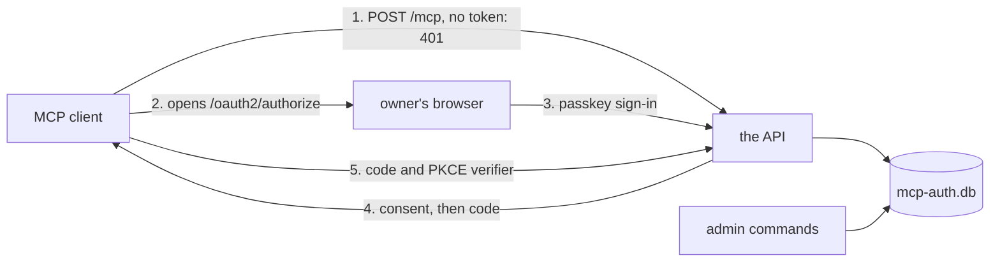

# The OAuth server

The owner's MCP clients, such as Claude Code, reach the API's `/mcp` from the internet, so every MCP
request carries an access token. The API issues those tokens itself, from an OAuth 2.1 authorization
server that runs in the API's process. The server serves one user, the owner, who signs in with a
passkey. The server lets a client start an authorization only when the owner added that client by
hand, and asks for a fresh passkey sign-in and the owner's consent each time. `/rpc`, the API's
typed query route, takes no token, so the deployment's network keeps it off the internet.

The better-auth library runs the OAuth protocol, through its OAuth provider and MCP plugins. pepys
adds the owner's passkey sign-in, the list of clients, the check of each bearer token, and the
guards on each request. The server's code is a copy of the OAuth server in atc, the owner's agent
control tower, and the owner carries each fix between the two copies by hand.

[The API](./api.md) covers the queries that `/mcp` serves.
[Serving MCP](../../runbooks/serving-mcp.md) gives the settings, the public paths, and the steps to
add a client and revoke a grant.
[Decision 0025](../../decisions/0025-own-oauth-server-with-passkey.md) records why the API runs its
own server with a passkey, [decision 0027](../../decisions/0027-rpc-stays-off-the-public-route.md)
why only MCP and the OAuth paths are public, and
[decision 0028](../../decisions/0028-no-backup-of-auth-db.md) why `mcp-auth.db` has no backup.

## The deployment around the server

The API listens behind a proxy, such as a Cloudflare tunnel, that ends TLS and forwards only `/mcp`
and the OAuth paths. The proxy puts the browser paths behind a login of its own, such as Cloudflare
Access, and sends a client's requests straight through. Every request from the internet therefore
reaches the API from the proxy's address. A process on the API's own machine or network reaches the
API without the proxy, and so without the proxy's login. The server's rules assume that such a
process exists, and keep it out with the passkey.

## The database and the admin commands

`mcp-auth.db` is a SQLite file in `PEPYS_AUTH_DIR`, readable only by the API's user. It holds the
clients, the passkeys' public keys, the owner sessions and the tokens, each token as a hash. The API
writes no other file. The host writes the consumer files that the API reads, and never opens
`mcp-auth.db`.

The owner changes `mcp-auth.db` through the admin commands, which are the API's entry file run with
arguments: `clients add`, `clients remove`, `passkeys enroll`, `passkeys remove`, `grants`, and
`grants --revoke`, among others. A command opens `mcp-auth.db` while the server runs, and exits. The
server and each command open the file in WAL mode with a busy timeout, so the two share it. A
command skips the deployment check, the check of the deployment's plug-ins that the server runs
before it listens.

Each serving API process needs the `mcp-auth.db` that issued a token to accept it. Two serving
processes behind one public route, each with its own `mcp-auth.db`, therefore refuse each other's
tokens, so one route takes one serving process.

The API generates better-auth's secret at random on each start, and keeps the pending approvals in
memory. A restart therefore ends every sign-in in progress, and keeps every grant, because the
grants live in `mcp-auth.db`. Losing `mcp-auth.db` loses the clients, the passkeys and the grants.
The owner then adds each client again, enrolls a passkey, and signs each client in once.

## Getting a grant

A grant is what one approved authorization produced, and `grants` lists each grant by its ID.
Revoking a grant ends its refresh token and every access token issued under it.

1. The client posts to `/mcp` with no token. The API answers 401 with a `WWW-Authenticate` header
   that points at its protected resource metadata (RFC 9728), where the client finds the
   authorization server.
2. The client opens the owner's browser on `/oauth2/authorize`. For a client the owner never added,
   or a redirect URI the client was not added with, the server shows an error page with fixed text,
   and redirects nowhere. The server has no dynamic client registration and fetches no client
   metadata document, so the owner's list is the only way in. better-auth matches every character of
   the redirect URI, except the port of an `http` loopback redirect URI, which may differ from the
   one the client was added with, as RFC 8252 section 8.3 asks.
3. The server starts a pending approval for the authorization, and asks for a passkey sign-in,
   whatever session the browser kept. A passed sign-in starts an owner session, which carries this
   one approval to the code exchange.
4. The consent page lists the scopes that the client asked for and the server grants. The server
   grants one scope, `read`, which every MCP tool needs, and the page shows it ticked. The owner may
   untick it, and the server denies a consent with no scope ticked.
5. The client exchanges the code once, with its PKCE verifier. Every client is a public client in
   the OAuth sense: it holds no secret, and PKCE with S256 proves that the client that exchanges the
   code is the one that asked for it.

The pending approval, the owner session's approval and the code each last one approval window, which
`@pepys/api` sets in `packages/api/src/oauth/`, counted from when each one starts. A slow owner can
therefore take more than one window from the first sign-in page to the code exchange. At the code
exchange, the server detaches the new tokens from the owner session and deletes the session. The
owner's sign-in therefore lasts one authorization, and a grant outlives it.

When an authorization request has no `resource` parameter, the server sets it to
`<public_origin>/mcp` before better-auth sees the request, so every token is bound to the one
resource the API serves. `<public_origin>` is the origin that clients reach the API at, the value of
`PEPYS_API_PUBLIC_URL`. The redirect that carries a code also carries the `iss` parameter of
[RFC 9207](https://www.rfc-editor.org/rfc/rfc9207), so a client can check which server sent it.

## Tokens

The API checks each access token against `mcp-auth.db` on every request, so a revoked grant fails on
its next request. Every token is opaque, with better-auth's JWT plugin off. The API keeps every
token, code and cookie out of its log lines, errors and security events.

The OAuth options in `packages/api/src/oauth/` set each lifetime:

- An authorization code works once. A second exchange of the same code revokes what the first one
  made.
- An access token expires before its refresh token, so a client refreshes it over the life of a
  grant.
- A refresh token rotates on every use.

## Refreshing a token

A refresh runs in two steps:

1. One SQL update marks the old refresh token used. The update changes the row only while the token
   is still unused, so of two refreshes at once, one fails.
2. better-auth writes the new refresh token, then the new access token, in separate statements,
   outside any transaction.

A refresh that presents a used refresh token revokes every refresh token and access token of that
client, across all its grants, because a reused token means that someone else holds a copy.

An admin command or an API stop during a refresh has a different result before and after step 1:

- A `grants --revoke` or a `clients remove` that commits before step 1 deletes the old refresh
  token, so the refresh fails.
- A `grants --revoke` that commits after step 1 deletes the rows that carry the grant's ID at that
  moment, and records the grant's ID in `pepys_revoked_grant` in the same transaction. A trigger on
  each token table refuses a row whose grant ID is recorded there, so each later write fails, and
  the server ends the refresh with a 500 and no token.
- A `clients remove` that commits after step 1 makes each later write fail, because each token row
  needs its client's row.
- When the API stops after step 1, the client never receives a new token. It holds only its old
  refresh token, which is now used, and any row that step 2 wrote stays unknown to it. Its next
  refresh is a reuse, which revokes every token of that client, in every grant. The owner then runs
  a new authorization for the client.

## The bearer check

The API checks the bearer token of every request to `/mcp` before MCP sees it, whatever the MCP
method. It checks `POST /` the same way, because `POST /` is a second address of the MCP endpoint,
for a client set up with the bare origin. The sign-in pages, the OAuth endpoints and the metadata
take no bearer token.

- A request with no `Authorization` header gets 401 with the metadata challenge. A header that holds
  no bearer token gets the same 401, and the API records a security event.
- A token that `mcp-auth.db` does not hold, or holds expired or revoked, gets 401 with
  `error="invalid_token"`.
- A token without the `read` scope gets 403 with `insufficient_scope`. A client gets such a token
  when it asks, at a refresh, for only `offline_access`, the scope that asks for a refresh token.

The API serves no DPoP, the scheme that binds a token to a client's key (RFC 9449). better-auth
binds a token to a key whenever a token request carries a `DPoP` header, and has no option to turn
that off. The API therefore refuses such a token request with `invalid_request`, and leaves the DPoP
fields out of its metadata.

## The owner's passkey

The owner is the one user, and a passkey is the one credential that signs the owner in. With no
passkey enrolled, every sign-in fails. The passkey's relying party is the API's public host name, so
a passkey works only at that origin.

The owner enrolls a passkey with a one-time enrollment token, which `passkeys enroll` prints. The
token enrolls one passkey, and the command prints the time it expires. `passkeys enroll --reset`
deletes every passkey, every unused enrollment token and every owner session in one transaction,
then prints a new token. `passkeys remove` deletes one passkey and every owner session. Grants
survive both.

A sign-in can pass its passkey check just before a reset or a remove commits. Once the check passes
and the owner session starts, the API therefore checks in one transaction that the passkey and the
session both still exist. When either is gone, the API ends the sign-in.

## Pending approvals

The API keeps each pending approval in memory until the approval window ends or the owner signs in.
It holds at most 3 pending approvals for one client, and at most 16 in all. A new approval past the
client's limit ends that client's oldest approval, and a new approval past the total limit ends the
oldest approval of all. A client that floods the server therefore ends its own approvals first, and
never blocks a new authorization of another client. Across all clients, the API refuses an eleventh
authorization started within a minute.

After 5 failed passkey checks for one pending approval, the API ends that approval. The API locks
the approval, and never the owner. A process that reaches the API without the proxy could otherwise
lock the owner out with failed checks. An attacker can never guess a passkey assertion, so the lock
ends only a request that keeps failing.

The proxy's login and the passkey both guard the browser paths. A stranger on the internet must pass
both. A process that skips the proxy must still pass the passkey check. The API checks no header
from the proxy's login, because the passkey check keeps that process out on its own, and checking
the header would need the API to fetch the login's signing keys from the internet.

## The guards on each request

Every request from the internet comes from the proxy's address, so the API counts no limit per
network address. It checks what each request carries:

- The API serves the OAuth paths and `/mcp` only to a request whose `Host` is the public host name,
  the API's own loopback address and port, or a host in `PEPYS_API_ALLOWED_HOSTS`. It answers 403 to
  any other. `/rpc` takes any `Host`.
- A form post to `/login`, `/enroll` or `/consent` must carry the public origin or the API's
  loopback origin in its `Origin` header, because only the server's own pages post those forms. An
  MCP request with an `Origin` header must carry one of the same origins. The API answers any other
  with 403.
- The sign-in, enrollment, consent and error pages forbid framing and caching, and run no script
  except the passkey script, on the pages that ask for a passkey. A form on them posts only to the
  API, and the consent form also posts to the client's redirect origin. The error page shows a fixed
  sentence per error code, and copies no text from the request.

## Security events

The API writes one line to stderr for each security event: `pepys security ` and a JSON object. An
event records a started or refused authorization, a passkey sign-in, a consent, a refused code
exchange or a refused bearer token. It records the socket's peer address, and the address in the
`CF-Connecting-IP` header, marked `trusted` only when the peer is in
`PEPYS_API_TRUST_FORWARDED_FROM`. The API puts a client's name in an event only when `mcp-auth.db`
holds that client, and a redirect host only after better-auth checked the redirect URI, so a crafted
request never puts its own text in the log.

The API writes at most 20 events of each kind a minute. Past that, it counts the dropped events, and
writes one `suppressed` event with the count at the end of the minute, so a flood of refused tokens
never fills the log.
