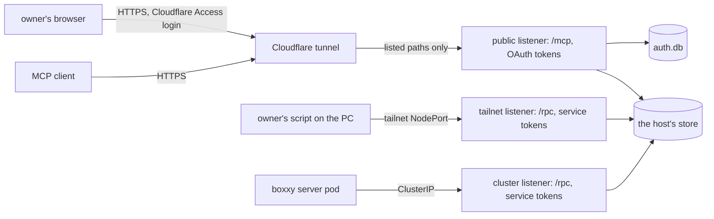

# Auth for the API

- **Status:** draft

The API runs three listeners, and each one takes one kind of credential. The public listener serves
`/mcp` and the sign-in pages through a Cloudflare tunnel, so the owner's MCP clients, such as Claude
Code on the owner's PC, reach pepys from anywhere. It takes only OAuth access tokens from the API's
own authorization server. The tailnet listener serves `/rpc` to a script on the owner's PC over the
owner's tailnet, and the cluster listener serves `/rpc` to pods in the cluster. Both take only
service tokens. Ingest keeps its own check on each route, and OAuth plays no part in it. This doc
builds the part of [Auth](./pepys/auth.md) that the API's read routes need.

This work comes after v1. The decision record [0024: The scope of v1](../decisions/0024-v1-scope.md)
leaves auth out of v1, and bars every source of personal data, such as mail, until auth is built.
This design is that auth, and it is the first work after v1, before the first such source.

Three outside systems appear in this doc:

- **atc** is the owner's agent control tower. Its gateway serves MCP on a public route behind its
  own OAuth server, and this design follows that server.
- **impz** runs the owner's coding agents in small virtual machines, called imps.
- **boxxy** dispatches work to coding agents. Its server runs as a pod in the same cluster as pepys,
  sends its facts to an ingest route, and reads its two plug-in queries from the API.

## Shape



better-auth's OAuth provider and MCP plugins run the protocol. pepys adds the owner's passkey
sign-in, the list of clients the owner added, the bearer check and the scope check, as atc does. A
grant is everything that one approved authorization produced: its refresh tokens and the access
tokens each one issued. Revoking a grant ends all of them.
[atc's OAuth doc](https://github.com/zgeoff/atc/blob/fa46d50b25a6599d2c246604509282c1a3db951a/docs/architecture/remote/oauth.md)
at that commit gives the reasons behind the rules this design shares with atc.

Two placeholders stand for the public route: `<public_origin>` is the value of
`PEPYS_API_PUBLIC_URL`, such as `https://<public_host>`, and `<public_host>` is its host name.

## Contracts

### The API process

A deployment's API entry passes its arguments to `serveAPI`. With no arguments, `serveAPI` serves
the listeners. With an admin command, it runs that command against `auth.db` and exits. The owner
runs each command with `kubectl exec` in the API's container, where `auth.db` lives. A command reads
only `PEPYS_AUTH_DIR` and `PEPYS_API_PUBLIC_URL`, and runs beside the server, which keeps serving.

```ts
// a deployment's API entry
serveAPI({ deployment, environment: process.env, argv: process.argv.slice(2) });
// argv [] → serves the listeners
// argv ['clients', 'add', 'Claude Code', '--redirect-uri', 'http://localhost:33418/callback']
//   → prints 'client 9f3k2m…' and exits 0
```

```ts
// @pepys/api
interface ServeAPIOptions {
  // …existing fields
  argv?: readonly string[]; // absent or empty: serve
}
```

| Command                                                      | Does                                                      |
| ------------------------------------------------------------ | --------------------------------------------------------- |
| `clients add <name> --redirect-uri <uri> [--redirect-uri …]` | adds a public client and prints its client ID             |
| `clients`                                                    | lists the clients                                         |
| `clients remove <client_id>`                                 | removes a client with every grant and token it holds      |
| `passkeys enroll`                                            | prints a one-time token that the owner types on `/enroll` |
| `passkeys enroll --reset`                                    | ends every passkey and sign-in, then prints a token       |
| `passkeys`                                                   | lists the passkeys                                        |
| `passkeys remove <passkey_id>`                               | removes one passkey                                       |
| `grants`                                                     | lists the live grants                                     |
| `grants revoke <client_id>`                                  | revokes every grant of one client                         |

### Configuration

`readAPIConfig` reads these variables beside `PEPYS_STORE_DIR`. `PEPYS_API_HOST` and
`PEPYS_API_PORT` set the cluster listener, which always runs.

```text
PEPYS_API_CALLERS_FILE     the service callers file, as JSON below; always needed
PEPYS_API_TAILNET_SOURCES  the client addresses the tailnet listener admits, as CIDRs split by
                           commas; unset: no tailnet listener
PEPYS_API_TAILNET_HOST     the tailnet listener's bind address; default 127.0.0.1
PEPYS_API_TAILNET_PORT     the tailnet listener's port; default 8083
PEPYS_API_PUBLIC_URL       <public_origin>, an https origin with no path;
                           unset: no public listener and no OAuth
PEPYS_API_PUBLIC_HOST      the public listener's bind address; default 127.0.0.1
PEPYS_API_PUBLIC_PORT      the public listener's port; default 8082
PEPYS_AUTH_DIR             the folder that holds auth.db; needed when PEPYS_API_PUBLIC_URL is set
```

```ts
// @pepys/api: the callers file at PEPYS_API_CALLERS_FILE. It holds digests, never a token.
interface CallersFile {
  version: 1;
  callers: Record<
    string, // the caller's name, such as 'owner' or 'boxxy'; its principal is `service:<name>`
    {
      listeners: readonly ('tailnet' | 'cluster')[]; // where its tokens work; at least one
      scopes: readonly 'read'[]; // at least one
      credentials: readonly {
        id: string; // unique within its caller, such as 'pc' or '2026-11'
        sha256: string; // the token's SHA-256 digest, as 64 lowercase hex characters
      }[]; // at least one; two during a rotation
    }
  >;
}
```

```json
{
  "version": 1,
  "callers": {
    "owner": {
      "listeners": ["tailnet"],
      "scopes": ["read"],
      "credentials": [{ "id": "pc", "sha256": "3f9a…" }]
    },
    "boxxy": {
      "listeners": ["cluster"],
      "scopes": ["read"],
      "credentials": [{ "id": "2026-11", "sha256": "c07e…" }]
    }
  }
}
```

A service token is `pepyss_` and 32 or more characters from `A-Z`, `a-z`, `0-9`, `-` and `_`. The
caller holds the token, and the callers file holds its digest.

### The listeners

Every listener answers 404 to a path it does not serve.

| Listener | Serves                                       | Takes                                            | Reached through                            |
| -------- | -------------------------------------------- | ------------------------------------------------ | ------------------------------------------ |
| public   | `/mcp` and the OAuth and sign-in paths below | an OAuth access token                            | the tunnel, then a ClusterIP Service       |
| tailnet  | `/rpc/*`                                     | a service token of a caller that lists `tailnet` | a NodePort on the server's tailnet address |
| cluster  | `/rpc/*` and `GET /healthz`                  | a service token of a caller that lists `cluster` | a ClusterIP Service                        |

### The public listener

The tunnel forwards only the paths below. It sends the owner's browser through a Cloudflare Access
login first, and sends a client's request straight to the listener.

| Path                                        | Caller            | At the tunnel |
| ------------------------------------------- | ----------------- | ------------- |
| `/oauth2/authorize`                         | the owner browser | Access login  |
| `/login`                                    | the owner browser | Access login  |
| `/enroll`                                   | the owner browser | Access login  |
| `/consent`                                  | the owner browser | Access login  |
| `/error`                                    | the owner browser | Access login  |
| `/mcp`                                      | an MCP client     | straight in   |
| `/oauth2/token`                             | a client          | straight in   |
| `/oauth2/revoke`                            | a client          | straight in   |
| `/.well-known/oauth-authorization-server`   | a client          | straight in   |
| `/.well-known/oauth-protected-resource`     | a client          | straight in   |
| `/.well-known/oauth-protected-resource/mcp` | a client          | straight in   |

```http
POST /mcp HTTP/1.1
Host: <public_host>

HTTP/1.1 401 Unauthorized
WWW-Authenticate: Bearer resource_metadata="<public_origin>/.well-known/oauth-protected-resource/mcp", scope="read"
```

`GET /.well-known/oauth-protected-resource/mcp` and `GET /.well-known/oauth-protected-resource` both
answer:

```json
{
  "resource": "<public_origin>/mcp",
  "authorization_servers": ["<public_origin>"],
  "scopes_supported": ["read"],
  "bearer_methods_supported": ["header"]
}
```

### The bearer check

One function decides the caller on every listener. It runs on `/mcp` and `/rpc/*`, before MCP or
oRPC sees the request. The sign-in pages, the OAuth endpoints, the metadata and `/healthz` take no
bearer token. Every MCP request needs a token, whatever its method, `initialize` included.

```ts
// @pepys/api
const caller = await readCaller(request, listener);
// → { kind: 'grant', clientID: '9f3k2m…', clientName: 'Claude Code', grantID: 'g_51…', scopes: ['read'] }
//   or { kind: 'service', name: 'owner', credentialID: 'pc', scopes: ['read'] }
//   or { kind: 'refused', status: 401, reason: 'malformed' | 'invalid_token' } → with the challenge
//   or { kind: 'refused', status: 403, reason: 'source_not_allowed' }

type Listener = 'public' | 'tailnet' | 'cluster';
```

- On `public`, only an opaque access token that `auth.db` holds, unexpired, unrevoked and bound to
  the resource `<public_origin>/mcp`, gives a `grant` caller. The IDs are better-auth's own.
- On `tailnet` and `cluster`, only a service token whose digest the callers file holds gives a
  `service` caller, and only when its caller lists that listener. The API answers a token of a
  caller that lists another listener as it answers an unknown token.
- The tailnet listener reads the client address of the connection. When the address sits outside
  `PEPYS_API_TAILNET_SOURCES`, the API answers 403 before it reads the token.
- The cluster listener answers 403 to a client address in Tailscale's ranges, `100.64.0.0/10` and
  `fd7a:115c:a1e0::/48`. A NodePort that the deployment points at the cluster port then fails
  closed.
- Every listener needs a credential on every query, whatever address it binds, loopback included.
  Tests and local runs write a callers file and send a token, so no process in the pod reads the
  store without one.
- Every procedure needs the scope `read`, so the API answers a caller without it with HTTP 403 and
  `WWW-Authenticate: Bearer error="insufficient_scope", scope="read"`. A procedure declares its own
  scope once a second scope exists.
- A 401 for `invalid_token` adds `error="invalid_token"` to the challenge. A 401 for `malformed`, a
  header that holds no bearer token, adds no error.
- A 401 on the tailnet or the cluster listener carries `WWW-Authenticate: Bearer` with no
  `resource_metadata`.

## Constraints

### Fail closed at start

- When `PEPYS_API_CALLERS_FILE` is unset, or its file is missing or fails a rule below, the API
  exits 1, whatever `PEPYS_API_HOST` binds. Its message names the caller and the rule, and holds no
  digest.
- The callers file fails when it names no caller, a caller has no listener, no scope or no
  credential, a listener is not `tailnet` or `cluster`, two credentials of one caller share an ID, a
  digest is not 64 lowercase hex characters, or one digest appears twice.
- When `PEPYS_API_TAILNET_SOURCES` does not parse, holds a loopback address, or holds a range wider
  than `/10` for IPv4 or `/48` for IPv6, the API exits 1.
- When `PEPYS_API_PUBLIC_URL` is set and is not an `https` origin with no path, the API exits 1.
- When `PEPYS_API_PUBLIC_URL` is set and `PEPYS_AUTH_DIR` is unset, the API exits 1.
- When two listeners name the same port number, the API exits 1.
- An admin command runs no deployment check. An unknown command or a bad argument exits 2 with the
  usage.

### Service tokens

- The API finds a service token by the SHA-256 digest of what the caller sent, and keeps only
  digests in memory.
- The API reads the callers file again when its folder changes, and every 30 seconds. Reloads run
  one at a time, in order, so an older read never replaces a newer one.
- When a reloaded file fails a start rule, the API keeps the last good set and writes a
  `callers_reload` security event with outcome `rejected`. A request that starts after a reload
  finishes sees the new set.
- A credential removed from the 1Password item stops working once the kubelet writes the changed
  Secret into the pod, then within 30 seconds. The other callers keep working, and no process
  restarts.

### What better-auth does not cover

Each rule in this doc holds whatever better-auth does by default. Where the pinned better-auth falls
short of a rule, pepys enforces the rule in its own code, as atc does for its forced sign-in and its
resource default. When an authorization request names no resource, pepys sets `<public_origin>/mcp`
before better-auth sees it. The redirect that carries a code carries `iss` too (RFC 9207), and the
authorization server metadata sets `authorization_response_iss_parameter_supported` to `true`, which
the MCP spec asks for.

### Tokens and grants

- An OAuth token works on the public listener only. The API answers a service token on the public
  listener with 401, and an OAuth token on the tailnet or the cluster listener with 401.
- The authorization server has no dynamic client registration and never fetches a client ID metadata
  document, which a client would host to register itself. When an authorization names a client that
  the owner never added, the owner's browser gets the error page and no redirect.
- Every client is public: no secret, PKCE with S256 required.
- An authorization code lasts 10 minutes and works once. A second exchange revokes what the first
  made.
- An access token is opaque, lasts 1 hour, and is checked against `auth.db` on every request.
- A refresh token lasts 30 days and rotates on each use.
- A refresh runs as one `auth.db` transaction that consumes the old refresh token by compare and
  swap: it marks the token used only when the token is still unused and its grant still exists, and
  issues the new pair in the same transaction. When the swap changes no row, the refresh fails and
  issues nothing. better-auth's own rotation is not atomic, so pepys runs this step in its own code.
  No in-memory lock takes part, so the rule holds across processes.
- A refresh that presents a consumed refresh token revokes that token's grant, in the same
  transaction.
- The server and an admin command open `auth.db` in WAL mode with a busy timeout. When
  `grants revoke` or `clients remove` races a refresh of the same client, every token of that client
  fails once the command has returned. A test runs the two at once.
- The API runs only in the StatefulSet pod that owns `auth.db`'s volume, never in a Deployment.
- `auth.db` stores a hash of each token, code and enrolment token, never the value.
- The API never writes a token, a code, a cookie or an `Authorization` header to a log line, an
  error or a security event.

### The owner

- The owner is the one user, and a passkey is the one credential that signs the owner in. With no
  passkey enrolled, every sign-in fails.
- The passkey's relying party ID is `<public_host>`.
- Each authorization needs a fresh passkey sign-in for that one request. One sign-in approves one
  authorization.
- An enrolment token lasts 10 minutes and enrols one passkey.
- `auth.db` holds an owner generation number. Each passkey ceremony, enrolment, owner session and
  pending approval records the generation it began under, and the API refuses to complete one whose
  generation is not the current one.
- `passkeys enroll --reset` runs as one transaction: it deletes every passkey, every unused
  enrolment token and every owner session, raises the generation, and stores the new enrolment
  token's hash. A ceremony or approval begun before the reset then fails, and an older enrolment
  token adds no passkey. Grants and their tokens survive the reset.
- `passkeys remove` deletes every owner session and raises the generation in the same transaction.
- The consent page lists the scopes the client asked for, with `read` ticked.

### Requests

- The public listener answers only a request whose `Host` is `<public_host>`, and answers 403 to any
  other. The tailnet and the cluster listener check no `Host` and no `Origin`.
- A form post to `/login`, `/enroll` or `/consent`, and an MCP request with an `Origin` header, must
  come from `<public_origin>`. The API answers any other with 403.
- The sign-in, enrolment, consent and error pages carry the headers below. Only `/login` and
  `/enroll` list a script: the passkey script, by its hash. Only `/consent` adds the client's
  redirect origin to `form-action`. The error page shows a fixed sentence per error code, never text
  from the request.

  ```http
  Content-Security-Policy: default-src 'none'; style-src 'unsafe-inline'; script-src 'sha256-<passkey_script_hash>'; form-action 'self' <redirect_origin>; frame-ancestors 'none'; base-uri 'none'
  X-Frame-Options: DENY
  Cache-Control: no-store
  Referrer-Policy: same-origin
  ```

- The public listener sees cloudflared's address, never the client's, so every limit counts per
  client and grant, and no security event carries a client address.
- The API writes one line to stderr for each security event: `pepys security ` and a JSON object.
  Each kind writes at most 20 lines a minute. Past that, the API counts the dropped events and
  writes one `suppressed` event with the count when the minute ends.

  ```ts
  // @pepys/api: the security event line; the formatter picks each field by name
  interface SecurityEvent {
    version: 1;
    ts: string; // ISO 8601
    kind:
      | 'authorize_started' // outcome accepted | rejected; reason 'rate_limited'
      | 'authorize_invalid' // rejected; better-auth's error code, 'bad_host', 'bad_origin' or 'other'
      | 'owner_auth' // succeeded | failed; 'assertion_failed', 'locked', 'expired', 'not_enrolled', 'invalid_token'
      | 'consent' // allowed | denied; 'none_ticked'
      | 'token_exchange' // rejected; better-auth's error code or 'other'
      | 'bearer' // rejected; 'malformed', 'invalid_token' or 'source_not_allowed'
      | 'callers_reload' // accepted | rejected; the failed rule
      | 'suppressed'; // reason: the dropped kind, with count
    listener: Listener;
    outcome?: string;
    reason?: string;
    count?: number;
    method?: 'passkey' | 'enrollment_token'; // owner_auth only
    route: string; // a path the API serves, else 'other'; never a query
    client?: { id: string; name: string }; // only for a client auth.db holds
    service?: { name: string; credentialID: string }; // only for a service caller
    redirectHost?: string; // only after better-auth validated the redirect URI
    correlationID?: string; // random, joins one authorization's events
    userAgent?: string; // cut to 200 characters, control characters removed
  }
  ```

- better-auth's telemetry stays off whatever the environment says.
- The API generates better-auth's secret at random on each start. A restart ends the sign-ins in
  progress and keeps every grant.

### Ingest

- Ingest's routes keep their own checks: the GitHub webhook signature, the signature on each boxxy
  fact batch, and the telemetry route's bearer token and imp identity token
  ([ingest in v1](./v1.md)). The API's tokens open no ingest route, and an ingest secret opens no
  API route.
- The API reads the store and writes nothing but `auth.db`. The host never opens `auth.db`.

## Deployment changes

The repo that holds the deployment makes these changes in its Pulumi program and manifests. The
exposure registry is a file the estate shares, so the coordinator makes its entries. The boxxy
server sends its token, and the API's Secret holds its digest, before the deployment moves to the
release that requires tokens: that release exits 1 with no callers file.

1. Route `<public_host>` through the shared Cloudflare tunnel to the public listener's ClusterIP
   Service. Add one rule for the browser paths, behind a Cloudflare Access application that admits
   only the owner, and one for the client paths. Every other path, `/rpc/*` included, gets the
   tunnel's 404. cloudflared passes the request's `Host` through unchanged.
2. In the API's container of the host's StatefulSet pod, set `PEPYS_API_PUBLIC_URL`, set
   `PEPYS_API_TAILNET_SOURCES` to the PC's tailnet address, and bind the three listeners on
   `0.0.0.0`. Mount a volume that outlives its claim at `PEPYS_AUTH_DIR`; the host's container never
   mounts it. Mount the callers file's Secret as a folder, never with `subPath`, because the kubelet
   never updates a `subPath` mount.
3. Give the tailnet listener a NodePort Service with `externalTrafficPolicy: Local`, whose one port
   targets the tailnet listener's port. `Local` keeps the PC's address, which the tailnet listener
   checks. A check in the deployment repo fails when the Service targets another port or another
   traffic policy. Give the public and the cluster listener a ClusterIP Service each.
4. Add NetworkPolicy rules: cloudflared reaches the public port alone, the boxxy server reaches the
   cluster port alone, and the PC's tailnet address reaches the tailnet port alone.
5. Add one 1Password item per service credential: the owner's PC token and the boxxy server's token.
   The API's Secret builds the callers file from their digests. The boxxy server's Secret takes its
   token, and the owner's script reads its item with `op read`.
6. The coordinator adds a `tailnet`-scope entry for the NodePort to the exposure registry, as
   Grafana's NodePort has, and names the API's service token as its auth layer. The public-route
   entry names the API's OAuth server as the route's auth layer.
7. Run `passkeys enroll`, then add each client with its redirect URI. Claude Code takes the client
   ID with `--client-id` and a fixed `--callback-port`, and sends the redirect URI
   `http://localhost:<port>/callback`.

## Decisions

- **The API checks a credential on every query, on every listener.** This changes the network that
  [Auth](./pepys/auth.md#network) describes: the API serves a public route, the passkey's relying
  party is `<public_host>`, a token is bound to `<public_origin>/mcp`, and `passkeys enroll` prints
  a token. A NetworkPolicy never stops a process on the cluster's node, so only a caller with a
  credential reads the store once mail joins it.
- **The API runs its own authorization server, from atc's code.** pepys serves one owner, and an
  outside identity provider adds a second system to trust and to keep up. pepys copies atc's OAuth
  server into `@pepys/api`; moving the copies in atc, impz and pepys to one package is separate
  work.
- **The owner signs in with a passkey.** pepys has no API tokens of its own for the owner to approve
  a code with, as impz does, and a passkey works from each of the owner's devices.
- **The owner adds each client by hand.** The MCP authorization spec of 2026-07-28 allows
  pre-registration. Client ID metadata documents and dynamic registration would let any client start
  a sign-in.
- **The public route runs through the shared Cloudflare tunnel.** The MCP route answers each post
  with JSON and opens no stream, so it needs no TLS front of its own, and atc's gateway runs the
  same way. The change feed's design settles the route again for a stream.
- **Cloudflare Access and the passkey both guard sign-in.** Access adds a login in front of the
  sign-in pages, and only the owner's passkey approves a grant, so neither one alone lets a stranger
  in.
- **`/rpc` stays off the public route.** atc and impz each expose only `/mcp`. The owner's script
  runs on the PC, which is on the tailnet, so the internet reaches only MCP and sign-in, and the
  script needs no browser sign-in.
- **Each listener takes one kind of credential, and each service caller lists its listeners.** A
  leaked boxxy token is useless from the tailnet, a leaked owner token is useless from a pod, and
  neither works on the public route. The tailnet listener checks the client address too, so the PC's
  token works from the PC alone.
- **The tailnet route is plain HTTP.** WireGuard encrypts the tailnet and proves each peer, as for
  Grafana's NodePort, so TLS adds a certificate to keep and no protection.
- **Service tokens come from a callers file that the API reloads.** The API shares its pod with the
  host, so a revocation by rollout would stop the host. The file holds only digests, so a read of
  the API's Secret opens nothing.
- **The API has one scope, `read`.** The API has no write, and `write` arrives with the first write
  route, as [Scopes](./pepys/auth.md#scopes) sets out.
- **No agent session in an imp gets a token until scopes split by plug-in.** A session would reach
  the API through impz's credential broker. Until a scope can name one plug-in, a session that reads
  GitHub data would read mail too.
- **`auth.db` has no backup.** A lost `auth.db` costs one passkey enrolment and one sign-in per
  client.

## Builder decides

- The names of internal functions and files.
- How the routes mount on Elysia beside better-auth's handler, and how the API reads a connection's
  client address.
- The wording of every page and error.
- Whether the bearer check reuses better-auth's MCP helper or reads the token table directly.
- How the API watches the callers file's folder.
- The better-auth version, within the
  [dependency rule](../../.claude/skills/ci-design/SKILL.md#dependency-exceptions). `@pepys/api` is
  public, so better-auth ships as its dependency and type-checks with the kit's compiler options.
- The SQLite driver and Kysely dialect that open `auth.db`.
- How tests drive a passkey sign-in, such as a scripted authenticator, and which test lane runs the
  full flow from the 401 to a query.

## Out of scope

- Writes, the `write` scope and manual facts: [Auth](./pepys/auth.md#manual-writes) covers them for
  the first write route.
- The change feed's stream checks: the change feed is not built yet.
- Enrichment's internal port: enrichment is not built yet.
- Scopes split by plug-in.
