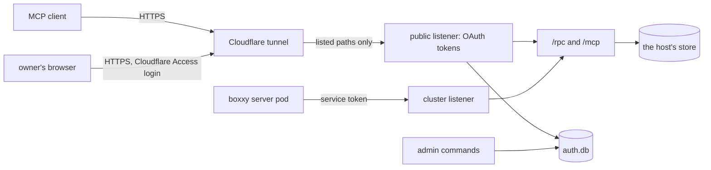

# Auth for the API's public route

- **Status:** draft

The API gets a public route, so the owner's MCP clients, such as Claude Code on the owner's PC,
reach pepys with no port-forward and no tailnet. The API runs two listeners: a public one that takes
only OAuth access tokens from its own authorization server, and a cluster one that takes only
service tokens. Ingest keeps its own check on each route, and OAuth plays no part in it. This doc
builds the part of [Auth](./pepys/auth.md) that the API's read routes need.

This work comes after v1. The decision record [0024: The scope of v1](../decisions/0024-v1-scope.md)
leaves auth out of v1, and bars every source of personal data, such as mail, until auth is built.
This design is that auth, and it is the first work after v1, before the first such source.

Three outside systems appear in this doc:

- **atc** is the owner's agent control tower. Its gateway serves MCP on a public route behind its
  own OAuth server, and this design follows that server.
- **impz** runs the owner's coding agents in small virtual machines, called imps. It also serves MCP
  on a public route behind OAuth.
- **boxxy** dispatches work to coding agents. Its server runs as a pod in the same cluster as pepys,
  sends its facts to an ingest route, and reads its two plug-in queries from the API.

## Shape



better-auth's OAuth provider and MCP plugins run the protocol. pepys adds the owner's passkey
sign-in, the list of clients the owner added, the bearer check and the scope check, as atc does. A
grant is everything that one approved authorization produced: its refresh tokens and the access
tokens each one issued. Revoking a grant ends all of them. This doc states every rule the builder
needs.
[atc's OAuth doc](https://github.com/zgeoff/atc/blob/fa46d50b25a6599d2c246604509282c1a3db951a/docs/architecture/remote/oauth.md)
at that commit gives the reasons behind the rules this design shares with atc.

Two placeholders stand for the public route: `<public_origin>` is the value of
`PEPYS_API_PUBLIC_URL`, such as `https://<public_host>`, and `<public_host>` is its host name.

## Contracts

### The API process

A deployment's API entry passes its arguments to `serveAPI`. With no arguments, `serveAPI` serves
both listeners. With an admin command, it runs that command against `auth.db` and exits. The owner
runs each command with `kubectl exec` in the API's container, where `auth.db` lives. A command reads
only `PEPYS_AUTH_DIR` and `PEPYS_API_PUBLIC_URL`, and runs beside the server, which keeps serving.

```ts
// a deployment's API entry
serveAPI({ deployment, environment: process.env, argv: process.argv.slice(2) });
// argv [] → serves both listeners
// argv ['clients', 'add', 'Claude Code', '--redirect-uri', 'http://localhost:33418/callback']
//   → prints 'client 9f3k2m…' and exits 0
```

```ts
// @pepys/api
interface ServeAPIOptions {
  // …existing fields
  argv?: readonly string[]; // absent or empty: serve
}
```

| Command                                                      | Does                                                      |
| ------------------------------------------------------------ | --------------------------------------------------------- |
| `clients add <name> --redirect-uri <uri> [--redirect-uri …]` | adds a public client and prints its client ID             |
| `clients`                                                    | lists the clients                                         |
| `clients remove <client_id>`                                 | removes a client with every grant and token it holds      |
| `passkeys enroll`                                            | prints a one-time token that the owner types on `/enroll` |
| `passkeys enroll --reset`                                    | removes every passkey, then prints a token                |
| `passkeys`                                                   | lists the passkeys                                        |
| `passkeys remove <passkey_id>`                               | removes one passkey                                       |
| `grants`                                                     | lists the live grants                                     |
| `grants revoke <client_id>`                                  | revokes every grant of one client                         |

### Configuration

`readAPIConfig` reads these five variables beside `PEPYS_STORE_DIR`. `PEPYS_API_HOST` and
`PEPYS_API_PORT` set the cluster listener.

```text
PEPYS_API_PUBLIC_URL     <public_origin>, an https origin with no path;
                         unset: no public listener and no OAuth
PEPYS_API_PUBLIC_HOST    the public listener's bind address; default 127.0.0.1
PEPYS_API_PUBLIC_PORT    the public listener's port; default 8082
PEPYS_AUTH_DIR           the folder that holds auth.db; needed when PEPYS_API_PUBLIC_URL is set
PEPYS_API_SERVICE_TOKENS the service tokens, as JSON below; needed when PEPYS_API_HOST is not loopback
```

```ts
// @pepys/api: the value of PEPYS_API_SERVICE_TOKENS
interface ServiceTokens {
  clients: Record<
    string, // the client's name, such as 'boxxy'; its principal is `service:<name>`
    {
      scopes: readonly 'read'[]; // at least one
      tokens: readonly string[]; // one, or two during a rotation; each 'pepyss_' and 32 or more characters
    }
  >;
}
```

### The public listener

The public listener serves the paths below and answers 404 to every other path. The tunnel forwards
only these paths. It sends the owner's browser through a Cloudflare Access login first, and sends a
client's request straight to the listener.

| Path                                        | Caller            | At the tunnel |
| ------------------------------------------- | ----------------- | ------------- |
| `/oauth2/authorize`                         | the owner browser | Access login  |
| `/login`                                    | the owner browser | Access login  |
| `/enroll`                                   | the owner browser | Access login  |
| `/consent`                                  | the owner browser | Access login  |
| `/error`                                    | the owner browser | Access login  |
| `/mcp`                                      | an MCP client     | straight in   |
| `/rpc/*`                                    | an oRPC client    | straight in   |
| `/oauth2/token`                             | a client          | straight in   |
| `/oauth2/revoke`                            | a client          | straight in   |
| `/.well-known/oauth-authorization-server`   | a client          | straight in   |
| `/.well-known/oauth-protected-resource`     | a client          | straight in   |
| `/.well-known/oauth-protected-resource/mcp` | a client          | straight in   |

```http
POST /mcp HTTP/1.1
Host: <public_host>

HTTP/1.1 401 Unauthorized
WWW-Authenticate: Bearer resource_metadata="<public_origin>/.well-known/oauth-protected-resource/mcp", scope="read"
```

A 401 on `/rpc/*` carries `WWW-Authenticate: Bearer` with no `resource_metadata`, because RFC 9728
has a client refuse metadata whose resource differs from the URL it called.
`GET /.well-known/oauth-protected-resource/mcp` and `GET /.well-known/oauth-protected-resource` both
answer:

```json
{
  "resource": "<public_origin>/mcp",
  "authorization_servers": ["<public_origin>"],
  "scopes_supported": ["read"],
  "bearer_methods_supported": ["header"]
}
```

### The bearer check

One function decides the caller on both listeners. The public listener runs the Host check under
[Requests](#requests) on every request, before it matches a path. A request to `/rpc/*` or `/mcp`
then passes `readCaller` and the scope check before oRPC or MCP sees it. The cluster listener checks
no `Host` and no `Origin`. Every MCP request needs a token, whatever its method, `initialize`
included.

```ts
// @pepys/api
const caller = await readCaller(request, listener);
// → { kind: 'grant', clientID: '9f3k2m…', clientName: 'Claude Code', grantID: 'g_51…', scopes: ['read'] }
//   or { kind: 'service', name: 'boxxy', scopes: ['read'] }
//   or { kind: 'loopback', scopes: ['read'] }
//   or { kind: 'refused', reason: 'malformed' | 'invalid_token' } → HTTP 401 with the challenge

type Listener = 'public' | 'cluster';
```

- On `public`, only an opaque access token that `auth.db` holds, unexpired, unrevoked and bound to
  the resource `<public_origin>/mcp`, gives a `grant` caller. The IDs are better-auth's own.
- On `cluster`, only a `pepyss_` token from the service tokens gives a `service` caller.
- On a `cluster` listener bound to loopback with no service tokens set, every request gives a
  `loopback` caller. Tests and local runs use this case. Loopback means `127.0.0.0/8`, `::1` or
  `localhost`. With service tokens set, a loopback listener needs a token too.
- Every procedure needs the scope `read`, so the API answers a caller without it with HTTP 403 and
  `WWW-Authenticate: Bearer error="insufficient_scope", scope="read"`. A procedure declares its own
  scope once a second scope exists.
- A 401 for `invalid_token` adds `error="invalid_token"` to the challenge. A 401 for `malformed`, a
  header that holds no bearer token, adds no error.
- The cluster listener's 401 carries `WWW-Authenticate: Bearer` with no `resource_metadata`.
- The cluster listener answers `GET /healthz` with 200 and needs no token, for the kubelet's probes.

## Constraints

### Fail closed at start

- When `PEPYS_API_HOST` is not a loopback address and `PEPYS_API_SERVICE_TOKENS` is unset, the API
  exits 1. Only a loopback cluster listener serves with no token.
- When `PEPYS_API_PUBLIC_URL` is set and is not an `https` origin with no path, the API exits 1.
- When `PEPYS_API_PUBLIC_URL` is set and `PEPYS_AUTH_DIR` is unset, the API exits 1.
- When `PEPYS_API_SERVICE_TOKENS` does not parse, a client has no scope, a token is shorter than 32
  characters after its prefix, or one token appears under two clients, the API exits 1. Its message
  holds no token.
- When the public and the cluster listener name the same port number, the API exits 1.
- An admin command runs no deployment check. An unknown command or a bad argument exits 2 with the
  usage.

### What better-auth does not cover

Each rule in this doc holds whatever better-auth does by default. Where the pinned better-auth falls
short of a rule, pepys enforces the rule in its own code, as atc does for its forced sign-in and its
resource default. When an authorization request names no resource, pepys sets `<public_origin>/mcp`
before better-auth sees it. The redirect that carries a code carries `iss` too (RFC 9207), and the
authorization server metadata sets `authorization_response_iss_parameter_supported` to `true`, which
the MCP spec asks for.

### Tokens and grants

- A token works on one listener only. The API answers an OAuth token on the cluster listener with
  401, and a service token on the public listener with 401.
- The authorization server has no dynamic client registration and never fetches a client ID metadata
  document, which a client would host to register itself. When an authorization names a client that
  the owner never added, the owner's browser gets the error page and no redirect.
- Every client is public: no secret, PKCE with S256 required.
- An authorization code lasts 10 minutes and works once. A second exchange revokes what the first
  made.
- An access token is opaque, lasts 1 hour, and is checked against `auth.db` on every request.
- A refresh token lasts 30 days and rotates on each use. A spent refresh token used again revokes
  every grant of its client.
- The API runs the token requests of one client one at a time, behind an in-memory lock keyed by the
  client ID, because better-auth's rotation is not atomic. The lock holds because the API runs as
  one replica.
- The server and an admin command open `auth.db` in WAL mode with a busy timeout. When
  `grants revoke` or `clients remove` races a refresh of the same client, every token of that client
  fails once the command has returned. A test runs the two at once.
- `auth.db` stores a hash of each token, code and enrolment token, never the value.
- The API compares service tokens by their SHA-256 digests in constant time, and keeps only the
  digests in memory.
- The API never writes a token, a code, a cookie or an `Authorization` header to a log line, an
  error or a security event.

### The owner

- The owner is the one user, and a passkey is the one credential that signs the owner in. With no
  passkey enrolled, every sign-in fails.
- The passkey's relying party ID is `<public_host>`.
- Each authorization needs a fresh passkey sign-in for that one request. One sign-in approves one
  authorization.
- An enrolment token lasts 10 minutes and enrols one passkey.
- The consent page lists the scopes the client asked for, with `read` ticked.

### Requests

- The public listener answers only a request whose `Host` is `<public_host>`, and answers 403 to any
  other.
- A form post to `/login`, `/enroll` or `/consent`, and an MCP request with an `Origin` header, must
  come from `<public_origin>`. The API answers any other with 403.
- The sign-in, enrolment, consent and error pages carry the headers below. Only `/login` and
  `/enroll` list a script: the passkey script, by its hash. Only `/consent` adds the client's
  redirect origin to `form-action`. The error page shows a fixed sentence per error code, never text
  from the request.

  ```http
  Content-Security-Policy: default-src 'none'; style-src 'unsafe-inline'; script-src 'sha256-<passkey_script_hash>'; form-action 'self' <redirect_origin>; frame-ancestors 'none'; base-uri 'none'
  X-Frame-Options: DENY
  Cache-Control: no-store
  Referrer-Policy: same-origin
  ```

- The API writes one line to stderr for each security event: `pepys security ` and a JSON object.
  Each kind writes at most 20 lines a minute. Past that, the API counts the dropped events and
  writes one `suppressed` event with the count when the minute ends.

  ```ts
  // @pepys/api: the security event line; the formatter picks each field by name
  interface SecurityEvent {
    version: 1;
    ts: string; // ISO 8601
    kind:
      | 'authorize_started' // outcome accepted | rejected; reason 'rate_limited'
      | 'authorize_invalid' // rejected; better-auth's error code, 'bad_host', 'bad_origin' or 'other'
      | 'owner_auth' // succeeded | failed; 'assertion_failed', 'locked', 'expired', 'not_enrolled', 'invalid_token'
      | 'consent' // allowed | denied; 'none_ticked'
      | 'token_exchange' // rejected; better-auth's error code or 'other'
      | 'bearer' // rejected; 'malformed' or 'invalid_token'
      | 'suppressed'; // reason: the dropped kind, with count
    outcome?: string;
    reason?: string;
    count?: number;
    method?: 'passkey' | 'enrollment_token'; // owner_auth only
    route: string; // a path the API serves, else 'other'; never a query
    client?: { id: string; name: string }; // only for a client auth.db holds
    redirectHost?: string; // only after better-auth validated the redirect URI
    correlationID?: string; // random, joins one authorization's events
    userAgent?: string; // cut to 200 characters, control characters removed
  }
  ```

- better-auth's telemetry stays off whatever the environment says.
- The API generates better-auth's secret at random on each start. A restart ends the sign-ins in
  progress and keeps every grant.

### Ingest

- Ingest's routes keep their own checks: the GitHub webhook signature, the signature on each boxxy
  fact batch, and the telemetry route's bearer token and imp identity token
  ([ingest in v1](./v1.md)). The API's tokens open no ingest route, and an ingest secret opens no
  API route.
- The API reads the store and writes nothing but `auth.db`. The host never opens `auth.db`.

## Deployment changes

The repo that holds the deployment makes these changes in its Pulumi program and manifests. The
boxxy server sends its token, and the API's Secret holds it, before the deployment moves to the
release that requires tokens: that release exits 1 on a cluster listener bound beyond loopback with
no tokens.

1. Route `<public_host>` through the shared Cloudflare tunnel. Add one rule for the browser paths,
   behind a Cloudflare Access application that admits only the owner, and one for the client paths.
   Every other path gets the tunnel's 404. cloudflared passes the request's `Host` through
   unchanged. The public-route registry entry names the pepys API's OAuth server as the route's auth
   layer.
2. Set `PEPYS_API_PUBLIC_URL`, bind both listeners on `0.0.0.0`, and mount a volume that outlives
   its claim at `PEPYS_AUTH_DIR` in the API's container. The host's container never mounts it.
3. Add NetworkPolicy rules: the shared tunnel's cloudflared reaches the public port alone, and the
   boxxy server reaches the cluster port alone.
4. Add a 1Password item for the boxxy server's API token. The API's Secret builds
   `PEPYS_API_SERVICE_TOKENS` from it, and the boxxy server sends it as a bearer token.
5. Run `passkeys enroll`, then add each client with its redirect URI. Claude Code takes the client
   ID with `--client-id` and a fixed `--callback-port`, and sends the redirect URI
   `http://localhost:<port>/callback`.

## Decisions

- **The API checks a token on every query beyond loopback.** This changes the network that
  [Auth](./pepys/auth.md#network) describes: the API serves a public route, the passkey's relying
  party is `<public_host>`, a token is bound to `<public_origin>/mcp`, and `passkeys enroll` prints
  a token.
- **The API runs its own authorization server.** pepys serves one owner, and an outside identity
  provider adds a second system to trust and to keep up.
- **The owner adds each client by hand.** The MCP authorization spec of 2026-07-28 allows
  pre-registration. Client ID metadata documents and dynamic registration would let any client start
  a sign-in.
- **Each credential works on one listener.** A leaked service token is useless outside the cluster.
  On the public route, the MCP spec lets an MCP server accept only tokens that its authorization
  server issued.
- **The cluster listener checks a token.** A NetworkPolicy never stops a process on the cluster's
  node, so a policy alone leaves the API open to every process there. Once mail joins the store,
  only a caller with a token reads it.
- **Service tokens come from an environment variable.** Ingest reads its secrets the same way, and a
  variable needs no file-mode check at start.
- **One resource, `<public_origin>/mcp`, serves `/mcp` and `/rpc`.** An MCP client takes the
  resource from the metadata at its MCP URL, and one grant then serves both routes. The owner adds a
  script that reads oRPC as a client with a loopback redirect URI, and the script signs in as an MCP
  client does.
- **Cloudflare Access and the passkey both guard sign-in.** Access adds a login in front of the
  sign-in pages, and only the owner's passkey approves a grant, so neither one alone lets a stranger
  in.
- **The API has one scope, `read`.** The API has no write, and `write` arrives with the first write
  route, as [Scopes](./pepys/auth.md#scopes) sets out.

## Builder decides

- The names of internal functions and files.
- How the public routes mount on Elysia beside better-auth's handler.
- The wording of every page and error.
- Whether the bearer check reuses better-auth's MCP helper or reads the token table directly.
- The better-auth version, within the
  [dependency rule](../../.claude/skills/ci-design/SKILL.md#dependency-exceptions). `@pepys/api` is
  public, so better-auth ships as its dependency and type-checks with the kit's compiler options.
- The SQLite driver and Kysely dialect that open `auth.db`.
- How tests drive a passkey sign-in, such as a scripted authenticator, and which test lane runs the
  full flow from the 401 to a query.

## Out of scope

- Writes, the `write` scope and manual facts: [Auth](./pepys/auth.md#manual-writes) covers them for
  the first write route.
- The change feed's stream checks: the change feed is not built yet.
- Enrichment's internal port: enrichment is not built yet.
- A token for agent sessions in imps. The API serves no agent session.

## Open questions

The owner settles each one. Until then, the code follows the recommendation.

- **Passkey or approval code?** atc signs the owner in with a passkey. impz shows a code, and the
  owner approves it with one of impz's own API tokens. Recommendation: the passkey, because pepys
  has no API tokens of its own for the owner, and a passkey works from each of the owner's devices.
- **Shared tunnel or a TLS front on the server?** The tunnel with Access on the browser paths
  matches atc's gateway. impz uses a TLS front on the server instead, because that front holds a
  long event stream open. Recommendation: the shared tunnel, because the MCP route answers each post
  with JSON and opens no stream. The change feed's design settles it again. atc's gateway has a
  tunnel of its own, in a sidecar, so that it can trust the client address that the tunnel forwards.
  pepys's API shares its pod with the host, so on the shared tunnel its security events record that
  address as unverified, and every limit counts per client and grant.
- **`/rpc` on the public route?** atc and impz each expose only `/mcp`. Recommendation: expose
  `/rpc` behind the same check, because a dashboard or a script on the owner's PC reads oRPC.
- **A backup of `auth.db`?** atc backs its auth database up nightly. Recommendation: no backup,
  because a lost `auth.db` costs one passkey enrolment and one sign-in per client.
- **Port atc's server or share a package?** atc and impz each hold a copy. Recommendation: port
  atc's code into `@pepys/api` now, and move the three copies to one package as separate work.
- **Agent sessions in imps?** A session would reach the API through impz's credential broker, which
  adds a service token to each request. Recommendation: give no session a token until scopes split
  by plug-in, so a session that reads GitHub data never reads mail.
