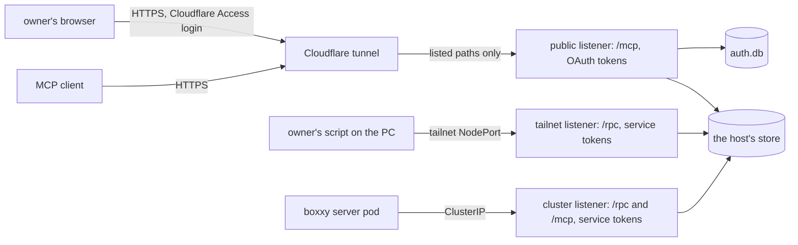

# Auth for the API

- **Status:** draft

The API runs three listeners, and each one takes one kind of credential:

- The public listener serves `/mcp` and the sign-in pages through a Cloudflare tunnel, so the
  owner's MCP clients, such as Claude Code on the owner's PC, reach pepys from anywhere. It takes
  only OAuth access tokens from the API's own authorization server.
- The tailnet listener serves `/rpc` to a script on the owner's PC over the owner's Tailscale
  tailnet. It takes only service tokens: long random strings that the API checks against a file of
  their digests.
- The cluster listener serves `/rpc` and `/mcp` to other pods in the k3s cluster that runs pepys,
  such as the boxxy server. It takes only service tokens.

The API shares a pod with the host, pepys's process that writes the store, and only reads the store.
This design builds the part of [Auth](../pepys/auth.md) that the API's read routes need. Ingest, the
process that takes in facts from sources ([ingest](../pepys/ingest.md)), keeps its own check on each
of its routes.

This work comes after v1. The decision record
[0024: The scope of v1](../../decisions/0024-v1-scope.md) leaves auth out of v1, and bars every
source of personal data, such as mail, until auth is built. This design is that auth, and it is the
first work after v1, before the first such source.

| Doc                            | Covers                                                                                 |
| ------------------------------ | -------------------------------------------------------------------------------------- |
| this README                    | the listeners, the bearer check, service tokens, security events and the deployment    |
| [The OAuth server](./oauth.md) | the public listener's paths, the admin commands, grants, the owner's passkey and pages |

## Shape



These outside systems appear in this design:

- **atc** is the owner's agent control tower. Its gateway serves MCP on a public route behind its
  own OAuth server, and pepys copies that server's code.
- **better-auth** is the TypeScript library that both OAuth servers run on.
- **impz** runs the owner's coding agents in small virtual machines, called imps. Its credential
  broker adds a stored token to each request a session sends to an outside service.
- **boxxy** dispatches work to coding agents. Its server runs as a pod in the same cluster as pepys,
  sends its facts to an ingest route, and reads its two plug-in queries from the API.

Two placeholders stand for the public route: `<public_origin>` is the value of
`PEPYS_API_PUBLIC_URL`, such as `https://<public_host>`, and `<public_host>` is its host name.

## Contracts

### Configuration

`readAPIConfig` in `@pepys/api` reads these variables beside `PEPYS_STORE_DIR`. The cluster listener
always runs. `PEPYS_API_HOST` sets its bind address, default 127.0.0.1, and `PEPYS_API_PORT` its
port, default 8081.

```text
PEPYS_API_CALLERS_FILE     the service callers file, as JSON below; always needed
PEPYS_API_TAILNET_SOURCES  the client addresses the tailnet listener admits, as CIDRs split by
                           commas; unset: no tailnet listener
PEPYS_API_TAILNET_HOST     the tailnet listener's bind address; needed when
                           PEPYS_API_TAILNET_SOURCES is set
PEPYS_API_TAILNET_PORT     the tailnet listener's port; default 8083
PEPYS_API_PUBLIC_URL       <public_origin>, an https origin with no path;
                           unset: no public listener and no OAuth
PEPYS_API_PUBLIC_HOST      the public listener's bind address; default 127.0.0.1
PEPYS_API_PUBLIC_PORT      the public listener's port; default 8082
PEPYS_AUTH_DIR             the folder that holds auth.db; needed when PEPYS_API_PUBLIC_URL is set
```

```ts
// @pepys/api: the callers file at PEPYS_API_CALLERS_FILE, as JSON. It holds digests, never a token.
// A key the schema does not name fails the file.
interface CallersFile {
  version: 1;
  callers: Record<
    string, // matches /^[a-z][a-z0-9-]{0,31}$/, such as 'owner'; its principal is `service:<name>`
    {
      listeners: readonly ('tailnet' | 'cluster')[]; // where its tokens work; at least one, none twice
      scopes: readonly 'read'[]; // at least one
      credentials: readonly {
        id: string; // not empty, unique within its caller, such as 'pc' or '2026-11'
        sha256: string; // the token's SHA-256 digest, as 64 lowercase hex characters
      }[]; // two during a rotation; empty when the caller is revoked
    }
  >; // may be empty: then no service token works
}
```

The owner makes each service token as `pepyss_` and 32 or more random characters from `A-Z`, `a-z`,
`0-9`, `-` and `_`. The caller holds the token, and the callers file holds its digest. The API
checks no token's shape, only its digest.

### The listeners

Every listener answers 404 to a path it does not serve.

| Listener | Serves                                                         | Takes                                            | Reached through                              |
| -------- | -------------------------------------------------------------- | ------------------------------------------------ | -------------------------------------------- |
| public   | `/mcp` and [the OAuth server's paths](./oauth.md#public-paths) | an OAuth access token                            | the tunnel, then a ClusterIP Service         |
| tailnet  | `/rpc/*`                                                       | a service token of a caller that lists `tailnet` | a NodePort on the k3s node's tailnet address |
| cluster  | `/rpc/*`, `/mcp`, and `GET /healthz` for the kubelet's probes  | a service token of a caller that lists `cluster` | a ClusterIP Service                          |

`GET /healthz` answers 200 while the process serves, and reads nothing. The kubelet uses it for the
liveness and the readiness probe.

### The bearer check

One function decides the caller on every listener. It runs on `/mcp` and `/rpc/*`, before MCP or
oRPC sees the request. The sign-in pages, the OAuth endpoints, the metadata and `/healthz` take no
bearer token. Every MCP request needs a token, whatever its method, `initialize` included.

```ts
// @pepys/api
const caller = await readCaller(request, { listener, clientAddress: server.requestIP(request) });
// → { kind: 'grant', clientID: '9f3k2m…', clientName: 'Claude Code', grantID: 'g_51…', scopes: ['read'] }
//   or { kind: 'service', name: 'owner', credentialID: 'pc', scopes: ['read'] }
//   or { kind: 'refused', status: 401, reason: 'malformed' | 'invalid_token' } → with the challenge
//   or { kind: 'refused', status: 403, reason: 'source_not_allowed' }

type Listener = 'public' | 'tailnet' | 'cluster';
```

- On `public`, only an opaque access token that `auth.db` holds, unexpired, unrevoked and bound to
  the resource `<public_origin>/mcp`, gives a `grant` caller. The IDs are better-auth's own.
- On `tailnet` and `cluster`, only a service token whose digest the callers file holds gives a
  `service` caller, and only when its caller lists that listener.
- The API answers 401 `invalid_token` to each other bearer token: an unknown one, one whose caller
  lists another listener, an OAuth token on the tailnet or the cluster listener, and a service token
  on the public listener.
- The tailnet listener reads the client address of the connection. When the address sits outside
  `PEPYS_API_TAILNET_SOURCES`, the API answers 403 before it reads the token.
- The cluster listener answers 403 to a client address in Tailscale's ranges, `100.64.0.0/10` and
  `fd7a:115c:a1e0::/48`.
- A NodePort pointed at the cluster port by mistake then fails closed when its
  `externalTrafficPolicy` is `Local`, which keeps the client's tailnet address. With the default
  `Cluster`, kube-proxy swaps in a node address, so the check in step 6 of
  [deployment changes](#deployment-changes) catches that NodePort instead.
- Every listener needs a credential on every query, whatever address it binds, loopback included.
  Tests and local runs write a callers file and send a token, so every API client sends a
  credential.
- Every procedure needs the scope `read`, so the API answers a caller without it with HTTP 403 and
  `WWW-Authenticate: Bearer error="insufficient_scope", scope="read"`. A procedure declares its own
  scope once a second scope exists.
- A 401 for `invalid_token` adds `error="invalid_token"` to the challenge. A 401 for `malformed`, a
  header that holds no bearer token, adds no error.
- A 401 on the tailnet or the cluster listener carries `WWW-Authenticate: Bearer` with no
  `resource_metadata`. The public listener's 401 is in [the OAuth server](./oauth.md#public-paths).

### Security events

The API writes one line to stderr for each security event: `pepys security ` and a JSON object. The
API writes at most 20 lines of each kind a minute. Past that, it counts the dropped events and
writes one `suppressed` event with the count at the end of the minute.

```ts
// @pepys/api: the security event line; the formatter picks each field by name
interface SecurityEvent {
  version: 1;
  ts: string; // ISO 8601
  kind:
    | 'authorize_started' // outcome accepted | rejected; reason 'rate_limited'
    | 'authorize_invalid' // rejected; better-auth's error code, 'bad_host', 'bad_origin' or 'other'
    | 'owner_auth' // succeeded | failed; 'assertion_failed', 'locked', 'expired', 'not_enrolled', 'invalid_token'
    | 'consent' // allowed | denied; 'none_ticked'
    | 'token_exchange' // rejected; better-auth's error code or 'other'
    | 'bearer' // rejected; 'malformed', 'invalid_token' or 'source_not_allowed'
    | 'callers_reload' // accepted | rejected; the failed rule
    | 'suppressed'; // reason: the dropped kind, with count
  listener?: Listener; // absent on callers_reload and suppressed
  outcome?: string;
  reason?: string;
  count?: number;
  method?: 'passkey' | 'enrollment_token'; // owner_auth only
  route?: string; // a path the API serves, else 'other'; never a query; absent with no request
  client?: { id: string; name: string }; // only for a client auth.db holds
  service?: { name: string; credentialID: string }; // only for a service caller
  redirectHost?: string; // only after better-auth validated the redirect URI
  correlationID?: string; // random, joins one authorization's events
  userAgent?: string; // cut to 200 characters, control characters removed
}
```

## Constraints

### Fail closed at start

- When `PEPYS_API_CALLERS_FILE` is unset, or its file is missing or breaks a callers file rule, the
  API exits 1, whatever `PEPYS_API_HOST` binds. The API names the variable, the caller or the rule
  in its message, and never a digest.
- The callers file rules are the rules in the comments of `CallersFile`, and that no digest appears
  twice. A file with no caller, and a caller with no credential, pass: they admit no service token.
- When `PEPYS_API_TAILNET_SOURCES` does not parse, holds a loopback address, or holds a range wider
  than `/10` for IPv4 or `/48` for IPv6, the API exits 1.
- When `PEPYS_API_PUBLIC_URL` is set and is not an `https` origin with no path, the API exits 1.
- When `PEPYS_API_PUBLIC_URL` is set and `PEPYS_AUTH_DIR` is unset, the API exits 1.
- When `PEPYS_API_TAILNET_SOURCES` is set and `PEPYS_API_TAILNET_HOST` is unset, the API exits 1.
- When two listeners that run name the same port number, the API exits 1.

### Service tokens

- The API finds a service token by the SHA-256 digest of what the caller sent, and keeps only
  digests in memory.
- The API reads the callers file again when its folder changes, and every 30 seconds. Reloads run
  one at a time, in order, so an older read never replaces a newer one.
- When a reloaded file breaks a callers file rule, the API keeps the last good set and writes a
  `callers_reload` security event with outcome `rejected`. A reload that changes the set writes one
  with outcome `accepted`, and a reload that changes nothing writes none. A request that starts
  after a reload finishes sees the new set.
- To revoke a credential, the owner removes its entry, which leaves a valid file even when it was
  the last one. The kubelet writes the changed Secret into the pod within its sync period and cache
  delay, about a minute by default. The credential stops working at most 30 seconds after that. The
  other callers keep working, and no process restarts.
- The API never writes a service token or an `Authorization` header to a log line, an error or a
  security event.

### Ingest and the store

- Ingest's routes keep their own checks: the GitHub webhook signature, the signature on each boxxy
  fact batch, and the telemetry route's bearer token and imp identity token
  ([ingest in v1](../v1.md)). The API's tokens open no ingest route, and an ingest secret opens no
  API route.
- The API reads the store and writes nothing but `auth.db`. The host never opens `auth.db`.

## Deployment changes

The owner's cloud repo holds the deployment's Pulumi program and manifests. Whoever changes the
deployment makes these changes there. The repo's exposure registry lists every public route and port
of the owner's servers, and other projects share it, so the owner's coordinator agent makes its
entries.

Do step 8 before the deployment moves to the release that requires tokens. That release exits 1 with
no callers file.

1. Route `<public_host>` through the shared Cloudflare tunnel to the public listener's ClusterIP
   Service, with the paths [the OAuth server's paths](./oauth.md#public-paths) list. Expect:
   `/rpc/*` and every other path get the tunnel's 404.
2. In the API's container of the host's StatefulSet pod, set `PEPYS_API_PUBLIC_URL`. Set
   `PEPYS_API_TAILNET_SOURCES` to the PC's tailnet address. Bind the three listeners on `0.0.0.0`.
3. Mount a PersistentVolume with the `Retain` reclaim policy at `PEPYS_AUTH_DIR` in the API's
   container only.
4. Mount the callers file's Secret as a folder, never with `subPath`. The kubelet never updates a
   `subPath` mount.
5. Give the tailnet listener a NodePort Service with `externalTrafficPolicy: Local`, whose one port
   targets the tailnet listener's port. `Local` keeps the PC's address, which the tailnet listener
   checks. Give the public and the cluster listener a ClusterIP Service each.
6. Add a check to the cloud repo that fails when the tailnet NodePort targets another port or takes
   another traffic policy, and when any NodePort targets the public or the cluster port.
7. Add NetworkPolicy rules. cloudflared reaches the public port alone. The boxxy server reaches the
   cluster port alone. The PC's tailnet address reaches the tailnet port alone.
8. Add one 1Password item per service credential: the owner's PC token and the boxxy server's token.
   Build the callers file in the API's Secret from their digests. Put the boxxy token in the boxxy
   server's Secret. The owner's script reads its item with `op read`.
9. Ask the coordinator agent to add two exposure registry entries. The first is a `tailnet`-scope
   entry for the NodePort, with the API's service token as its auth layer, like the registry's entry
   for Grafana's NodePort. The second is a public entry for `<public_host>`, with the API's OAuth
   server as its auth layer.
10. Run the admin command `passkeys enroll` in the API's container, then add each client, as
    [the OAuth server](./oauth.md#adding-a-client) says. Expect: an MCP client gets a 401, signs the
    owner in, and reads a query.

## Decisions

- **The API checks a credential on every query, on every listener.** A NetworkPolicy never stops a
  process that runs on the cluster's node, and such a process reaches every listener. Only a
  credential then keeps the owner's mail from that process.
- **`/rpc` stays off the public route.** atc and impz each expose only `/mcp`. The owner's script
  runs on the PC, which is on the tailnet, so the internet reaches only MCP and sign-in, and the
  script needs no browser sign-in.
- **Each listener takes one kind of credential, and each service caller lists its listeners.** A
  leaked boxxy token opens nothing from the tailnet, a leaked owner token opens nothing from a pod,
  and neither works on the public route. The tailnet listener checks the client address too, so the
  PC's token works from the PC alone.
- **The tailnet route is plain HTTP.** WireGuard encrypts the tailnet and proves each peer, so TLS
  adds a certificate to keep and no protection. Grafana's NodePort on the same server runs the same
  way.
- **Service tokens come from a callers file that the API reloads.** The API shares its pod with the
  host, so a revocation by rollout would stop the host. The file holds only digests, so a read of
  the API's Secret opens nothing.
- **The API has one scope, `read`.** The API has no write, and `write` arrives with the first write
  route, as [Scopes](../pepys/auth.md#scopes) sets out.
- **No agent session in an imp gets a token until scopes split by plug-in.** A session would reach
  the API through impz's credential broker. Until a scope can name one plug-in, a session that reads
  GitHub data would read mail too.

## Builder decides

- The names of internal functions and files.
- How the listeners mount on Elysia.
- How the API watches the callers file's folder.
- The body and wording of every error.- How tests give the tailnet listener a client address, and
  whether `@pepys/testing` ships a helper that writes a test callers file.

## Out of scope

- Writes, the `write` scope and manual facts: [Auth](../pepys/auth.md#manual-writes) covers them for
  the first write route.
- The change feed's stream checks: the change feed is not built yet.
- Enrichment's internal port: enrichment is not built yet.
- Scopes split by plug-in.
