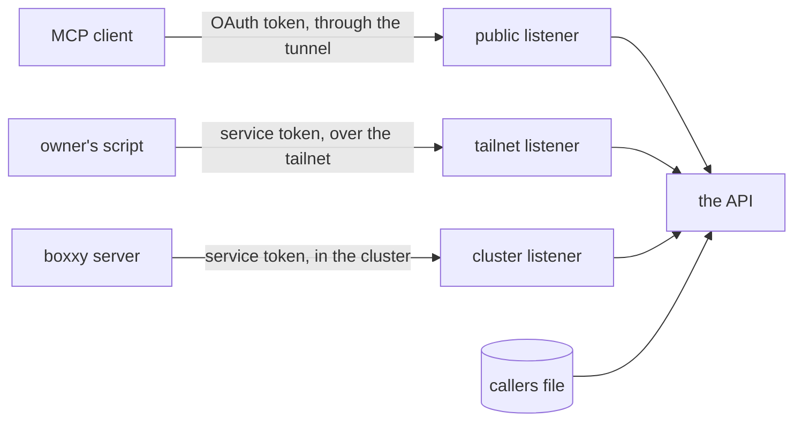

# Auth for the API

- **Status:** agreed
- **Decision records:** [0026](../../decisions/0026-credentials-bound-to-listeners.md),
  [0027](../../decisions/0027-rpc-stays-off-the-public-route.md)

The API serves MCP at `/mcp` behind its own OAuth server, which
[the OAuth server](../../architecture/queries/oauth-server.md) describes, and serves typed oRPC
queries under `/rpc` with no credential. This design adds service tokens to `/rpc`, so a script on
the owner's PC and a pod in the cluster each read it with a credential of its own, and splits the
API into three listeners that each take one kind of credential.
[Serving MCP](../../runbooks/serving-mcp.md) gives the settings of the public route that the API
serves now.

## Shape



These outside systems appear in this design:

- **atc** is the owner's agent control tower. Its gateway serves MCP on a public route behind its
  own OAuth server. `@pepys/api` holds a copy of that server's code, so the owner carries each fix
  in atc over to pepys by hand.
- **cloudflared** is the tunnel's connector, a pod in the cluster that passes each request from the
  tunnel to the API.
- **impz** runs the owner's coding agents in small virtual machines, called imps. Its credential
  broker adds a stored token to each request a session sends to an outside service.
- **boxxy** dispatches work to coding agents. Its server runs as a pod in the same k3s cluster as
  pepys. It sends its facts to an ingest route, and reads the boxxy plug-in's queries from `/rpc`.
- **The tailnet** is the owner's Tailscale network. The owner's PC and the k3s node are on it.
- **The cloud repo** is the owner's repo that holds the cluster's Pulumi program and manifests.

Two placeholders stand for the public route: `<public_origin>` is the value of
`PEPYS_API_PUBLIC_URL`, such as `https://<public_host>`, and `<public_host>` is its host name.

## Decisions

- **An agent session in an imp gets no token until a scope can name one plug-in.** A session reaches
  the API through impz's credential broker. With the one `read` scope, a token that reads GitHub
  data reads mail too.

## Service tokens and listeners

[0026](../../decisions/0026-credentials-bound-to-listeners.md) records the decisions of this
section.

### The three listeners

Each listener takes one kind of credential, on every query, whatever address it binds, loopback
included. A NetworkPolicy never stops a process on the cluster's node, which reaches every listener,
so only a credential keeps the owner's mail from that process.

| Listener | Serves                                                                                | Takes                                            | Reached through                              |
| -------- | ------------------------------------------------------------------------------------- | ------------------------------------------------ | -------------------------------------------- |
| public   | `/mcp` and [the public paths](../../runbooks/serving-mcp.md#1-route-the-public-paths) | an OAuth access token                            | the tunnel, then a ClusterIP Service         |
| tailnet  | `/rpc/*`                                                                              | a service token of a caller that lists `tailnet` | a NodePort on the k3s node's tailnet address |
| cluster  | `/rpc/*`, `/mcp`, and `GET /healthz` for the kubelet's probes                         | a service token of a caller that lists `cluster` | a ClusterIP Service                          |

- Every listener answers 404 to a path it doesn't serve. `GET /healthz` answers 200 while the
  process serves, and reads nothing.
- The tailnet and cluster listeners check no `Host` and no `Origin`.
- The tailnet listener serves the script on the owner's PC. It answers 403, before it reads the
  token, to a client address outside `PEPYS_API_TAILNET_SOURCES`.
- The cluster listener serves pods such as the boxxy server. It answers 403 to a client address in
  Tailscale's ranges, `100.64.0.0/10` and `fd7a:115c:a1e0::/48`.
- That 403 guards against a NodePort that points at the cluster port by mistake. A NodePort with
  `externalTrafficPolicy: Local` keeps the client's tailnet address, so the cluster listener refuses
  the request. With the default `Cluster`, kube-proxy puts a node address in place of the client's
  address, and the 403 never fires. Step 5 of [Deploying the listeners](#deploying-the-listeners)
  adds a check that catches that NodePort.
- The API answers 401 `invalid_token` to a service token on the public listener, an OAuth token on
  the tailnet or cluster listener, and a service token whose caller lists another listener. A 401 on
  the tailnet or cluster listener carries `WWW-Authenticate: Bearer` with no `resource_metadata`.
- Security events gain a `listener` field, the kind `callers_reload`, the bearer reason
  `source_not_allowed`, and a `service` field with the caller's name and credential ID.

The listeners add these variables. `PEPYS_API_HOST` and `PEPYS_API_PORT` then bind the cluster
listener.

| Variable                    | Holds                                                                             | Default     | Needed                                  |
| --------------------------- | --------------------------------------------------------------------------------- | ----------- | --------------------------------------- |
| `PEPYS_API_CALLERS_FILE`    | the path of the callers file, in the form [Service tokens](#service-tokens) gives | none        | always                                  |
| `PEPYS_API_TAILNET_SOURCES` | the client addresses the tailnet listener admits, as CIDRs split by commas        | unset       | to run the tailnet listener             |
| `PEPYS_API_TAILNET_HOST`    | the address the tailnet listener binds                                            | none        | when `PEPYS_API_TAILNET_SOURCES` is set |
| `PEPYS_API_TAILNET_PORT`    | the port the tailnet listener binds                                               | `8083`      | no                                      |
| `PEPYS_API_PUBLIC_HOST`     | the address the public listener binds                                             | `127.0.0.1` | no                                      |
| `PEPYS_API_PUBLIC_PORT`     | the port the public listener binds                                                | `8082`      | no                                      |

### Service tokens

A service token is a long random string that a script or a pod sends as its bearer token. The owner
makes each one as `pepyss_` and 32 or more random characters from `A-Z`, `a-z`, `0-9`, `-` and `_`.
The caller holds the token, and the callers file holds its SHA-256 digest. The API checks no token's
shape, only its digest.

```ts
// @pepys/api: the callers file at PEPYS_API_CALLERS_FILE, as JSON. It holds digests, never a token.
// A key the schema does not name fails the file.
interface CallersFile {
  version: 1;
  callers: Record<
    string, // the caller's name; matches /^[a-z][a-z0-9-]{0,31}$/, such as 'owner'
    {
      listeners: readonly ('tailnet' | 'cluster')[]; // where its tokens work; at least one, none twice
      scopes: readonly 'read'[]; // at least one
      credentials: readonly {
        id: string; // not empty, unique within its caller, such as 'pc' or '2026-11'
        sha256: string; // the token's SHA-256 digest, as 64 lowercase hex characters
      }[]; // empty when the caller is revoked
    }
  >; // may be empty: then no service token works
}
```

- To rotate a token, add the new credential beside the old one, move the caller to the new token,
  then remove the old credential.
- The API exits 1 at start when `PEPYS_API_CALLERS_FILE` is unset, or its file is missing or breaks
  a rule in the comments of `CallersFile`, or a digest appears twice. The API names the variable,
  the caller or the rule in its error, and never a digest. A file with no caller, and a caller with
  no credential, pass: they admit no service token.
- The API exits 1 when `PEPYS_API_TAILNET_SOURCES` doesn't parse, holds a loopback address, or holds
  a range wider than `/10` for IPv4 or `/48` for IPv6. It exits 1 when `PEPYS_API_TAILNET_SOURCES`
  is set and `PEPYS_API_TAILNET_HOST` is unset, and when two listeners name the same port.
- The API finds a service token by the digest of what the caller sent, and keeps only digests in
  memory.
- The API reads the callers file again when its folder changes, and every 30 seconds. Reloads run
  one at a time, in order, so an older read never replaces a newer one.
- When a reloaded file breaks a rule, the API keeps the last good set and writes a `callers_reload`
  event with outcome `rejected`. A reload that changes the set writes one with outcome `accepted`,
  and a reload that changes nothing writes none. A request that starts after a reload finishes sees
  the new set.
- To revoke a credential, the owner removes its 1Password item and applies the cloud repo's Pulumi
  program, which removes the entry from the callers file. The kubelet writes the changed Secret into
  the pod within its sync period and cache delay, about a minute by default. The credential stops
  working at most 30 seconds after that, and no process restarts.
- The API keeps every service token and `Authorization` header out of its log lines, errors and
  security events.

### Deploying the listeners

Before you build the listeners, run two checks on this k3s cluster. Each one tests a fact this
design relies on:

1. Send a request from the PC to a NodePort Service with `externalTrafficPolicy: Local`. Expect: the
   pod sees the PC's tailnet address as the client address. If the pod sees another address, the
   tailnet listener relies on the token alone, and the tailnet rules here change to say so.
2. Change the data of a Secret through the cloud repo's Pulumi program, and keep its name fixed.
   Expect: the kubelet writes the change into a pod's folder mount, and the pod keeps running. If
   the mount never changes or the pod restarts, a revocation restarts the pod and the host, and
   [Service tokens](#service-tokens) changes to say so.

Then deploy the listeners with the steps below. A build of the API that reads
`PEPYS_API_CALLERS_FILE` exits 1 at start without a callers file. Do step 3 before you deploy that
build.

1. Set `PEPYS_API_TAILNET_SOURCES` to the PC's tailnet address. Bind the three listeners on
   `0.0.0.0`.
2. Mount the callers file's Secret as a folder. Never use a `subPath` mount: the kubelet never
   updates it. Give the Secret a fixed name in the Pulumi program. A change to its data then
   replaces the Secret under the same name, and leaves the pod's spec as it is. A change to the
   pod's spec rolls the pod and stops the host.
3. Add one 1Password item per service credential: the owner's PC token and the boxxy server's token.
   Build the callers file in the API's Secret from their digests. Put the boxxy token in the boxxy
   server's Secret. Let the owner's script read its item with `op read`. Expect: the API starts and
   logs no `callers_reload` rejection.
4. Give the tailnet listener a NodePort Service with `externalTrafficPolicy: Local`. Point its one
   port at the tailnet listener's port. Give the public listener and the cluster listener a
   ClusterIP Service each. Expect: a request from the PC with its token reads `/rpc`.
5. Add a check to the cloud repo that fails on a wrong NodePort. It fails when the tailnet NodePort
   targets another port or takes another traffic policy. It also fails when any NodePort targets the
   public or the cluster port.
6. Add NetworkPolicy rules. Let cloudflared reach the public port alone. Let the boxxy server reach
   the cluster port alone. Let the PC's tailnet address reach the tailnet port alone.
7. Add an exposure registry entry for the NodePort, reachable only from the tailnet. Name the API's
   service tokens as its guard.

### Decisions for the listeners

- **Each listener takes one kind of credential, and each service caller lists its listeners.** A
  leaked boxxy token opens nothing from the tailnet, a leaked owner token opens nothing from a pod,
  and neither works on the public route. The tailnet listener checks the client address too, so the
  PC's token works from the PC alone.
- **Pods get a listener of their own.** The boxxy server can't sign in with a passkey and doesn't
  come from the PC's tailnet address, so it can't use the public or the tailnet listener. The
  cluster listener also serves `/mcp`, so a pod reaches MCP with a service token.
- **The tailnet route is plain HTTP.** WireGuard encrypts the tailnet and authenticates each peer,
  so TLS adds a certificate to keep and no protection.
- **Service tokens come from a callers file that the API reloads.** The API shares its pod with the
  host, so a revocation by rollout would stop the host. The file holds only digests, so a read of
  the API's Secret opens nothing.

## Deployment of the public route

Make these changes in the cloud repo.

1. Route `<public_host>` through the shared Cloudflare tunnel to the API's ClusterIP Service, with
   the paths that [the public paths](../../runbooks/serving-mcp.md#1-route-the-public-paths) list.
   Put the browser paths behind a Cloudflare Access application that admits only the owner. Keep the
   request's `Host` unchanged in cloudflared. Expect: `/rpc/*` and every other path get the
   tunnel's 404.
2. Set `PEPYS_API_PUBLIC_URL` in the API's container of the StatefulSet pod. Set `PEPYS_API_HOST` to
   `0.0.0.0`. Expect: the API logs
   `api listening on http://0.0.0.0:<port>, serving /mcp at <public_origin>/mcp`.
3. Mount a PersistentVolume with the `Retain` reclaim policy at `PEPYS_AUTH_DIR`, in the API's
   container only.
4. Add a NetworkPolicy rule that lets cloudflared reach the API's port.
5. Add a public entry for `<public_host>` to the cloud repo's exposure registry. The registry lists
   every public route and port of the owner's servers. Name the API's OAuth server as the route's
   guard.
6. Add each client, as [Add a client](../../runbooks/serving-mcp.md#3-add-a-client) says. Its steps
   1 to 3 enroll the owner's passkey. Expect: an MCP client gets a 401, signs the owner in, and
   reads a query.

## Out of scope

- Writes, the `write` scope and manual facts: [Auth](../pepys/auth.md#manual-writes) covers them for
  the first write route.
- The checks on the streams of the [change feed](../pepys/change-feed.md), which tells clients which
  rows changed.
- The internal port of [enrichment](../pepys/enrichment.md), the part of pepys that calls git, model
  APIs and other outside systems.
- Scopes split by plug-in.
