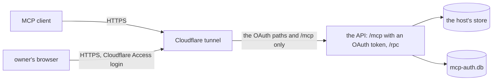

# Auth for the API

- **Status:** agreed
- **Decision records:** [0026](../../decisions/0026-credentials-bound-to-listeners.md),
  [0027](../../decisions/0027-rpc-stays-off-the-public-route.md)

The API serves MCP at `/mcp` to the owner's MCP clients, such as Claude Code on the owner's PC, from
anywhere, through a Cloudflare tunnel. Every MCP request needs an OAuth access token from the API's
own authorization server, which [The OAuth server](./oauth.md) describes. The API also serves typed
oRPC queries under `/rpc` to scripts. The tunnel never forwards `/rpc`, and `/rpc` takes no
credential yet: [Later work](#later-work-service-tokens-and-more-listeners) adds service tokens and
the listeners that take them.

The API shares a pod with the host, pepys's process that writes the store, and only reads the store.
This design builds the part of [Auth](../pepys/auth.md) that the API's read routes need. Ingest, the
process that takes in facts from sources ([ingest](../pepys/ingest.md)), keeps its own check on each
of its routes. The decision record [0024: The scope of v1](../../decisions/0024-v1-scope.md) bars
every source of personal data, such as mail, until this auth is built.

| Doc                            | Covers                                                                          |
| ------------------------------ | ------------------------------------------------------------------------------- |
| this README                    | the configuration, the bearer check, security events and the deployment         |
| [The OAuth server](./oauth.md) | the public paths, the admin commands, grants, the owner's passkey and the pages |

## Shape



These outside systems appear in this design:

- **atc** is the owner's agent control tower. Its gateway serves MCP on a public route behind its
  own OAuth server, and pepys copies that server's code.
- **better-auth** is the TypeScript library that both OAuth servers run on.
- **cloudflared** is the tunnel's connector, a pod in the cluster that passes each request from the
  tunnel to the API.
- **impz** runs the owner's coding agents in small virtual machines, called imps. Its credential
  broker adds a stored token to each request a session sends to an outside service.
- **boxxy** dispatches work to coding agents. Its server runs as a pod in the same k3s cluster as
  pepys, sends its facts to an ingest route, and reads its two plug-in queries from the API.
- **The cloud repo** is the owner's repo that holds the cluster's Pulumi program and manifests.

Two placeholders stand for the public route: `<public_origin>` is the value of
`PEPYS_API_PUBLIC_URL`, such as `https://<public_host>`, and `<public_host>` is its host name.

## Contracts

### Configuration

`readAPIConfig` in `@pepys/api` reads these variables. With `PEPYS_API_PUBLIC_URL` unset, the API
serves `/rpc` alone, and answers 404 on `/mcp`.

```text
PEPYS_STORE_DIR                 the store the host writes; always needed
PEPYS_API_HOST                  the bind address; default 127.0.0.1
PEPYS_API_PORT                  the port; default 8081
PEPYS_API_PUBLIC_URL            <public_origin>: https, or http on a loopback host for a local
                                run, with no path; unset: no /mcp and no OAuth
PEPYS_AUTH_DIR                  the folder that holds mcp-auth.db, with mode 0600; needed when
                                PEPYS_API_PUBLIC_URL is set
PEPYS_API_ALLOWED_HOSTS         more Host values the API answers on the OAuth paths and /mcp,
                                split by commas, for a proxy that rewrites Host; default none
PEPYS_API_TRUST_FORWARDED_FROM  peer addresses, split by commas, each exactly as the socket
                                reports it; the API marks the CF-Connecting-IP address of a
                                request from one of them trusted; default none
```

### The bearer check

The API checks the bearer token of every request to `/mcp` and `POST /` before MCP sees it, whatever
its method, `initialize` included. The sign-in pages, the OAuth endpoints and the metadata take no
bearer token.

- Only an opaque access token that `mcp-auth.db` holds, unexpired, unrevoked and bound to the
  resource `<public_origin>/mcp`, passes. The IDs are better-auth's own.
- The API answers 401 to a request with no token or with any other token. The challenge, the
  request's `WWW-Authenticate` header, is in [the OAuth server](./oauth.md#public-paths). A 401 for
  a token the API doesn't hold adds `error="invalid_token"`. A 401 for a header that holds no bearer
  token adds no error.
- Every MCP tool needs the scope `read`. A token lacks `read` when its client refreshed it with a
  narrower `scope`, such as `offline_access` alone. The API answers such a token with HTTP 403 and
  `WWW-Authenticate: Bearer error="insufficient_scope", error_description="Insufficient scope", scope="read"`,
  with the `resource_metadata` of the 401.

### Security events

The API writes one line to stderr for each security event: `pepys security ` and a JSON object. The
API writes at most 20 lines of each kind a minute. Past that, it counts the dropped events and
writes one `suppressed` event with the count at the end of the minute.

```ts
// @pepys/api: the security event line; the formatter picks each field by name
interface SecurityEvent {
  version: 1;
  ts: string; // ISO 8601
  kind:
    | 'authorize_started' // outcome accepted | rejected; reason 'rate_limited'
    | 'authorize_invalid' // rejected; better-auth's error code, 'bad_host', 'bad_origin' or 'other'
    | 'owner_auth' // succeeded | failed; 'assertion_failed', 'locked', 'expired', 'not_enrolled', 'invalid_token'
    | 'consent' // allowed | denied; 'none_ticked'
    | 'token_exchange' // rejected; better-auth's error code or 'other'
    | 'bearer' // rejected; 'malformed' or 'invalid_token'
    | 'suppressed'; // reason: the dropped kind, with count
  outcome?: string;
  reason?: string;
  count?: number;
  method?: 'passkey' | 'enrollment_token'; // owner_auth only
  route?: string; // a path the API serves, else 'other'; never a query
  client?: { id: string; name: string }; // only for a client mcp-auth.db holds
  redirectHost?: string; // only after better-auth validated the redirect URI
  correlationID?: string; // random, joins one authorization's events
  peer?: { address: string; provenance: 'socket' }; // the socket's peer address
  forwarded?: {
    address: string; // from CF-Connecting-IP
    header: 'cf-connecting-ip';
    provenance: 'trusted' | 'unverified'; // trusted only from a peer in PEPYS_API_TRUST_FORWARDED_FROM
  };
  userAgent?: { summary: string; provenance: 'client' }; // cut to 60 characters, control characters removed
}
```

## Constraints

### Fail closed at start

- When `PEPYS_API_PUBLIC_URL` is set and is not an origin with no path, `https` or `http` on a
  loopback host, the API exits 1.
- When `PEPYS_API_PUBLIC_URL` is set and `PEPYS_AUTH_DIR` is unset, the API exits 1.
- When `PEPYS_API_PUBLIC_URL` is set, `PEPYS_API_HOST` binds a non-loopback address, and the public
  URL is not `https`, the API exits 1. A listener other machines reach sits behind a proxy that ends
  TLS.

### Ingest and the store

- Ingest's routes keep their own checks: the GitHub webhook signature, the signature on each boxxy
  fact batch, and the telemetry route's bearer token and imp identity token
  ([ingest in v1](../v1.md)). The API's tokens open no ingest route, and an ingest secret opens no
  API route.
- The API reads the store and writes only `mcp-auth.db`. The host never opens `mcp-auth.db`.

## Deployment changes

Make these changes in the cloud repo.

1. Route `<public_host>` through the shared Cloudflare tunnel to the API's ClusterIP Service, with
   the paths that [the OAuth server's public paths](./oauth.md#public-paths) list. Put the browser
   paths behind a Cloudflare Access application that admits only the owner. Keep the request's
   `Host` unchanged in cloudflared. Expect: `/rpc/*` and every other path get the tunnel's 404.
2. In the API's container of the host's StatefulSet pod, set `PEPYS_API_PUBLIC_URL` and bind
   `PEPYS_API_HOST` on `0.0.0.0`. Expect: the API's log line names `<public_origin>/mcp`.
3. Mount a PersistentVolume with the `Retain` reclaim policy at `PEPYS_AUTH_DIR` in the API's
   container only.
4. Add a NetworkPolicy rule that lets cloudflared reach the API's port.
5. Add a public entry for `<public_host>` to the cloud repo's exposure registry, the list of every
   public route and port of the owner's servers, with the API's OAuth server as the route's guard.
6. Run the admin command `passkeys enroll` in the API's container, then add each client, as
   [the OAuth server](./oauth.md#adding-a-client) says. Expect: an MCP client gets a 401, signs the
   owner in, and reads a query.

## Decisions

- **`/rpc` stays off the public route.** atc and impz each expose only `/mcp`. The owner's script
  runs on the PC, which is on the tailnet, so the internet reaches only MCP and sign-in, and the
  script needs no browser sign-in. ([0027](../../decisions/0027-rpc-stays-off-the-public-route.md))
- **The API has one scope, `read`.** The API has no write, and `write` arrives with the first write
  route, as [Scopes](../pepys/auth.md#scopes) sets out.
- **No agent session in an imp gets a token until scopes split by plug-in.** A session would reach
  the API through impz's credential broker. Until a scope can name one plug-in, a session that reads
  GitHub data would read mail too.

## Later work: service tokens and more listeners

The API binds one listener, and `/rpc` takes no credential. This section holds the design for the
work that adds a credential to `/rpc`.
[0026](../../decisions/0026-credentials-bound-to-listeners.md) records its decisions.

### The three listeners

Each listener takes one kind of credential, on every query, whatever address it binds, loopback
included. A NetworkPolicy never stops a process on the cluster's node, which reaches every listener,
so only a credential keeps the owner's mail from that process.

| Listener | Serves                                                         | Takes                                            | Reached through                              |
| -------- | -------------------------------------------------------------- | ------------------------------------------------ | -------------------------------------------- |
| public   | `/mcp` and [the OAuth server's paths](./oauth.md#public-paths) | an OAuth access token                            | the tunnel, then a ClusterIP Service         |
| tailnet  | `/rpc/*`                                                       | a service token of a caller that lists `tailnet` | a NodePort on the k3s node's tailnet address |
| cluster  | `/rpc/*`, `/mcp`, and `GET /healthz` for the kubelet's probes  | a service token of a caller that lists `cluster` | a ClusterIP Service                          |

- Every listener answers 404 to a path it doesn't serve. `GET /healthz` answers 200 while the
  process serves, and reads nothing.
- The tailnet and cluster listeners check no `Host` and no `Origin`.
- The tailnet listener serves the owner's script on the PC over the owner's Tailscale network, the
  tailnet. It answers 403, before it reads the token, to a client address outside
  `PEPYS_API_TAILNET_SOURCES`.
- The cluster listener serves pods such as the boxxy server. It answers 403 to a client address in
  Tailscale's ranges, `100.64.0.0/10` and `fd7a:115c:a1e0::/48`. A NodePort pointed at the cluster
  port by mistake then fails closed when its `externalTrafficPolicy` is `Local`, which keeps the
  client's tailnet address. With the default `Cluster`, kube-proxy swaps in a node address, so the
  NodePort check in the deployment steps below catches that NodePort instead.
- The API answers 401 `invalid_token` to a service token on the public listener, an OAuth token on
  the tailnet or cluster listener, and a service token whose caller lists another listener. A 401 on
  the tailnet or cluster listener carries `WWW-Authenticate: Bearer` with no `resource_metadata`.
- Security events gain a `listener` field, the kind `callers_reload`, the bearer reason
  `source_not_allowed`, and a `service` field with the caller's name and credential ID.

```text
PEPYS_API_CALLERS_FILE          the service callers file, as JSON below; always needed
PEPYS_API_TAILNET_SOURCES       the client addresses the tailnet listener admits, as CIDRs split
                                by commas; unset: no tailnet listener
PEPYS_API_TAILNET_HOST          the tailnet listener's bind address; needed when
                                PEPYS_API_TAILNET_SOURCES is set
PEPYS_API_TAILNET_PORT          the tailnet listener's port; default 8083
PEPYS_API_PUBLIC_HOST           the public listener's bind address; default 127.0.0.1
PEPYS_API_PUBLIC_PORT           the public listener's port; default 8082
```

`PEPYS_API_HOST` and `PEPYS_API_PORT` then bind the cluster listener.

### Service tokens

A service token is a long random string that a script or a pod sends as its bearer token. The owner
makes each one as `pepyss_` and 32 or more random characters from `A-Z`, `a-z`, `0-9`, `-` and `_`.
The caller holds the token, and the callers file holds its SHA-256 digest. The API checks no token's
shape, only its digest.

```ts
// @pepys/api: the callers file at PEPYS_API_CALLERS_FILE, as JSON. It holds digests, never a token.
// A key the schema does not name fails the file.
interface CallersFile {
  version: 1;
  callers: Record<
    string, // the caller's name; matches /^[a-z][a-z0-9-]{0,31}$/, such as 'owner'
    {
      listeners: readonly ('tailnet' | 'cluster')[]; // where its tokens work; at least one, none twice
      scopes: readonly 'read'[]; // at least one
      credentials: readonly {
        id: string; // not empty, unique within its caller, such as 'pc' or '2026-11'
        sha256: string; // the token's SHA-256 digest, as 64 lowercase hex characters
      }[]; // empty when the caller is revoked
    }
  >; // may be empty: then no service token works
}
```

- To rotate a token, add the new credential beside the old one, move the caller to the new token,
  then remove the old credential.
- The API exits 1 at start when `PEPYS_API_CALLERS_FILE` is unset, or its file is missing or breaks
  a rule in the comments of `CallersFile`, or a digest appears twice. The message names the
  variable, the caller or the rule, and never a digest. A file with no caller, and a caller with no
  credential, pass: they admit no service token.
- The API exits 1 when `PEPYS_API_TAILNET_SOURCES` doesn't parse, holds a loopback address, or holds
  a range wider than `/10` for IPv4 or `/48` for IPv6. It exits 1 when `PEPYS_API_TAILNET_SOURCES`
  is set and `PEPYS_API_TAILNET_HOST` is unset, and when two listeners name the same port.
- The API finds a service token by the digest of what the caller sent, and keeps only digests in
  memory.
- The API reads the callers file again when its folder changes, and every 30 seconds. Reloads run
  one at a time, in order, so an older read never replaces a newer one.
- When a reloaded file breaks a rule, the API keeps the last good set and writes a `callers_reload`
  event with outcome `rejected`. A reload that changes the set writes one with outcome `accepted`,
  and a reload that changes nothing writes none. A request that starts after a reload finishes sees
  the new set.
- To revoke a credential, the owner removes its 1Password item and applies the cloud repo's Pulumi
  program, which removes the entry from the callers file. The kubelet writes the changed Secret into
  the pod within its sync period and cache delay, about a minute by default. The credential stops
  working at most 30 seconds after that, and no process restarts.
- The API keeps every service token and `Authorization` header out of its log lines, errors and
  security events.

### Deploying the listeners

Before you build the listeners, run two checks on this k3s cluster. Each one tests a fact this
design relies on:

1. Send a request from the PC to a NodePort Service with `externalTrafficPolicy: Local`. Expect: the
   pod sees the PC's tailnet address as the client address. If the pod sees another address, the
   tailnet listener relies on the token alone, and the tailnet rules here change to say so.
2. Change the data of a Secret through the cloud repo's Pulumi program, and keep its name fixed.
   Expect: the kubelet writes the change into a pod's folder mount, and the pod keeps running. If
   the mount never changes or the pod restarts, a revocation restarts the pod and the host, and
   [Service tokens](#service-tokens) changes to say so.

Do step 3 below before the API starts to require a callers file. Without one, it exits 1.

1. Set `PEPYS_API_TAILNET_SOURCES` to the PC's tailnet address, and bind the three listeners on
   `0.0.0.0`.
2. Mount the callers file's Secret as a folder. The kubelet never updates a `subPath` mount, so
   never use `subPath`. Give the Secret a fixed name in the Pulumi program, so a change to its data
   replaces the Secret under the same name and leaves the pod's spec as it is. A change to the pod's
   spec rolls the pod and stops the host.
3. Add one 1Password item per service credential: the owner's PC token and the boxxy server's token.
   Build the callers file in the API's Secret from their digests. Put the boxxy token in the boxxy
   server's Secret. The owner's script reads its item with `op read`. Expect: the API starts and
   logs no `callers_reload` rejection.
4. Give the tailnet listener a NodePort Service with `externalTrafficPolicy: Local`, whose one port
   targets the tailnet listener's port. Give the public and the cluster listener a ClusterIP Service
   each. Expect: a request from the PC with its token reads `/rpc`.
5. Add a check to the cloud repo that fails when the tailnet NodePort targets another port or takes
   another traffic policy, and when any NodePort targets the public or the cluster port.
6. Add NetworkPolicy rules: cloudflared reaches the public port alone, the boxxy server reaches the
   cluster port alone, and the PC's tailnet address reaches the tailnet port alone.
7. Add an exposure registry entry for the NodePort, reachable only from the tailnet, with the API's
   service tokens as its guard.

### Decisions for the listeners

- **Each listener takes one kind of credential, and each service caller lists its listeners.** A
  leaked boxxy token opens nothing from the tailnet, a leaked owner token opens nothing from a pod,
  and neither works on the public route. The tailnet listener checks the client address too, so the
  PC's token works from the PC alone.
- **Pods get a listener of their own.** The boxxy server can't sign in with a passkey and doesn't
  come from the PC's tailnet address, so it can't use the public or the tailnet listener. The
  cluster listener also serves `/mcp`, so a pod reaches MCP with a service token.
- **The tailnet route is plain HTTP.** WireGuard encrypts the tailnet and authenticates each peer,
  so TLS adds a certificate to keep and no protection.
- **Service tokens come from a callers file that the API reloads.** The API shares its pod with the
  host, so a revocation by rollout would stop the host. The file holds only digests, so a read of
  the API's Secret opens nothing.

## Out of scope

- Writes, the `write` scope and manual facts: [Auth](../pepys/auth.md#manual-writes) covers them for
  the first write route.
- The change feed's stream checks, which come with the change feed.
- Enrichment's internal port, which comes with enrichment.
- Scopes split by plug-in.
