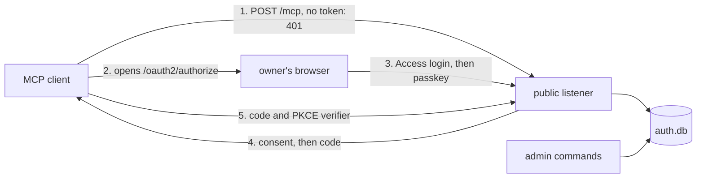

# The OAuth server

- **Status:** draft

The API's public listener runs an OAuth 2.1 authorization server for the owner's MCP clients.
better-auth's OAuth provider and MCP plugins run the protocol. pepys adds the owner's passkey
sign-in, the list of clients the owner added, the bearer check and the scope check, as atc does. A
grant is everything that one approved authorization produced: its refresh tokens and the access
tokens each one issued. Revoking a grant ends all of them.
[atc's OAuth doc](https://github.com/zgeoff/atc/blob/fa46d50b25a6599d2c246604509282c1a3db951a/docs/architecture/remote/oauth.md)
at that commit gives the reasons behind the rules this design shares with atc.

[Auth for the API](./README.md) holds the listeners, the bearer check, the configuration, the
security events and the deployment, and defines the placeholders `<public_origin>` and
`<public_host>`.

## Shape



## Contracts

### The API process

A deployment's API entry passes its arguments to `serveAPI`. With no arguments, `serveAPI` serves
the listeners. With an admin command, it runs that command against `auth.db` and exits. The owner
runs each command with `kubectl exec` in the API's container, where `auth.db` lives. A command reads
only `PEPYS_AUTH_DIR` and `PEPYS_API_PUBLIC_URL`, and runs beside the server, which keeps serving.

```ts
// a deployment's API entry
serveAPI({ deployment, environment: process.env, argv: process.argv.slice(2) });
// argv [] → serves the listeners
// argv ['clients', 'add', 'Claude Code', '--redirect-uri', 'http://localhost:33418/callback']
//   → prints 'client 9f3k2m…' and exits 0
```

```ts
// @pepys/api
interface ServeAPIOptions {
  // …existing fields
  argv?: readonly string[]; // absent or empty: serve
}
```

| Command                                                      | Does                                                      |
| ------------------------------------------------------------ | --------------------------------------------------------- |
| `clients add <name> --redirect-uri <uri> [--redirect-uri …]` | adds a public client and prints its client ID             |
| `clients`                                                    | lists the clients                                         |
| `clients remove <client_id>`                                 | removes a client with every grant and token it holds      |
| `passkeys enroll`                                            | prints a one-time token that the owner types on `/enroll` |
| `passkeys enroll --reset`                                    | ends every passkey and sign-in, then prints a token       |
| `passkeys`                                                   | lists the passkeys                                        |
| `passkeys remove <passkey_id>`                               | removes one passkey                                       |
| `grants`                                                     | lists the live grants                                     |
| `grants revoke <client_id>`                                  | revokes every grant of one client                         |

An admin command runs no deployment check. An unknown command or a bad argument exits 2 with the
usage.

### Public paths

The public listener serves the paths below. The tunnel forwards only these paths. It sends the
owner's browser through a Cloudflare Access login first, and sends a client's request straight to
the listener.

| Path                                        | Caller            | At the tunnel |
| ------------------------------------------- | ----------------- | ------------- |
| `/oauth2/authorize`                         | the owner browser | Access login  |
| `/login`                                    | the owner browser | Access login  |
| `/enroll`                                   | the owner browser | Access login  |
| `/consent`                                  | the owner browser | Access login  |
| `/error`                                    | the owner browser | Access login  |
| `/mcp`                                      | an MCP client     | straight in   |
| `/oauth2/token`                             | a client          | straight in   |
| `/oauth2/revoke`                            | a client          | straight in   |
| `/.well-known/oauth-authorization-server`   | a client          | straight in   |
| `/.well-known/oauth-protected-resource`     | a client          | straight in   |
| `/.well-known/oauth-protected-resource/mcp` | a client          | straight in   |

```http
POST /mcp HTTP/1.1
Host: <public_host>

HTTP/1.1 401 Unauthorized
WWW-Authenticate: Bearer resource_metadata="<public_origin>/.well-known/oauth-protected-resource/mcp", scope="read"
```

`GET /.well-known/oauth-protected-resource/mcp` and `GET /.well-known/oauth-protected-resource` both
answer:

```json
{
  "resource": "<public_origin>/mcp",
  "authorization_servers": ["<public_origin>"],
  "scopes_supported": ["read"],
  "bearer_methods_supported": ["header"]
}
```

### Adding a client

The owner runs `passkeys enroll` once, then `clients add` for each client with its redirect URI.
Claude Code takes the client ID with `--client-id` and a fixed `--callback-port`, and sends the
redirect URI `http://localhost:<port>/callback`.

## Constraints

### What better-auth does not cover

Each rule in this design holds whatever better-auth does by default. Where the pinned better-auth
falls short of a rule, pepys enforces the rule in its own code, as atc does for its forced sign-in
and its resource default. When an authorization request names no resource, pepys sets
`<public_origin>/mcp` before better-auth sees it. The redirect that carries a code carries `iss` too
(RFC 9207), and the authorization server metadata sets
`authorization_response_iss_parameter_supported` to `true`, which the MCP spec asks for.

### Tokens and grants

- The authorization server has no dynamic client registration and never fetches a client ID metadata
  document, which a client would host to register itself. When an authorization names a client that
  the owner never added, the owner's browser gets the error page and no redirect.
- Every client is public: no secret, PKCE with S256 required.
- An authorization code lasts 10 minutes and works once. A second exchange revokes what the first
  made.
- An access token is opaque, lasts 1 hour, and is checked against `auth.db` on every request.
- A refresh token lasts 30 days and rotates on each use.
- A refresh runs as one `auth.db` transaction that consumes the old refresh token by compare and
  swap: it marks the token used only when the token is still unused and its grant still exists, and
  issues the new pair in the same transaction. When the swap changes no row, the refresh fails and
  issues nothing. better-auth's own rotation is not atomic, so pepys runs this step in its own code.
  No in-memory lock takes part, so the rule holds across processes.
- A refresh that presents a consumed refresh token revokes that token's grant, in the same
  transaction.
- The server and an admin command open `auth.db` in WAL mode with a busy timeout. When
  `grants revoke` or `clients remove` races a refresh of the same client, every token of that client
  fails once the command has returned. A test runs the two at once.
- The API runs only in the StatefulSet pod that owns `auth.db`'s volume, never in a Deployment.
- `auth.db` stores a hash of each token, code and enrolment token, never the value.
- The API never writes a token, a code or a cookie to a log line, an error or a security event.

### The owner

- The owner is the one user, and a passkey is the one credential that signs the owner in. With no
  passkey enrolled, every sign-in fails.
- The passkey's relying party ID is `<public_host>`.
- Each authorization needs a fresh passkey sign-in for that one request. One sign-in approves one
  authorization.
- An enrolment token lasts 10 minutes and enrols one passkey.
- `auth.db` holds an owner generation number. Each passkey ceremony, enrolment, owner session and
  pending approval records the generation it began under, and the API refuses to complete one whose
  generation is not the current one.
- `passkeys enroll --reset` runs as one transaction: it deletes every passkey, every unused
  enrolment token and every owner session, raises the generation, and stores the new enrolment
  token's hash. A ceremony or approval begun before the reset then fails, and an older enrolment
  token adds no passkey. Grants and their tokens survive the reset.
- `passkeys remove` deletes every owner session and raises the generation in the same transaction.
- The consent page lists the scopes the client asked for, with `read` ticked.

### Requests

- The public listener answers only a request whose `Host` is `<public_host>`, and answers 403 to any
  other. The tailnet and the cluster listener check no `Host` and no `Origin`.
- A form post to `/login`, `/enroll` or `/consent`, and an MCP request with an `Origin` header, must
  come from `<public_origin>`. The API answers any other with 403.
- The sign-in, enrolment, consent and error pages carry the headers below. Only `/login` and
  `/enroll` list a script: the passkey script, by its hash. Only `/consent` adds the client's
  redirect origin to `form-action`. The error page shows a fixed sentence per error code, never text
  from the request.

  ```http
  Content-Security-Policy: default-src 'none'; style-src 'unsafe-inline'; script-src 'sha256-<passkey_script_hash>'; form-action 'self' <redirect_origin>; frame-ancestors 'none'; base-uri 'none'
  X-Frame-Options: DENY
  Cache-Control: no-store
  Referrer-Policy: same-origin
  ```

- The public listener sees cloudflared's address, never the client's, so every limit counts per
  client and grant, and no security event carries a client address.
- better-auth's telemetry stays off whatever the environment says.
- The API generates better-auth's secret at random on each start. A restart ends the sign-ins in
  progress and keeps every grant.

## Decisions

- **The API runs its own authorization server, from atc's code.** pepys serves one owner, and an
  outside identity provider adds a second system to trust and to keep up. pepys copies atc's OAuth
  server into `@pepys/api`; moving the copies in atc, impz and pepys to one package is separate
  work.
- **The owner signs in with a passkey.** pepys has no API tokens of its own for the owner to approve
  a code with, as impz does, and a passkey works from each of the owner's devices.
- **The owner adds each client by hand.** The MCP authorization spec of 2026-07-28 allows
  pre-registration. Client ID metadata documents and dynamic registration would let any client start
  a sign-in.
- **The public route runs through the shared Cloudflare tunnel.** The MCP route answers each post
  with JSON and opens no stream, so it needs no TLS front of its own, and atc's gateway runs the
  same way. The change feed's design settles the route again for a stream.
- **Cloudflare Access and the passkey both guard sign-in.** Access adds a login in front of the
  sign-in pages, and only the owner's passkey approves a grant, so neither one alone lets a stranger
  in.
- **One resource, `<public_origin>/mcp`.** Only MCP serves OAuth tokens, so every grant is bound to
  it, and the passkey's relying party is `<public_host>`.
- **`auth.db` has no backup.** A lost `auth.db` costs one passkey enrolment and one sign-in per
  client.

## Builder decides

- How the public routes mount on Elysia beside better-auth's handler.
- The wording of every page and error.
- Whether the bearer check reuses better-auth's MCP helper or reads the token table directly.
- The better-auth version, within the
  [dependency rule](../../../.claude/skills/ci-design/SKILL.md#dependency-exceptions). `@pepys/api`
  is public, so better-auth ships as its dependency and type-checks with the kit's compiler options.
- The SQLite driver and Kysely dialect that open `auth.db`.
- How tests drive a passkey sign-in, such as a scripted authenticator, and which test lane runs the
  full flow from the 401 to a query.
