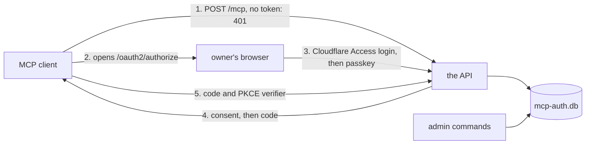

# The OAuth server

- **Status:** agreed
- **Decision records:** [0025](../../decisions/0025-own-oauth-server-with-passkey.md),
  [0027](../../decisions/0027-rpc-stays-off-the-public-route.md),
  [0028](../../decisions/0028-no-backup-of-auth-db.md)

The API runs an OAuth 2.1 authorization server for the owner's MCP clients, such as Claude Code. An
MCP client reaches the API from anywhere through a Cloudflare tunnel that the owner's other servers
share. The tunnel never forwards `/rpc`
([0027](../../decisions/0027-rpc-stays-off-the-public-route.md)).

pepys copies the server from atc, the owner's agent control tower, whose gateway serves MCP behind
the same kind of server.
[atc's OAuth doc](https://github.com/zgeoff/atc/blob/fa46d50b25a6599d2c246604509282c1a3db951a/docs/architecture/remote/oauth.md)
at that commit gives the reasons behind the rules the two servers share.

better-auth's OAuth provider and MCP plugins run the protocol. pepys adds the owner's passkey
sign-in, the list of clients the owner added, and the check of each bearer token and its scope. A
grant is everything that one approved authorization produced: its refresh tokens and every access
token issued under it. Revoking a grant ends all of them.

[Auth for the API](./README.md) holds the bearer check, the
[configuration](./README.md#configuration), the security events and the deployment. It also names
the outside systems and defines the placeholders `<public_origin>` and `<public_host>`.

## Shape



## Contracts

### The API process

A deployment's API entry is the file that starts its API, such as
`packages/source-github/src/api/serve-api.ts`. It passes its command-line arguments to `serveAPI`.
With no arguments, `serveAPI` serves the API. With an admin command, it runs that command against
`mcp-auth.db` and exits.

The owner runs each command with `kubectl exec` in the API's container, where `mcp-auth.db` lives. A
command reads only `PEPYS_AUTH_DIR`, and runs beside the server, which keeps serving.

```ts
// a deployment's API entry
await serveAPI({ deployment, environment: process.env, argv: process.argv.slice(2) });
// argv [] → serves the API
// argv ['clients', 'add', 'Claude Code', '--redirect-uri', 'http://localhost:33418/callback']
//   → prints 'Added Claude Code. Its client ID is 9f3k2m…' and exits 0
```

```ts
// @pepys/api
interface ServeAPIOptions {
  deployment: Deployment;
  environment: Readonly<Record<string, string | undefined>>;
  argv?: readonly string[]; // absent or empty: serve
}
```

| Command                                                      | Does                                                         |
| ------------------------------------------------------------ | ------------------------------------------------------------ |
| `clients add <name> --redirect-uri <uri> [--redirect-uri …]` | adds a public client and prints its client ID                |
| `clients`                                                    | lists the clients                                            |
| `clients remove <client_id>`                                 | removes a client with every grant and token it holds         |
| `passkeys enroll`                                            | prints a one-time token that the owner types on `/enroll`    |
| `passkeys enroll --reset`                                    | deletes every passkey and owner session, then prints a token |
| `passkeys`                                                   | lists the passkeys                                           |
| `passkeys remove <passkey_id>`                               | removes one passkey                                          |
| `grants`                                                     | lists the live grants                                        |
| `grants --revoke=<grant_id>`                                 | revokes one grant, in the flag form atc's command uses       |

An admin command skips `checkDeployment`, the check of the deployment's plug-ins that the server
runs at start. An unknown command or a bad argument exits 2 with the usage.

### Public paths

The tunnel forwards only the paths below. It sends the owner's browser through a Cloudflare Access
login first, and sends a client's request straight to the API.

| Path                                        | Caller              | At the tunnel |
| ------------------------------------------- | ------------------- | ------------- |
| `/oauth2/authorize`                         | the owner's browser | Access login  |
| `/login`                                    | the owner's browser | Access login  |
| `/enroll`                                   | the owner's browser | Access login  |
| `/consent`                                  | the owner's browser | Access login  |
| `/error`                                    | the owner's browser | Access login  |
| `/mcp`                                      | an MCP client       | straight in   |
| `/`, `POST` only                            | an MCP client       | straight in   |
| `/oauth2/token`                             | an MCP client       | straight in   |
| `/oauth2/revoke`                            | an MCP client       | straight in   |
| `/.well-known/oauth-authorization-server`   | an MCP client       | straight in   |
| `/.well-known/oauth-protected-resource`     | an MCP client       | straight in   |
| `/.well-known/oauth-protected-resource/mcp` | an MCP client       | straight in   |

`POST /` is a second address for the MCP endpoint, for a client that posts MCP to the origin with no
path. It takes the same token as `POST /mcp` and answers the same 401:

```http
POST /mcp HTTP/1.1
Host: <public_host>

HTTP/1.1 401 Unauthorized
WWW-Authenticate: Bearer resource_metadata="<public_origin>/.well-known/oauth-protected-resource/mcp"
```

`GET /.well-known/oauth-protected-resource/mcp` and `GET /.well-known/oauth-protected-resource` both
answer with the protected resource metadata that better-auth builds, without its introspection and
DPoP fields:

```json
{
  "resource": "<public_origin>/mcp",
  "authorization_servers": ["<public_origin>"],
  "scopes_supported": ["read"],
  "bearer_methods_supported": ["header"]
}
```

### Adding a client

`<api_pod>` is the pod that runs the API, and `<api_entry>` is the deployment's API entry.

1. Run `kubectl exec <api_pod> -- bun <api_entry> passkeys enroll`, and type the printed token on
   `<public_origin>/enroll`. Expect: one passkey in the list that `passkeys` prints.
2. Pick a fixed callback port, `<port>`, for the client.
3. Run
   `kubectl exec <api_pod> -- bun <api_entry> clients add <name> --redirect-uri http://localhost:<port>/callback`.
   Expect: a client ID, `<client_id>`.
4. In Claude Code, add the MCP server `<public_origin>/mcp` over HTTP, with `<client_id>` in
   `--client-id` and `<port>` in `--callback-port`. Leave out `--client-secret`: every client is
   public. Expect: when Claude Code first connects, it opens the owner's browser on
   `/oauth2/authorize`.

## Constraints

### What pepys adds to better-auth

The rules in this design hold whatever better-auth does by default. Where better-auth falls short of
a rule, pepys enforces the rule in its own code, as atc does. pepys's own code does these:

- It forces a fresh passkey sign-in for each authorization.
- When an authorization request names no resource, it sets `<public_origin>/mcp` before better-auth
  sees the request.
- It serves better-auth's authorization server metadata without the introspection and DPoP fields,
  and sets `token_endpoint_auth_methods_supported` and `revocation_endpoint_auth_methods_supported`
  to `["none"]`.
- It locks a pending approval after failed passkey checks, as [Requests](#requests) says.

better-auth adds the `iss` parameter to the redirect that carries a code (RFC 9207), and sets
`authorization_response_iss_parameter_supported` to `true` in the metadata.

### Tokens and grants

- The authorization server has no dynamic client registration and never fetches a client ID metadata
  document, which a client would host to register itself. When an authorization names a client that
  the owner never added, the owner's browser gets the error page and no redirect.
- Every client is public: no secret, PKCE with S256 required.
- An authorization code lasts 10 minutes and works once. A second exchange revokes what the first
  made.
- An access token is opaque, lasts 1 hour, and is checked against `mcp-auth.db` on every request.
- A refresh token lasts 30 days and rotates on each use. As in atc, better-auth runs the rotation,
  and pepys adds no refresh code of its own. better-auth marks the old refresh token used with one
  SQL update that changes the row only while the token is still unused. When that update changes no
  row, the refresh fails.
- better-auth writes the new token pair after that update, in separate statements and outside any
  transaction. pepys accepts this gap, as atc does. A crash between the two leaves the client with
  no refresh token, and the owner signs the client in again. A `grants --revoke` that commits
  between the two leaves the new pair alive. A `clients remove` in the same gap leaves nothing: the
  new rows need the client's row.
- A refresh that presents a used refresh token revokes every refresh token and access token of that
  client, across all its grants. This is better-auth's rule, and atc keeps it too.
- The server and an admin command open `mcp-auth.db` in WAL mode with a busy timeout of 5 seconds,
  so a command and a running server share the file.
- The API runs only in the StatefulSet pod that owns the volume of `mcp-auth.db`. A Kubernetes
  Deployment could start a second copy on another volume.
- `mcp-auth.db` stores a hash of each token, code and enrollment token.
- The API keeps every token, code and cookie out of its log lines, errors and security events.

### The owner

The owner is the one user, and a passkey is the one credential that signs the owner in. With no
passkey enrolled, every sign-in fails. The passkey's relying party ID is `<public_host>`.

Each authorization moves through these records:

| Record           | Lives                                                                   |
| ---------------- | ----------------------------------------------------------------------- |
| pending approval | from the start of the authorization until the owner answers the consent |
| owner session    | from a passed passkey check until the code exchange, at most 10 minutes |

- One passkey sign-in approves one authorization.
- An enrollment token lasts 15 minutes and enrolls one passkey.
- `passkeys enroll --reset` deletes every passkey, every unused enrollment token and every owner
  session in one transaction, then stores the new enrollment token's hash. An older enrollment token
  then adds no passkey. Grants and their tokens survive the reset.
- `passkeys remove` deletes the passkey and every owner session in one transaction.
- Once a passkey check passes and better-auth starts the owner session, the API checks in one
  transaction that the passkey and the session both still exist, and deletes the session when either
  is gone. A sign-in that a reset or a remove overtook then fails.
- The consent page lists the scopes the client asked for, with `read` ticked. The owner may untick
  it, and the API denies a consent with no scope ticked.

### Requests

- The API serves the OAuth paths and `/mcp` only to a request whose `Host` is `<public_host>`, the
  API's own loopback address and port, or a host in `PEPYS_API_ALLOWED_HOSTS`. It answers 403 to any
  other. `/rpc` takes any `Host`.
- A form post to `/login`, `/enroll` or `/consent`, and an MCP request with an `Origin` header, must
  come from `<public_origin>` or the API's own loopback origin. The API answers any other with 403.
- The sign-in, enrollment, consent and error pages carry the headers below, shown as `/login` sends
  them. `<passkey_script_hash>` is the SHA-256 of the passkey script, and `<redirect_origin>` is the
  origin of the client's redirect URI. On `/login` and `/enroll`, `script-src` lists the passkey
  script; on `/consent` and `/error` it is `'none'`. On `/consent`, `form-action` adds
  `<redirect_origin>`; on the other pages it is `'self'` alone. The error page shows a fixed
  sentence per error code, and copies no text from the request.

  ```http
  Content-Security-Policy: default-src 'none'; style-src 'unsafe-inline'; script-src 'sha256-<passkey_script_hash>'; form-action 'self'; frame-ancestors 'none'; base-uri 'none'
  X-Frame-Options: DENY
  Cache-Control: no-store
  Referrer-Policy: same-origin
  ```

- The API sees the address of cloudflared, the tunnel's connector in the cluster, as the address of
  every request from the tunnel. No limit counts per network address.
- The API holds at most 16 pending approvals, and at most 3 for one client: a new one ends the
  client's oldest. Across all clients, it refuses an eleventh authorization started within a minute.
- After 5 failed passkey checks for one pending approval, the API ends that approval and writes an
  `owner_auth` event with reason `locked`. The owner starts again from the client.
- A security event records the socket's peer address. It also records the address in the
  `CF-Connecting-IP` header, marked `trusted` when the peer is in `PEPYS_API_TRUST_FORWARDED_FROM`,
  else `unverified`.
- pepys turns better-auth's telemetry off, whatever the environment sets.
- The API generates better-auth's secret at random on each start. A restart ends the sign-ins in
  progress and keeps every grant. A test restarts the API and refreshes a grant made before the
  restart.

## Decisions

- **The API runs its own authorization server, copied from atc.** pepys serves one owner, and an
  outside identity provider adds a second system to trust and to keep up. A package that atc, pepys
  and impz, the owner's agent runner, share is outside this design.
  ([0025](../../decisions/0025-own-oauth-server-with-passkey.md))
- **The owner signs in with a passkey.** impz approves a sign-in code with one of its own API
  tokens. pepys has no such tokens for the owner, and a passkey works from each of the owner's
  devices. ([0025](../../decisions/0025-own-oauth-server-with-passkey.md))
- **The owner adds each client by hand.** The MCP authorization spec of 2026-07-28 allows
  pre-registration. Client ID metadata documents and dynamic registration would let any client start
  a sign-in. ([0025](../../decisions/0025-own-oauth-server-with-passkey.md))
- **The public route runs through the shared Cloudflare tunnel.** impz holds long event streams
  open, and runs its own TLS front for them. The MCP route answers each post with one message, as
  JSON or as an event stream that ends after it, so the shared tunnel serves it, as it serves atc's
  gateway. ([0027](../../decisions/0027-rpc-stays-off-the-public-route.md))
- **Cloudflare Access and the passkey both guard sign-in.** A stranger on the internet has to pass
  Access's login, and then the owner's passkey, to approve a grant. A process on the cluster's node
  skips Access, and still needs the passkey.
- **Failed passkey checks lock one pending approval, and leave the owner's sign-in open.** Nobody
  can guess a passkey assertion, so the lock only ends a request that keeps failing. A process on
  the cluster's node reaches the API without Access, and a lock on the owner would let it lock the
  owner out.
- **The API checks no Cloudflare Access header.** The passkey already stops a sign-in from a process
  on the cluster's node, and the check would need the API to reach the internet for Access's keys.
- **Every grant is bound to `<public_origin>/mcp`.** Only `/mcp` takes an OAuth token, so the API
  serves one resource.
- **`mcp-auth.db` has no backup.** A lost `mcp-auth.db` costs one passkey enrollment and one sign-in
  per client. ([0028](../../decisions/0028-no-backup-of-auth-db.md))

## How it is built

- The OAuth routes are an Elysia plugin, mounted on the API's app beside `/rpc`.
- The bearer check reads the access token through `/pepys/verify-access-token`, a server-only
  endpoint that pepys adds to better-auth.
- better-auth ships as a dependency of `@pepys/api`, which is public, so its types check with the
  [kit's compiler options](../../../packages/kit/README.md#configuration).
- `mcp-auth.db` opens through `bun:sqlite` and the Kysely dialect of `@zgeoff/kysely-bun-sqlite`.
- Tests sign the owner in with a scripted authenticator. `bun run test` runs the whole flow, from
  the 401 to a tool call.
