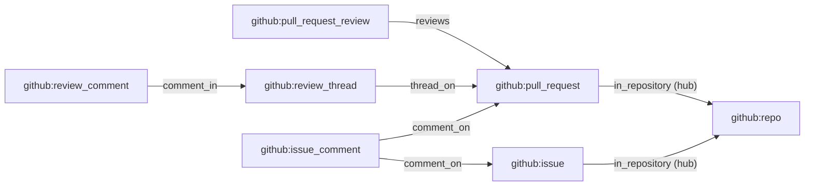

# GitHub tables for six more kinds

- **Status:** agreed

The GitHub plug-in stores the facts of repositories, pull request reviews, review comments, review
threads, issue comments and issues. It has no consumer for them, so the `get_entity` and
`neighbourhood` queries never return an entity of these kinds. This design adds six consumers, one
per kind. Each builds a table and an entity view, and all but the repository consumer write a link
from each row to its parent. The design also changes the pull request consumer, which gains a link
to the repository and an alias for the merge commit.

[The GitHub plug-in](../architecture/plug-ins/github.md) covers the families and the pull request
consumer. [The host](../architecture/consumers/host.md) covers fact mode, scope mode, the reads a
consumer has and the link check. [Entities and links](../architecture/queries/entities-and-links.md)
covers entity views, aliases, links and hub link types.

## Shape

Each box is an entity kind. Each arrow is a link type, and points from a row to its parent. The
consumer of the row's kind writes the link.



## Contracts

### The consumers

| Consumer                     | Streams                                                     | Link it writes  |
| ---------------------------- | ----------------------------------------------------------- | --------------- |
| `github_repository`          | `facts.github.repository`                                   | none            |
| `github_issue`               | `facts.github.issue`                                        | `in_repository` |
| `github_pull_request_review` | `facts.github.pull_request_review`                          | `reviews`       |
| `github_review_comment`      | `facts.github.review_comment`                               | `comment_in`    |
| `github_review_thread`       | `facts.github.review_comment`, `facts.github.review_thread` | `thread_on`     |
| `github_issue_comment`       | `facts.github.pull_request`, `facts.github.issue_comment`   | `comment_on`    |
| `github_pull_request`        | `facts.github.pull_request`                                 | `in_repository` |

The first six consumers are the ones this design adds. Each runs in fact mode, and
[The tables](#the-tables) lists the tables each one owns. Scope mode does not fit them: the host
gives a scope-mode consumer only the facts whose `entity` field is the scope, and the `entity` of a
review fact or a comment fact is the review or the comment, never the pull request.

Write each declaration in the shape of the review consumer's, which declares a link type and lists
it in `links`:

```ts
// source-github, the declaration file of the review consumer
const reviews = defineLinkType({
  name: 'reviews',
  from: ['github:pull_request_review'],
  to: ['github:pull_request'],
  hub: false,
});

export const githubPullRequestReviewConsumer = defineConsumer({
  name: 'github_pull_request_review',
  entry: new URL('consumers/github-pull-request-review.ts', import.meta.url),
  input: { mode: 'fact', streams: [pullRequestReviewFamily.stream] },
  tables: { github_pull_request_review, github_pull_request_review_alias },
  entityViews: [
    {
      table: 'github_pull_request_review',
      kind: pullRequestReviewFamily.entityKind,
      id: 'id',
      title: 'state',
      url: 'url',
      actor: 'author_id',
      updatedAt: 'updated_at',
    },
  ],
  reads: ['github_pull_request_review', 'github_pull_request_review_alias'],
  links: [reviews],
});
```

A consumer returns one answer for each fact: the list of its operations. The consumer puts a row's
link in the answer that writes the row:

```ts
// the answer to the first fact of review 9001 on pull request 77
[
  { upsert: { github_pull_request_review: { id, pull_request_id: pullRequestID /* … */ } } },
  { upsert: { github_pull_request_review_alias: { alias, entity_id: id, updated_at } } },
  linkReviews({ from: id, to: pullRequestID, confidence: 1, evidence: fact.id }),
];
```

### The link types

```ts
// source-github. One constant, which the issue and the pull request declarations both list: the
// deployment check refuses one name with two shapes, and the order of `from` is part of the shape.
export const inRepository = defineLinkType({
  name: 'in_repository',
  from: ['github:issue', 'github:pull_request'],
  to: ['github:repo'],
  hub: true,
});
```

| Link type       | `from`                                | `to`                                  | `hub` |
| --------------- | ------------------------------------- | ------------------------------------- | ----- |
| `reviews`       | `github:pull_request_review`          | `github:pull_request`                 | false |
| `comment_in`    | `github:review_comment`               | `github:review_thread`                | false |
| `thread_on`     | `github:review_thread`                | `github:pull_request`                 | false |
| `comment_on`    | `github:issue_comment`                | `github:issue`, `github:pull_request` | false |
| `in_repository` | `github:issue`, `github:pull_request` | `github:repo`                         | true  |

`in_repository` is a [hub link type](../architecture/queries/entities-and-links.md#links), because
one repository has thousands of pull requests. `neighbourhood` follows a hub type only for a caller
that sets `includeHubs`:

- A caller that leaves `includeHubs` unset gets no `in_repository` link, even when it lists
  `in_repository` in `linkTypes`. A walk from a pull request then never reaches the repository.
- A caller that sets `includeHubs` and starts at a repository gets some of the repository's pull
  requests and issues, with `isTruncated` set. The walk reads at most 1,000 link rows a hop and
  returns at most 200 entities.

### The tables

Every entity table has the primary key `id`. Each ID column is an `entityID`, each time is a
`timestamp`, and a column is not null unless marked. A fact's payload is the webhook delivery, which
holds the fact's own object beside others, such as the pull request beside a review. The `payload`
column holds only the fact's own object: the `review` object for a review row.

```text
github_repository             index: none
  id                          github:repo:<repository.id>
  full_name                   text; the view's title
  owner_id         nullable   github:user:<repository.owner.id>; the view's actor
  url                         repository.html_url
  is_private, is_archived     boolean
  default_branch   nullable   text
  created_at       nullable
  updated_at                  the fact's time
  deleted_at       nullable   the view's deletedAt
  payload                     json

github_issue                  index: repository_id
  id                          github:issue:<issue.id>
  repository_id               github:repo:<repository.id>
  number                      integer
  title                       text
  state                       text
  author_id        nullable   github:user:<issue.user.id>; the view's actor
  url                         issue.html_url
  created_at, updated_at
  closed_at        nullable
  deleted_at       nullable   the view's deletedAt
  payload                     json

github_pull_request_review    index: pull_request_id
  id                          github:pull_request_review:<review.id>
  pull_request_id             github:pull_request:<pull_request.id>
  repository_id
  state                       text; the view's title
  author_id        nullable   github:user:<review.user.id>; the view's actor
  url                         review.html_url
  commit_sha       nullable   text
  submitted_at     nullable
  updated_at                  pull_request.updated_at of the winning fact
  payload                     json

github_review_comment         indexes: thread_id; pull_request_id
  id                          github:review_comment:<comment.id>
  thread_id                   github:review_thread:<comment.in_reply_to_id, else comment.id>
  pull_request_id, repository_id
  review_id        nullable   github:pull_request_review:<comment.pull_request_review_id>
  author_id        nullable   the view's actor
  title                       text; the first line of comment.body that is not empty, else the path
  path                        text
  url                         comment.html_url
  created_at, updated_at
  deleted_at       nullable   the view's deletedAt
  payload                     json

github_review_thread          index: pull_request_id
  id                          the entity of a thread fact; the thread_id of a comment fact
  pull_request_id, repository_id
  path                        text; the view's title
  url                         the view's url; the view has no actor
  started_at                  the time of the thread's earliest fact
  evidence                    text; the ID of the thread's earliest fact
  is_resolved                 boolean; false until a thread fact arrives
  resolution_at    nullable   the time of the newest thread fact
  resolution_fact  nullable   text; the ID of the newest thread fact
  updated_at                  the latest time of any fact of the thread

github_issue_comment          index: repository_id, parent_number
  id                          github:issue_comment:<comment.id>
  repository_id
  parent_number               integer; issue.number
  is_on_pull_request          boolean; the payload has an `issue.pull_request` object
  issue_id                    github:issue:<issue.id>; no issue row has this ID for a pull request
  author_id        nullable   the view's actor
  title                       text; the first line of comment.body that is not empty, else ''
  url                         comment.html_url
  created_at, updated_at
  deleted_at       nullable   the view's deletedAt
  payload                     json

github_issue_comment_parent   primary key: repository_id, number
  repository_id
  number                      integer; a pull request's number
  pull_request_id  nullable   null until the consumer reads a pull request fact with this key
  waiting                     json; [{ comment, evidence }] sorted by comment, [] once the ID is set
```

Every consumer in the table below but the thread consumer owns an alias table, named after its
entity table with `_alias` added. [Aliases](../architecture/queries/entities-and-links.md#aliases)
gives the columns of an alias table, and the rule by which a consumer writes an alias row.

| Kind           | Aliases                                                                                |
| -------------- | -------------------------------------------------------------------------------------- |
| repository     | `html_url`, and `full_name`, which has the form `<owner>/<repo>`                       |
| issue          | `html_url`, and `<owner>/<repo>#<number>`                                              |
| review         | `html_url`                                                                             |
| review comment | `html_url`                                                                             |
| issue comment  | `html_url`                                                                             |
| review thread  | none                                                                                   |
| pull request   | `html_url`, `<owner>/<repo>#<number>`, and `merge_commit_sha` once `is_merged` is true |

## Constraints

### Which fact wins

Each consumer but the thread consumer keeps one row per object, from the fact with the later time,
as the `github_pull_request` consumer does. The fact whose row the consumer keeps wins, and the
other fact loses. [Review threads](#review-threads) holds the thread consumer's rules.

- A fact's time is its `at`, for every kind but a review. Ingest takes `at` from the object's own
  update time.
- A review fact's time is the `pull_request.updated_at` of its payload, which ingest requires in
  every review fact. A review fact's `at` is the review's `submitted_at`, which is the same in every
  fact of one review.
- A fact wins when no row is stored, when its time is later than the stored row's time, and when the
  two times are equal and its row differs from the stored row. In that last case the later fact in
  the stream wins, because the host applies facts in stream order.
- A fact loses when its time is earlier than the stored row's time, and when the two times are equal
  and the two rows are equal.
- For a fact that loses, the consumer returns an empty answer. A deletion fact that loses is the one
  exception.
- For a deletion fact, the consumer sets `deleted_at` to the fact's time. When the deletion fact
  loses, the consumer writes the stored row with only `deleted_at` changed. The consumer never
  clears `deleted_at`.
- The deletion facts are `github.repository.deleted`, `github.issue.deleted`,
  `github.review_comment.deleted` and `github.issue_comment.deleted`. GitHub sends no deletion for a
  review or a review thread, so their tables have no `deleted_at`.
- The review consumer never changes a stored `state` of `dismissed`, whatever fact wins. GitHub has
  no action that takes a dismissal back.

### Every consumer

- A consumer changes only its own tables. For a fact that embeds another object, such as the pull
  request in a review fact, the consumer returns no operation on that object's table.
- For a fact that lacks a field the row needs, the consumer returns an empty answer.
- The issue, review and review comment consumers return the link to the parent in each answer of a
  fact that wins, with `confidence: 1` and the fact's ID as `evidence`. They return no link for a
  fact that loses. [Review threads](#review-threads) and
  [Issue comments and their parent](#issue-comments-and-their-parent) hold the link rules of the
  other two.
- A consumer never removes the links of a row that GitHub deleted. `neighbourhood` lists a deleted
  row's ID in `unresolved`.
- A consumer's rows, aliases and links are the same in every arrival order of facts with different
  times.
- The thread consumer and the issue comment consumer each read two streams, and their rows and links
  never depend on which stream's facts arrive first. The host's order across streams is not fixed:
  `pepys up` replays one whole stream before it starts the next, and `pepys run` reads a batch from
  one stream, then a batch from the other, again and again. A consumer that relied on that order
  would build other rows in a replay.

### Review threads

A thread row merges the facts of every comment of the thread with the thread's own `resolved` and
`unresolved` facts. The thread consumer reads only the stored thread row and the fact.

- A review comment's thread ID is `comment.in_reply_to_id` when the comment has one, else
  `comment.id`. Ingest gives a thread fact its `entity` by the same rule, so the facts of both
  streams reach one thread row.
- The consumer creates the row from the first fact that arrives, also when that fact is a reply. It
  merges each later fact into the row.
- The thread's earliest fact is the fact with the earliest `at`, and the smaller fact ID when two
  are equal. The consumer takes `path`, `url`, `started_at` and `evidence` from the earliest fact. A
  comment fact gives the `path` and `html_url` of its comment. A thread fact gives those of the
  comment in `thread.comments` with the smallest ID.
- The consumer takes `is_resolved`, `resolution_at` and `resolution_fact` from the thread fact with
  the latest `at`, and the larger fact ID when two are equal. A comment fact never changes them.
- `updated_at` is the latest `at` of every fact of the thread.
- When the merged row differs from the stored row, the consumer returns the row and the `thread_on`
  link, with the row's `evidence` as the link's evidence. Otherwise it returns an empty answer.
- The thread consumer orders facts only by `at` and fact ID, never by stream order, so two facts
  with equal times give one row in every order.

### Issue comments and their parent

The payload of an issue comment fact holds the issue's ID and number. For a comment on a pull
request, that ID is not the pull request's ID, and the payload holds no pull request ID. The issue
comment consumer therefore reads the pull request stream, and keeps one row in
`github_issue_comment_parent` for each pull request number of a repository.

- For a comment fact that loses, the consumer returns an empty answer, by
  [Which fact wins](#which-fact-wins). The rules below are for a comment fact that wins.
- For a comment whose payload has no `issue.pull_request` object, the consumer writes `comment_on`
  to `issue_id`, and reads no parent row.
- For a comment on a pull request, the consumer reads the parent row whose key is the comment's
  `repository_id` and `parent_number`.
  - When the parent row holds a `pull_request_id`, the consumer writes `comment_on` to it.
  - When no parent row exists, or its `pull_request_id` is null, the consumer writes the comment row
    and no link. It also writes the parent row, with the comment and the fact's ID in `waiting`, in
    place of an earlier entry of the same comment.
- For a pull request fact, the consumer reads the parent row whose key is the pull request's base
  repository ID and number.
  - When no parent row exists, the consumer writes one with the `pull_request_id` and an empty
    `waiting`.
  - When the parent row holds a `pull_request_id`, the consumer returns an empty answer.
  - When the parent row holds a null `pull_request_id`, the consumer sets the ID and empties
    `waiting`. In the same answer it writes one `comment_on` link for each entry that `waiting`
    held, with the entry's evidence.
- For a pull request fact, the consumer changes no `github_issue_comment` row.
- The consumer compares times only between two facts of one comment, which share a stream.

### The pull request consumer

- For a fact that wins, the consumer writes the `in_repository` link from the pull request to its
  `repository_id`.
- For a fact that wins, of a merged pull request that has a `merge_commit_sha`, the consumer writes
  the SHA as an alias, by the rule in
  [Aliases](../architecture/queries/entities-and-links.md#aliases).
- The changed entry file gives the pull request consumer a new version. `pepys up` builds that
  version by a replay of `facts.github.pull_request` into a file beside the live one, then swaps the
  file in, as [Versions](../architecture/consumers/host.md#versions) describes.

## Decisions

- **One consumer per kind.** A change to one kind's entry file replays only that kind's streams.
- **The thread consumer reads the comment stream.** The thread stream holds only `resolved` and
  `unresolved` facts, so a thread that nobody resolved has no fact there.
- **A thread has no alias.** A thread has no URL of its own. Its row's `url` is the URL of one of
  its comments, and that alias belongs to the comment.
- **The issue comment consumer finds a pull request through its own parent table.** A fact-mode
  consumer reads only its own tables, and only by key. The parent table's key is a repository ID and
  a pull request number, and a repository rename changes neither.
- **A comment waits in the parent row until the consumer reads a fact of its pull request.** The
  consumer then finds every waiting comment with one read by key.
- **The pull request consumer writes `in_repository`.** Only the pull request consumer builds the
  pull request row, which holds the repository ID.
- **`in_repository` joins only issues and pull requests to their repository.** Every other kind
  reaches its repository through one of the two.
- **A deleted row keeps its links.** A link from a deleted comment to its pull request stays true,
  and `neighbourhood` reports the deleted end as unresolved.
- **The review consumer orders facts by `pull_request.updated_at`, and keeps `dismissed`.** Every
  fact of one review has the same `submitted_at`, so that time cannot order them.

## Tests

[The test store](../architecture/consumers/plug-ins-and-build.md#the-test-store) runs the consumers
in memory.
[Writing an entry file](../architecture/consumers/plug-ins-and-build.md#writing-an-entry-file)
covers `applyInBothOrders`, which applies a list of facts in order and in reverse, and sets `isSame`
when both give the same rows and links.

| Test                 | Where                                           | Asserts                                                                                 |
| -------------------- | ----------------------------------------------- | --------------------------------------------------------------------------------------- |
| consumer unit tests  | beside each entry file under `consumers/`       | the full answer, with `toStrictEqual`                                                   |
| arrival order        | each declaration's test file                    | `applyInBothOrders` sets `isSame` for facts of one object with different times          |
| order across streams | the thread and issue comment declaration tests  | `applyInBothOrders` sets `isSame` for facts of both streams, some with equal times      |
| `get_entity`         | each declaration's test file, on the test store | the entity by ID and by each alias, and not found for a deleted one                     |
| `neighbourhood`      | the review and the thread declaration tests     | a walk from a pull request returns its reviews, and its threads                         |
| hub links            | the issue declaration test                      | a walk from an issue leaves the repository out, and returns it with `includeHubs`       |
| e2e journey          | the CLI's e2e folder                            | the API returns a pull request's review, thread and issue comment from the host's files |

- Write one unit test for each of these: a new object, a fact that loses, a deletion, each alias,
  the link, a reply's thread ID, a review fact that changes no pull request row, an issue comment
  that waits, and a pull request fact that links the waiting comments.
- The test store keeps one `link` table that all consumers share, and runs no compiled module. Only
  the e2e journey proves that `neighbourhood` joins the `link` tables of several consumer files, and
  that scriptc compiles each entry file.
- The e2e setup waits for each consumer in its `readConsumers` list to reach the end of one stream.
  Add each consumer of this design to that list, once for each stream the consumer reads.

## Stages

Each stage leaves `main` working. In each stage, the builder also does these:

- Add the stage's consumers to the plug-in, to the families table of
  [the GitHub plug-in](../architecture/plug-ins/github.md), and to the kinds in
  [Entities and links](../architecture/queries/entities-and-links.md).
- Write [the glue](../architecture/consumers/plug-ins-and-build.md#the-glue) of the stage's
  consumers with `bun run schema:generate`.
- Refresh the case "accepts the stub deployment", by the steps in
  [The consumers.json case file](../../.claude/skills/project-testing/SKILL.md#the-consumersjson-case-file).
  The stub deployment holds the GitHub plug-in, so each added consumer changes its `consumers.json`.

1. The `in_repository` link type, the pull request consumer's link and merge commit alias, and
   `github_repository`.
2. `github_issue`, with the hub link test.
3. `github_pull_request_review`, with the `neighbourhood` test of reviews.
4. `github_review_comment` and `github_review_thread`, with the `neighbourhood` test of threads and
   the e2e journey.
5. `github_issue_comment` with its parent table, and the issue comment in the e2e journey.

## Builder decides

- The file and constant names, and the helper functions of each entry file.
- More columns for fields of a payload that a query needs, beside the columns listed.
- The longest title a comment row stores.
- Whether a stage lands as one pull request or as several.

## Out of scope

- A link from a review comment to its review. `review_id` holds the relation as a column.
- `in_repository` links from releases, reviews, comments and threads.
- A backfill of repositories. `github_repository` holds a row only for a repository with a
  `repository` event.
- A deletion mark for a thread whose every comment is deleted, and for an issue that moves to
  another repository.
- A link from a comment or a description to an issue or pull request that its text mentions, such as
  `acme/api#412`.

## Open questions

- **Does a stored reply ever answer another reply?** A measurement settles it: a count, over
  `facts.github.review_comment`, of the replies whose `in_reply_to_id` is the ID of a comment that
  has an `in_reply_to_id` itself. GitHub's API creates a reply only on a thread's first comment.
  Until the count, the consumers take `in_reply_to_id` as the thread's first comment, as
  [Review threads](#review-threads) states.
- **Does a dismissal change `pull_request.updated_at`?** A measurement settles it: for each stored
  review with a `submitted` fact and a `dismissed` fact, compare the `pull_request.updated_at` of
  the two. When the two are equal and the `submitted` fact comes later in the stream, the
  `submitted` fact wins. Until the measurement, the rule that a stored `dismissed` state never
  changes keeps the state right in that case.
