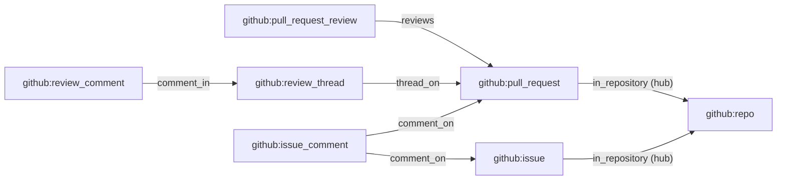

# GitHub tables for six more kinds

- **Status:** draft

The GitHub plug-in stores the facts of repositories, pull request reviews, review comments, review
threads, issue comments and issues, and no consumer builds them, so `get_entity` and `neighbourhood`
return none of them. Six fact-mode consumers each build one kind's table, entity view and aliases,
and write the link from each row to its parent. The pull request consumer also writes a link to its
repository and a merge commit alias.

[The GitHub plug-in](../architecture/plug-ins/github.md) covers the families and the built
consumers. [The host](../architecture/consumers/host.md) covers fact mode, the reads a module has
and the link check. [Entities and links](../architecture/queries/entities-and-links.md) covers
entity views, aliases and the `link` table.

## Shape

Each box is an entity kind, and each arrow is a link type, from the row that writes it to its
parent.



## Contracts

### The consumers

| Consumer                     | Streams, in this order                                      | Tables                                                                              | Links it writes |
| ---------------------------- | ----------------------------------------------------------- | ----------------------------------------------------------------------------------- | --------------- |
| `github_repository`          | `facts.github.repository`                                   | `github_repository`, `github_repository_alias`                                      | none            |
| `github_issue`               | `facts.github.issue`                                        | `github_issue`, `github_issue_alias`                                                | `in_repository` |
| `github_pull_request_review` | `facts.github.pull_request_review`                          | `github_pull_request_review`, `github_pull_request_review_alias`                    | `reviews`       |
| `github_review_comment`      | `facts.github.review_comment`                               | `github_review_comment`, `github_review_comment_alias`                              | `comment_in`    |
| `github_review_thread`       | `facts.github.review_comment`, `facts.github.review_thread` | `github_review_thread`                                                              | `thread_on`     |
| `github_issue_comment`       | `facts.github.pull_request`, `facts.github.issue_comment`   | `github_issue_comment`, `github_issue_comment_alias`, `github_issue_comment_parent` | `comment_on`    |
| `github_pull_request`        | `facts.github.pull_request`, as built                       | as built                                                                            | `in_repository` |

Every consumer runs in fact mode. A scope read returns only the facts whose `entity` is the scope,
and each of these facts names its own object, so a scope of a pull request never holds a review or a
comment.

A declaration follows the built ones. The review consumer shows the parts that are new: a link type,
and an alias table beside the entity table.

```ts
// source-github, the declaration file of the review consumer
const reviews = defineLinkType({
  name: 'reviews',
  from: ['github:pull_request_review'],
  to: ['github:pull_request'],
  hub: false,
});

export const githubPullRequestReviewConsumer = defineConsumer({
  name: 'github_pull_request_review',
  entry: new URL('consumers/github-pull-request-review.ts', import.meta.url),
  input: { mode: 'fact', streams: [pullRequestReviewFamily.stream] },
  tables: { github_pull_request_review, github_pull_request_review_alias },
  entityViews: [
    {
      table: 'github_pull_request_review',
      kind: pullRequestReviewFamily.entityKind,
      id: 'id',
      title: 'state',
      url: 'url',
      actor: 'author_id',
      updatedAt: 'updated_at',
    },
  ],
  reads: ['github_pull_request_review', 'github_pull_request_review_alias'],
  links: [reviews],
});
```

A consumer returns the link in the same answer as the row it rests on:

```ts
// the answer to the first fact of review 9001 on pull request 77
[
  { upsert: { github_pull_request_review: { id, pull_request_id: pullRequestID /* … */ } } },
  { upsert: { github_pull_request_review_alias: { alias, entity_id: id, updated_at } } },
  linkReviews({ from: id, to: pullRequestID, confidence: 1, evidence: fact.id }),
];
```

### The link types

```ts
// source-github. One constant, which the issue and the pull request declarations both list: the
// deployment check refuses one name with two shapes, and the order of `from` is part of the shape.
export const inRepository = defineLinkType({
  name: 'in_repository',
  from: ['github:issue', 'github:pull_request'],
  to: ['github:repo'],
  hub: true,
});
```

| Link type       | `from`                                | `to`                                  | `hub` |
| --------------- | ------------------------------------- | ------------------------------------- | ----- |
| `reviews`       | `github:pull_request_review`          | `github:pull_request`                 | false |
| `comment_in`    | `github:review_comment`               | `github:review_thread`                | false |
| `thread_on`     | `github:review_thread`                | `github:pull_request`                 | false |
| `comment_on`    | `github:issue_comment`                | `github:issue`, `github:pull_request` | false |
| `in_repository` | `github:issue`, `github:pull_request` | `github:repo`                         | true  |

`neighbourhood` drops a hub type from the walk in both directions unless the caller sets
`includeHubs`, also when the caller names the type in `linkTypes`. A walk from a pull request
therefore reaches its repository only with `includeHubs`. A walk from a repository with
`includeHubs` reads at most 1,000 link rows a hop and returns at most 200 entities, so for a large
repository it returns a part, with `isTruncated` set.

### The tables

Every entity table has the primary key `id`. Each ID column is an `entityID`, each time is a
`timestamp`, and a column is not null unless marked. `payload` holds the fact's own object, such as
`payload.review`, and never the objects embedded beside it.

```text
github_repository             index: none
  id                          github:repo:<repository.id>
  full_name                   text; the view's title
  owner_id         nullable   github:user:<repository.owner.id>; the view's actor
  url                         repository.html_url
  is_private, is_archived     boolean
  default_branch   nullable   text
  created_at       nullable
  updated_at                  the fact's time
  deleted_at       nullable   the view's deletedAt
  payload                     json

github_issue                  index: repository_id
  id                          github:issue:<issue.id>
  repository_id               github:repo:<repository.id>
  number                      integer
  title                       text
  state                       text
  author_id        nullable   github:user:<issue.user.id>; the view's actor
  url                         issue.html_url
  created_at, updated_at
  closed_at        nullable
  deleted_at       nullable   the view's deletedAt
  payload                     json

github_pull_request_review    index: pull_request_id
  id                          github:pull_request_review:<review.id>
  pull_request_id             github:pull_request:<pull_request.id>
  repository_id
  state                       text; the view's title
  author_id        nullable   github:user:<review.user.id>; the view's actor
  url                         review.html_url
  commit_sha       nullable   text
  submitted_at     nullable
  updated_at                  pull_request.updated_at of the winning fact
  payload                     json

github_review_comment         indexes: thread_id; pull_request_id
  id                          github:review_comment:<comment.id>
  thread_id                   github:review_thread:<comment.in_reply_to_id, else comment.id>
  pull_request_id, repository_id
  review_id        nullable   github:pull_request_review:<comment.pull_request_review_id>
  author_id        nullable   the view's actor
  title                       text; the first line of the body that is not empty, else the path
  path                        text
  url                         comment.html_url
  created_at, updated_at
  deleted_at       nullable   the view's deletedAt
  payload                     json

github_review_thread          index: pull_request_id
  id                          the entity of a thread fact; a comment fact's thread_id
  pull_request_id, repository_id
  path                        text; the view's title
  url                         the URL of the first fact's comment; the view has no actor
  started_at                  the time of the first fact
  evidence                    text; the ID of the first fact
  is_resolved                 boolean; false until a thread fact arrives
  resolution_at    nullable   the time of the newest thread fact
  resolution_fact  nullable   text; the ID of that fact
  updated_at                  the latest time of any fact of the thread

github_issue_comment          index: repository_id, parent_number
  id                          github:issue_comment:<comment.id>
  repository_id
  parent_number               integer; issue.number
  is_on_pull_request          boolean; the body has an `issue.pull_request` object
  issue_id                    github:issue:<issue.id>; names no row for a pull request
  author_id        nullable   the view's actor
  title                       text; the first line of the body that is not empty, else ''
  url                         comment.html_url
  created_at, updated_at
  deleted_at       nullable   the view's deletedAt
  payload                     json

github_issue_comment_parent   primary key: repository_id, number
  repository_id
  number                      integer
  pull_request_id  nullable   null until a pull request fact names the number
  waiting                     json; [{ comment, evidence }] sorted by comment, [] once the ID is set
```

Each `<table>_alias` table has the three columns of `github_pull_request_alias`, and its consumer
writes and moves a row by the same rule.

| Kind           | Aliases, each in lowercase with no `/` at the end         |
| -------------- | --------------------------------------------------------- |
| repository     | `html_url`; `<owner>/<repo>` from `full_name`             |
| issue          | `html_url`; `<owner>/<repo>#<number>`                     |
| review         | `html_url`                                                |
| review comment | `html_url`                                                |
| issue comment  | `html_url`                                                |
| review thread  | none                                                      |
| pull request   | as built, and `merge_commit_sha` once `is_merged` is true |

## Constraints

### Every consumer

- A consumer changes only its own tables. A fact that embeds another object, such as the pull
  request in a review fact, gives no operation on that object's table.
- A fact that lacks a field its row needs gives no operations.
- The link to the parent is in the answer that writes the row, with `confidence: 1` and the fact's
  ID as `evidence`. A fact that loses writes no link.
- A row that GitHub deleted keeps its links. `neighbourhood` lists its ID in `unresolved`.
- A consumer's rows, aliases and links are the same in every arrival order of facts with different
  times.
- The two consumers with two streams also give the same result when two facts have equal times, and
  in every order of their streams. The host replays one stream to its tail before the next when it
  builds a version, and reads them in turn afterwards, so the order across streams differs between a
  replay and a live run.

### Which fact wins

A fact's time is its `at`, which ingest takes from the object's own update time.

| Consumer                     | Time that orders facts                      | Deletion                              |
| ---------------------------- | ------------------------------------------- | ------------------------------------- |
| `github_repository`          | `at`                                        | `github.repository.deleted`           |
| `github_issue`               | `at`                                        | `github.issue.deleted`                |
| `github_pull_request_review` | the body's `pull_request.updated_at`        | none: a dismissal is a state          |
| `github_review_comment`      | `at`                                        | `github.review_comment.deleted`       |
| `github_issue_comment`       | `at`                                        | `github.issue_comment.deleted`        |
| `github_review_thread`       | none: see [Review threads](#review-threads) | none: GitHub sends no thread deletion |

- When the stored row has a later time than the fact, the answer is empty. When the times are equal
  and the rows are equal, the answer is empty. When the times are equal and the rows differ, the
  later fact in the stream wins.
- A deletion fact sets `deleted_at` to its time, and no later fact clears it. A deletion fact that
  loses on time still sets `deleted_at` on the stored row.
- Every fact of one review has the same `at`, because `submitted_at` never changes, so `at` cannot
  order them. The review consumer orders by `pull_request.updated_at`, which ingest requires in
  every review body. A stored state of `dismissed` survives every later fact.

### Review threads

- A review comment's thread is `comment.in_reply_to_id` when the comment has one, else `comment.id`.
  Ingest gives a thread fact its entity by the same rule, so the rows of both streams meet in one
  thread row.
- The consumer reads only its stored thread row and the fact. A reply that arrives before the first
  comment creates the row, and the first comment then merges into it.
- The first fact of a thread is the one with the earliest `at`, and the smaller fact ID on a tie.
  `path`, `url`, `started_at` and `evidence` come from it. For a thread fact, the comment is the one
  in `thread.comments` with the smallest ID.
- `is_resolved` comes from the thread fact with the latest `at`, and the larger fact ID on a tie. A
  comment fact never changes it.
- `updated_at` is the latest `at` of every fact.
- The answer holds the row and the `thread_on` link, with the row's `evidence`, when the merged row
  differs from the stored row, and is empty otherwise.

### Issue comments and their parent

- For a comment whose body has no `issue.pull_request` object, `comment_on` points at `issue_id`.
- For a comment on a pull request, `comment_on` points at the `pull_request_id` of the
  `github_issue_comment_parent` row with the comment's `repository_id` and `parent_number`. The body
  holds no pull request ID.
- A pull request fact gives the parent row of its base repository ID and its number. When the stored
  row has the ID, the answer is empty. When the row has a waiting list, the answer sets the ID,
  empties the list, and holds one `comment_on` link for each waiting comment, with the evidence the
  list holds.
- A winning comment fact with no ID in the parent row writes the comment row, and puts the comment
  in the waiting list with the fact's ID as evidence, in place of any earlier entry of that comment.
- A pull request fact changes no `github_issue_comment` row.

### The pull request consumer

- A winning fact adds the `in_repository` link from the pull request to `repository_id`.
- A winning fact of a merged pull request with a `merge_commit_sha` adds the SHA as an alias, by the
  alias rule.
- The new module is a new version, so `up` replays `facts.github.pull_request` into a new file and
  swaps it in. The issue consumer writes the same link type from its first version.

## Decisions

- **Six consumers, one per kind.** A change to one kind's module replays only that kind's streams.
- **The thread consumer reads the comment stream.** The thread stream holds only `resolved` and
  `unresolved` facts, so a thread that nobody resolved has no fact there.
- **A thread has no alias.** Its only URL is its first comment's, and that alias belongs to the
  comment.
- **The issue comment consumer keeps its own index of pull request numbers.** A fact-mode module
  reads only its own tables by key, and the index keys on IDs that survive a repository rename.
- **`comment_on` waits in a list when the pull request has no fact yet.** A module has no scan, so
  the pull request fact finds the waiting comments in one row by key.
- **The pull request consumer writes `in_repository`.** Only it holds a pull request's repository.
- **A deleted row keeps its links.** The link stays true, and `neighbourhood` already reports a
  deleted end as unresolved.

## Tests

| Test                                    | Where                                           | Asserts                                                                                        |
| --------------------------------------- | ----------------------------------------------- | ---------------------------------------------------------------------------------------------- |
| consumer unit tests                     | beside each entry file under `consumers/`       | the full operation list, with `toStrictEqual`, for each rule in [Constraints](#constraints)    |
| arrival order                           | each declaration's test file                    | `applyInBothOrders` gives `isSame` for facts of one object with different times                |
| arrival order across streams            | the thread and issue comment declaration tests  | `applyInBothOrders` gives `isSame` for facts of both streams, with equal times among them      |
| `get_entity`                            | each declaration's test file, on the test store | the entity by ID and by each alias, and not found for a deleted one                            |
| `neighbourhood`                         | the review and thread declaration tests         | a walk from a pull request returns its reviews and threads                                     |
| hub links                               | the issue declaration test                      | a walk from an issue leaves the repository out, and returns it with `includeHubs`              |
| the compiled modules and the link union | a journey in the CLI's e2e folder               | the API returns a pull request's review, thread and conversation comment from the host's files |

- Each unit test row covers one rule: a new object, a fact that loses, a deletion, each alias, the
  link, a reply's thread ID, a review fact that leaves the pull request table alone, a comment that
  waits, and a pull request fact that frees the waiting comments.
- The test store keeps one `link` table, so only the e2e journey proves that `neighbourhood` joins
  the `link` tables of several consumer files. Its setup lists each new consumer with each of its
  streams.
- Each stage refreshes the committed glue, and the stub deployment's case in the `consumers.json`
  case file.

## Stages

Each stage leaves `main` working, and adds its consumers to the plug-in, to the families table of
[the GitHub plug-in](../architecture/plug-ins/github.md), and to the kinds in
[Entities and links](../architecture/queries/entities-and-links.md).

1. The `in_repository` link type, the pull request consumer's link and merge commit alias, and
   `github_repository`.
2. `github_issue`.
3. `github_pull_request_review`.
4. `github_review_comment` and `github_review_thread`, with the `neighbourhood` tests and the e2e
   journey.
5. `github_issue_comment`, with its parent index.

## Builder decides

- The file and constant names, and the helper functions of each entry file.
- The columns that hold the rest of each payload's often-read fields, beyond those listed.
- The longest title a comment row stores.
- Whether a stage is one pull request or several commits of one.

## Out of scope

- A link from a review comment to its review. `review_id` holds the relation as a column.
- `in_repository` links from releases, reviews, comments and threads.
- A backfill of repositories. `github_repository` holds a row only for a repository with a
  `repository` event.
- A tombstone for a thread whose every comment is deleted, and for an issue that moves to another
  repository.
- A link whose target is a reference as the text wrote it.

## Open questions

- **Does a stored reply ever answer another reply?** A measurement settles it: a count, over
  `facts.github.review_comment`, of the replies whose `in_reply_to_id` names a comment that has an
  `in_reply_to_id` itself. GitHub's API creates a reply only on a thread's first comment. Until the
  count, the thread of a comment is one step away, as [Review threads](#review-threads) states.
- **Does a dismissal move `pull_request.updated_at`?** A measurement settles it: the stored
  `dismissed` facts beside the `submitted` facts of the same reviews. Until then, the sticky
  `dismissed` state keeps the state right when the two times are equal.
