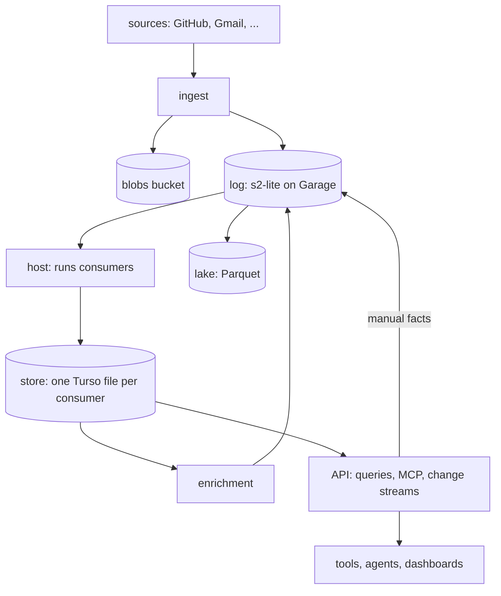

# pepys design

pepys is a personal data hub. It takes in its owner's own data from pluggable sources, keeps every
change as an immutable fact, builds entities and cross-source links from those facts, and serves
them to the owner's tools and agents through typed queries, MCP tools and live change streams. The
question it exists to answer is "what is waiting on me, across everything?". Every other part of the
design follows from one split: facts are kept forever and never change, and everything built from
them can be deleted and rebuilt by replaying the facts.

pepys ships as `@pepys/*` packages plus a deployment that assembles them in code. The core packages
hold the log, the host, the store and the API, and none of them is written for one source. A source
is a package that brings its ingest paths, its fact families and the consumers that build its
entities. GitHub and Gmail are the first two sources, and these docs use them as their examples.

The deployment chooses its sources and holds what is personal to its owner: the owner's identity,
queries such as "waiting on me", and consumers that only that owner wants.

## Principles

- Facts enter at one place, the log. A fact is a source event, an enrichment result or a manual
  assertion, and nothing changes or deletes it.
- Everything else is a projection: entity tables, links, the change feed and the search index. A
  replay of the facts rebuilds any projection.
- The bucket is the only state. Everything durable lives in object storage, and local disks hold
  caches and rebuildable projections.
- A consumer is pure. The same facts give the same output, and outside calls happen only in
  enrichment, whose results return to the log as facts.
- Each table has one owner, and a consumer writes only the tables it owns.
- Facts record what happened, and meaning is decided at query time. Blame runs on every merged pull
  request, and the asker decides which of them count as fixes.
- Entities are named by global string IDs, with no foreign keys, so a link can point at an entity
  that has not arrived yet.

## Pipeline

Ingest writes attachments to the blobs bucket before it appends the fact that references them, so a
fact never points at a missing blob. The host is the only writer of the store. Enrichment reads the
store's change feed and writes its results to the log, never to the store. The API reads the store
and never writes it; manual links and corrections reach the log as facts.

## Design docs

- [Storage](./storage.md) — Garage on the owner's k3s server, the buckets, and blobs.
- [Log](./log.md) — s2-lite streams, the fact envelope, fact IDs, cursors, events and observations.
- [Ingest](./ingest.md) — what every source does, and the GitHub and Gmail sources.
- [Entities](./entities.md) — per-source tables, the shared entity view, aliases, people and
  tombstones.
- [Consumers](./consumers.md) — TypeScript compiled to WebAssembly, the host contract, and the two
  input modes.
- [Host](./host.md) — the Rust process that runs consumers, batches writes, and deploys consumer
  versions.
- [Store](./store.md) — Turso files, attach, and the Kysely dialect for queries.
- [Links](./links.md) — link tables, link extractors, typed links and retractions.
- [Enrichment](./enrichment.md) — git, MIME, model judgements and the job model.
- [Search](./search.md) — LEAF-IR embeddings, full-text search and hybrid ranking.
- [API](./api.md) — the query catalog, MCP, auth and agent writes.
- [Change feed](./change-feed.md) — the change log and the Durable Streams read protocol.
- [History](./history.md) — transitions, the fact index, and the Parquet lake.

## Spikes

Each spike settles one open question before the work that depends on it starts.

- [scriptc to WebAssembly](./spikes/scriptc-wasm/README.md)
- [s2-lite durability](./spikes/s2-lite-durability/README.md)
- [Turso from TypeScript](./spikes/turso-bindings/README.md)
- [oRPC on Elysia v2](./spikes/orpc-elysia-v2/README.md)
- [LEAF-IR under Bun](./spikes/leaf-ir-bun/README.md)
- [MIME parsers](./spikes/mime-parsers/README.md)
- [Durable Streams conformance](./spikes/durable-streams-conformance/README.md)
- [Source history retention](./spikes/source-retention/README.md)
- [Jev terms and choice sets](./spikes/jev-terms/README.md)
- [Parquet escape hatch](./spikes/parquet-escape-hatch/README.md)
