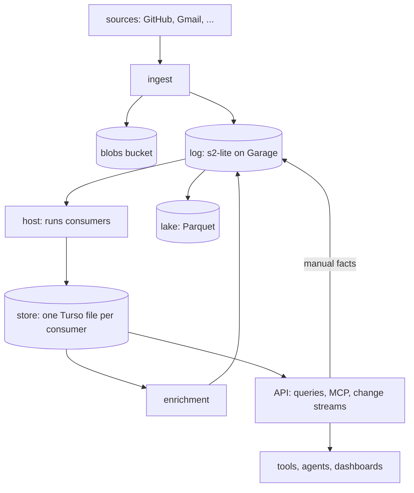

# pepys design

pepys is a personal data hub. It takes in its owner's own data from pluggable sources, keeps every
change as an immutable fact, builds entities and cross-source links from those facts, and serves
them to the owner's tools and agents through typed queries, MCP tools and live change streams. The
question it exists to answer is "what is waiting on me, across everything?". Every other part of the
design follows from one split: facts are kept forever and never change, and everything built from
them can be deleted and rebuilt by replaying the facts.

GitHub and Gmail are the first two sources, and these docs use them as their examples.

## Principles

- Facts enter at one place, the log. A fact is a source event, an enrichment result or a manual
  assertion, and pepys never changes or deletes it.
- Everything else is a projection: entity tables, links, the change feed and the search index. A
  replay of the facts rebuilds any projection.
- Object storage is the only state. Everything durable lives in object storage, and local disks hold
  caches and rebuildable projections.
- A consumer is pure. The same facts give the same output, and outside calls happen only in
  enrichment, whose results return to the log as facts.
- Each table belongs to one consumer, and a consumer writes only its own tables.
- Facts record what happened, and each query decides what the facts mean. For example, enrichment
  runs `git blame` on every merged pull request, and a query picks which of those pull requests
  count as bug fixes.
- Entities are named by global string IDs, with no foreign keys, so a link can point at an entity
  that has not arrived yet.

## Pipeline

Ingest writes attachments to the blobs bucket before it appends the fact that references them, so a
fact never points at a missing blob. The host is the only writer of the store. Enrichment reads the
store's change feed and writes its results to the log, never to the store. The API reads the store
and never writes it; manual links and corrections reach the log as facts.

## Packages

pepys is built from three kinds of package:

- **Core packages** hold the parts in the pipeline, such as ingest, the host, the store and the API.
  They are never written for one source.
- **A source package** brings one source: how ingest receives its data, the facts it writes, and the
  consumers that build its entities.
- **The deployment package** picks the sources and holds what is personal to the owner: the owner's
  identity, queries such as "waiting on me", and consumers that only the owner wants.

| Package or Rust crate  | Kind       | Holds                                                           | Design doc                       |
| ---------------------- | ---------- | --------------------------------------------------------------- | -------------------------------- |
| `@pepys/contract`      | core       | the typed contract of every API query and write                 | [API](./api.md)                  |
| `@pepys/schema`        | core       | the API that declares consumers and tables, and the generator   | [Consumers](./consumers.md)      |
| `@pepys/ingest`        | core       | the shared ingest code and the interface each source fills in   | [Ingest](./ingest.md)            |
| `@pepys/enrichment`    | core       | the enrichment jobs and the model clients they call             | [Enrichment](./enrichment.md)    |
| `@pepys/api`           | core       | the API server, its auth, and the reader of the store's changes | [API](./api.md)                  |
| `@pepys/kysely-turso`  | core       | the Kysely dialect for Turso                                    | [Store](./store.md)              |
| `@pepys/source-<name>` | source     | one source, such as `source-github` or `source-gmail`           | [Ingest](./ingest.md)            |
| `@pepys/deployment`    | deployment | the owner's identity, sources, queries and consumers            | [Entities](./entities.md#people) |
| `pepys-host`           | core crate | the host, which runs consumers and swaps in their new versions  | [Host](./host.md)                |
| `pepys-schema`         | core crate | the Rust types generated from `@pepys/schema`                   | [Consumers](./consumers.md)      |

A source package depends on `@pepys/schema` and `@pepys/ingest`. A core package never imports a
source package or the deployment package.

## Design docs

- [Architecture](./architecture.md) — ports and adapters, strategies, champion and challenger, and
  buckets.
- [Storage](./storage.md) — Garage on the owner's k3s server, the buckets, and blobs.
- [Log](./log.md) — s2-lite streams, the fact envelope, fact IDs, cursors, events and observations.
- [Ingest](./ingest.md) — what every source does, and the GitHub and Gmail sources.
- [Entities](./entities.md) — per-source tables, the shared entity view, aliases, people and
  tombstones.
- [Consumers](./consumers.md) — TypeScript compiled to WebAssembly, the host contract, and the two
  input modes.
- [Host](./host.md) — the Rust process that runs consumers, batches writes, and deploys consumer
  versions.
- [Store](./store.md) — Turso files, attach, and the Kysely dialect for queries.
- [Links](./links.md) — link tables, link extractors, typed links and retractions.
- [Enrichment](./enrichment.md) — git, MIME, model judgements and the job model.
- [Search](./search.md) — LEAF-IR embeddings, full-text search and hybrid ranking.
- [API](./api.md) — the query catalog, MCP, auth and agent writes.
- [Auth](./auth.md) — the API's OAuth server: clients, tokens, scopes and threats.
- [Change feed](./change-feed.md) — the change log and the Durable Streams read protocol.
- [History](./history.md) — transitions, the fact index, and the Parquet lake.
- [Runtime](./runtime.md) — the k3s workloads, images, secrets, network routes and schedules.

## Spikes

Each spike settles one open question before the work that depends on it starts. The spikes live in
[research/](../../../research/README.md), whose index says what each one answers.
