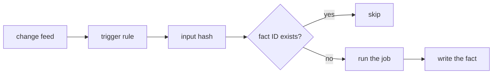

# Enrichment

Enrichment is the part of pepys that calls outside the process: git, a MIME parser, a model API, an
embedding model. It runs as a TypeScript service on Bun, because its time goes to waiting on git,
disks and networks. Every result returns to the log as a fact, so a replay reads the stored result
and never repeats the outside call. Enrichment never writes the store.

## The write-back pattern

A projection must produce the same rows on every replay. An outside call breaks that rule: a model
can answer differently, git needs a mirror, and a model call costs money each time. Enrichment makes
the call once and writes the answer as a fact, and a plain consumer projects that fact. The fact is
permanent, so its answer stays fixed until a new job version writes a new fact.

A job's fact ID is a hash of the job, the job version and the input hash. Before it runs, a job
looks up that ID in enrichment's own Turso file, so a restart, a replay or a second trigger never
repeats the work on the same input.

## Jobs

| Job            | Trigger                         | Writes                                      |
| -------------- | ------------------------------- | ------------------------------------------- |
| git diff       | each push                       | the diff hunks per file                     |
| git blame      | each merged pull request        | the commits that wrote the lines it changed |
| mail text      | each new message                | the plain text, as a blob and a fact        |
| mail label     | each extracted mail text        | one label and its probability, from Jev     |
| link judgement | each candidate pair from search | related, unrelated or unclear, from Jev     |
| embedding      | each extracted text             | one vector, from LEAF-IR                    |

### Git

Enrichment keeps a bare mirror of each followed repository and fetches it on each push fact. It runs
the `git` CLI through Bun's shell. A local mirror gives complete diffs with no rate limit, and
blame, which the GitHub API does not offer.

Blame runs on every merged pull request: on the files it changed, at the parent commit, and on the
lines it removed or changed, since new lines have no earlier author. The result maps commits to pull
requests through each pull request's merge commit SHA, which the pull request consumer records as an
alias. That mapping holds for squash merges. A repository that merges with merge commits or rebases
needs each pull request's commit list, which joins when such a repository is followed.

### Mail text

The mail text job parses each raw MIME message with an npm MIME parser and writes the plain text as
a blob plus a fact. Every later mail job reads that text. The
[MIME spike](../../../research/mime-parsers/README.md) picks the parser.

### Models

High-volume typed decisions go to Jev, through its API. Jev returns one choice from a set the caller
defines, with a calibrated probability, which matches labelling an email or judging a candidate
pair. Jev does not find links: code proposes each candidate pair, and Jev only judges it.

Claude, on the owner's subscription, does agent work over MCP, such as briefs and reply drafts. That
work reads the graph and is not an enrichment job. When an agent's output must become a fact, it
follows the same write-back pattern.

pepys runs no local language model. LEAF-IR is a small embedding model that runs on the CPU, so the
embedding job runs locally.

## Job versions

A model fact records the hashes of the model, the prompt, the grammar and the input. Prompts, label
sets and trigger rules live in versioned data files rather than code, and a change to any of them
gives a new job version without a rebuild. The projection uses the newest version, and the facts of
older versions stay for comparison.

`pepys preview enrich <job>` runs a new version on recent items and shows the labels that change.
`pepys up enrich <job>` runs it on every item. The owner's own corrections, which the API writes as
facts, form the test set, so a preview reports how often a new version agrees with them.
