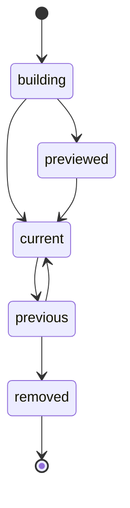

# Host

The host is a Rust process that runs every consumer on every fact. It embeds wasmtime to run
consumer modules and the Turso engine to write the store, and reads the log through S2's Rust SDK.
It schedules work per scope, applies the operations consumers return in batched transactions, keeps
each consumer's offset in the same transaction as its writes, and deploys new consumer versions
without a gap for readers. Rust is used here because the host runs on every fact; the services that
wait on networks are TypeScript.

## Batches and offsets

The host groups the facts for one consumer into batches and applies each batch in one Turso
transaction. The transaction holds the batch's operations, the consumer's new offset and the batch's
change log row. All three commit together or not at all, so a crash never leaves rows written with
the offset behind, or the reverse. On restart, the host replays at most the uncommitted batch, and
upserts make that harmless.

## Scheduling

A scope runs on one worker at a time: the host takes a keyed lock per scope, so two recomputes of
one pull request never overlap and miss each other's facts. Different scopes run in parallel, up to
a concurrency limit per consumer.

The host keeps the set of dirty scopes in memory and debounces it, so a burst of pushes to one pull
request causes one recompute. Each scope consumer keeps an offset into the change feed it listens
to, and on restart the host rebuilds the dirty set from that offset.

## Consumer versions

A consumer version is a module identified by the hash of its content, and every row the host writes
records the hash of the module that wrote it. The host owns the lifecycle of a version as a
transition table:



A version moves only along these edges, and the host is the one writer of version state.

## Preview and up

`pepys preview <consumer>` builds a version, replays every fact into a throwaway file, and prints
the diff against the current version. It changes nothing a reader can see, and it exists for
development.

`pepys up` deploys. It replays into a new file to the side, catches the new file up to the live head
of the log, pauses that consumer's writer for the last few facts, swaps the new file in, and marks
dirty every dependent scope whose input rows the diff changed. It asks nothing. When a preview of
the same hash exists, `up` reuses its file and replays only the facts that arrived since.

Building to the side keeps readers on the old version until the swap, so no reader sees a
half-replayed table. The previous version's file stays on disk, and `pepys up` with the previous
hash swaps it back with no replay.

## File layout

```text
store/<consumer>/
  <module hash>/      the database file with its write-ahead log files
  <module hash>/
  current ->          symlink to the live version's directory
```

A swap never renames a database file, because SQLite finds its write-ahead log files by path and a
renamed file can pick up a stale log. The swap runs in this order:

1. The host builds the new version in its own directory.
2. The host stops that consumer's writer and checkpoints the new file's write-ahead log.
3. The host repoints the `current` symlink, which is one atomic step.
4. The host writes a `consumer.swapped` event so the API attaches the new file.
5. The host keeps the old directory for rollback.

## Snapshots

After a checkpoint, the host copies each current file to the snapshots bucket on a schedule. A
restore downloads the snapshots and replays only the facts after each snapshot's offsets.

## Waking readers

After each commit, the host signals the API over a local socket, so live change-stream readers get
new rows without polling the files.
