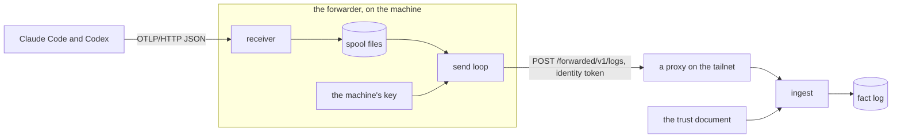

# The telemetry forwarder

- **Status:** agreed

Ingest stores a telemetry export only when an imp sends it. An imp is a small virtual machine that
impz runs a coding agent in, and the imp's broker adds two tokens to each export: a token that every
imp shares, and an identity token that the broker signs.
[The checks](../../architecture/plug-ins/telemetry.md#the-checks) covers both. A coding agent on a
machine outside impz, such as the owner's PC, has neither token, so pepys stores none of its
telemetry. Its exports go to the sink: a script on the machine that listens on the OTLP port,
appends each export to a file per day, and sends nothing on.

The telemetry forwarder, `@pepys/telemetry-forwarder`, is one program that replaces the sink. It
appends each export to a spool file, one file per day, and sends each one to ingest with an identity
token that the machine signs with its own key. Ingest gains one route for forwarders, the sender
route, whose only check is that identity token, so the machine holds no copy of the shared token.

Ingest checks a forwarder's token against the machine's trust document: a JSON file that holds the
public half of the machine's key, which the owner adds to the deployment.
[The sender proof](../../architecture/ingest/ingest.md#the-sender-proof) covers how ingest checks a
token.

## Shape

The receiver and the send loop share only the spool files. The receiver answers an exporter once the
export is in a spool file, whatever the send loop does.

## The docs

| Doc                                   | Covers                                                                                                                                             |
| ------------------------------------- | -------------------------------------------------------------------------------------------------------------------------------------------------- |
| [The forwarder](./forwarder.md)       | the program on the machine: the receiver, the spool files, the send loop, the health answer, the identity token, the settings and the commands     |
| [The sender route](./sender-route.md) | the change to `@pepys/kit`, `@pepys/ingest` and the telemetry plug-in, the trust document, what the deployment needs, and who can write through it |

## Decisions

- **One program receives and sends.** The spool files are the only state between the receiver and
  the send loop. A fault in ingest, or in the proxy in front of it, therefore never fails an
  exporter. Codex's exporter sends each export once, and it loses nothing to such a fault.
- **The machine signs its own identity token, and holds no shared token.** The private key stays on
  the machine, and the deployment holds only the public half. A person who takes the machine gets
  the machine's key, and gets nothing that lets them send as an imp.
- **Every process of the machine's user can send as the machine.** Each one can read the key file, a
  coding agent included.
  [Who can write through the route](./sender-route.md#who-can-write-through-the-route) gives what
  such a process can write.

## Stages

| Stage | Who                          | Builds                                                                                                                                                                                        | The machine after it                                      |
| ----- | ---------------------------- | --------------------------------------------------------------------------------------------------------------------------------------------------------------------------------------------- | --------------------------------------------------------- |
| 1     | a builder, in this repo      | the receiver, the spool files and the health answer of the forwarder                                                                                                                          | unchanged: the sink runs                                  |
| 2     | a builder, in this repo      | the sender route, the forwarder's identity code, send loop and install command, and their tests                                                                                               | unchanged: the sink runs                                  |
| 3     | the owner, in the deployment | a pepys release that holds stage 2; the two variables, the trust document, the tailnet name and the larger volume of [what the deployment needs](./sender-route.md#what-the-deployment-needs) | holds a key and a unit that is not enabled; the sink runs |
| 4     | the owner, on the machine    | the switch from the sink to the forwarder                                                                                                                                                     | the forwarder runs, and the sink is gone                  |

Stage 3 needs the machine's trust document, so the owner installs the package on the machine and
runs `install` at the start of stage 3. `install` makes the key and prints the document, and enables
and starts nothing.

In stage 4 the owner does the switch in this order:

1. Stop the sink.
2. Move every `*-logs.jsonl` file of the sink into the spool folder. They are the history: every
   export the sink stored.
3. Enable and start the forwarder's unit.

The forwarder appends to the current day's file that the sink began, and sends the newest file
first, so a new export never waits behind the history. An exporter that sends between step 1 and
step 3 gets no connection. Codex sends each export once, so it loses that export.

## Open questions

- **Can the release workflow publish a package name that npm has never seen?** The owner settles it,
  from npm's rules for trusted publishing. Until then, stage 3 waits for the release.
