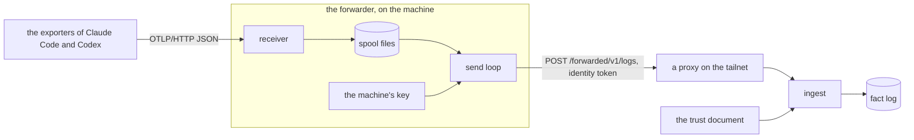

# The telemetry forwarder

- **Status:** agreed

pepys stores the telemetry of a coding agent only when the agent runs in an imp. On any other
machine, such as the owner's PC, the agent's OTLP exporter sends its exports to the sink: a script
on the machine that listens on the OTLP port, appends each export to one file per day, and sends
nothing on.

The telemetry forwarder is a program in `@pepys/source-telemetry` that replaces the sink. It appends
each export to a spool file, one file per day, and sends each export to ingest with an identity
token that the machine signs with its own key. Ingest gains one route for forwarders, the sender
route, whose only check is that identity token.

The design uses these terms:

- **impz** is the owner's system that runs each coding agent in an **imp**, a small virtual machine.
  **impd** is the impz daemon on a host. Its broker adds two tokens to each export of an imp: a
  token that every imp shares, and an identity token that impd signs. Ingest's telemetry path checks
  both, as [The checks](../../architecture/plug-ins/telemetry.md#the-checks) says. A machine outside
  impz has neither token.
- **The trust document** of a machine is a JSON file with the public half of the machine's key. The
  owner adds the file to the deployment, and ingest checks each of the machine's tokens against it,
  as [The sender proof](../../architecture/ingest/ingest.md#the-sender-proof) says.
- **The deployment** is the owner's running pepys: ingest, the host and the API, with the
  configuration in the owner's infrastructure repo.
- **The tailnet** is the owner's private network of devices. A name on the tailnet answers only to
  those devices.

## Shape

The receiver and the send loop share only the spool files. The receiver answers an exporter once the
export is in a spool file, whatever the send loop does.

## The docs

| Doc                                   | Covers                                                                                                                                                |
| ------------------------------------- | ----------------------------------------------------------------------------------------------------------------------------------------------------- |
| [The forwarder](./forwarder.md)       | the program on the machine: the receiver, the spool files, the send loop, the answer to `GET /health`, the identity token, the settings, the commands |
| [The sender route](./sender-route.md) | the change to `@pepys/kit`, `@pepys/ingest` and the telemetry plug-in, the trust document, what the deployment needs, and who can write through it    |

## Decisions

- **One program receives and sends.** The spool files are the only state between the receiver and
  the send loop, so an exporter gets its answer even while ingest, or the proxy in front of ingest,
  is down. Codex's exporter sends each export once, and an outage of ingest costs it nothing.
- **The machine signs its own identity token, and holds no shared token.** The private key stays on
  the machine, and the deployment holds only the public half. A person who takes the machine gets
  the machine's key, and gets nothing that lets them send as an imp.
- **Every process on the machine can send as the machine.** The receiver takes an export from any
  process that reaches its loopback port, with no credential, and each process of the machine's user
  can read the key file, a coding agent included. The design accepts both: an exporter has no
  credential that the same user's other processes could not read, so the machine is one sender.
  [Who can write through the route](./sender-route.md#who-can-write-through-the-route) gives what
  such a process can write.
- **The forwarder ships inside `@pepys/source-telemetry`.** npm already has that package, so the
  release workflow publishes the forwarder with no step by hand: a package name that npm has never
  seen needs a person to publish it once. The package owns the OTLP paths, and installs on the
  machine with `@pepys/kit` and a few small libraries. `@pepys/cli` would bring the API, ingest and
  the consumer compiler with it.

## Stages

No stage is built yet.

| Stage | Who                          | Does                                                                                                                         | The machine after it                                                   |
| ----- | ---------------------------- | ---------------------------------------------------------------------------------------------------------------------------- | ---------------------------------------------------------------------- |
| 1     | a builder, in this repo      | the forwarder's receiver and spool files, its `GET /health`, the `bin` entry and the `run` command                           | unchanged: the sink runs                                               |
| 2     | a builder, in this repo      | the sender route; the forwarder's identity files, token signer, send loop and `install` command; their tests                 | unchanged: the sink runs                                               |
| 3     | the owner, in the deployment | releases pepys with stage 2, then does each item of [what the deployment needs](./sender-route.md#what-the-deployment-needs) | holds the package, a key and a unit that is not enabled; the sink runs |
| 4     | the owner, on the machine    | switches from the sink to the forwarder                                                                                      | the forwarder runs, and the sink is gone                               |

In stage 3, after the release, the owner installs the package on the machine and runs the
forwarder's [`install` command](./forwarder.md#the-commands). The command makes the key, writes a
systemd user unit, and prints the trust document that the deployment needs. It enables and starts
nothing.

**Caution:** between step 1 and step 3 below, nothing listens on the OTLP port. Codex's exporter
sends each export once, so Codex loses each export it sends in that time. Do the three steps without
a pause.

In stage 4, the owner switches in this order:

1. Stop the sink, and disable its unit.
2. Move every `*-logs.jsonl` file of the sink into the spool folder. These files are the history:
   every log export the sink stored, in the spool's own line format and file names.
3. Enable and start the forwarder's unit. Expect: `GET /health` answers 200 with `"send":"sending"`.

The forwarder appends to the current day's file that the sink began. It sends the newest file first,
so a new export never waits behind the history.
