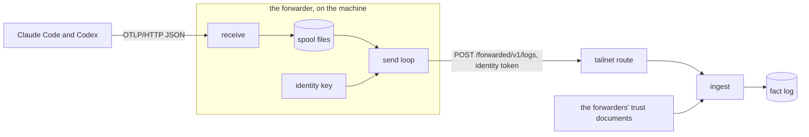

# The telemetry forwarder

- **Status:** agreed

Ingest takes a telemetry export only from an imp, because only an imp's broker holds the shared
token and signs the identity token. A coding agent on a machine outside impz, such as the owner's
PC, therefore stores nothing in pepys. Its exports go to the sink: a script on the machine that
listens on the OTLP port, appends each export to a daily file, and sends nothing on.

The telemetry forwarder, `@pepys/telemetry-forwarder`, is one program that replaces the sink. It
writes each export to a spool file, and sends it to ingest with an identity token that the machine
signs with its own key. Ingest gains one route for it, whose only check is that identity token, so
no copy of the shared token goes on the machine.

[The telemetry plug-in](../../architecture/plug-ins/telemetry.md) covers the OTLP paths, the two
checks of an imp's export and the fact IDs. [Ingest](../../architecture/ingest/ingest.md) covers
each step of a delivery, the status codes and the sender proof.

## Shape

Receive and the send loop share only the spool files. Receive answers an exporter once the export is
in a spool file, whatever the send loop does.

## The docs

| Doc                                   | Covers                                                                                                                                       |
| ------------------------------------- | -------------------------------------------------------------------------------------------------------------------------------------------- |
| [The forwarder](./forwarder.md)       | the program on the machine: receive, the spool files, the send loop, the health answer, the identity token, the settings and the commands    |
| [The sender route](./sender-route.md) | the change to the kit, ingest and the telemetry plug-in, the trust document, what the deployment builds, and who can write through the route |

## Decisions

- **One program receives and sends.** The spool file is the only state between the two halves, so a
  fault in ingest or the route never fails an exporter, and Codex's exporter, which sends each
  export once, loses nothing.
- **The machine signs its own identity token, and holds no shared token.** The private key stays on
  the machine, the deployment holds only the public half, and a machine that is lost or taken gives
  up nothing that an imp uses.

## Stages

| Stage | Builds                                                                                    | Where          | The machine after it                     |
| ----- | ----------------------------------------------------------------------------------------- | -------------- | ---------------------------------------- |
| 1     | receive, the spool and the health answer                                                  | this repo      | unchanged: the sink runs                 |
| 2     | the sender route, the identity, the send loop, the install command, the tests, a release  | this repo      | unchanged: the sink runs                 |
| 3     | the release's image, the two variables, the trust document, the tailnet route, the volume | the deployment | unchanged: the sink runs                 |
| 4     | the install, the switch from the sink, the load of the history                            | the machine    | the forwarder runs, and the sink is gone |

Stage 4 needs the machine's trust document in stage 3, so `install` runs once before stage 3 to
print it, and writes a unit that nothing starts. The switch stops the sink and starts the forwarder
on the same port. The history loads when the sink's `*-logs.jsonl` files move into the spool folder,
after the switch.
