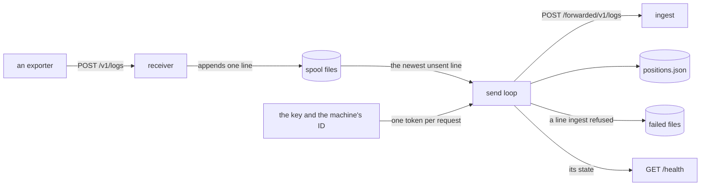

# The forwarder

- **Status:** agreed

The forwarder is the program of `@pepys/telemetry-forwarder`. It runs on a machine that is no imp,
takes each OTLP export on a local port, appends it to a spool file, and sends it to
[the sender route](./sender-route.md) of ingest with an identity token that the machine signs.
[The design's README](./README.md) says what an imp and the sink are, why the forwarder exists, and
the stages.

## Shape



## Contracts

### The receiver

The receiver listens on `PEPYS_FORWARDER_HOST` and `PEPYS_FORWARDER_PORT`. It takes a `POST` to
`/v1/logs`, `/v1/metrics` and `/v1/traces`, and answers each in the first row that fits:

| The request                                                  | Answer   | Stored   |
| ------------------------------------------------------------ | -------- | -------- |
| its content type is not `application/json`                   | 415      | nothing  |
| its body does not parse as JSON, or its gzip body is corrupt | 400      | nothing  |
| it is for `/v1/metrics` or `/v1/traces`                      | 200 `{}` | nothing  |
| it is for `/v1/logs`, and the append fails                   | 503      | nothing  |
| it is for `/v1/logs`                                         | 200 `{}` | one line |

The receiver unpacks a body whose `content-encoding` is `gzip` before it stores the export. It
answers `GET /health` with [the health answer](#the-health-answer).

### The spool files

```text
<PEPYS_FORWARDER_SPOOL_DIR>/
  2026-03-02-logs.jsonl          one spool file per UTC day of receipt, mode 0600
  positions.json                 the send loop's position in each spool file
  failed/2026-03-02-logs.jsonl   the lines of that day's spool file that ingest refused
```

Each line of a spool file is one export:

```ts
// forwarder, the spool. One line of `<day>-logs.jsonl`, as JSON with no line break inside.
interface SpoolLine {
  received: string; // when the receiver took the export, ISO 8601 in UTC
  path: '/v1/logs';
  ua: string | null; // the exporter's `user-agent`
  body: unknown; // the export as parsed JSON, after gzip is unpacked
}

// positions.json: the byte offset of the first line not yet sent, by file name.
// A spool file with no entry starts at 0.
type Positions = Record<string, number>; // { "2026-03-02-logs.jsonl": 48211 }

// One line of a file under `failed/`: the spool line and why it left the spool.
interface FailedLine extends SpoolLine {
  // status null: the line is no SpoolLine, so the send loop made no request
  failed: { at: string; status: number | null; reason: string };
}
```

The sink writes its log exports in the same line format, under the same file names. A log file of
the sink that the owner moves into the spool folder is therefore a spool file with no entry in
`positions.json`, and the send loop sends it from its first line. The send loop reads only the files
named `<day>-logs.jsonl`, and leaves every other file in the folder alone.

### The send request

The send loop posts the `body` of one spool line per request:

```http
POST <PEPYS_FORWARDER_INGEST_URL>/forwarded/v1/logs
content-type: application/json
imp-identity: <a token signed for this request>

{"resourceLogs":[…]}
```

The send loop reads the answer, and does what the first row that fits says:

| The answer                                                            | The send loop                                                                |
| --------------------------------------------------------------------- | ---------------------------------------------------------------------------- |
| 2xx                                                                   | moves the position past the line                                             |
| 400, 413, 415, 422 or 500, with ingest's `{"error": "<reason>"}` body | copies the line to the `failed` file, and moves the position past it         |
| 401, 403 or 404                                                       | goes to the `stopped` state, and makes its next request 15 minutes later     |
| any other answer, a timeout, or no connection                         | goes to the `waiting` state, and makes its next request after the retry wait |

Ingest sends each status of the second row only for a body that it refuses again on a resend, as
[Retries and status codes](../../architecture/ingest/ingest.md#retries-and-status-codes) says. A 500
without ingest's body comes from the proxy in front of ingest, so it falls to the last row.

### The health answer

```http
GET /health

200 {"send":"off","failed":0}
200 {"send":"sending","failed":0}
200 {"send":"waiting","status":503,"since":"2026-03-02T10:15:00Z","failed":2}
503 {"send":"stopped","status":401,"since":"2026-03-02T10:15:00Z","failed":2}
```

```ts
// forwarder, the send loop. The receiver reads it for each health request.
interface SendState {
  // off: no ingest URL. sending: the last request got a 2xx or moved a line to `failed`, or no
  // request was made yet.
  send: 'off' | 'sending' | 'waiting' | 'stopped';
  status?: number | null; // waiting and stopped only: the last answer, null for none
  since?: string; // waiting and stopped only: when the state began
  failed: number; // the lines moved to a `failed` file since the process started
}
```

Only the `stopped` state answers 503.

### The identity token

The machine is an issuer of identity tokens. The forwarder signs one compact ES256 token per
request:

```ts
// forwarder, identity. The header and the claims of one token.
const header = { alg: 'ES256', kid }; // kid: the key ID in the machine's trust document

const claims = {
  iss: 'study-pc', // PEPYS_FORWARDER_ISSUER
  sub: '5f0c8a52-1d7e-4b3a-9c1f-2e6d7a8b9c10', // the machine's ID: a random UUID, made once by `install`
  aud: 'forwarder.pepys.example', // PEPYS_FORWARDER_AUDIENCE: what ingest holds in PEPYS_TELEMETRY_FORWARDER_AUDIENCE
  iat: 1794355200, // the machine's clock, in seconds, when the request is made
  exp: 1794355255, // iat + 55, the longest life the verifier takes
  jti: '0c5e…', // random for each token
  imp_name: 'study-pc', // the issuer name. The verifier needs the claim, though the machine is no imp.
};
```

The header name and the claim names are those of impz, because ingest checks the token with
`verifyImpIdentity` from `@impz/client/identity`. The signature is the 64-byte `r || s` form that
WebCrypto's ECDSA `sign` returns; the verifier refuses a DER signature.

The verifier takes a token from 5 seconds before its `iat` to 5 seconds after its `exp`, by ingest's
clock. A token therefore passes while the machine's clock is at most 5 seconds ahead of ingest's
clock, or at most 60 seconds behind it.

`install` prints the machine's trust document, in
[the format that ingest reads](./sender-route.md#the-trust-document).

### Settings

| Variable                       | Holds                                                         | Default                                    |
| ------------------------------ | ------------------------------------------------------------- | ------------------------------------------ |
| `PEPYS_FORWARDER_HOST`         | the address the receiver listens on                           | `127.0.0.1`                                |
| `PEPYS_FORWARDER_PORT`         | the port the receiver listens on                              | `4318`                                     |
| `PEPYS_FORWARDER_SPOOL_DIR`    | the spool folder                                              | `~/.local/state/pepys-telemetry-forwarder` |
| `PEPYS_FORWARDER_IDENTITY_DIR` | the folder of the private key and the machine's ID, mode 0700 | `~/.config/pepys-telemetry-forwarder`      |
| `PEPYS_FORWARDER_INGEST_URL`   | the origin of the tailnet name that reaches ingest            | none                                       |
| `PEPYS_FORWARDER_ISSUER`       | the machine's issuer name                                     | none                                       |
| `PEPYS_FORWARDER_AUDIENCE`     | the audience of each token                                    | none                                       |

With `PEPYS_FORWARDER_INGEST_URL` unset, the forwarder runs the receiver alone and starts no send
loop. With it set, the forwarder exits 1 at start when the issuer, the audience, the key or the
machine's ID is missing.

### The commands

```sh
pepys-telemetry-forwarder run
# the receiver, and the send loop when PEPYS_FORWARDER_INGEST_URL is set; runs until a stop signal

pepys-telemetry-forwarder install --issuer study-pc --audience forwarder.pepys.example \
  --ingest-url https://ingest.tailnet.example
# → makes the key and the machine's ID in the identity folder, when it holds none
# → writes ~/.config/systemd/user/pepys-telemetry-forwarder.service
# → prints the trust document to stdout, and the issuer and the machine's ID to stderr
```

```ini
# the unit that `install` writes
[Service]
ExecStart=<absolute path of the bun that runs install> <absolute path of the package's bin file> run
Environment=PEPYS_FORWARDER_ISSUER=study-pc
Environment=PEPYS_FORWARDER_AUDIENCE=forwarder.pepys.example
Environment=PEPYS_FORWARDER_INGEST_URL=https://ingest.tailnet.example
Restart=always

[Install]
WantedBy=default.target
```

- `install` needs `--issuer` and `--audience`. Without `--ingest-url`, the unit sets no ingest URL.
- `install` writes each other `PEPYS_FORWARDER_` variable of its own environment into the unit.
- `install` never enables or starts the unit.
- `install` never replaces a key or an ID that the identity folder holds, so a second run prints the
  same trust document. A second run writes the unit again.
- `install` refuses an issuer name that is not 1 to 128 letters, digits, `.`, `_` or `-`.

### The package

`@pepys/telemetry-forwarder` is a public package, because a machine installs it from npm. It has the
fields that [the agent guidelines](../../../AGENTS.md#packages) list for a public package, and a
`bin` of `pepys-telemetry-forwarder`. The release scripts find each package that is not private, so
the release needs no list changed. The list of public packages in the agent guidelines gains the
name.

```text
packages/telemetry-forwarder/src/
  run-forwarder.ts   the entry: reads the settings, starts the receiver and the send loop
  receive/           the receiver and the health answer
  spool/             the spool files, the positions, the failed files and retention
  send/              the send loop
  identity/          the key, the machine's ID, the token signer and the trust document
  install/           the install command
```

Stage 1 builds `receive/` and the append to a spool file. Stage 2 builds the rest. Shipped code
imports neither `@pepys/ingest` nor `@impz/client`. The tests take `@pepys/ingest` and
`@pepys/source-telemetry` as dev dependencies.

## Constraints

The receiver:

- The receiver answers 200 to a log export only after the append of the line returns. It never waits
  for the send loop, and never reads `positions.json`.
- The receiver sets no size limit of its own. An export over the limits of ingest's telemetry path,
  4,194,304 bytes or 1,000 records, gets 413 from ingest and goes to the `failed` file.

The send loop:

- The send loop has one request in flight. Before each request it picks the newest spool file that
  holds an unsent line, and sends that file's first unsent line. An export of the current day
  therefore never waits behind a line of an older day.
- A wait holds the whole loop, because a failed request says the route is down, whatever the line.
  After the wait, the loop picks its line again. A new export never shortens a wait.
- The send loop reads a line only once the line ends in a line break, because the receiver appends
  to the newest file.
- The send loop writes `positions.json` after each line it moves past, by a write to a temporary
  file and a rename. When the process ends between an answer and that write, the next run sends one
  export again.
- The retry wait is 1 second at first, doubles after each request that falls to the last row of the
  answer table, never passes 300 seconds, and returns to 1 second after a 2xx.
- The send loop logs one error line when it enters the `stopped` state, and none for each request
  after it. A 2xx returns the loop to `sending`. The receiver keeps running in every state, and the
  spool keeps every export.
- A line that is no `SpoolLine`, or whose `path` is not `/v1/logs`, goes to the `failed` file with a
  null status.

Resends, retention and the key:

- A resend changes no row.
  [The telemetry plug-in](../../architecture/plug-ins/telemetry.md#one-record-becomes-one-fact)
  builds each fact ID from the record, and the host applies each fact ID once. The fact log holds
  one copy of a resend when ingest gets the same bytes from the same sender within an hour and has
  not restarted, and two copies otherwise.
- At start, and each time it sends the last line of a file, the send loop deletes each spool file
  whose position is at its end and whose day is more than 7 days before the current UTC day. It
  deletes the file's entry in `positions.json` with it. A file of the history that is older than 7
  days therefore goes as soon as its last line is sent.
- The send loop never deletes a spool file that holds an unsent line, and never deletes a file under
  `failed/`.
- The private key and the machine's ID are files of mode 0600. No command prints the private key,
  and no log line holds the key or a token.
- Every fact that the forwarder sends carries the origin `{ issuer: <iss>, subject: <sub> }`. A
  caller of [the session query](../../architecture/plug-ins/telemetry.md#the-query) passes that pair
  to read a session that ran on the machine, so a machine that loses its ID file writes under a new
  origin.

The tests of the send loop run it against an ingest in the same process, with a clock and a timer
that the test sets:

- the ingest is `createIngest` from `@pepys/ingest`, with the telemetry plug-in and
  `createMemoryFactLog`;
- its sender proof comes from `readImpIdentitySenderProof`, which reads a folder that holds the
  trust document the forwarder's identity code wrote.

Each line below is one test:

- An export sent twice inside the hour leaves one copy in the log. Sent again after the hour, it
  leaves two copies, and the set of fact IDs in the log stays the same.
- Two 503 answers and then a 200 move the position past the export once, and leave no line in the
  `failed` file.
- A token signed by a key that is not in the trust document gets 401, the loop enters `stopped` with
  the position unchanged, and `/health` answers 503.
- A `stopped` loop that then gets a 200 moves the position on, and `/health` answers 200.
- A process that ends in the middle of a file, and starts again, sends from the saved position and
  sends no earlier line.
- A 400 answer copies the line to the `failed` file, the loop sends the next line, and `/health`
  counts one failed line.
- A 500 answer with no `error` body leaves the line in the spool.
- With an older file unsent, a line that arrives in the current day's file goes out before the older
  file's next line.

## Decisions

- **The spool keeps the sink's line format.** The history then loads with no conversion.
- **One stored export per request.** The request body is the body the exporter sent, so ingest's
  limits and fact IDs are those of an export sent straight to ingest.
- **The send loop moves a line to `failed` only on an answer that ingest sends for a body it never
  stores.** Every other failure keeps the line in the spool, because nothing sends a line in
  `failed` again.
- **The newest file goes first.** A load of the history, or a long outage, never delays the current
  day's exports.
- **The send loop deletes what it sent, after 7 days.** pepys is the durable home of the data, and
  the 7 days leave time to send a file again when a fault is found.

## Builder decides

- The names of internal functions and files inside each folder, and how the receiver reads the send
  loop's state.
- The file format of the private key and of the machine's ID.
- The request timeout, and whether the send loop sends a gzip body.
- Whether the receiver calls `fsync` after an append.
- How the send loop learns of a new line: a poll of the spool folder, or a signal inside the
  process.
- How the tests make ingest answer 503: a `FactLog` of their own that gives no acknowledgement, or
  ingest's stub fact log behind a new `./test-utils/*` export of `@pepys/ingest`.
- The wording of each log line and each error.

## Out of scope

- Metrics and traces. The receiver answers them and stores nothing, because ingest stores neither.
- A second machine. Each machine would run its own install with its own issuer name; nothing here is
  tested with two.
- A change of the machine's key. A new key is a new trust document and a restart of ingest.
- A command that sends the lines of a `failed` file again.
- An alert on a `stopped` loop or a failed line. `/health` shows both, and nothing in this design
  reads it.
