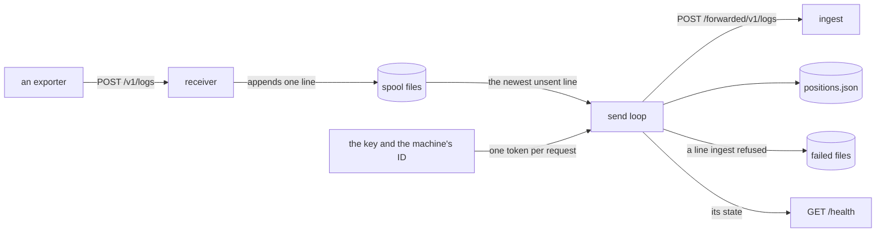

# The forwarder

- **Status:** agreed

The forwarder is a program in `@pepys/source-telemetry` for a machine outside impz. It takes each
OTLP export on a local port, appends the export to a spool file, and sends it to
[the sender route](./sender-route.md) of ingest with an identity token that the machine signs.
[The design's README](./README.md) defines impz, the sink, the trust document and the tailnet, and
gives the stages.

## Shape



## Contracts

### The receiver

The receiver listens on `PEPYS_FORWARDER_HOST` and `PEPYS_FORWARDER_PORT`. It takes a `POST` to
`/v1/logs`, `/v1/metrics` and `/v1/traces`, and answers each request by the first row that fits:

| The request                                                  | Status   | Stored   |
| ------------------------------------------------------------ | -------- | -------- |
| its content type is not `application/json`                   | 415      | nothing  |
| its body does not parse as JSON, or its gzip body is corrupt | 400      | nothing  |
| it is for `/v1/metrics` or `/v1/traces`                      | 200 `{}` | nothing  |
| it is for `/v1/logs`, and the append fails                   | 503      | nothing  |
| it is for `/v1/logs`                                         | 200 `{}` | one line |

The receiver unpacks a body whose `content-encoding` is `gzip` before it stores the export. It
serves [`GET /health`](#get-health) too.

### The spool files

```text
<PEPYS_FORWARDER_SPOOL_DIR>/
  2026-03-02-logs.jsonl          one spool file per UTC day of receipt, mode 0600
  positions.json                 the send loop's position in each spool file
  failed/2026-03-02-logs.jsonl   the lines of that day's spool file that ingest refused
```

Each line of a spool file is one export:

```ts
// forwarder, the spool. One line of `<day>-logs.jsonl`, as JSON with no line break inside.
interface SpoolLine {
  received: string; // when the receiver took the export, ISO 8601 in UTC
  path: '/v1/logs';
  ua: string | null; // the exporter's `user-agent`
  body: object; // the export as parsed JSON, after gzip is unpacked
}

// positions.json, by file name. A spool file with no entry starts at offset 0.
type Positions = Record<string, Position>;

interface Position {
  offset: number; // the byte offset of the first line not yet sent
  sentAt?: string; // when the send loop passed the last line of a file of an earlier day
}

// One line of a file under `failed/`.
interface FailedLine {
  line: unknown; // the spool line as parsed JSON, or its text when it does not parse
  failed: { at: string; status: number | null; reason: string }; // status null: no request was made
}
```

The sink writes each log export as the same line, under the same file names. A log file of the sink
that the owner moves into the spool folder is therefore a spool file with no position, and the send
loop sends it from its first line.

- The send loop reads only the files named `<day>-logs.jsonl`, and leaves every other file in the
  folder alone. The sink's `<day>-metrics.jsonl` files are such files.
- The send loop sends a line when the line parses as JSON, its `path` is `/v1/logs`, and its `body`
  is an object. It checks no other field.

### The send request

The send loop posts one spool line per request, with `JSON.stringify` of the line's `body` as the
request body:

```http
POST <PEPYS_FORWARDER_INGEST_URL>/forwarded/v1/logs
content-type: application/json
imp-identity: <a token signed for this request>

{"resourceLogs":[…]}
```

The send loop acts on the answer by the first row of this table, the answer table, that fits:

| The answer                                    | The send loop                                                               |
| --------------------------------------------- | --------------------------------------------------------------------------- |
| 2xx                                           | moves the position past the line                                            |
| 400, 413, 415 or 422                          | appends the line to the `failed` file, and moves the position past it       |
| 401, 403, 404 or 500                          | enters the `stopped` state, and makes its next request 15 minutes later     |
| any other answer, a timeout, or no connection | enters the `waiting` state, and makes its next request after the retry wait |

Ingest answers 400, 413, 415 or 422 only for a body that it refuses again on a resend, as
[Retries and status codes](../../architecture/ingest/ingest.md#retries-and-status-codes) says.
Ingest answers 500 for a fault of the deployment, such as a log that refuses every append. On a 500
the send loop therefore keeps the line, because the fault would otherwise move every line of the
spool to `failed`.

### `GET /health`

```http
GET /health

200 {"send":"off","failed":0}
200 {"send":"sending","failed":0}
200 {"send":"waiting","status":503,"since":"2026-03-02T10:15:00Z","failed":2}
503 {"send":"stopped","status":401,"since":"2026-03-02T10:15:00Z","failed":2}
```

```ts
// forwarder, the send loop. The receiver reads it for each `GET /health`.
interface SendState {
  // off: no ingest URL. sending: no request has failed since the last one that moved the position.
  send: 'off' | 'sending' | 'waiting' | 'stopped';
  status?: number | null; // waiting and stopped only: the last answer, null for none
  since?: string; // waiting and stopped only: when the state began
  failed: number; // the lines in the files under `failed/`
}
```

The receiver answers 503 in the `stopped` state, and 200 in every other state.

### The identity token

The machine is an issuer of identity tokens. The forwarder signs one compact ES256 token per
request:

```ts
// forwarder, identity. The JOSE header and the claims of one token.
const header = { alg: 'ES256', kid }; // kid: the key ID in the machine's trust document

const claims = {
  iss: 'study-pc', // PEPYS_FORWARDER_ISSUER
  sub: '5f0c8a52-1d7e-4b3a-9c1f-2e6d7a8b9c10', // the machine's ID: a random UUID, made once by `install`
  aud: 'forwarder.pepys.example', // PEPYS_FORWARDER_AUDIENCE: what ingest holds in PEPYS_TELEMETRY_FORWARDER_AUDIENCE
  iat: 1794355175, // the machine's clock, in seconds, when the request is made, less 25
  exp: 1794355230, // iat + 55, the longest life the verifier takes
  jti: '0c5e…', // random for each token
  imp_name: 'study-pc', // the issuer name. The verifier needs the claim, and the telemetry path's `read` ignores it.
};
```

- The HTTP header `imp-identity` and the claim `imp_name` keep impz's names, because ingest checks
  the token with `verifyImpIdentity` from `@impz/client/identity`.
- The signature is the 64-byte `r || s` form that WebCrypto's ECDSA `sign` returns. The verifier
  refuses a DER signature.
- The verifier takes a token from 5 seconds before its `iat` to 5 seconds after its `exp`, by
  ingest's clock. With `iat` 25 seconds in the past, a token passes while the machine's clock is at
  most 30 seconds ahead of ingest's clock, or at most 35 seconds behind it.

`install` prints the machine's trust document, in
[the format that ingest reads](./sender-route.md#the-trust-document).

### Settings

| Variable                       | Holds                                                         | Default                                    |
| ------------------------------ | ------------------------------------------------------------- | ------------------------------------------ |
| `PEPYS_FORWARDER_HOST`         | the address the receiver listens on                           | `127.0.0.1`                                |
| `PEPYS_FORWARDER_PORT`         | the port the receiver listens on                              | `4318`                                     |
| `PEPYS_FORWARDER_SPOOL_DIR`    | the spool folder                                              | `~/.local/state/pepys-telemetry-forwarder` |
| `PEPYS_FORWARDER_IDENTITY_DIR` | the folder of the private key and the machine's ID, mode 0700 | `~/.config/pepys-telemetry-forwarder`      |
| `PEPYS_FORWARDER_INGEST_URL`   | the base URL of the tailnet name that reaches ingest          | none                                       |
| `PEPYS_FORWARDER_ISSUER`       | the machine's issuer name                                     | none                                       |
| `PEPYS_FORWARDER_AUDIENCE`     | the audience of each token                                    | none                                       |

With `PEPYS_FORWARDER_INGEST_URL` unset, the forwarder runs the receiver alone and starts no send
loop. With it set, the forwarder exits 1 at start when the issuer, the audience, the key or the
machine's ID is missing.

### The commands

The owner installs the package for the machine's user with
`bun add --global --exact @pepys/source-telemetry@<version>`, which puts `pepys-telemetry-forwarder`
on the user's path.

```sh
pepys-telemetry-forwarder run
# the receiver, and the send loop when PEPYS_FORWARDER_INGEST_URL is set; runs until a stop signal

pepys-telemetry-forwarder install --issuer study-pc --audience forwarder.pepys.example \
  --ingest-url https://ingest.tailnet.example
# → makes the key and the machine's ID in the identity folder, when it holds none
# → writes ~/.config/systemd/user/pepys-telemetry-forwarder.service
# → prints the trust document to stdout
# → prints the issuer and the machine's ID to stderr, one labelled line each
```

```ini
# the unit that `install` writes
[Unit]
Description=pepys telemetry forwarder

[Service]
ExecStart=<bun> <bin> run
Environment=PEPYS_FORWARDER_ISSUER=study-pc
Environment=PEPYS_FORWARDER_AUDIENCE=forwarder.pepys.example
Environment=PEPYS_FORWARDER_INGEST_URL=https://ingest.tailnet.example
Restart=always
RestartSec=5

[Install]
WantedBy=default.target
```

- `<bun>` is the absolute path of the bun that runs `install`. `<bin>` is the absolute path of the
  package's bin file, with each symbolic link resolved. The unit therefore runs the installed
  version, by path, whatever the user's path holds later.
- `install` exits 1, and writes nothing, when its bin file is under the system's temporary folder,
  where `bunx` keeps a package: a later `bunx` run can delete that copy.
- `install` needs `--issuer` and `--audience`. `--ingest-url` is optional, and without it the unit
  sets no ingest URL.
- `install` exits 1 for an issuer name that is not 1 to 128 letters, digits, `.`, `_` or `-`, and
  for an ingest URL that is not `https://` with a host and no path.
- `install` copies `PEPYS_FORWARDER_HOST`, `PEPYS_FORWARDER_PORT`, `PEPYS_FORWARDER_SPOOL_DIR` and
  `PEPYS_FORWARDER_IDENTITY_DIR` from its own environment into the unit, when they are set. It takes
  the issuer, the audience and the ingest URL from the flags only.
- `install` never enables or starts the unit.
- The file of the machine's ID holds the issuer name too. `install` never replaces a key or an ID
  that the identity folder holds, and exits 1 when `--issuer` differs from the stored name. A second
  run therefore prints the same trust document, and writes the unit again.

### The package

The forwarder is the folder `src/forwarder/` of `@pepys/source-telemetry`:

```text
packages/source-telemetry/src/
  forwarder-bin.ts     the `bin` entry, `pepys-telemetry-forwarder`: picks the command
  forwarder/
    run-forwarder.ts   the `run` command: reads the settings, starts the receiver and the send loop
    receive/           the receiver and `GET /health`
    spool/             the spool files, the positions, the failed files and retention
    send/              the send loop
    identity/          the key, the machine's ID, the token signer and the trust document
    install/           the `install` command
```

- The package's `src/index.ts` exports nothing of the forwarder, so a plug-in or a deployment that
  imports the package loads none of it.
- The forwarder imports no file of the package outside `src/forwarder/`, and neither `@pepys/ingest`
  nor `@impz/client`. It adds no dependency to the package.
- The package's `files` list ships the folder as it ships the rest of `src/`, so the forwarder's
  code type-checks with the options of
  [the kit's README](../../../packages/kit/README.md#configuration), as all shipped code does.
- `bun run check:outside-install` already installs a package with a `bin`, `@pepys/cli`, so a second
  `bin` changes nothing in that check.
- The package's README gains a section on the forwarder: the install line, the two commands and the
  settings.

Stage 1 builds `forwarder-bin.ts`, `run-forwarder.ts`, `receive/` and the append to a spool file,
with a send state that is always `off`. Stage 2 builds the rest.

## Constraints

The receiver:

- The receiver answers 200 to a log export only after the append of the line returns. It never waits
  for the send loop, and never reads `positions.json`.
- The receiver sets no size limit of its own. An export over the limits of ingest's telemetry path,
  4,194,304 bytes or 1,000 records, gets 413 from ingest and goes to the `failed` file.

The order and the waits of the send loop:

- The send loop has one request in flight. Before each request it picks the newest spool file that
  holds an unsent line, and sends that file's first unsent line. An export of the current day
  therefore never waits behind a line of an older day.
- The send loop makes no request during a wait, whatever arrives, because a request that fails says
  the route is down for every line. After the wait, it picks its line again.
- The retry wait is 1 second at first, doubles after each request that fits the last row of the
  answer table, and never passes 300 seconds. It returns to 1 second when a request moves the
  position. The send loop ignores a `retry-after` header.
- A request that moves the position returns the send loop to `sending`, from `waiting` and from
  `stopped`.
- The send loop logs one error line when it enters the `stopped` state, and no line for a later
  request in that state. The receiver keeps running in every state, and the spool keeps every
  export.

The files of the send loop:

- The send loop reads a line of the newest file only once the line ends in a line break, because the
  receiver appends to that file. In an older file, it reads a last line with no line break as a
  line.
- A line that the send loop does not send, by the rule under [The spool files](#the-spool-files),
  goes to the `failed` file with a null status.
- The send loop writes `positions.json` after each line it moves past, by a write to a temporary
  file and a rename. When the process ends between an answer and that write, the next run sends one
  export again.
- With no `positions.json`, every file starts at offset 0. When the file does not parse, or holds an
  offset past the end of its spool file, the send loop enters `stopped` with a null status and sends
  nothing, so the owner decides between a repair and a resend of the spool.
- The send loop deletes a spool file, and its position, 7 days after the file's `sentAt`. It checks
  at start and each time it sets a `sentAt`. The history therefore stays on the machine for 7 days
  after it is sent.
- The send loop never deletes a spool file that holds an unsent line, and never deletes a file under
  `failed/`.

Resends, the key and the origin:

- A resend of an export changes nothing in the store.
  [The telemetry plug-in](../../architecture/plug-ins/telemetry.md#one-record-becomes-one-fact)
  builds each fact ID from the record, and the host applies each fact ID once.
- A resend can add a second copy to the fact log. Ingest's
  [recent-body step](../../architecture/ingest/ingest.md#why-a-fact-id-comes-from-the-signed-body)
  appends nothing for the same bytes from the same sender within one hour, and forgets every body
  when ingest restarts.
- The private key and the file of the machine's ID are files of mode 0600. No command prints the
  private key, and no log line holds the key or a token.
- Every fact that the forwarder sends carries the pair `{ issuer: <iss>, subject: <sub> }` as its
  `origin`. A caller of [the session query](../../architecture/plug-ins/telemetry.md#the-query)
  passes that pair to read a session that ran on the machine. A machine that loses its ID file gets
  a new ID, and the query then needs the old pair for its old sessions and the new pair for its new
  ones.

The tests of the send loop run it against an ingest in the same process, with a clock and a timer
that the test sets:

- the ingest is `createIngest` from `@pepys/ingest`, with the telemetry plug-in and
  `createMemoryFactLog`;
- `readImpIdentitySenderProof` from `@pepys/ingest` gives that ingest its check of identity tokens,
  from a folder that holds the trust document the forwarder's own code wrote.

Each line below is one test:

- An export sent twice inside the hour leaves one copy of each fact in the log.
- An export sent again after the hour leaves two copies of each fact in the log, and no fact ID that
  the first copy lacks.
- Two 503 answers and then a 200 move the position past the export once, and leave no line in the
  `failed` file.
- A token signed by a key that is not in the trust document gets 401, the send loop enters `stopped`
  with the position unchanged, and `GET /health` answers 503.
- A `stopped` send loop that then gets a 200 moves the position on, and `GET /health` answers 200.
- A 500 answer leaves the line in the spool, and the send loop enters `stopped`.
- A process that ends in the middle of a file, and starts again, sends from the saved position and
  sends no earlier line.
- A 400 answer appends the line to the `failed` file, the send loop sends the next line, and
  `GET /health` counts one failed line.
- With an older file unsent, a line that arrives in the current day's file goes out before the older
  file's next line.
- A file whose `sentAt` is 7 days old is deleted, and a file whose `sentAt` is 6 days old stays.

## Decisions

- **The spool keeps the sink's line format.** The history then loads with no conversion.
- **One stored export per request.** Ingest's limits and fact IDs are then those of the same export
  sent straight to ingest.
- **The send loop moves a line to `failed` only on a 4xx that ingest sends for the body.** Every
  other failure keeps the line in the spool, because the forwarder never sends a line in `failed`
  again. A fault of a plug-in that makes ingest answer 422 to every export still moves each line to
  `failed`. The `failed` files keep those lines with ingest's reason, and `GET /health` counts them.
- **The newest file goes first.** A load of the history, or a long outage, never delays the current
  day's exports.
- **The send loop deletes a file 7 days after it sent the file.** pepys is the durable home of the
  data. For 7 days, the owner can send a file again by deleting its position.
- **The token's `iat` is 25 seconds in the past.** The clock of a PC drifts, most of all after
  sleep, and the verifier gives 5 seconds on the early side. The shift gives about 30 seconds on
  each side.

## Builder decides

- The names of internal functions and files inside each folder, and how the receiver reads the send
  loop's state.
- The file format of the private key and of the machine's ID.
- The request timeout, and whether the send loop sends a gzip body.
- Whether the receiver calls `fsync` after an append.
- How the send loop learns of a new line: a poll of the spool folder, or a signal inside the
  process.
- How the tests make ingest answer 503 and 500: a `FactLog` of their own, or ingest's stub fact log
  behind a new `./test-utils/*` export of `@pepys/ingest`.
- The wording of each log line and each error.

## Out of scope

- Metrics and traces. The receiver answers them and stores nothing, because ingest stores neither.
- A second machine. Each machine would run its own install with its own issuer name; nothing here is
  tested with two.
- A change of the machine's key. A new key is a new trust document and a restart of ingest.
- A command that sends the lines of a `failed` file again.
- An alert on a `stopped` send loop or a failed line. `GET /health` shows both, and nothing in this
  design reads it.
- A test in the e2e lane. The tests above run ingest in the test's own process.
