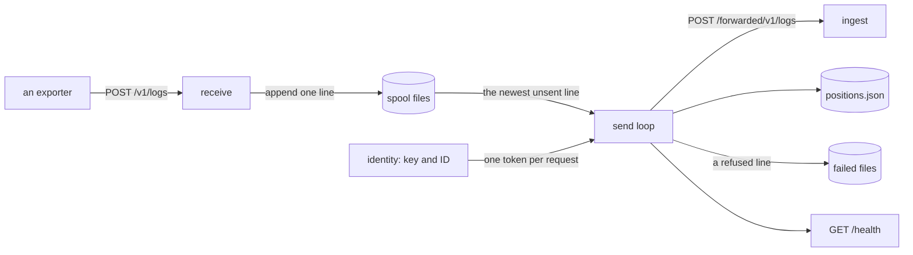

# The forwarder

- **Status:** agreed

The forwarder is the program of `@pepys/telemetry-forwarder` that runs on a machine outside impz. It
takes each OTLP export on a local port, writes it to a spool file, and sends it to
[the sender route](./sender-route.md) of ingest with an identity token that the machine signs.
[The design's README](./README.md) covers why, and the stages.

## Shape



## Contracts

### Receive

The forwarder listens on `PEPYS_FORWARDER_HOST` and `PEPYS_FORWARDER_PORT`, and answers these
requests:

| Request                                        | Answer                       | Stored   |
| ---------------------------------------------- | ---------------------------- | -------- |
| `POST /v1/logs`, JSON                          | 200 `{}`                     | one line |
| `POST /v1/metrics`, `POST /v1/traces`          | 200 `{}`                     | nothing  |
| `POST /v1/logs` when the append fails          | 503                          | nothing  |
| a body with another content type               | 415                          | nothing  |
| a body that is no JSON, or a corrupt gzip body | 400                          | nothing  |
| `GET /health`                                  | [the health answer](#health) | nothing  |

Receive unpacks a body whose `content-encoding` is `gzip` before it stores the export.

### The spool files

```text
<PEPYS_FORWARDER_SPOOL_DIR>/
  2026-03-02-logs.jsonl          one file per UTC day of receipt, mode 0600
  positions.json                 the send loop's position in each file
  failed/2026-03-02-logs.jsonl   the exports that ingest refused for good
```

Each line of a spool file is one export:

```ts
// forwarder, the spool. One line of `<day>-logs.jsonl`, as JSON with no line break inside.
interface SpoolLine {
  received: string; // when receive took the export, ISO 8601 in UTC
  path: '/v1/logs';
  ua: string | null; // the exporter's `user-agent`
  body: unknown; // the export as parsed JSON, after gzip is unpacked
}

// positions.json: the byte offset of the first line not yet sent, by file name.
// A file with no entry starts at 0.
type Positions = Record<string, number>; // { "2026-03-02-logs.jsonl": 48211 }

// One line of a file under `failed/`: the spool line and why it left the spool.
interface FailedLine extends SpoolLine {
  // status null: the line did not parse, so no request was made
  failed: { at: string; status: number | null; reason: string };
}
```

The sink writes the same line format under the same file names. A sink file that is moved into the
spool folder is therefore a spool file with no entry in `positions.json`, and the send loop sends it
from its first line.

### The send request

The send loop posts the `body` of one spool line per request:

```http
POST <PEPYS_FORWARDER_INGEST_URL>/forwarded/v1/logs
content-type: application/json
imp-identity: <a token signed for this request>

{"resourceLogs":[…]}
```

Each answer sets what the loop does next:

| Answer                         | The loop                                                             |
| ------------------------------ | -------------------------------------------------------------------- |
| 2xx                            | moves the position past the line                                     |
| 400, 413, 415, 422, 500        | copies the line to the `failed` file, and moves the position past it |
| 401, 403, 404                  | [stops](#health), and sends the same line again every 15 minutes     |
| any other status, or no answer | keeps the position, waits, and sends the same line again             |

Ingest answers each status in the second row only when a resend of the same body fails in the same
way. A status that ingest never sends comes from the proxy in front of it, such as a 502 while
ingest restarts, so the loop sends the line again.

### Health

```http
GET /health

200 {"send":"sending"}
200 {"send":"off"}
200 {"send":"waiting","status":503,"since":"2026-03-02T10:15:00Z"}
503 {"send":"stopped","status":401,"since":"2026-03-02T10:15:00Z"}
```

`send` is `off` with no ingest URL, `waiting` between two tries of the last row of the answer table,
and `stopped` after a 401, a 403 or a 404. `status` is the last answer, or null for no answer, and
`since` is when the state began. Only `stopped` answers 503.

### The identity token

The machine is an issuer of identity tokens. The forwarder signs one compact ES256 token per
request:

```ts
// forwarder, identity. The header and the claims of one token.
const header = { alg: 'ES256', kid }; // kid: the key ID in the machine's trust document

const claims = {
  iss: 'study-pc', // PEPYS_FORWARDER_ISSUER
  sub: 'pc-7d41c0a9', // the machine's ID, made once by `install`
  aud: 'forwarder.pepys.example', // PEPYS_FORWARDER_AUDIENCE: what ingest holds in PEPYS_TELEMETRY_FORWARDER_AUDIENCE
  iat: 1794355200, // the machine's clock, in seconds, when the request is made
  exp: 1794355255, // iat + 55
  jti: '0c5e…', // random for each token
  imp_name: 'study-pc', // the issuer name: the verifier needs the claim, and the machine is no imp
};
```

The signature is the 64-byte `r || s` form that WebCrypto's ECDSA `sign` returns.
`verifyImpIdentity` in `@impz/client/identity` refuses a DER signature.

`install` prints the machine's trust document, in
[the format the sender route's folder takes](./sender-route.md#the-trust-document).

### Settings

| Variable                       | Holds                                                         | Default                                    |
| ------------------------------ | ------------------------------------------------------------- | ------------------------------------------ |
| `PEPYS_FORWARDER_HOST`         | the address receive listens on                                | `127.0.0.1`                                |
| `PEPYS_FORWARDER_PORT`         | the port receive listens on                                   | `4318`                                     |
| `PEPYS_FORWARDER_SPOOL_DIR`    | the spool folder                                              | `~/.local/state/pepys-telemetry-forwarder` |
| `PEPYS_FORWARDER_IDENTITY_DIR` | the folder of the private key and the machine's ID, mode 0700 | `~/.config/pepys-telemetry-forwarder`      |
| `PEPYS_FORWARDER_INGEST_URL`   | the origin of the route to ingest                             | none                                       |
| `PEPYS_FORWARDER_ISSUER`       | the machine's issuer name                                     | none                                       |
| `PEPYS_FORWARDER_AUDIENCE`     | the audience of each token                                    | none                                       |

With `PEPYS_FORWARDER_INGEST_URL` unset, the forwarder runs receive alone and starts no send loop.
With it set, the forwarder exits 1 at start when the issuer, the audience, the key or the machine's
ID is missing.

### The commands

```sh
pepys-telemetry-forwarder run
# receive, and the send loop when PEPYS_FORWARDER_INGEST_URL is set; runs until a stop signal

pepys-telemetry-forwarder install --issuer study-pc --audience forwarder.pepys.example \
  --ingest-url https://ingest.tailnet.example
# → makes the key and the machine's ID in the identity folder, when it holds none
# → writes ~/.config/systemd/user/pepys-telemetry-forwarder.service, with the three settings
# → prints the trust document to stdout
```

`install` never starts the service, and never replaces a key or an ID that the identity folder
holds, so a second run prints the same trust document. Without `--ingest-url`, the unit sets no
ingest URL.

### The package

`@pepys/telemetry-forwarder` is a public package, because a machine installs it from npm. It has the
fields that [the agent guidelines](../../../AGENTS.md#packages) list for a public package, and a
`bin` of `pepys-telemetry-forwarder`. The release scripts find each package that is not private, so
the release needs no list changed. The list of public packages in the agent guidelines gains the
name.

Its `src/` holds the entry, `run-forwarder.ts`, and one folder per part: `receive/` with the health
answer, `spool/` with the positions, the failed files and retention, `send/`, `identity/` and
`install/`.

Shipped code imports neither `@pepys/ingest` nor `@impz/client`. The tests take `@pepys/ingest` and
`@pepys/source-telemetry` as dev dependencies.

## Constraints

- Receive answers 200 only after the append of the line returns. Receive never waits for the send
  loop, and never reads `positions.json`.
- The send loop has one request in flight. Before each request it picks the newest spool file that
  holds an unsent line, and sends that file's first unsent line. A new export therefore waits behind
  one request at most, however much history the spool holds.
- The send loop reads a line only once the line ends in a line break, because receive appends to the
  newest file.
- The send loop writes `positions.json` after each line it moves past, by a write to a temporary
  file and a rename. A stop between an answer and the write resends one export at the next start.
- A resend changes no row: the telemetry source builds each fact ID from the record, and the host
  applies each fact ID once. The log can still hold two copies. Ingest appends nothing for a resend
  only when the bytes and the sender are the same, the first copy is under an hour old, and ingest
  has not restarted.
- The retry wait starts at 1 second, doubles after each failed try, stops at 300 seconds, and
  returns to 1 second after a 2xx.
- A stopped loop logs one error line when it stops, and none for each try after it. A 2xx on a later
  try starts the loop again. Receive keeps running while the loop is stopped, and the spool keeps
  every export.
- A spool line that does not parse, or whose `body` is no JSON object, goes to the `failed` file
  with a null status.
- The forwarder deletes a spool file, and its entry in `positions.json`, when the position is at the
  end of the file and the day in the file's name is more than 7 days before the current UTC day. It
  never deletes a file that holds an unsent line, and never deletes a file under `failed/`.
- The private key and the machine's ID are files of mode 0600. No command prints the private key,
  and no log line holds the key or a token.
- Every fact that the forwarder sends carries the origin `{ issuer: <iss>, subject: <sub> }`. A
  caller of `telemetry_session_model_requests` passes that pair for a session that ran on the
  machine. A machine whose ID file is lost writes under a new origin.
- A token passes ingest's check only while the machine's clock is at most 5 seconds ahead of
  ingest's clock, or at most 60 seconds behind it. Outside that, each request gets 401 and the loop
  stops until the clock is right.

The tests of the send loop run it against `createIngest` from `@pepys/ingest`, with the telemetry
plug-in, `createMemoryFactLog`, and the sender proof that `readImpIdentitySenderProof` reads from a
folder holding the trust document that the forwarder's own identity code wrote:

- An export sent twice leaves one set of fact IDs in the log, both inside the hour and after it.
- Two 503 answers and then a 200 move the position past the export once, and leave no line in the
  `failed` file.
- A token signed by a key that is not in the trust document gets 401, the loop stops with the
  position unchanged, and `/health` answers 503.
- A stopped loop that then gets a 200 moves the position on, and `/health` answers 200.
- A loop that stops in the middle of a file starts again at the saved position, and sends no earlier
  line.
- A 400 answer copies the line to the `failed` file, and the loop sends the next line.
- With an older file unsent, a line that arrives in today's file goes out before the older file's
  next line.

## Decisions

- **Only a status that ingest means as final moves a line to `failed`.** Each other failure keeps
  the line in the spool, because a line in `failed` is never sent again.
- **The forwarder deletes what it sent, after 7 days.** pepys is the durable home of the data, and
  the 7 days leave time to send a file again when a fault is found.

## Builder decides

- The names of internal functions and files inside each folder.
- The file format of the private key and of the machine's ID.
- The request timeout, and whether the send loop sends a gzip body.
- Whether receive calls `fsync` after an append.
- How the tests make ingest answer 503: a `FactLog` of their own that gives no acknowledgement, or
  ingest's stub fact log behind a new `./test-utils/*` export of `@pepys/ingest`.
- The wording of each log line and each error.

## Out of scope

- Metrics and traces. The forwarder answers them and stores nothing.
- A cost for Codex records. The telemetry consumers own what a record becomes.
- A second machine. Each machine would run its own install with its own issuer name; nothing here is
  tested with two.
- Any change to how an imp sends telemetry.
- A change of the machine's key. A new key is a new trust document and a restart of ingest.
- A command that sends the lines of a `failed` file again.
