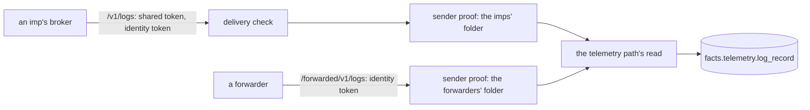

# The sender route

- **Status:** agreed

Ingest gains one more URL for telemetry exports, `/forwarded/v1/logs`, for
[the forwarder](./forwarder.md) on a machine that is no imp. A request there needs no shared token:
ingest checks only the identity token that the machine signed. The route leads into the telemetry
plug-in's existing receive path, and has trust documents and an audience of its own.
[The design's README](./README.md) says what an imp and a trust document are, why the route exists,
and the stages.

These docs own the terms that this one uses:

- [Ingest](../../architecture/ingest/ingest.md) covers a receive path, its delivery check,
  [the sender proof](../../architecture/ingest/ingest.md#the-sender-proof) with its audience and its
  folder of trust documents, and the recent bodies that ingest keeps.
- [The telemetry plug-in](../../architecture/plug-ins/telemetry.md) covers the path `/v1/logs` and
  its two checks.
- [The host](../../architecture/consumers/host.md) covers the process that applies each fact ID
  once.

## Shape



## Contracts

### Sender routes in the kit

```ts
// kit, the sources
interface ReceivePath {
  // …existing fields

  // More routes into this path. A sender route has the path's limits, encodings, `read`, answer
  // and `reach`. It skips the path's `check`, reads no secret, and proves its own sender.
  readonly senderRoutes?: readonly SenderRoute[] | undefined;
}

interface SenderRoute {
  readonly route: string;

  // Its two variables differ from those of the path's own `sender`.
  readonly sender: SenderRequirement;
}

// kit, the deployments. One entry of `listReceiveRoutes`.
interface ReceiveRoute {
  // …existing fields
  check: DeliveryCheck['kind'] | 'sender'; // 'sender' for a sender route, whose `stores` is true
}
```

The telemetry source declares one sender route:

```ts
// source-telemetry, the plug-in file
live: receiveOtlpLogs({
  // …existing fields: the route '/v1/logs', its token check and its sender stay as they are
  senderRoutes: [
    {
      route: '/forwarded/v1/logs',
      sender: {
        kind: 'imp-identity',
        audienceEnv: 'PEPYS_TELEMETRY_FORWARDER_AUDIENCE',
        issuersEnv: 'PEPYS_TELEMETRY_FORWARDER_ISSUERS',
      },
    },
  ],
}),
```

These files change:

| Package            | File                                                       | Change                                                                               |
| ------------------ | ---------------------------------------------------------- | ------------------------------------------------------------------------------------ |
| `kit`              | `src/sources/types.ts`, `src/index.ts`                     | `senderRoutes` and `SenderRoute`                                                     |
| `kit`              | `src/deployments/check-deployment.ts`                      | the two refusals under [Constraints](#constraints)                                   |
| `kit`              | `src/deployments/list-receive-routes.ts`, its `types.ts`   | one `ReceiveRoute` per sender route                                                  |
| `ingest`           | `src/receive/create-ingest.ts`                             | one handler per sender route, which keeps recent bodies of its own                   |
| `ingest`           | `src/receive/make-receive-handler.ts`                      | the handler of a sender route skips the delivery check and proves the route's sender |
| `ingest`           | `src/sender-proof/imp-identity/read-imp-identity-trust.ts` | reads the two variables of each sender route too                                     |
| `source-telemetry` | `src/otlp/receive-otlp-logs.ts`, `src/telemetry-plugin.ts` | passes `senderRoutes` through, and declares the route                                |

The two architecture docs, Ingest and The telemetry plug-in, change with them. `ReceiveRoute.check`
gains a value, which breaks a caller that matches on every value, so the release that holds the
change says so.

### The trust document

A trust document is one `.json` file in the folder at `PEPYS_TELEMETRY_FORWARDER_ISSUERS`, for one
machine that runs a forwarder. The forwarder's `install` command prints it on that machine, and the
owner adds it to the deployment:

```json
{
  "issuer": "study-pc",
  "keys": [
    {
      "kty": "EC",
      "crv": "P-256",
      "x": "<base64url>",
      "y": "<base64url>",
      "kid": "<the RFC 7638 SHA-256 thumbprint of the key>",
      "alg": "ES256",
      "use": "sig"
    }
  ],
  "retire": []
}
```

`loadIdentityIssuers` in `@impz/client/identity` takes exactly these fields. An issuer name is 1 to
128 letters, digits, `.`, `_` or `-`.

### What the deployment needs

In [stage 3](./README.md#stages), the owner adds these to the deployment, in the deployment's own
repo:

- **The two variables of ingest.** `PEPYS_TELEMETRY_FORWARDER_ISSUERS` names a folder that holds the
  forwarders' trust documents and nothing else. `PEPYS_TELEMETRY_FORWARDER_AUDIENCE` holds an
  audience that differs from the audience of the imps.
- **A restart of ingest for each change to the folder.** Ingest reads the folder at start only.
  Ingest exits at start when a document fails the loader's check, or when two documents in the
  folder name one issuer.
- **A name on the tailnet that reaches the sender route alone.** The name resolves only on the
  tailnet and has a TLS certificate. A proxy serves it, and passes a request for the URL path
  `/forwarded/v1/logs` to ingest's port. The proxy answers 404 itself to every other URL path of the
  name.
- **A rule in the network policy** that admits the proxy to ingest's port.
- **The sender route in each list of ingest's routes that the deployment keeps**, when it keeps one.
- **Room for the history on the volume of the fact log**, before [stage 4](./README.md#stages) loads
  it.

## Who can write through the route

The route has no shared secret. A caller can write through it when the caller holds the private key
of an issuer in the forwarders' folder, and can reach the route. The key file is readable by every
process that runs as the machine's user, a coding agent included.

Such a caller can do these things:

- It writes telemetry log records, and nothing else, because the route runs the telemetry path's
  `read`.
- It writes only under its own issuer, because each fact takes the issuer of its origin from the
  verified token.
- It picks the subject of that origin, because the key signs any `sub`. One issuer therefore stands
  for one machine: every subject under an issuer is that machine's word.
- It picks the session ID and the time of each record, as
  [the known limits](../../architecture/plug-ins/telemetry.md#known-limits) say of every sender.
- It hides a true record when it sends a record with the same fact ID first, because the host
  applies the first copy of a fact ID. It needs the record's own key for that, such as the request
  ID of a model request. Every sender on the telemetry path can do the same.
- It sends as many requests as it likes, each within the path's limits of 4,194,304 bytes and 1,000
  records.

The token has these limits:

- The token never signs the body, and the verifier never checks `jti`. One token therefore passes
  with any body, any number of times, until 60 seconds after its `iat`. TLS on the tailnet name
  keeps the token from a listener.
- A forwarder's token never passes `/v1/logs`. That path needs the shared token too, and an issuer
  in the imps' folder.
- An imp's token never passes the sender route. Its issuer, the impd that runs the imp, has no
  document in the forwarders' folder, and its audience differs.

To end a key, the owner takes its trust document out of the folder and restarts ingest. The facts
that the key wrote stay in the log, under its origin.

The sender route stays off the public tunnel, and is reached only by the tailnet name, for these
reasons:

- Ingest reads a body of up to 4,194,304 bytes before it checks the sender, so on a public route any
  caller makes ingest read that much per request.
- The key is the route's only check. While the route answers only on the tailnet, a person who
  copies the key still needs a device on the tailnet to use it.
- The network policy admits the proxy to ingest's whole port. Only the proxy's own rule for the one
  URL path keeps ingest's other routes off the tailnet name.

Each pod that the network policy admits to ingest's port, and each process on the node, reaches the
sender route too, without the proxy. None of them holds a forwarder's key.

## Constraints

- The path `/v1/logs` keeps both of its checks, whatever the two forwarder variables hold.
- While either forwarder variable is unset or empty, or the folder holds no document, the sender
  route answers 401 to every request, and ingest starts as before.
- The handler of a sender route answers 405 and 413 as the path does, then 401 without a proven
  sender, and then runs the path's steps from the recent-body step on.
- `read` gets the sender that the route proved, so each fact of the route carries the origin
  `{ issuer, subject }` of the forwarder's token.
- The telemetry path's `reach` is `private`, so the sender route is `private`: the deployment's
  public tunnel never forwards it.
- A route of the path's `ignoredRoutes` is no sender route. It keeps the path's own check and
  sender.
- `checkDeployment` refuses a sender route whose name another route of the deployment has.
- `checkDeployment` refuses a sender route whose `issuersEnv` or `audienceEnv` equals that of the
  path's own `sender`, so the two groups of senders never share a folder or an audience variable.

The tests of the sender route sit beside ingest's receive tests and the telemetry plug-in's tests.
Each line is one test:

- A request with a good identity token and no `authorization` header stores its records, with the
  token's issuer and subject as their origin.
- A request with no `imp-identity` header gets 401.
- A forwarder's token with the shared token gets 401 on `/v1/logs`.
- A token of an issuer in the imps' folder gets 401 on `/forwarded/v1/logs`.
- With either forwarder variable unset, the sender route answers 401, and `/v1/logs` stores an imp's
  export.
- `checkDeployment` refuses each of the two cases above.

## Decisions

- **The forwarders have a route, a folder and an audience of their own.** The imps' path keeps both
  of its checks, and a key of one group never passes the other group's route.
- **A sender route is part of the receive path, never a second source.** A fact ID holds the name of
  its source, so one record gets one fact ID on either route.
- **The tailnet takes the place of the shared token.** A shared token on the machine would be a copy
  of the imps' secret, in the same user's files as the key.

## Builder decides

- The names of internal functions and types that the kit does not export.
- How the handler of a sender route shares code with the handler of the path.

## Open questions

- **How does the proxy limit the tailnet name to one URL path?** A spike in the deployment's repo
  settles it: the proxy's rule must match `/forwarded/v1/logs` exactly, and every other URL path of
  the name must get the proxy's 404. Until then, the owner adds no tailnet name, and stage 3 does
  not finish.
