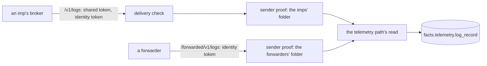

# The sender route

- **Status:** agreed

Ingest gains one more URL for telemetry exports, `/forwarded/v1/logs`, for
[the forwarder](./forwarder.md) on a machine outside impz. A request to it needs no shared token:
ingest checks only the identity token that the machine signed. The URL leads into the telemetry
plug-in's existing receive path, and has trust documents and an audience of its own.
[The design's README](./README.md) defines impz, impd, the trust document, the deployment and the
tailnet, and gives the stages.

This doc uses the words of [Ingest](../../architecture/ingest/ingest.md):

- A **receive path** is what a source declares for the deliveries that senders post to it. A
  **route** is a URL path that ingest serves for a receive path, such as `/v1/logs`.
- The **delivery check** of a receive path is a signature of the body, or a token in a header.
- The [**sender proof**](../../architecture/ingest/ingest.md#the-sender-proof) checks a sender's
  identity token against an audience and a folder of trust documents, which two variables of ingest
  name.
- The **recent bodies** of a route are the bodies it stored in the last hour, which ingest keeps so
  that a resend appends nothing.

## Shape



## Contracts

### Sender routes in the kit

A receive path can declare sender routes: more routes into the same path, each with a sender proof
as its only check.

```ts
// kit, the sources
interface ReceivePath {
  // …existing fields

  // A sender route has the path's limits, encodings, `read`, answer and `reach`. Ingest skips the
  // path's `check` on it, reads no secret for it, and proves the sender that the route names.
  readonly senderRoutes?: readonly SenderRoute[] | undefined;
}

interface SenderRoute {
  readonly route: string;
  readonly sender: SenderRequirement;
}

// kit, the deployments. One entry of `listReceiveRoutes`.
interface ReceiveRoute {
  // …existing fields
  check: DeliveryCheck['kind'] | 'sender'; // the text 'sender' for a sender route
}

// kit, the deployments. One more failure of `checkDeployment`.
type DeploymentFailure =
  // …existing kinds
  // a sender route names a variable that the `sender` of its own path names
  { kind: 'shared-sender-variable'; source: string; route: string; variable: string };
```

The telemetry source declares one sender route:

```ts
// source-telemetry, the plug-in file
live: receiveOtlpLogs({
  // …existing fields: the route '/v1/logs', its token check and its sender stay as they are
  senderRoutes: [
    {
      route: '/forwarded/v1/logs',
      sender: {
        kind: 'imp-identity',
        audienceEnv: 'PEPYS_TELEMETRY_FORWARDER_AUDIENCE',
        issuersEnv: 'PEPYS_TELEMETRY_FORWARDER_ISSUERS',
      },
    },
  ],
}),
```

These files change:

| Package            | File                                                              | Change                                                                                  |
| ------------------ | ----------------------------------------------------------------- | --------------------------------------------------------------------------------------- |
| `kit`              | `src/sources/types.ts`, `src/index.ts`                            | `senderRoutes` and `SenderRoute`                                                        |
| `kit`              | `src/deployments/check-deployment.ts`, its `types.ts`             | the two refusals under [Constraints](#constraints)                                      |
| `kit`              | `src/deployments/list-receive-routes.ts`, its `types.ts`          | one `ReceiveRoute` per sender route, with `stores` true                                 |
| `ingest`           | `src/receive/create-ingest.ts`                                    | one handler per sender route, with recent bodies of its own                             |
| `ingest`           | `src/receive/make-receive-handler.ts`                             | the handler of a sender route skips the delivery check, and proves the route's `sender` |
| `ingest`           | `src/sender-proof/imp-identity/read-imp-identity-trust.ts`        | reads the two variables of each sender route too                                        |
| `source-telemetry` | `src/otlp/receive-otlp-logs.ts`, `src/telemetry-plugin.ts`        | passes `senderRoutes` through, and declares the route                                   |
| `source-telemetry` | `src/otlp/is-nested-too-deep.ts`, `src/otlp/receive-otlp-logs.ts` | [an export that `read` cannot read gets 422](#an-export-that-read-cannot-read)          |

- The builder of stage 2 adds the route to [Ingest](../../architecture/ingest/ingest.md) and
  [The telemetry plug-in](../../architecture/plug-ins/telemetry.md), and to the READMEs of the three
  packages where they describe a receive path.
- `kitVersion` stays 1: a plug-in built with the earlier kit declares no sender route, and loads as
  before.
- A caller that matches on every value of `ReceiveRoute.check` fails its type check until it handles
  `'sender'`.

### The two groups of trust documents

At start, ingest compares what each sender route trusts with what its path's own `sender` trusts, by
the values it loaded. It exits 1, with the reason, in each of these cases:

- the audience of the sender route equals the audience of the path;
- an issuer name is in a trust document of both folders;
- a key is in a trust document of both folders, by the RFC 7638 SHA-256 thumbprint of the key,
  whatever its `kid`.

`readImpIdentityTrust` makes the comparison, after it loads both folders. It skips a pair in which
either side has no audience or no document, because that side refuses every request.

### An export that `read` cannot read

The telemetry source builds a fact ID from a record with `formatCanonicalJSON`, which walks the
record to any depth. A record `body` that nests tens of thousands of arrays exhausts the stack,
`read` throws, and ingest answers 500 to every resend of the export. Stage 2 adds a check:

- `isNestedTooDeep` returns true for a value nested more than 64 levels deep. It walks the value
  with a loop, so no depth exhausts the stack.
- The `read` of `receiveOtlpLogs` calls `isNestedTooDeep` on every record before it builds a fact
  ID, whether or not the record has an event key. For a record nested too deep, it refuses the
  export with 422 and the reason `the export holds a record that is nested too deep`.

### The trust document

`install`, a command of the forwarder, prints the machine's trust document on the machine. The owner
adds it, as one `.json` file, to the folder that `PEPYS_TELEMETRY_FORWARDER_ISSUERS` names:

```json
{
  "issuer": "study-pc",
  "keys": [
    {
      "kty": "EC",
      "crv": "P-256",
      "x": "<base64url>",
      "y": "<base64url>",
      "kid": "<the RFC 7638 SHA-256 thumbprint of the key>",
      "alg": "ES256",
      "use": "sig"
    }
  ],
  "retire": []
}
```

`loadIdentityIssuers` in `@impz/client/identity` takes exactly these fields. An issuer name is 1 to
128 letters, digits, `.`, `_` or `-`.

### What the deployment needs

In [stage 3](./README.md#stages), the owner changes the deployment's configuration in these ways:

- **Set the two variables of ingest.** `PEPYS_TELEMETRY_FORWARDER_ISSUERS` names a folder that holds
  the forwarders' trust documents and no other file. `PEPYS_TELEMETRY_FORWARDER_AUDIENCE` holds an
  audience that differs from the audience of the imps.
- **Restart ingest after each change to the folder.** Ingest reads the folder at start only. It
  exits at start when a document fails the loader's check, or when two documents in the folder name
  one issuer.
- **Add a name on the tailnet for the sender route.** The name resolves only on the tailnet and has
  a TLS certificate. A proxy serves the name, and passes only a request for the URL path
  `/forwarded/v1/logs` to ingest's port. The proxy answers 404 itself to every other URL path of the
  name, and takes a body of 4,194,304 bytes, the limit of the telemetry path.
- **Admit the proxy to ingest's port** in the network policy.
- **Add the sender route to the list of ingest's routes** that the deployment's build compares with
  `listReceiveRoutes`, when the deployment keeps such a list.
- **Give the volume of the fact log room for the history**, the exports that the sink stored, before
  stage 4 sends them.

## Who can write through the route

The route has no shared secret. A caller can write through it when the caller holds the private key
of an issuer in the forwarders' folder, and can reach the route.

### Who holds a key, and who reaches the route

- Every process on the machine that reaches the forwarder's receiver writes through the route with
  no key at all. The receiver listens on the loopback address and takes an export with no
  credential, and the forwarder then signs and sends it. On a machine with one user, those processes
  are the user's own. A second user of the machine reaches the receiver too.

- Every process that runs as the machine's user can read the key file, a coding agent included.
- From outside the cluster, only a device on the tailnet reaches the route, through the tailnet
  name. The deployment's public tunnel never forwards the route, because the telemetry path's
  `reach` is `private`.
- Inside the cluster, each pod that the network policy admits to ingest's port, and each process on
  the node, reaches the route without the proxy. None of them holds a forwarder's key.

### What the design accepts

A caller with a key and a way to the route, and a process that posts to the forwarder's receiver,
can each do these things. The design accepts each one:

- It writes telemetry log records, and no other kind of fact, because the route runs the telemetry
  path's `read`.
- It writes only under its own issuer, because each fact takes the issuer of its `origin` from the
  verified token.
- With the key, it writes any subject, because the key signs any `sub`. Through the receiver, it
  writes under the machine's own subject. The `origin` of a fact therefore proves the issuer and
  never the subject, and one issuer stands for one machine.
- It writes any session ID and any time, as
  [the known limits](../../architecture/plug-ins/telemetry.md#known-limits) say of every sender on
  the telemetry path.
- It hides a true record when it first sends a record with the same fact ID, because
  [the host](../../architecture/consumers/host.md#a-fact-mode-batch) applies only the first copy of
  a fact ID. To do that it must know the value the fact ID is built from, such as the request ID of
  a model request. Every sender on the telemetry path can do the same.
- It sends as many requests as it likes, each within the path's limits of 4,194,304 bytes and 1,000
  records.
- It sends one token with any body, any number of times, until 60 seconds after the token's `iat`:
  55 seconds of life and 5 of leeway. The token never signs the body, and the verifier never checks
  `jti`. TLS on the tailnet name keeps a token from a listener.

The receiver takes no credential because an OTLP exporter has none to give that the same user's
other processes could not read: an exporter's settings are files and variables of that user. The
machine is therefore one sender, and the design treats every process of its user as the machine.

To make ingest refuse a key, the owner takes the key's trust document out of the folder and restarts
ingest. The facts that the key wrote stay in the log, under its origin.

### What keeps the two groups of senders apart

- A forwarder's token never passes `/v1/logs`. That route needs the shared token too, and an issuer
  in the imps' folder.
- An imp's token never passes the sender route. The token's issuer is an impd, and the token's
  audience is the imps' audience. Ingest refuses to start while an impd's issuer name or key is in
  the forwarders' folder, or while the two audiences are equal.

### Why the route answers only on the tailnet

- Ingest reads a body of up to 4,194,304 bytes before it checks the sender. On a public name, any
  caller could make ingest read that much per request.
- The key is the only thing ingest checks. While the route answers only on the tailnet, a person who
  copies the key still needs a device on the tailnet to use it.

The proxy's rule for the one URL path matters for a second reason: the network policy admits the
proxy to ingest's whole port, so that rule alone keeps ingest's other routes off the tailnet name.

## Constraints

- The route `/v1/logs` keeps both of its checks, whatever the two forwarder variables hold.
- While either forwarder variable is unset or empty, or the folder holds no document, the sender
  route answers 401 to every request. Ingest still starts, and every other route works.
- The handler of a sender route answers 405 and 413 as the path's handler does, then 401 without a
  proven sender. It then runs every later step of the path's handler, from the recent-body step on,
  resync marks included.
- `read` gets the sender that the route proved, so each fact of the route carries the `origin`
  `{ issuer, subject }` of the forwarder's token.
- A sender route takes the `reach` of its path. The telemetry path's `reach` is `private`, so the
  sender route is `private`.
- Ingest serves each of the path's `ignoredRoutes`, here `/v1/metrics` and `/v1/traces`, with the
  path's own check and sender, as before. A sender route has no ignored routes.
- `checkDeployment` refuses a sender route whose `route` equals another route of the deployment,
  with the existing failure for a duplicate route.
- Ingest exits at start in each case under
  [The two groups of trust documents](#the-two-groups-of-trust-documents), so no token passes both a
  sender route and its path.
- An export with a record nested more than 64 levels deep gets 422 on both routes, and stores
  nothing.
- `checkDeployment` refuses a sender route whose `issuersEnv` or `audienceEnv` equals the
  `issuersEnv` or the `audienceEnv` of its path's own `sender`, with `shared-sender-variable`. A
  path with no `sender` of its own can declare a sender route.

The tests of the sender route sit beside ingest's receive tests, the kit's deployment tests and the
telemetry plug-in's tests. Each line is one test:

- A request with a good identity token and no `authorization` header stores its records, with the
  token's issuer and subject as their `origin`.
- A request with no `imp-identity` header gets 401.
- A forwarder's token with the shared token gets 401 on `/v1/logs`.
- A token of an issuer in the imps' folder gets 401 on `/forwarded/v1/logs`.
- With either forwarder variable unset, the sender route answers 401, and `/v1/logs` stores an imp's
  export.
- Ingest exits at start when the two audience variables hold one audience.
- Ingest exits at start when one issuer name is in both folders.
- Ingest exits at start when one key is in both folders under two issuer names and two key IDs.
- An export with a record `body` of 35,000 nested arrays gets 422, and an export with a record
  nested 64 levels deep is stored.
- `checkDeployment` refuses a sender route whose `route` another route has.
- `checkDeployment` refuses a sender route that names its path's `issuersEnv`.

## Decisions

- **The forwarders have a route, a folder and an audience of their own.** The imps' route keeps both
  of its checks, and a key of one group never passes the other group's route.
- **A sender route is part of the receive path, never a second source.** A fact ID holds the name of
  its source, so one record gets one fact ID on either route.
- **The tailnet takes the place of the shared token.** A shared token on the machine would be a copy
  of the imps' secret, in the same user's files as the key.

## Builder decides

- The names of internal functions and types that the kit does not export.
- How the handler of a sender route shares code with the handler of the path.

## Open questions

- **How does the proxy limit the tailnet name to one URL path?** A spike in the owner's
  infrastructure repo settles it, and no one has run it. The spike passes when the proxy sends
  `/forwarded/v1/logs` to ingest and answers 404 itself to every other URL path of the name. Until
  then, the owner adds no tailnet name, and stage 3 does not finish.
