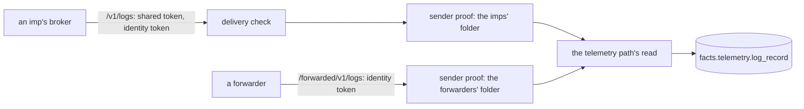

# The sender route

- **Status:** agreed

Ingest gains a route that takes a telemetry export with a proven sender as its only check, so
[the forwarder](./forwarder.md) on a machine outside impz sends with no shared token. The route is a
second way into the telemetry receive path, with trust documents and an audience of its own.
[The design's README](./README.md) covers why, and the stages.

## Shape



## Contracts

### The route in ingest

A receive path gains sender routes: more routes into the same path, each with a proven sender as its
only check.

```ts
// kit, the sources
interface ReceivePath {
  // …existing fields

  // More routes into this path. A sender route has the path's limits, encodings, `read` and
  // answer. It skips the path's `check`, reads no secret, and proves its own sender.
  readonly senderRoutes?: readonly SenderRoute[] | undefined;
}

interface SenderRoute {
  readonly route: string;
  readonly sender: SenderRequirement; // its own audience and its own folder of trust documents
}
```

The telemetry source declares one:

```ts
// source-telemetry, the plug-in file
live: receiveOtlpLogs({
  // …existing fields: route '/v1/logs', its token check and its sender stay as they are
  senderRoutes: [
    {
      route: '/forwarded/v1/logs',
      sender: {
        kind: 'imp-identity',
        audienceEnv: 'PEPYS_TELEMETRY_FORWARDER_AUDIENCE',
        issuersEnv: 'PEPYS_TELEMETRY_FORWARDER_ISSUERS',
      },
    },
  ],
}),
```

These files change:

| Package            | File                                                       | Change                                                                |
| ------------------ | ---------------------------------------------------------- | --------------------------------------------------------------------- |
| `kit`              | `src/sources/types.ts`, `src/index.ts`                     | `senderRoutes` and `SenderRoute`                                      |
| `kit`              | `src/deployments/check-deployment.ts`                      | a sender route's name is unique among every route of the deployment   |
| `kit`              | `src/deployments/list-receive-routes.ts`, its `types.ts`   | lists each sender route, with `check` of `sender`                     |
| `ingest`           | `src/receive/create-ingest.ts`                             | one handler per sender route, with its own recent bodies              |
| `ingest`           | `src/receive/make-receive-handler.ts`                      | a sender route skips the delivery check and proves the route's sender |
| `ingest`           | `src/sender-proof/imp-identity/read-imp-identity-trust.ts` | reads the variables of each sender route too                          |
| `source-telemetry` | `src/otlp/receive-otlp-logs.ts`, `src/telemetry-plugin.ts` | passes `senderRoutes` through, and declares the route                 |

The two architecture docs linked in the opening change with them.

### The trust document

The deployment puts each machine's trust document in the folder at
`PEPYS_TELEMETRY_FORWARDER_ISSUERS`, as a `.json` file. The forwarder's `install` command prints it:

```json
{
  "issuer": "study-pc",
  "keys": [
    {
      "kty": "EC",
      "crv": "P-256",
      "x": "<base64url>",
      "y": "<base64url>",
      "kid": "<the RFC 7638 SHA-256 thumbprint of the key>",
      "alg": "ES256",
      "use": "sig"
    }
  ],
  "retire": []
}
```

`loadIdentityIssuers` in `@impz/client/identity` takes exactly these fields. An issuer name is 1 to
128 letters, digits, `.`, `_` or `-`.

### What the deployment needs

The deployment's own repo builds these, in [stage 3](./README.md#stages):

- The machine's trust document in a folder of its own, at `PEPYS_TELEMETRY_FORWARDER_ISSUERS`, and
  an audience at `PEPYS_TELEMETRY_FORWARDER_AUDIENCE` that differs from the audience of the imps.
  Ingest reads the folder at start only, so ingest restarts to take a document. Ingest exits at
  start when a document fails the loader's check, or when two documents in one folder name one
  issuer. While either variable is unset, the route answers 401 and every other route works.
- A route that carries `/forwarded/v1/logs` from the tailnet to ingest's port, over TLS, and no
  other path of ingest. The deployment's tailnet route to the API is the model: a name that resolves
  on the tailnet only, a certificate, and a proxy that the network policy admits to the pod. That
  route sends every path to its pod, so this route adds an exact path.
- The route in the deployment's own list of ingest's routes, as `private`: `reach` on a receive path
  says only whether the public tunnel forwards the route.
- Room on the log's volume for the stored history, before stage 4.

## Who can write through the route

The route has no shared secret. A caller writes through it when it holds the private key of an
issuer in the forwarders' folder and can reach the route.

- **What the caller writes:** telemetry log records, and nothing else, because the route runs the
  telemetry path's `read`. Each fact carries the token's issuer as its origin, so the caller never
  writes under another issuer. The caller picks the `sub`, so one issuer stands for one machine, and
  the origin's subject is only what that machine says.
- **What the caller picks beside that:** the session ID and the time of each record, as
  [the known limits](../../architecture/plug-ins/telemetry.md#known-limits) say of every sender. The
  host applies the first copy of a fact ID, so a caller that writes a record's fact ID first hides
  the true record. A caller sends as many requests as it likes, each within the path's size and fact
  limits.
- **What the key holder is:** every process that runs as the machine's user reads the key file.
  Taking the trust document out of the folder, and a restart of ingest, ends the key. The facts it
  wrote stay in the log, under its origin.
- **What a token does not prove:** the token signs no body, and the verifier checks no `jti`. A
  token therefore passes for any body, any number of times, until 60 seconds after it was issued.
  TLS on the route keeps a token from a listener.
- **Why the two folders differ:** a forwarder's token never passes `/v1/logs`, which also needs the
  shared token and an issuer in the imps' folder. An imp's token never passes the forwarded route,
  whose folder holds no impd.

The route stays on the tailnet, with an exact path, for three reasons. Ingest reads a body of up to
4,194,304 bytes before it checks the sender, so an open route lets any caller make ingest read that
much per request. Network position is the route's second check, in place of the shared token: a
stolen key is useless off the tailnet. The network policy admits the proxy to ingest's whole port,
so only the proxy's own path rule keeps ingest's other routes off the tailnet name.

Inside the cluster, each pod that the network policy admits to ingest's port, and each process on
the node, reaches the route too. None of them holds the key.

## Constraints

- The path `/v1/logs` keeps both of its checks, and a deployment that sets neither forwarder
  variable serves it as before.
- A sender route takes the path's `reach`, and each route of the path's `ignoredRoutes` stays behind
  the path's own check.
- The sender route's proven sender is the `sender` that `read` gets, so each fact of the route
  carries the origin `{ issuer, subject }` of the forwarder's token.
- An export over the path's limits, 4,194,304 bytes or 1,000 records, gets 413 and goes to the
  `failed` file. Receive sets no lower limit of its own.

The tests of the sender route sit beside ingest's receive tests and the telemetry plug-in's tests:

- A request with a good identity token and no `authorization` header stores its records.
- A request with no `imp-identity` header gets 401.
- A forwarder's token with the shared token gets 401 on `/v1/logs`, and a token of an issuer in the
  imps' folder gets 401 on `/forwarded/v1/logs`.
- With either forwarder variable unset, the route answers 401, and `/v1/logs` stores an imp's
  export.

## Decisions

- **The forwarders have a route, a folder and an audience of their own.** The imps' path keeps both
  of its checks, and no key of one group passes the other group's route.
- **A sender route is part of the receive path, never a second source.** The fact ID holds the
  source's name, so one record gets one fact ID on either route.

## Builder decides

- The names of internal functions and types that the kit does not export.
- How the handler of a sender route shares code with the handler of the path.

## Open questions

- **How does the proxy limit the route to one path?** A spike in the deployment's repo settles it.
  The proxy's route must match `/forwarded/v1/logs` exactly and answer 404 on every other path of
  the name. Until then, stage 3 does not ship.
