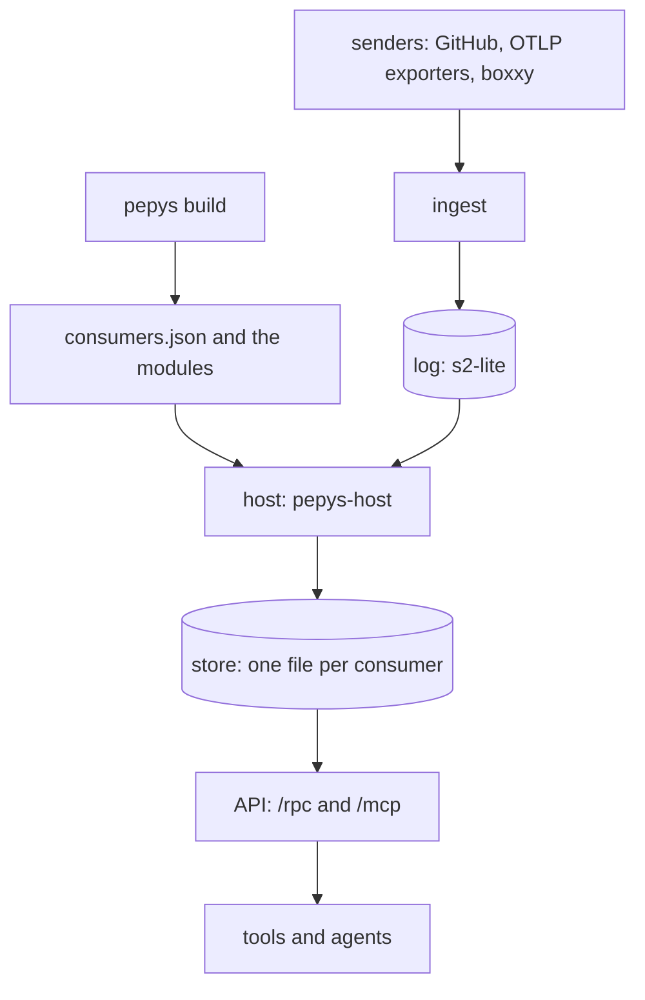

# pepys v1

pepys v1 stores the facts of three sources, builds entities and links from them, and answers queries
about them over oRPC and MCP. The sources are GitHub, the telemetry of coding agents, and boxxy,
whose package lives in the boxxy repo. A plug-in declares its sources, consumers, link types and
queries with `@pepys/kit`, and a deployment is a list of plug-ins. The
[pepys design](./pepys/README.md) describes the whole of pepys and defines its terms. This doc
states what v1 builds, and it is right where the two differ.

The sketches hold every type and rule of v1, and each section here links the sketch it follows. A
sketch shows a design and does not compile. Where this doc and a sketch differ, the sketch is right.

| Doc or sketch                                                  | Holds                                                                 |
| -------------------------------------------------------------- | --------------------------------------------------------------------- |
| [01-kit.ts](./v1/sketches/01-kit.ts)                           | the kit, the testing package, `pepys build`                           |
| [02-ingest-log.ts](./v1/sketches/02-ingest-log.ts)             | the receive route, the fact log port, one append with its retries     |
| [03-manifest-host.ts](./v1/sketches/03-manifest-host.ts)       | `consumers.json`, the wire, the Rust host, scope mode, the fact index |
| [04-store-api.ts](./v1/sketches/04-store-api.ts)               | the store reader, the link check, the core queries, the API           |
| [05-telemetry-github.ts](./v1/sketches/05-telemetry-github.ts) | the telemetry and GitHub plug-ins, the delivery query module          |
| [The manifest and the host](./v1-host.md)                      | `consumers.json`, and how the host runs a module                      |
| [The plug-ins of v1](./v1-plug-ins.md)                         | telemetry and GitHub, in prose                                        |
| [Open for the builder](./v1-open.md)                           | what two trial runs found, and what no run has checked                |
| [Work list](./v1-work-list.md)                                 | the build, as numbered slices in dependency order                     |
| [0024: The scope of v1](../decisions/0024-v1-scope.md)         | what is in v1, what is out, and the rejected alternatives             |

Ingest answers a sender with success only when the log holds every fact of the delivery. The host is
the one writer of the store, and it applies only what `consumers.json` declares.

## What v1 is

- **The core works for any source.** Ingest takes a signed fact batch, a webhook or an OTLP export
  on a receive path, and reads a source's API on a pull path. The host runs every consumer of the
  deployment, in fact mode and in scope mode.
- **Three plug-ins.** The GitHub and telemetry plug-ins live in this repo. The boxxy plug-in lives
  in the boxxy repo, and the core packages hold no boxxy name.
- **Links, in part.** A consumer declares the link types it writes, the host checks each link
  against them, and a query follows links through one view. v1 has no link extractor, no manual link
  and no retraction.
- **Two core queries.** `get_entity` returns one entity's row, and `neighbourhood` walks the links
  around one entity. Each plug-in adds its own queries. Every query is a typed route and an MCP
  tool. The API takes no write.
- **What pepys publishes.** `@pepys/kit` and `@pepys/testing` go to npm, because a plug-in in
  another repo builds and tests against them, with the packages that a deployment imports. Each
  release carries the host binary. pepys publishes no container image.
- **Who may call.** The API checks no token: its listen address and the deployment's network rules
  decide who reaches it. Each ingest route checks its delivery, and the telemetry route also needs a
  proven sender.

## The kit and the testing package

Sketch: [01-kit.ts](./v1/sketches/01-kit.ts).

A plug-in author imports `@pepys/kit` and writes plain data: a fact family with one zod schema per
fact type, a source with its paths, a consumer with its tables, and a query. The kit holds no secret
and reads no environment. Ingest, the API, the build and the test store each check the deployment
first, with one function of the kit, and stop on a failure. That check refuses, for example, a link
end whose entity kind no plug-in brings, two entity views of one kind, and a source named as a fact
kind.

- **Dependencies.** The kit depends on zod, and on Kysely as an optional peer dependency for its
  types only. It has no SQLite binding, so a process that only declares or sends installs none. The
  SQL schema generator and the glue generator live in the kit, because they write text and open no
  database.
- **Sending.** `@pepys/kit/send` signs a fact batch and sends it. The sender reads every 5xx answer
  as "send the same batch again" and every 4xx answer as "the batch is wrong".
- **Testing.** `@pepys/testing` runs a consumer's TypeScript entry on Bun over one in-memory
  database, with every table, the host's link table and the two shared views. It drops a repeated
  fact by its ID and repeats the host's link check and scope replace in TypeScript. It does not
  prove the scriptc compile, the Rust host or the route. It depends on the kit and on
  `@pepys/kysely-turso`.
- **oRPC.** Every `@orpc/*` package is pinned to exactly `2.0.0-beta.50`, in the API, in the
  contract and in each client. The kit has no oRPC dependency: the client type of one plug-in's
  queries is a type alone, so a package that holds a plug-in types its calls without the API
  package.
- **Names.** An entity kind is `<source>:<kind>` in every place, so a pull request is
  `github:pull_request` in its entity ID, its entity view and a link end. Table, consumer and query
  names are snake case and singular.
- **Imports.** A lint rule keeps each core package to the named core packages, so no core package
  imports a plug-in.

## Plug-ins and compile-time settings

Sketch: [01-kit.ts](./v1/sketches/01-kit.ts), parts E to H.

A plug-in holds sources, consumers and queries. The kit works out its link types from the consumers
and its entity kinds from the fact families and the entity views. A consumer declares its entry
file, its input (the mode and the streams), its tables, one entity view per table whose rows are
entities, the tables it reads by key, and the link types it writes. A query declares a name, which
is the procedure key and the MCP tool name, a description for an agent, zod schemas with no
transform, the consumers it reads, and a handler.

A plug-in may declare settings: a zod schema of flat values, and the defaults. The deployment file
gives the values as literals, by plug-in name, and the deployment check parses them. `pepys build`
writes the checked values into the generated glue of each consumer of the plug-in, as a constant
that the entry file imports. A consumer reads no setting at run time, so it stays deterministic, and
a changed setting gives a new consumer version. The deploy tag pattern of the GitHub plug-in is the
one setting in v1.

`pepys build <file> --out <directory>` takes a file that exports a deployment or a plug-in:

1. It checks the deployment.
2. It writes the glue of every consumer: the boundary file and the SQL schema. A package commits and
   publishes the glue of its own consumers.
3. It compiles each entry with scriptc, and fails unless scriptc attests the module deterministic.
4. It writes each module under its hash, and `consumers.json`.

For a consumer of a dependency, the build copies that package's `src` folder to a work folder and
writes the glue there with its own generator. A published glue file is never compared, so a pepys
release that changes the generator does not wait for the other package to publish again.

## Ingest

Sketch: [02-ingest-log.ts](./v1/sketches/02-ingest-log.ts), parts 1 and 3.

Ingest mounts one POST route per receive path and starts one timer per pull path. A receive path is
data, and ingest owns every step but the source's own pure read:

| Field of the path | Default  | Sets                                                                 |
| ----------------- | -------- | -------------------------------------------------------------------- |
| check             | required | an HMAC-SHA256 signature of the body as sent, or a token in a header |
| body limit        | 1 MiB    | the size of the body as sent, and of the body after decoding         |
| fact limit        | 100      | the facts of one delivery                                            |
| encodings         | none     | whether the path takes a gzip body                                   |
| answer            | a status | the body of a success: a status object, or `{}` for an OTLP exporter |
| reach             | private  | a mark for the deployment's network rules; it changes no answer      |
| sender            | none     | that the path needs a proven sender                                  |

Ingest handles one delivery in this order, and each step answers and stops, or goes on:

1. 405 unless the method is POST, then 413 for a body over the limit.
2. 401 unless the check passes on the bytes as sent. No code of the source has run yet.
3. 401 unless the sender is proven, on a path that needs one.
4. The same answer as the first time, with no append, for a body that this process stored in the
   last hour.
5. 415 or 413 from the decoding, then the source's read, which refuses, ignores or returns a batch.
6. 413 for a batch over the fact limit, then 422 for a bad envelope or a stream that the source does
   not own.
7. The blobs, then the appends, then the answer.

**Signed batches.** A fact batch is a JSON body of facts, each with a type, the sender's event ID,
an entity, a time and a payload. The sender signs the body with the route's secret, and the secret
is the one proof of who sent a batch. Ingest builds each fact ID as `event:<source>:<event ID>`.

**Fact IDs come from the signed body.** Neither check signs a time, so a captured delivery passes
the check again at any later time. Every fact ID of every signed route therefore comes from the
signed body and never from a header. A replay then carries the fact IDs of the first delivery, and
each consumer drops the copy, so a replay changes no row and no link.

**A body stored in the last hour is dropped.** Ingest keeps the SHA-256 of each body it stored
whole, in memory, for one hour. It answers a repeat of such a body as it answered the first, and
appends nothing. This step bounds how fast a replay grows the log. It is not what keeps the rows
right.

**The `SenderProof` port.** A path that needs a proven sender holds the kind of proof as data.
Ingest calls the port beside the check, and hands the proven sender, an issuer and a subject, to the
source's read. With no proof, ingest answers 401 and stores nothing. The port has three adapters:
one that verifies the signed identity token of a worker's machine, a fake for tests, and one that
proves nothing, which ingest uses when a path's trust documents are missing.

**Answers.** Ingest answers 200 only when every append of every stream is acknowledged.

| Case                                             | The log holds                                      | Answer                |
| ------------------------------------------------ | -------------------------------------------------- | --------------------- |
| every append is acknowledged                     | every fact                                         | 200                   |
| one fact is too large for any append             | nothing                                            | 413                   |
| an append has no acknowledgement after its tries | the appends before it on that stream, and maybe it | 503, `retry-after: 1` |
| the log refuses for a reason that no retry mends | the appends before it on that stream               | 500                   |

503 means "send the same delivery again, unchanged".

## The log

Sketch: [02-ingest-log.ts](./v1/sketches/02-ingest-log.ts), parts 2 and 4, and the opening of the
types in [01-kit.ts](./v1/sketches/01-kit.ts).

The fact log port has one write: it stores a list of facts of one stream in one append, guarded by
the offset that the first record must get. All the facts land or none does. A single fact is a batch
of one. The port has an S2 adapter and a memory adapter, and the memory adapter is the test fake: it
can lose a reply, drop an append, and land an append late.

- **Limits.** One append takes 1000 records and 1 MiB of metered bytes, measured against s2-lite
  0.43.2. Ingest cuts one stream's facts into as many appends as the limits need, and refuses the
  whole batch when one fact fits no append.
- **Order.** A delivery holds a stream's turn for all of its appends on that stream, so the appends
  of two deliveries never interleave. Streams do not wait for each other.
- **An unknown outcome.** When a reply is lost, the appender reads exactly the offsets that the
  append aimed at and compares every fact ID, in order. A full match means the append landed. No
  record there means it has not landed, and the appender sends it again with the same guard. Any
  other content means another writer took the offset, and the appender appends the whole run at the
  new tail. A fact can then be in the log twice, and no fact is lost.
- **The envelope.** A fact ID has the form `event:<source>:<event ID>` for a pushed fact, beside the
  webhook, observation, enrichment and manual forms. One case file holds the accepted and refused
  envelopes, and the TypeScript parser and the Rust host both test against it.

## The manifest and the host

[The manifest and the host](./v1-host.md) describes the file that `pepys build` writes and how
`pepys-host` runs a module from it. The host runs the link check and the scope replace on a module's
output, and the module calls neither.

## The store API

Sketch: [04-store-api.ts](./v1/sketches/04-store-api.ts).

A query reads through the store reader port. One call opens one read-only connection, attaches the
current file of each consumer that the query lists, and runs the handler in one transaction. When a
named consumer has no current version, the handler does not run, and the failure lists every such
consumer. The port has a Turso adapter in the API and a memory adapter in the testing package.

Every connection has two views over the attached files: `entity`, with one row per entity, and
`link_effective`, with every link. A call keeps the version folders it resolved at its start, so a
version swap in the middle of a call changes nothing for that call.

- **`get_entity`** reads the kind from the ID, finds the consumer and table that own the kind, and
  returns the entity row and the full row. A kind with no entity view answers `NOT_FOUND`.
- **`neighbourhood`** walks breadth first, in both directions, with one query per hop. It attaches
  every consumer that has a current version and returns the names of the ones it skipped. The depth
  is 1 by default and 3 at most, the walk returns 50 entities by default and 200 at most, and it
  follows a hub link type only when the caller asks. A cut walk is marked and is no error.
- **One router.** The two core procedures and each plug-in query sit in one flat router with snake
  case keys. The API serves the router as `/rpc` and as MCP tools at `/mcp`, and registers no tool
  by hand. The text an agent reads comes from the procedure's description, and a typed error reaches
  an agent as a tool error with its code.
- **Listening.** The API reads its store folder, its port and its listen address from the
  environment, and listens on 127.0.0.1 unless the deployment sets another address.

## Telemetry and GitHub

[The plug-ins of v1](./v1-plug-ins.md) describes telemetry, at the standard OTLP paths with the
proven sender in each fact, and GitHub, with fact IDs from the body hash, the tie rule and the
resync pull.

## Open for the builder

[Open for the builder](./v1-open.md) holds what the builder must settle. A run of a real compiled
module through the real host found 9 places where the sketch does not match the host, and a compile
of the real outside module needed 5 rewrites. The doc also lists each item that the sketches mark as
assumed, not checked or not designed.
